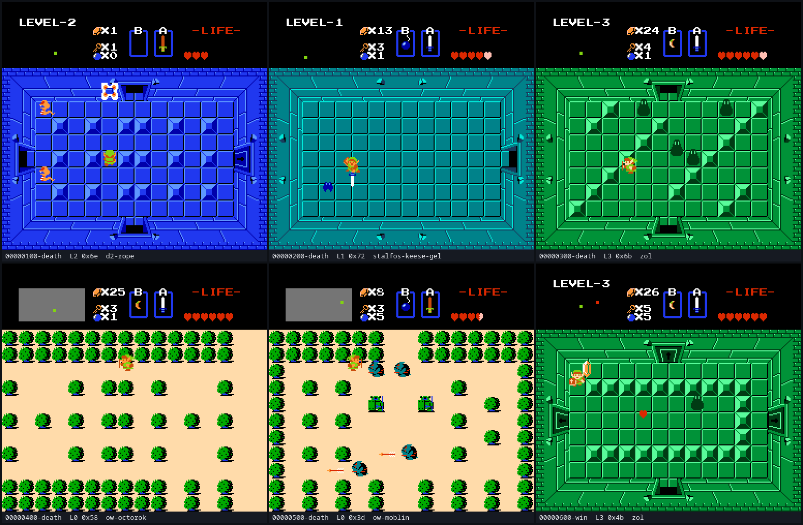

# Triforce: a deep learning agent for The Legend of Zelda (NES)

Triforce trains reinforcement learning agents to play *The Legend of Zelda* on the NES, from the start of the game to
Ganon and Zelda, on two routes through the first quest:

- **`d3first`, the main route (2.0.0.0; the owner's corrected order since round 36)**, the speedrunners' order: the
  wood sword until the magic sword, Dungeons 3, 4, 1, 2, 5, 7, the magic sword under a gravestone, Dungeons 6, 8
  and 9, by screen scrolls, recorder warps, two dock warps (the recorder played in the water beside a raft dock: the
  whirlwind carries Link over the dock and the game sets him down on a screen it never meant to, 0x55 to the meat
  under the Armos, 0x3f into the graveyard), the heart containers of heart rock, the ladder and the raft
  (`docs/routes/d3first.md`). The models play it from console power on to the end of the game.
- **`d2first`**, the first route: Dungeon 2, the white sword, Dungeons 1, 3 and 4, the mountain (two heart
  containers, 100 rupees, the Lost Hills), Dungeon 5, the whirlwind, two shops and a pond to Dungeon 7, the magic
  sword, Dungeons 6, 8 and 9 (`docs/routes/d2first.md`), with a few detours (the bow, the red candle, the red ring,
  the silver arrow).

Most rooms are on both routes and are played by the same models; where `d3first`'s wood sword or a room of its own
needed it, a family has a second run for that route's part (before the magic sword).



## How it works

- **No pixels.** The networks never see the screen. Every observation is built from the game's RAM: Link, the
  enemies, projectiles and items, the room's tiles, and a pointer to the current objective.
- **One model per kind of room.** There are 34 specialist PPO models, grouped by the enemies they face (Goriyas,
  Darknuts, the Moldorm, each boss, and so on). A runner follows a fixed route through the game and hands each
  room to its specialist.
- **Actions that mean something.** Each action is a short move (eight directions), a sword swing, an item, or a
  speedrunner's clip (the screen wrap, a clip into a block, a ladder clip over water), and the agent only acts when
  the game would actually listen. The action mask offers only what the game would really do at that moment, so the
  model never wastes a step on a sword swing the game would ignore. Every action is played with the controller
  alone, as a player would press it.
- **A fast emulator in Rust.** The NES emulator (`crates/zcore`, cut down from TetaNES), the game model, the
  environments and the policy's forward pass are all Rust. Python handles PPO training, evaluation and the tools,
  and talks to the game through the `triforce._native` extension module.

## How well it plays

**`d3first`** (2.0.0.7, the owner's corrected order and his bomb rules: on this route a bomb is a weapon only in
dungeon rooms the route must clear, and the 10th kill's bomb anywhere; 0:0x2d's bomb-wall rupee cave left out;
`docs/experiments/round36.md` "The corrected route", `round37.md` "The owner's bomb rules", `round38.md` "0x2d
dropped"; nothing retrained: 2.0.0.3's 51 networks): a golden path (games race from triforce to triforce, each
segment's first winner continuing, stitched into one replay) from console power on, the models alone, reaches the
ending; three of three races did, in 325 runs together (160,248 frames for the corpus's: about 45 minutes of game,
two wall bombs and one key cheated). No bombs are handed
over: a wall the route must bomb when Link has none is still given one and counted. Single runs are the hard part:
the wood sword makes Dungeons 3, 4, 5 and 7 hard, and two of the new legs lose most runs. Of 1,000 runs started at
each dungeon's entrance (300 for Dungeons 1, 8 and 9), models alone, in the route's order:

| Dungeon (route order) | 3 | 4 | 1 | 2 | 5 | 7 | 6 | 8 | 9 (to the ending) |
|---|---:|---:|---:|---:|---:|---:|---:|---:|---:|
| Link's heart containers there | 3 | 4 | 5 | 7 | 8 | 9 | 13 | 13 | 15 |
| Its triforce taken | 23.2% | 18.5% | 93.3% | 99.8% | 31.2% | 13.1% | 36.4% | 40.0% | 51.3% |

Dungeon 5 now gets the bombs of the legs before it (8 at the median; it was 7.0% in 2.0.0.3's order with 2);
Dungeon 7 is played at 9 containers with the wood sword and usually 2 bombs (42.3% in the old order at 11 with a
bag of 8). Most legs between the dungeons are 99-100%; three are not: Level 5 to Level 7 through the recorder, the
raft and the dock warp at 0x55 **78.9%** (the engine plays the warp; its Zora and Octoroks cost 85 runs a 1000),
Level 7 to Level 6 by the world wrap, 0x2f's heart, the dock warp at 0x3f and the magic sword **22.4%** (the
Lynels of 0x50 and 0x60 send Link back the old route's way), and out of Level 6 to Level 8 **32.0%** (the Lynel
network walks back into Level 6). From the start, 23.5% of single runs take the Dungeon 3 triforce, 4.5% Dungeon
4's, 3.8% Dungeon 1's, 3.0% Dungeon 2's, 6 of 1000 Dungeon 5's and 1 Dungeon 7's; none ends the game yet. In
2.0.0.3's order one single run of 1000 did (`corpus/replays/single-run-d3first-old-order-51-networks.tfreplay`).

**`d2first`**: out of 1,000 runs from the start of the game with the 2.0.0.0 team (round 33's Wizzrobe, Vire and
Like-Like models on 1.9.0.1's team; act mode `temperature:0.5+relax:16`, the speedrunners' clips allowed;
`docs/experiments/round33.md` "The landing"):

| Link reaches | 2.0.0.0 | Rounds 30-31 | Round 29 | Round 27 | Round 26 | Round 25 |
|---|---:|---:|---:|---:|---:|---:|
| Dungeon 1 (after Dungeon 2 and the white sword) | 85% | 85% | 82% | 76% | 75% | 84% |
| Dungeon 3 | 74% | 74% | 73% | 64% | 65% | 74% |
| The Dungeon 3 triforce | 62% | 62% | 59% | 50% | 50% | 57% |
| The Dungeon 4 triforce | 60% | 56% | 54% | 44% | 44% | 51% |
| Dungeon 5 | 60% | 56% | 54% | 44% | 44% | 51% |
| The Dungeon 5 triforce | 35% | 30% | 26% | 23% | 22% | 20% (the end of round 25's route) |
| Dungeon 7 | 34% | 30% | 26% | 23% | 22% | |
| The Dungeon 7 triforce | 13.1% | 12.5% | 9.1% | 6.1% | 6.7% (the end of round 26's route) | |
| Dungeon 6 | 13.1% | 12.5% | 9.0% | 6.0% | | |
| The Dungeon 6 triforce | 4.0% | 3.0% | 1.7% | 1.1% (the end of round 27's route) | | |
| The Dungeon 8 triforce | 1.2% | 1.3% | 0.4% | | | |
| Dungeon 9 | 1.2% | 1.3% | 0.4% | | | |
| The end of the game | **4 of 1,000** | 0 of 1,000 | 0 of 1,000 | | | |

Since round 26 the route runs on from the Dungeon 5 triforce through the whirlwind, two shops and a pond to Dungeon
7 and its triforce. Of 1,000 runs started at Dungeon 7's entrance, 40% take its triforce; its six Blue Goriyas in
one room (7:0x1b) are what loses most of the rest. Dungeon 2 lost eight points since round 25, all in its two Goriya
rooms (the Goriya model was retrained for Dungeon 7), which is why the early rows fell. With the planner switched
on (an act mode that tries each action in the emulator before playing it, on random numbers of its own, and takes
another if Link is hit; `docs/experiments/round25.md` §12), 85% of runs from the start reach the Dungeon 7 triforce;
the models alone are the number the training is judged by. Clips off (the no-clip way) is no longer measured (the
owner, Nov 18).

Round 27 runs the route on from the Dungeon 7 triforce to the magic sword and Dungeon 6 (`docs/routes/d6.md` §15):
of 1,000 runs started at Dungeon 6's entrance, 30% take its triforce, and its two Wizzrobe block rooms (6:0x38 and
6:0x3a) are what loses most of the rest; from the start, 1.1% of runs take all seven pieces. The earlier rows match
round 26's within noise (the same seeds, paired). With the planner on, 38% of 300 runs from the start reach the
Dungeon 6 triforce (`docs/experiments/round27.md` §14).

Rounds 28 and 29 run the route on to the end of the game: a burned tree to Dungeon 8, the leg to Dungeon 9, the red
ring and the silver arrow, Ganon and Zelda's room. Of 1,000 runs started at Dungeon 8's entrance, 25% take its
triforce; of 1,000 started at Dungeon 9's entrance, 31% end the game. One team now plays the whole route, and every
earlier row is as good as round 27's or better (the same seeds, paired). From the start the models alone reach
Dungeon 9 in 4 runs of 1,000 and end the game in none: each dungeon is entered with fewer hearts than its own
segment starts with, and Dungeon 5's 5:0x05 is the first loss. With the planner on, 89 of 300 runs (30%) play from
the start of the game to the ending (`docs/experiments/round29.md` §20).

Rounds 30 and 31 (1.9.0.1) retrain the families that lose the most runs at the hearts the route brings (Dungeon 5's
and Dungeon 8's Darknuts, Manhandla, the Gibdos, Dungeon 7's Goriyas, the Wizzrobes, Patra, a Lynel) and play the
owner's eight changes to the route (Dungeon 1 entered twice so its locked door is open, a bombed wall instead of two
key rooms; a key taken in Dungeon 6 and one left in Dungeon 8; a new way through Dungeon 9). Every row from the start
is as good or better; from their entrances Dungeon 7's triforce is taken in 57% of runs (47%) and Dungeon 8's in 36%
(25%). Dungeon 9's new room 9:0x56 is not yet learned (two runs in three stop there): from Dungeon 9's entrance 14%
end the game (31% before), and with the planner on 27 of 300 runs from the start (9%).

Every round of training is written up in `docs/experiments/` (start with the newest `round*.md`), and
`docs/experiments/backlog.md` has what's next.

## Getting started

Needs Linux, Python 3.12 and stable Rust (`rust-toolchain.toml`).

```bash
uv venv --python 3.12 .venv
uv pip install --python .venv/bin/python -e '.[dev]'             # builds triforce._native through maturin
.venv/bin/maturin develop --release                              # rebuild the module after Rust changes (agents: triforce job build)
```

The ROM isn't included. Put an uncompressed *Legend of Zelda (U)* ROM at `roms/zelda.nes` or point
`$TRIFORCE_ROM` at it. The ROM payload (after the 16-byte iNES header) must have SHA-1
`a12d74c73a0481599a5d832361d168f4737bbcf6`. ROM-dependent tests fail without it; `TRIFORCE_ALLOW_NO_ROM=1` makes
them skip instead (both suites).

Trained models aren't checked in either (they're too big), so watching the agent means training a team first:
`scripts/train_round.py` trains and evaluates every specialist, `triforce promote` picks the models to use, and
`play-zelda.py` shows their runs.

## Finding your way around

- Working on the repo (people or agents): `AGENTS.md` (standing rules, workflow, how to resume), then the newest
  `docs/experiments/round*.md` and `docs/experiments/backlog.md`.
- Design and status: `docs/architecture.md` (modules and contracts), `docs/decisions.md` (departures from
  the design), `docs/progress.md` (Phase 0–2 status, historical), `docs/performance.md` (training throughput: benchmarks,
  profiles, `scripts/train_bench.sh` / `scripts/profile_train.sh`), `docs/rust-actor.md` (the agent acting in
  Rust: rollouts, plays, replay files).
- Game knowledge: `docs/ram-catalog.md` (RAM features), `docs/routes/d3first.md` and `docs/routes/d2first.md` (the
  two routes; `docs/route.md` is the old milestone1 route),
  `docs/specialists.md` (room families), `triforce/game.yaml` (room graph with `specialist:` tags),
  `triforce/routes.yaml` (route data).
- Data: start states in `triforce/states/` (`TFZSTATE` files, `$TRIFORCE_STATES_DIR` overrides), curriculum
  trajectories in `trajectories/<specialist>/<state>/`, checkpoints in `models/` (`$TRIFORCE_MODELS_DIR`), emulator
  test movies in `corpus/`.

## Commands

```bash
cargo test --profile release-tests --workspace --features zelda/zcore   # Rust tests (release without LTO; "Testing")
.venv/bin/python -m pytest -q -n 8 tests                       # Python tests (~1 min in 8 processes; 7 in one)
.venv/bin/python -m pytest -q -m e2e                           # only the end-to-end tests (untrained nets, seconds)
.venv/bin/python -m triforce.play --state 1_44w_0               # load a savestate and look at the room
.venv/bin/python -m triforce.play "MOVE E 16" "SWORD E"         # act; the session persists between calls
.venv/bin/python -m triforce.train --specialist ow-start --parallel 8 --iterations 100
.venv/bin/python -m triforce.evaluate --specialist ow-start      # promoted model on its own rooms
.venv/bin/python -m triforce.explore --specialist ow-zora --parallel 16   # Go-Explore: trajectories/ow-zora
.venv/bin/python -m triforce.train --specialist ow-zora --parallel 16   # curriculum: on in ow-zora.yaml
.venv/bin/python scripts/train_round.py --round round1          # train + evaluate every specialist (promotes only with --promote)
uv run training-gui.py                                          # live monitor: every job of the machine's job queue (triforce job, any worktree), else the newest logs/ folder; also serves http://<host>:22222/
uv run training-gui.py --web-only                               # only the web view, no window (no display needed, e.g. over SSH)
.venv/bin/python play-zelda.py 4x3                               # watch replays of the promoted models' runs on the main route (d3first) as they are simulated: the best so far (keys b w k d r g: best/success/stuck/died/random/golden; n next; s sound, click a cell to hear it; u/+/-/p; c clips off/on; --controller, --act argmax|sample|model, --power-on, --stop-at, --clips on|off)
.venv/bin/python play-zelda.py 4x3 --route d2first               # the same on the first route
.venv/bin/python play-zelda.py 3x2 --live                        # the top left cell is a live game: c turns clips off (and on) for the rest of that run, the route re-plans from where Link stands
.venv/bin/python play-zelda.py 2x3 runs/replays                  # or a folder of replay files, round and round (one FILE.tfreplay: on loop)
.venv/bin/python play-zelda.py 1x1 run.tfreplay --thoughts       # over the picture: what the replay says the agent was steered to (objective, targets), could do (the mask) and chose (network, action, probability, danger)
.venv/bin/python play-zelda.py 1x1 corpus/replays/golden-d3first-single-network.tfreplay   # ONE network in every slot beating the game by a golden path on d3first, from power on (golden-d3first-51-networks: the 51 specialists'; golden-d2first-34-networks: d2first's; single-run-d3first-old-order-51-networks: one unbroken run on 2.0.0.3's order)
uv run emu-zelda.py 5 05 --bombs 0                              # play a room yourself (Dungeon 5's 0x05; level o = overworld) from d3first's start state, PS5 controller or keyboard; DONE on leaving the room or dying; square/S saves a replay to ~/triforce-review/played/ (paused or DONE); triangle/R1 start over; -/+ the rate (--entry, --visit, --chain, --route, --hearts, --keys, --seed, --no-sound, --scale; --help for the keys)
.venv/bin/python create-video.py wins.mp4 2x3 runs/wins --sound  # film replays on a grid into a video (needs ffmpeg; 1x1 by default; --sound: the middle cell's, else the top left one's; --no-music, --no-sound-effects, --no-heart-beep; --split-audio: music and effects as two audio tracks; --controller; --thoughts)
.venv/bin/python zelda-headless.py runs/wins 3 --wins-only       # no window: play until 3 runs won, keep them as replays (--deaths-only, --stuck-only, --power-on, --stop-at step:N, --clips off, --route d2first)
.venv/bin/python zelda-headless.py runs/golden 1 --golden --power-on   # the golden path on d3first: games race triforce to triforce from each winner's state, stitched into one replay (--route d2first for the other)
.venv/bin/python zelda-map.py                                   # room map + per-room stats by scope: full run, segment, room only; clips both/on/off (--stats FILE, --route d2first, --rerender)
.venv/bin/python -m triforce.run --seed 1                      # --render (window) or --video out.mp4 (ffmpeg)
.venv/bin/python -m triforce.entry_states build --chains 0,1,2  # regenerate start states into target/entry-states/<ts> (start/build/path/install/audit)
.venv/bin/python -m triforce.entry_states install target/entry-states/<ts>   # then copy the finished build into triforce/states
.venv/bin/python -m triforce.entry_states idle                  # regenerate the power-on idle states (triforce/states/power_on) after a state-format or emulator change
triforce promote <specialist> <run-id>
triforce --models-dir models convert-model --promoted --out target/converted-models   # widen 1.5.0 runs to schema 6's observation (copies; RUN_DIR... for single runs)
triforce eval-chain --runs 20 --parallel 20                     # route d3first (the main route; --route d2first for the other); writes runs/eval-chain-<yymmdd-HHMMSS>.jsonl + .meta.json
triforce eval-chain --from 4_71s_0 --runs 20 --clips off       # every run with clips off (the plain way through every stretch); --clips-off-from 4:0x31 turns them off on the way
triforce eval-chain --runs 20 --parallel 20 --power-on --stop-at step:24   # from console power on (random idle delay per seed) to the overworld with Dungeon 3's triforce (d2first's step 24: Dungeon 2's)
triforce eval-chain --runs 20 --parallel 20 --replays runs/replays   # also record every run as runs/replays/<seed>-<ending>.tfreplay (its decisions, targets and masks; --streams rewards,keyframes)
triforce eval-batch r71-1k --chains r71-1k --runs 1000 --act model   # the fourteen chain segments (full, d2, post-d2, d1, post-d1, d3, post-d3, d4, post-d4, d5, post-d5, d7, post-d7, d6) as one batch (one log folder, a GUI bar each) into target/r56-chains/r71-1k-*.jsonl, then yardstick + room-stats
triforce eval-batch r71-families --families all --acts sample,argmax --jobs 4   # every family's promoted run in both act modes, 4 side by side
triforce eval-batch r71-check --chain 'd3: --from 3_7cs_0 --runs 200' --evaluate 'darknut: --specialist darknut --act argmax'   # a mixed batch (rerun: skips what is done)
triforce room-stats r70-1k                                     # per-room stats by scope (full run, segments, room only) of target/r56-chains/r70-1k-*.jsonl -> r70-1k-room-stats.json
triforce room-stats r72-1k --noclips                           # with r72-1k-noclips-*.jsonl (CLIPS=off TAG=r72-1k-noclips r56_chains.sh): by_clips per room -> r72-1k-both-room-stats.json
cargo run --release -p triforce-tools --bin tf -- replay verify runs/replays/*.tfreplay   # replay them on the emulator alone (replay info FILE prints one)
cargo run --release -p triforce-tools --bin tf -- --help        # movies, zcore goldens/self-diff, trace, corpus, bench
```

Training GUI charts use the plotted history (respecting **skip startup**). Success ranges use 10-percentage-point
bands and ticks, enclosing every displayed success series and the early-stop/eval reference lines; any value below 25%
restores the full 0–100% range. Health change encloses both real and total series with ±0.2 hearts of padding;
the "no change" reference appears only when zero is within that range.

The training GUI also serves a read-only web view of what runs now, for a phone or another machine:
`http://<host>:22222/` (`--web-port N`; `--web-host HOST`, default `0.0.0.0`, every interface: anyone on the network
can watch; `--no-web` turns it off, `--web-only` runs it without a window or display). No picking: one card per
training run, evaluation and eval-chain, what runs now on top (the newest start first; a run that starts pushes the
others down), the runs that just ended below (the newest end first), with the window's row and detail tabs (bar,
steps or episodes, speed, elapsed, time left, success, the charts, the evaluation, the last 15 console lines), one
line per live plan with its progress and queue, and the machine line. A run that ends stays 60 seconds with its
final figures. The page asks for `/api/state` (JSON) every second; nothing else is served. The web view is on unless
`--no-web` is given; a taken port (a second training-gui) is an error: one line and exit 1 (`--web-port N` for
another port).

Evaluations go through `triforce eval-batch NAME` (`triforce/eval_batch.py`): one log folder, every evaluation
listed up front, shown in the training GUI as one group named NAME with a progress bar per evaluation; its Eval tab
gives each outcome its share (`108× (10.8%)` of a chain's runs or of a family evaluation's episodes).

The machine's job queue (the owner, Nov 23): everything heavier than a build or a test runs through `triforce job`
(`triforce/job.py`, `triforce/jobqueue.py`), from any checkout:

```bash
triforce job run --agent A --task T --subtask S --desc "one sentence" [--express] [--timeout 40m] -- COMMAND...
triforce job golden --agent A --task T --timeout 10m [-- racer options]  # zelda-headless.py --golden --power-on --clips on --act model --parallel 16
triforce job build --agent A --task T                                    # maturin develop --release
triforce job test SUITE... --agent A --task T [--build]                 # python, asm, check, rust or all, side by side (--build: build first, one entry)
triforce job setup BRANCH [--from main]                                  # worktree ../triforce-<branch>: links, venv, build
triforce job list [--calibration]                                        # what runs, what waits in order, what ended in the last hour
triforce job progress DONE [TOTAL] --unit U                              # progress from a shell script running as a job
```

Each verb blocks until the work is done; output and exit code are the command's, and SIGTERM or Ctrl-C stops the
job. Two jobs run at once in the regular places plus one estimated at 10 minutes or less (or `--express`) in the
express place; the others wait, the shortest estimate first, a long one moving up as it waits (a tool's estimate
comes from its work and the queue's history; any other command needs `--timeout`, which is its estimate and where
it is stopped, exit 124). Builds and test suites have their own lane, two at once, first come first served, at nice
10 with `CARGO_BUILD_JOBS=4`; jobs run at nice 15, below the owner's player. A waiting job is only its wrapper (no
model, no GPU memory); `nice`, `ionice`, `timeout` or `CARGO_BUILD_JOBS=` after `--` are refused. The tools
(`triforce train|evaluate|eval-chain|eval-batch|select-checkpoint`, `train_round.py`, `full_runs.py`, the lab's
train, record and bench, every script that plays, trains or crunches) refuse to run outside a job unless a terminal
is attached, so the commands under "Commands" work as typed at a shell. The queue is one SQLite database
(`~/.local/state/triforce/queue.db`) with kernel locks for its places and no server; the training GUI and `triforce
job list` read it. Exempt: `play-zelda.py`, `emu-zelda.py`, `zelda-map.py`, `training-gui.py` and what finishes in seconds. The
rest (names, descriptions, ending a job, an old tree's commands): AGENTS.md "The job queue".

`zelda-map.py` stitches each level's rooms (Overworld, Dungeon 1–9) into one zoomable map from the savestates'
first playable frames; an overworld room without a savestate is walked into from the game start, so the overworld
is always all 128 rooms (cached in `screens/`, gitignored; `--rerender` rebuilds them); a dungeon's item cellars are
drawn with their entrance room. It overlays per-room statistics (hits taken, hearts ± per visit, death rate, reach)
in a **scope**: Full run, a Segment (To D2 / To D1 / To D3 / To D4, the route cut at the dungeon exits, or a dungeon
alone; the rooms off it dimmed) or Room only. The scopes come from the newest `target/r56-chains/*-room-stats.json`
(`triforce room-stats TAG`, written by `scripts/experiments/r56_chains.sh report`; `--stats FILE` picks one): in
a full run or a segment the death rate is the share of the runs started there that died in the room, in Room only
the share of isolated evaluation episodes, each with its own colour scale (legend beside Reload). The sidebar's
"by scope" table puts them side by side (and per route step where a room is visited more than once). The Clips
selector (Both / On / Off) shows the runs and episodes played with the run-time clips switch on, off or both
(`by_clips`; with `--route` On draws the clip way of each route stretch, Off the plain way). Without a
room-stats file it shows Room only from each promoted model's evaluation of its current weights in its act mode
(`eval.json` or `eval-<mode>.json`, `evaluate.read_evaluation`, `visited_rooms`: eval format 2, every room an
evaluation episode visited), merged across specialists weighted by visits; the sidebar always shows those
evaluations too. Click a room for everything known about it; wheel zooms, drag or arrows pan, Home fits, F5 reloads.

`triforce.play` is the debugging tool: it drives the game through the same Rust code path as training
(option executor, interrupts, masks, look-ahead) and prints the room, entities, legal actions and an ASCII
tile map. `--screenshot`, `--ram`, `--set` and `--save-state` help inspect savestates; `--capture` saves post-entry
states with the old v1 naming (not training start states: those come from `triforce.entry_states`).

## Emulator regression suite

zcore is checked against its own per-frame digests (`TFGOLDEN`, all 11 domains: RAM, PRG-RAM, CHR, nametables,
palette, OAM, pixels, CPU, PPU, mapper and APU state) over the corpus movies. Around any zcore change:

```bash
alias tf='cargo run --release -q -p triforce-tools --bin tf --'
tf ladder-golden -o target/ladder/hardware      # before the change: goldens of every corpus movie (~1.2M frames)
# ... change zcore ...
tf ladder-diff target/ladder/hardware           # after: "0 of N movies diverge", or each movie's first bad frame
tf ladder-diff                                  # the committed goldens of the seven short movies (corpus/golden/)
```

A change meant to be invisible (refactor, speed-up) must leave `ladder-diff` at 0. A deliberate behaviour change
will diverge: check that the divergence is the intended one (`tf trace MOVIE --frame K` before and after, then
`diff` the outputs), then regenerate the goldens, including the committed ones
(`tf ladder-golden --short -o corpus/golden`), and commit those with the change. A re-recorded movie, or a
re-recorded base movie it starts from (`power_on_to_start`), makes its golden stale (`ladder-diff` says so);
regenerate it the same way.

The corpus (`corpus/movies`, listed in `corpus/manifest.toml` by `tf corpus sync`) is the seven scripted short
movies, five random-input movies and 72 chain runs of the trained team (`chain-<segment>-<seed>`, twelve per
route segment), which start from copies of their start states in `corpus/states/`. To re-record the chain runs
(after a retrain, or when a zcore change is meant to change gameplay):

```bash
.venv/bin/python scripts/record_bench_runs.py target/corpus-runs --runs 12 --first-seed 500
for f in target/corpus-runs/*.tfreplay; do tf movie import "$f" -o "corpus/movies/chain-$(basename "$f" .tfreplay).tfmovie"; done
tf corpus sync && tf corpus check
```

`tf movie import` refuses a recording that no longer plays to the machine states it recorded (`tf replay verify`
checks the same; the recordings are replays, `triforce/replay.py`). `tf corpus check`
replays every movie and requires ≥ 1M frames and ≥ 10,000 gameplay frames in each of the overworld and
Dungeons 1-3.

`corpus/replays/` is the replay compatibility corpus (`AGENTS.md`, Versioning): replays recorded by the trained
team that every later build must still replay (`tf replay verify corpus/replays/*.tfreplay`; a cargo test runs
it). It is not re-recorded for a retrain, only after a deliberate break (then the old files move to
`corpus/replays/retired/` and `REPLAY_VERSION` goes up):

```bash
.venv/bin/python zelda-headless.py target/replays/po 1 --wins-only --power-on --name LINK --delay 100 --stop-at step:3 --streams rewards,keyframes --keyframe-frames 300    # -> v<N>-power-on.tfreplay
.venv/bin/python zelda-headless.py target/replays/state 1 --wins-only --from 0_3cc_0 --stop-at step:27 --streams rewards,keyframes --keyframe-frames 300                    # -> v<N>-state.tfreplay
.venv/bin/python zelda-headless.py target/replays/golden 1 --golden --power-on --parallel 8                                                                                           # -> v<N>-golden.tfreplay
```

## Testing

Two suites: `cargo test --profile release-tests --workspace --features zelda/zcore` (release without link-time
optimisation: Cargo.toml) and
`.venv/bin/python -m pytest -q` (an agent runs them as `triforce job test rust|python`). Nothing trains a model from
scratch; pipeline tests use untrained networks.

| Layer | Where | What it guards |
|---|---|---|
| Emulator | `crates/zcore` unit tests, the TetaNES test ROMs (`src/common.rs`, `test_roms/`), `tests/machine.rs` | CPU (official and unofficial opcodes), PPU/APU timing, MMC1, iNES parsing, the `ZCore` API (render toggle, snapshot/restore, state files, the pinned power-on state), shipped states load |
| Emulator regression | `tf ladder-diff` (above), `crates/tools/tests/cli.rs` (diffs the committed goldens with the build under test) | every short-movie frame unchanged, corpus coverage; the `tf` CLI end to end |
| Formats | `crates/movie` | `TFMOVIE`/`TFGOLDEN` round trips and refusals |
| Game model | `crates/zelda` (unit tests, `tests/game.rs`, `game_view.rs`, `objectives.rs`) | RAM decoding, masks, the option executor and its interrupts, look-ahead credit, room entry, objectives, hearts, linger |
| Env | `crates/env` (unit tests, `tests/*.rs`) | configs, every reward/penalty term, end-condition precedence, observations, curriculum, chains, explorer |
| Pool | `crates/pool` | rollout and play determinism across thread counts, auto-reset, render toggle, pacing, failures, eval/chain adapters |
| Python | `tests/` (`tests/native` for `triforce._native`) | PPO/buffer/metrics, CLIs (train, evaluate, eval-chain, run, play, entry_states, explore), watch grid, registry, the native wrapper's errors and pickling; `-m e2e` runs the end-to-end pipelines |

Coverage (`cargo llvm-cov --release --workspace --features zelda/zcore --summary-only`,
`pytest --cov=triforce`) guides where behaviour is untested; it is not a target.

## History

This is the third version of the project. The older two are kept on their own branches.

**v1** ([`v1-original-design`](https://github.com/DarkAutumn/triforce/tree/v1-original-design)) was a hand-written
project to learn reinforcement learning, built on stable-retro and stable-baselines3. It used a few models (overworld
and dungeon, with and without sword beams) and could play through the first dungeon. Here it is
[beating Dungeon 1](https://www.youtube.com/watch?v=yERh3IJ54dU).

**v2** ([`v2-stable-retro`](https://github.com/DarkAutumn/triforce/tree/v2-stable-retro)) was still written by hand,
but with my own neural network architectures and a PPO implementation built from scratch from the original paper.
Once I had learned what I wanted from doing it by hand, I started bringing in LLM agents to help.

**v3** (this branch) is agent-driven code to finish the project. I've learned what I set out to learn from the
hand-written versions, so now the point is to test and prototype ideas quickly and actually get through the game.
That started with a fast Rust emulator built for this project, with the game logic and the training environments in
Rust too.
