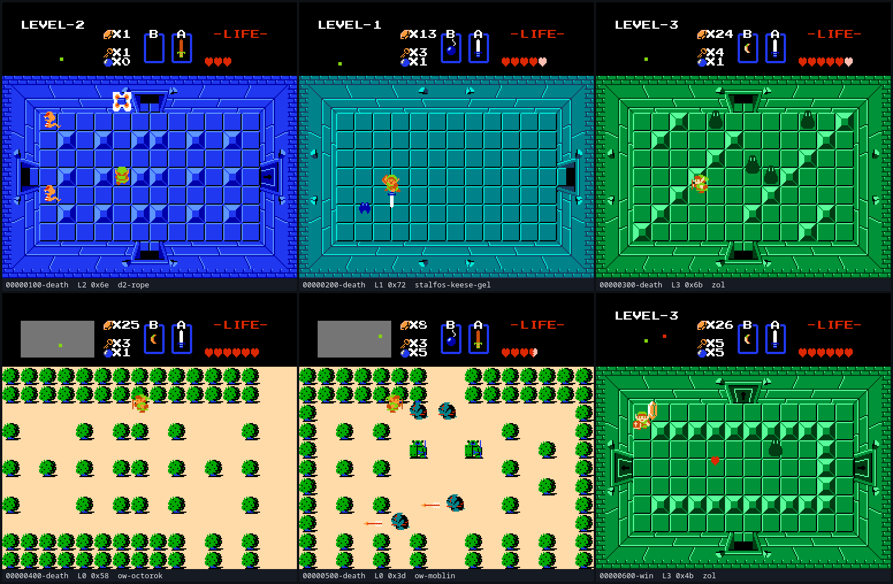

# Triforce: a deep learning agent for The Legend of Zelda (NES)

Triforce trains reinforcement learning agents to play *The Legend of Zelda* on the NES. The agents play from the
start of the game through Dungeon 2, go get the white sword, clear Dungeon 1 and Dungeon 3, and finish on the
triforce piece at the end of Dungeon 4, with a few detours along the way (a heart container, the bow, the raft, the
ladder).



## How it works

- **No pixels.** The networks never see the screen. Every observation is built from the game's RAM: Link, the
  enemies, projectiles and items, the room's tiles, and a pointer to the current objective.
- **One model per kind of room.** There are 24 specialist PPO models, grouped by the enemies they face (Goriyas,
  Darknuts, the Moldorm, each boss, and so on). A runner follows a fixed route through the game and hands each
  room to its specialist.
- **Actions that mean something.** Each action is a short move (eight directions), a sword swing, an item, or a
  speedrunner's clip (the screen wrap, a clip into a block, a ladder clip over water), and the agent only acts when
  the game would actually listen. The action mask offers only what the game would really do at that moment, so the
  model never wastes a step on a sword swing the game would ignore. Every action is played with the controller
  alone, as a player would press it.
- **A fast emulator in Rust.** The NES emulator (`crates/zcore`, cut down from TetaNES), the game model, the
  environments and the policy's forward pass are all Rust. Python handles PPO training, evaluation and the tools,
  and talks to the game through the `triforce._native` extension module.

## How well it plays

<!-- r71: numbers (the round 21 retrain's 1000-run chains replace the table below) -->

Out of 1,000 runs from the start of the game with the current team:

| Link reaches | Runs |
|---|---:|
| Dungeon 1 (after Dungeon 2 and the white sword) | 55% |
| Dungeon 3 | 36% |
| The Dungeon 3 triforce | 10% |

Every round of training is written up in `docs/experiments/` (start with the newest `round*.md`), and
`docs/experiments/backlog.md` has what's next.

## Getting started

Needs Linux, Python 3.12 and stable Rust (`rust-toolchain.toml`).

```bash
uv venv --python 3.12 .venv
uv pip install --python .venv/bin/python -e '.[dev]'             # builds triforce._native through maturin
.venv/bin/maturin develop --release                              # rebuild the module after Rust changes
```

The ROM isn't included. Put an uncompressed *Legend of Zelda (U)* ROM at `roms/zelda.nes` or point
`$TRIFORCE_ROM` at it. The ROM payload (after the 16-byte iNES header) must have SHA-1
`a12d74c73a0481599a5d832361d168f4737bbcf6`. ROM-dependent tests fail without it; `TRIFORCE_ALLOW_NO_ROM=1` makes
them skip instead (both suites).

Trained models aren't checked in either (they're too big), so watching the agent means training a team first:
`scripts/train_round.py` trains and evaluates every specialist, `triforce promote` picks the models to use, and
`play-zelda.py` shows their runs.

## Finding your way around

- Working on the repo (people or agents): `AGENTS.md` (standing rules, workflow, how to resume), then the newest
  `docs/experiments/round*.md` and `docs/experiments/backlog.md`.
- Design and status: `docs/architecture.md` (modules and contracts), `docs/decisions.md` (departures from
  the design), `docs/progress.md` (Phase 0–2 status, historical), `docs/performance.md` (training throughput: benchmarks,
  profiles, `scripts/train_bench.sh` / `scripts/profile_train.sh`), `docs/rust-actor.md` (the agent acting in
  Rust: rollouts, plays, replay files).
- Game knowledge: `docs/ram-catalog.md` (RAM features), `docs/routes/d2first.md` (the route; `docs/route.md` is the old milestone1 route),
  `docs/specialists.md` (room families), `triforce/game.yaml` (room graph with `specialist:` tags),
  `triforce/routes.yaml` (route data).
- Data: start states in `triforce/states/` (`TFZSTATE` files, `$TRIFORCE_STATES_DIR` overrides), curriculum
  trajectories in `trajectories/<specialist>/<state>/`, checkpoints in `models/` (`$TRIFORCE_MODELS_DIR`), emulator
  test movies in `corpus/`.

## Commands

```bash
cargo test --release --workspace --features zelda/zcore        # Rust tests (~1 min; see "Testing")
.venv/bin/python -m pytest -q                                   # Python tests (~1 min)
.venv/bin/python -m pytest -q -m e2e                           # only the end-to-end tests (untrained nets, seconds)
.venv/bin/python -m triforce.play --state 1_44w_0               # load a savestate and look at the room
.venv/bin/python -m triforce.play "MOVE E 16" "SWORD E"         # act; the session persists between calls
.venv/bin/python -m triforce.train --specialist ow-start --parallel 8 --iterations 100
.venv/bin/python -m triforce.evaluate --specialist ow-start      # promoted model on its own rooms
.venv/bin/python -m triforce.explore --specialist ow-zora --parallel 16   # Go-Explore: trajectories/ow-zora
.venv/bin/python -m triforce.train --specialist ow-zora --parallel 16   # curriculum: on in ow-zora.yaml
.venv/bin/python scripts/train_round.py --round round1          # train + evaluate every specialist (promotes only with --promote)
uv run training-gui.py                                          # live training monitor (newest logs/ folder)
.venv/bin/python play-zelda.py 4x3                               # watch replays of the promoted models' runs as they are simulated: the best so far (keys b w k d r g: best/success/stuck/died/random/golden; n next; s sound, click a cell to hear it; u/+/-/p; --controller, --act argmax|sample|model, --power-on, --stop-at)
.venv/bin/python play-zelda.py 2x3 runs/replays                  # or a folder of replay files, round and round (one FILE.tfreplay: on loop)
.venv/bin/python create-video.py wins.mp4 2x3 runs/wins --sound  # film replays on a grid into a video (needs ffmpeg; 1x1 by default; --sound: the middle cell's, else the top left one's; --controller)
.venv/bin/python zelda-headless.py runs/wins 3 --wins-only       # no window: play until 3 runs won, keep them as replays (--deaths-only, --stuck-only, --power-on, --stop-at step:N)
.venv/bin/python zelda-headless.py runs/golden 1 --golden --power-on   # the golden path: games race triforce to triforce from each winner's state, stitched into one replay
.venv/bin/python zelda-map.py                                   # room map + per-room eval stats of the promoted models (--rerender)
.venv/bin/python -m triforce.run --seed 1                      # --render (window) or --video out.mp4 (ffmpeg)
.venv/bin/python -m triforce.entry_states build --chains 0,1,2  # regenerate start states into target/entry-states/<ts> (start/build/path/install/audit)
.venv/bin/python -m triforce.entry_states install target/entry-states/<ts>   # then copy the finished build into triforce/states
.venv/bin/python -m triforce.entry_states idle                  # regenerate the power-on idle states (triforce/states/power_on) after a state-format or emulator change
triforce promote <specialist> <run-id>
triforce eval-chain --runs 20 --parallel 20                     # route d2first; writes runs/eval-chain-<yymmdd-HHMMSS>.jsonl + .meta.json
triforce eval-chain --runs 20 --parallel 20 --power-on --stop-at step:24   # from console power on (random idle delay per seed) to the overworld with Dungeon 2's triforce
triforce eval-chain --runs 20 --parallel 20 --replays runs/replays   # also record every run as runs/replays/<seed>-<ending>.tfreplay (--streams rewards,decisions,keyframes)
cargo run --release -p triforce-tools --bin tf -- replay verify runs/replays/*.tfreplay   # replay them on the emulator alone (replay info FILE prints one)
cargo run --release -p triforce-tools --bin tf -- --help        # movies, zcore goldens/self-diff, trace, corpus, bench
```

Training GUI charts use the plotted history (respecting **skip startup**). Success ranges use 10-percentage-point
bands and ticks, enclosing every displayed success series and the early-stop/eval reference lines; any value below 25%
restores the full 0–100% range. Health change encloses both real and total series with ±0.2 hearts of padding;
the "no change" reference appears only when zero is within that range.

`zelda-map.py` stitches each level's rooms (Overworld, Dungeon 1–9) into one zoomable map from the savestates'
first playable frames; an overworld room without a savestate is walked into from the game start, so the overworld
is always all 128 rooms (cached in `screens/`, gitignored; `--rerender` rebuilds them); a dungeon's item cellars are
drawn with their entrance room. It overlays per-room statistics: hits taken, hearts ± and death rate per visit.
They come from each promoted model's evaluation of its current weights in its act mode (`eval.json` or
`eval-<mode>.json`, `evaluate.read_evaluation`), `visited_rooms` (eval format 2, every room an evaluation episode
visited), merged across specialists weighted by visits; other evals are skipped. Click a room for everything known
about it; wheel zooms, drag or arrows pan, Home fits, F5 reloads.

`triforce.play` is the debugging tool: it drives the game through the same Rust code path as training
(option executor, interrupts, masks, look-ahead) and prints the room, entities, legal actions and an ASCII
tile map. `--screenshot`, `--ram`, `--set` and `--save-state` help inspect savestates; `--capture` saves post-entry
states with the old v1 naming (not training start states: those come from `triforce.entry_states`).

## Emulator regression suite

zcore is checked against its own per-frame digests (`TFGOLDEN`, all 11 domains: RAM, PRG-RAM, CHR, nametables,
palette, OAM, pixels, CPU, PPU, mapper and APU state) over the corpus movies. Around any zcore change:

```bash
alias tf='cargo run --release -q -p triforce-tools --bin tf --'
tf ladder-golden -o target/ladder/hardware      # before the change: goldens of every corpus movie (~1.2M frames)
# ... change zcore ...
tf ladder-diff target/ladder/hardware           # after: "0 of N movies diverge", or each movie's first bad frame
tf ladder-diff                                  # the committed goldens of the seven short movies (corpus/golden/)
```

A change meant to be invisible (refactor, speed-up) must leave `ladder-diff` at 0. A deliberate behaviour change
will diverge: check that the divergence is the intended one (`tf trace MOVIE --frame K` before and after, then
`diff` the outputs), then regenerate the goldens, including the committed ones
(`tf ladder-golden --short -o corpus/golden`), and commit those with the change. A re-recorded movie, or a
re-recorded base movie it starts from (`power_on_to_start`), makes its golden stale (`ladder-diff` says so);
regenerate it the same way.

The corpus (`corpus/movies`, listed in `corpus/manifest.toml` by `tf corpus sync`) is the seven scripted short
movies, five random-input movies and 72 chain runs of the trained team (`chain-<segment>-<seed>`, twelve per
route segment), which start from copies of their start states in `corpus/states/`. To re-record the chain runs
(after a retrain, or when a zcore change is meant to change gameplay):

```bash
.venv/bin/python scripts/record_bench_runs.py target/corpus-runs --runs 12 --first-seed 500
for f in target/corpus-runs/*.tfreplay; do tf movie import "$f" -o "corpus/movies/chain-$(basename "$f" .tfreplay).tfmovie"; done
tf corpus sync && tf corpus check
```

`tf movie import` refuses a recording that no longer plays to the machine states it recorded (`tf replay verify`
checks the same; the recordings are replays, `triforce/replay.py`). `tf corpus check`
replays every movie and requires ≥ 1M frames and ≥ 10,000 gameplay frames in each of the overworld and
Dungeons 1-3.

`corpus/replays/` is the replay compatibility corpus (`AGENTS.md`, Versioning): replays recorded by the trained
team that every later build must still replay (`tf replay verify corpus/replays/*.tfreplay`; a cargo test runs
it). It is not re-recorded for a retrain, only after a deliberate break (then the old files move to
`corpus/replays/retired/` and `REPLAY_VERSION` goes up):

```bash
.venv/bin/python zelda-headless.py target/replays/po 1 --wins-only --power-on --name LINK --delay 100 --stop-at step:3 --streams rewards,decisions,keyframes --keyframe-frames 300    # -> v<N>-power-on.tfreplay
.venv/bin/python zelda-headless.py target/replays/state 1 --wins-only --from 0_3cc_0 --stop-at step:27 --streams rewards,decisions,keyframes --keyframe-frames 300                    # -> v<N>-state.tfreplay
.venv/bin/python zelda-headless.py target/replays/golden 1 --golden --power-on --parallel 8                                                                                           # -> v<N>-golden.tfreplay
```

## Testing

Two suites, both about a minute: `cargo test --release --workspace --features zelda/zcore` and
`.venv/bin/python -m pytest -q`. Nothing trains a model from scratch; pipeline tests use untrained networks.

| Layer | Where | What it guards |
|---|---|---|
| Emulator | `crates/zcore` unit tests, the TetaNES test ROMs (`src/common.rs`, `test_roms/`), `tests/machine.rs` | CPU (official and unofficial opcodes), PPU/APU timing, MMC1, iNES parsing, the `ZCore` API (render toggle, snapshot/restore, state files, the pinned power-on state), shipped states load |
| Emulator regression | `tf ladder-diff` (above), `crates/tools/tests/cli.rs` (diffs the committed goldens with the build under test) | every short-movie frame unchanged, corpus coverage; the `tf` CLI end to end |
| Formats | `crates/movie` | `TFMOVIE`/`TFGOLDEN` round trips and refusals |
| Game model | `crates/zelda` (unit tests, `tests/game.rs`, `game_view.rs`, `objectives.rs`) | RAM decoding, masks, the option executor and its interrupts, look-ahead credit, room entry, objectives, hearts, linger |
| Env | `crates/env` (unit tests, `tests/*.rs`) | configs, every reward/penalty term, end-condition precedence, observations, curriculum, chains, explorer |
| Pool | `crates/pool` | rollout and play determinism across thread counts, auto-reset, render toggle, pacing, failures, eval/chain adapters |
| Python | `tests/` (`tests/native` for `triforce._native`) | PPO/buffer/metrics, CLIs (train, evaluate, eval-chain, run, play, entry_states, explore), watch grid, registry, the native wrapper's errors and pickling; `-m e2e` runs the end-to-end pipelines |

Coverage (`cargo llvm-cov --release --workspace --features zelda/zcore --summary-only`,
`pytest --cov=triforce`) guides where behaviour is untested; it is not a target.

## History

This is the third version of the project. The older two are kept on their own branches.

**v1** ([`v1-original-design`](https://github.com/DarkAutumn/triforce/tree/v1-original-design)) was a hand-written
project to learn reinforcement learning, built on stable-retro and stable-baselines3. It used a few models (overworld
and dungeon, with and without sword beams) and could play through the first dungeon. Here it is
[beating Dungeon 1](https://www.youtube.com/watch?v=yERh3IJ54dU).

**v2** ([`v2-stable-retro`](https://github.com/DarkAutumn/triforce/tree/v2-stable-retro)) was still written by hand,
but with my own neural network architectures and a PPO implementation built from scratch from the original paper.
Once I had learned what I wanted from doing it by hand, I started bringing in LLM agents to help.

**v3** (this branch) is agent-driven code to finish the project. I've learned what I set out to learn from the
hand-written versions, so now the point is to test and prototype ideas quickly and actually get through the game.
That started with a fast Rust emulator built for this project, with the game logic and the training environments in
Rust too.
