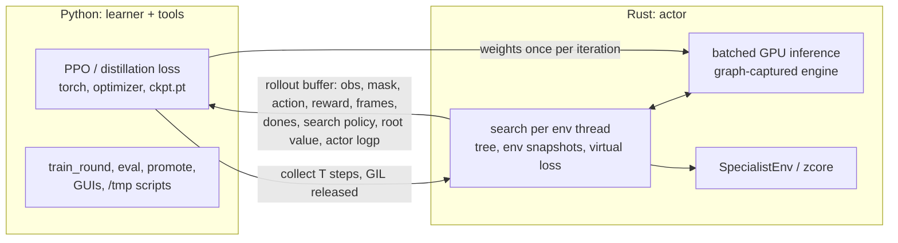

# All Rust? Python's role once inference and search move to Rust (Nov 9)

Question (Lee): if inference moves to the Rust side (a search, AlphaZero-style, makes several inferences per
real step), training becomes "PPO in Python → push the model to Rust → run N steps → push obs/returns back". What
is Python still worth then? Rewrite PPO and the GUIs in Rust too, or keep Python for the quick scripts (mapper,
one-off investigations)?

**Short answer.** Move the *actor* to Rust (search tree, env stepping, batched GPU inference) and keep the
*learner* (PPO / search-distillation losses, optimizer, checkpoints), the GUIs and scripting in Python. The
boundary becomes one call per rollout instead of one per step. A full rewrite costs a lot (learner,
checkpoints, GUIs, tests, scripting) and buys little speed, because the time goes to the emulator, not
Python. Reconsider only on the triggers in [When to reconsider](#when-to-reconsider-a-full-rewrite).

## What the code is today

| Part | Language | Lines | Hot path? |
|---|---|---:|---|
| zcore, zelda, env, pool, movie, tools (src) | Rust | ~34.7k | yes: all of env-thread time |
| `triforce-py` bindings (PyO3) | Rust | 3,735 | per step today (recv/send) |
| Rust tests | Rust | 9,462 | |
| learner: `ppo`, `rollout_buffer`, `model`, `train`, `metrics`, `inference` | Python | 1,892 | update 12–16% of main thread |
| `evaluate`, `runner`, `registry`, `run`, `cli`, `entry_states`, `explore`, `play*`, … | Python | 3,001 | orchestration |
| `training-gui.py` | Python (PySide6) | 2,366 | no; doesn't import `triforce` (reads `logs/`) |
| `zelda-map.py`, `play-zelda.py` | Python (PySide6, `_native`, torch) | 1,559 | no |
| `scripts/` | Python | 1,261 | no |
| Python tests | Python | 4,492 | |

The model is small: 852,768 parameters (boss-aquamentus `r47-base-dg`): embeddings, a 1-layer 64-wide
transformer over 12 entity slots, a 3-layer conv over the 22×32 grid, MLP trunk, three masked action heads and a
value head. 230 `ckpt.pt` files (torch pickles with optimizer state) are on disk.

Scripting load: `/tmp` holds 109 throwaway `.py` scripts from Nov 1–8 (about 12 a day). Their imports:
`triforce._native`/`triforce.*` in nearly all, `numpy` 20, `json` 17, `torch` 8, `PIL` 7, `PySide6` 5.

## Where the time goes, and what search changes

From `docs/performance.md` (ow-zora p16, trained policy, ~2,200 steps/s):

- Env threads: 92% of samples in zcore; under 1% in the game/env/pool code above it.
- Per env step: ~4.7–5.75 ms executing, 0.65–1.0 ms decision latency (GPU forward ~0.33 ms, Python bookkeeping
  ~0.2 ms, the rest queueing behind other envs' forwards).
- Main thread: blocked in `recv` 29–32% of the run; the rest is GPU waits, bookkeeping and the update. At ~1,465
  forwards/s (mean batch 1.4) the single Python thread is already about two-thirds busy.
- A CUDA graph is what makes inference cheap: batch-16 forward is 2.7 ms eager CUDA, 0.37 ms as a graph (168
  small kernels, launch-bound).

Measured today on the loaded machine (two trainings running, load ~11), single thread, stalfos-keese-gel from
`1_73s_0`, random legal actions:

| Measurement | Value |
|---|---:|
| Rust `SpecialistEnv::step` | 1.90 ms/step, 14.6 frames/step (0.130 ms/frame) |
| Python `_native.Env.step` loop (same specialist/state) | 2.26 ms/step, 15.8 frames/step (0.143 ms/frame) |
| `Session::snapshot` (`MachineState` is 24,640 bytes, `Copy`) | 0.56 µs |
| `SpecialistEnv::restore` (starts a new episode: objective, wavefront, trackers rebuilt) | 10.6–13.5 µs |

What follows for search over the real emulator (each simulation expands at least one node = one env step):

- **The emulator is the budget, whatever the language.** Throughput drops by roughly the number of simulations S
  per real step: at today's ~2,200 steps/s, S = 16 gives ~130 real steps/s (a 4,096-step update in ~30 s of
  collection vs ~2 s now), S = 64 gives ~35/s (~2 min). Python's share of that is the ~10% decision overhead
  above. Fewer, better-guided simulations (good priors, short depth, searching only at hard decisions,
  subtree reuse) matter far more than where the loop is written.
- **Snapshots are cheap; env state isn't covered.** The machine snapshot is a 25 KB copy in 0.6 µs, but
  `SpecialistEnv` and `Session` aren't `Clone`, and `SpecialistEnv::restore` starts a new episode (critic,
  objectives, linger, hearts, bombs and end conditions reset). A tree needs a full env snapshot so rewards and
  endings stay correct below the root. That work is Rust either way.
- **The tree must be Rust.** Thousands of node expansions a second per env thread through a GIL-bound
  coordinator wouldn't keep up. Nobody is proposing a Python tree; this just rules it out.
- **Leaf inference demand is about today's step rate** (~2,000–2,400 evaluations/s machine-wide), because the
  emulator caps expansions. The GPU has plenty of room (batch-16 graph forward 0.33 ms). The single Python main
  thread does not: at today's small async batches it is already ~2/3 busy. So whether Python can stay the
  inference server depends on batch size. Leaf-parallel search (several leaves in flight per tree, virtual
  loss) raises the batch and amortizes Python; one leaf at a time keeps batches at ~1.3 and caps throughput on
  the main thread.
- **"Push inference into Rust" can be slower than today if done naively.** Eager libtorch (tch-rs) or an eager
  candle/burn forward launches ~170 small kernels per batch, like eager PyTorch (2.7 ms vs the graph's 0.37
  ms). A Rust inference path needs graph capture or kernel fusion (ONNX Runtime CUDA EP with CUDA graphs, or
  TensorRT) to match the current setup. [INFERENCE: engine capabilities from general knowledge; web search was
  unavailable, not checked against current releases.]
- **Log-prob bit-exactness goes away.** `docs/performance.md` skipped `torch.compile` so rollout log-probs match
  the update's forward bit for bit. Any non-torch inference engine breaks that. Fix: the learner recomputes
  `logp_old`/`V` with its own network over the rollout before the update (one 4,096-row forward, milliseconds).
  Search targets (visit distributions, root values) don't need it.

## What Python would still be doing

With the actor in Rust: the learner (losses, optimizer, checkpoint I/O, warm starts/`widen_policy`, early stop,
metrics → TensorBoard/`metrics.jsonl`), round orchestration (`train_round.py`, eval, promote), the three GUIs,
`entry_states`/`explore` front ends, and all one-off investigations. None of these are hot paths; the learner's
compute is GPU kernels.

## Full Rust rewrite: pros and cons

**Pros**

- One language, one build, one test suite. The PyO3 layer (3,735 lines), the `maturin develop` step, the
  info-dict marshalling and the Python/Rust mirrors of contracts (`OBS_SPEC`, `ActionMask.from_flat`,
  `zelda_enums`) go away.
- No GIL and no main-thread hop: actor threads call inference directly; the ~0.2 ms bookkeeping per forward and
  the single-thread ceiling are gone.
- Torch-on-CPU problems go away (the libgomp barrier spin that took 15.6% of samples in `performance.md`
  change 2).
- A running compiled binary doesn't pick up code changes mid-round, unlike the fresh-import breakage of round 6
  (the worktree rule in CLAUDE.md). Partial: a round driver that launches later steps from a rebuilt binary
  still would.
- Scratch Rust is cheaper than it sounds: a `/tmp` crate depending on `env`/`zelda`/`zcore` built cold in 32 s
  (`-j4`, nice 19, loaded machine) and rebuilt after an edit in 0.8 s.

**Cons**

- **The learner needs a Rust autodiff/GPU stack.** tch-rs is libtorch from Rust: same kernels, but a
  multi-GB native dependency pinned to one libtorch version, with C++ build friction. In practice that's still
  PyTorch. burn/candle are pure Rust but less mature for training, with fewer debugging/profiling tools and
  numerics that differ from torch's `TransformerEncoderLayer`, orthogonal init and Adam. [INFERENCE: ecosystem
  state not re-checked today.] ~1.9k lines of learner plus ~1k of eval/registry to port and re-validate against
  the current training curves.
- **Checkpoints.** 230 torch-pickle checkpoints (weights + optimizer). Warm starts (`--load`, `warm_start`,
  `widen_policy`) are central to Lee's workflow; all of them need conversion (safetensors) or retraining.
- **The next research is in the learner.** Expert iteration (backlog "Idea 3"), branch:K advantages ("Idea 2"),
  search-policy distillation and value targets are loss-function experiments. Torch is the fastest place to
  iterate on those. A Rust learner slows exactly the part about to change most.
- **GUIs gain nothing.** `training-gui.py` reads `logs/` and doesn't import `triforce`, so its language doesn't
  matter. Porting it, `zelda-map.py` and `play-zelda.py` (~3.9k lines PySide6) to egui/iced is pure cost, plus
  re-checking the colorblind-safe palette.
- **Scripting gets more expensive.** There is no Rust scripting facade: the state store exists three times
  (`crates/env/tests/common`, `crates/pool/tests/zelda.rs`, `crates/triforce-py/src/context.rs`). The
  `/tmp` bench above needed a hand-rolled `StateStore`, the ROM loader and a missed `zelda/zcore` feature before it
  compiled. Python's `Game`/`Env` plus numpy/PIL/json does these in a few lines. Opus writes the Rust fine,
  but each investigation takes more code, more compile round trips and more tokens, and is harder for Lee to read
  and tweak. At ~12 investigations a day that adds up.
- **4.5k lines of Python tests** to port or drop.

**Python per-step overhead, for scale:** 2.26 vs 1.90 ms/step on a single env through the gym-style API (about
10% per frame, noisy on a loaded machine). In the pool it's the ~0.2 ms bookkeeping per forward. Neither is what
search costs.

## Recommendation: Rust actor, Python learner

1. **Search first, with inference still in Python.** Build the tree as a Rust pool task. Unexpanded leaves come
   out as ordinary pool rows (the `recv`/`send` protocol and `layout.rs` buffers as they are), answered by the
   existing CUDA-graph forward. No model port, bit-exact log-probs, and it shows whether Python is the
   bottleneck: watch the main thread's `recv`-blocked share and mean batch (`scripts/rollout_timeline.py`).
   Design the tree for several leaves in flight per env from the start; that decides the batch size in both
   setups.
2. **Move inference to Rust when step 1 shows the main thread saturated** (recv-blocked share near zero, batches
   small). Export the network trunk (logits + value) once per iteration and run it in a graph-captured engine
   (ONNX Runtime CUDA EP with CUDA graphs is the first candidate; tch-rs only if its libtorch can be the venv's).
   Masking and Gumbel sampling stay in Rust (they're already specified: `keyed_noise`, masked heads). Add a
   parity test: Rust vs torch logits on recorded observations within tolerance. The learner recomputes
   `logp_old`/`V`. Python then makes one blocking `collect()` call per rollout instead of one round trip per
   step.
3. **Keep the learner, GUIs and scripting in Python.** Once the actor owns its own loop, collection can overlap
   the PPO update (envs idle ~0.3 s per iteration today) with one-iteration-stale weights, if that ever pays.
   That's an option the split allows, not part of this recommendation.

Needed in Rust regardless of this decision: a full `SpecialistEnv` snapshot (trackers, critic, objectives, end
conditions, bomb ledger), not just `SessionSnapshot`; and, if Rust scripting is wanted at all, one shared
state-store/ROM facade crate instead of the three copies.

## When to reconsider a full rewrite

- The learner itself lands on the hot path: e.g. a learned dynamics model trained online (MuZero-style) where
  update and search interleave per step.
- The PyO3 boundary becomes the main cost of change: most features need edits in Rust, bindings and Python, and
  the coarse `collect()` boundary didn't stop that.
- A single shippable binary is wanted (a standalone player).
- A pure-Rust training stack is verified to reproduce a current PPO run (same curves, same success, from a
  converted checkpoint) on one specialist. That's a one-week spike to run before committing, not after.

## How these numbers were obtained

Static counts from `wc -l` over `crates/`, `triforce/`, `scripts/`, `tests/` and the top-level GUIs; script imports
from `/tmp/*.py`; parameter count from `models/boss-aquamentus/r47-base-dg/ckpt.pt`. The step/snapshot/restore
timings came from a throwaway `/tmp` crate (path dependencies on `env`, `zelda` with `zcore`, `zcore`) and a
throwaway Python loop over `triforce._native.Env`, both since deleted, run while `r51-bow-goriya` and
`r52-trap-nocurr` were training. Absolute times are inflated by that load; the ratios are what matter. Every other
throughput figure is quoted from `docs/performance.md`.
