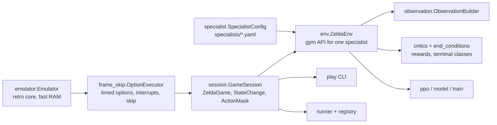

# Triforce v2 architecture and module contracts

Design: `triforce-v2-design.md` (kept outside the repo; decisions that change it go in `docs/decisions.md`).
This file lists the module boundaries and the interfaces between them.



## One emulator per process

stable-retro allows a single emulator per process. `GameSession` owns it. Anything that needs the game
(env, runner, play tool, tests) either creates the one `GameSession` or is handed it. Tests share one
session through the `session` fixture in `tests/conftest.py`. Training uses subprocess workers, one env each.

## Core (done)

| Module | Contract |
|---|---|
| `emulator.Emulator` | `step(buttons uint8[9] or None, frames)`, `frame` counter, `ram` (all blocks, cached per frame), `read(addr)`, `info` (data.json variables), `set_value(name, v)`, `save_state()/load_state(bytes)`, `get_screen()`. |
| `actions` | `ACTION_SCHEMA_VERSION`; `ActionKind` (zelda_enums) = MOVE, WAIT, SWORD, BEAMS, BOMB, BOOMERANG, ARROW; `DIRECTIONS` (N,S,W,E,NW,NE,SW,SE); `DURATIONS` (4,8,16,32). `Action(kind, direction, duration)`, `Action.from_indices(k, d, u)`, `.to_indices()`, `Action.parse('MOVE N 16')`. `ActionMask` with `kind[K]`, `direction[K,8]`, `duration[K,4]`, `to_flat()` → bool[`MASK_SIZE`] = K + K·8 + K·4. A kind whose direction (or duration) row is all False doesn't use that head. `compute_action_mask(state)`. |
| `frame_skip.OptionExecutor` | `execute(action, state) -> OptionResult(frames, interrupt, control_frames)`. Interrupt reasons in `frame_skip.Interrupt.ALL`. |
| `session.GameSession` | `load(name|path|bytes, randomize_rng=True, ram_overrides=None) -> ZeldaGame`; `act(action) -> StateChange`; `.state`, `.mask`, `.total_frames`, `.steps`; `snapshot()/restore()`. |
| `state_change.StateChange` | `previous`, `state`, `action`, `frames`, `interrupt`, `health_lost/gained`, `enemies_hit`, `enemies_stunned`, `items_gained`, `changed_location`, `gained_triforce`, `action_mask`. Look-ahead credit via `FutureCreditLedger`. |
| `describe`, `play` | Text dumps and the interactive `python -m triforce.play` tool. |

## Observation (`observation.py`)

```python
OBS_SCHEMA_VERSION: int
ROOM_VOCAB, ENTITY_VOCAB, NUM_TILE_CLASSES: int     # embedding vocab sizes
NUM_ENTITY_SLOTS = 12
class ObservationBuilder:
    def __init__(self, objective: bool): ...
    def reset(self, state: ZeldaGame, mask: ActionMask) -> dict[str, np.ndarray]
    def build(self, change: StateChange, mask: ActionMask) -> dict[str, np.ndarray]
    @staticmethod
    def observation_space() -> gymnasium.spaces.Dict
```

| Key | dtype / shape | Notes |
|---|---|---|
| `room_id` | int64 [1] | index < `ROOM_VOCAB` |
| `room_state` | float32 [R] | per-room flags from `docs/ram-catalog.md` |
| `link` | float32 [L] | |
| `entity_types` | int64 [12] | 0 = empty slot |
| `entity_features` | float32 [12, F] | feature 0 = presence |
| `grid` | int64 [22, 32] | tile class per 8px tile, row-major |
| `history` | float32 [H] | last action kind/dir/duration, frames since |
| `objective` | float32 [O] | all zeros when `objective` is off |
| `action_mask` | bool [`MASK_SIZE`] | `ActionMask.to_flat()` |

When the objective block is on, the env attaches `state.objectives` (v1's `Objective`) before calling the builder.

## Specialist task and environment (`specialist.py`, `env.py`)

`specialists/<name>.yaml` follows design §3.3; load with `specialist.load_specialist(name) -> SpecialistConfig`.

```python
class ZeldaEnv(gymnasium.Env):
    def __init__(self, specialist: str | SpecialistConfig, session: GameSession | None = None,
                 start_state: str | None = None): ...
    observation_space = ObservationBuilder.observation_space()
    action_space = MultiDiscrete([NUM_KINDS, NUM_DIRECTIONS, NUM_DURATIONS])
    def reset(seed=None, options=None) -> (obs, info)
    def step(action: array[3]) -> (obs, reward: float, terminated, truncated, info)
```

`info` keys every step: `frames` (int, frames this step: used for frame-aware discounting), `interrupt`,
`action` (str), `rewards` (dict name → value), `room` ((level, room, in_cave)), `health`, `max_health`,
`steps`, `total_frames`, `specialist`. On the last step: `ending` (end-condition name) and `outcome`
(`success` / `hard-failure` / `soft-failure`). An end condition that is not classified raises.

## Learning (`model.py`, `ppo.py`, `train.py`, `registry.py`)

- Action heads: kind (K), direction (8), duration (4). Direction/duration log-probs and entropies count only
  when the sampled kind uses that head (mask row non-empty).
- GAE discount per step: `gamma ** (frames / 8)`, `gamma = 0.99`; `frames` stored in the rollout buffer.
- Checkpoint (`models/<specialist>/<run-id>/ckpt.pt`): `obs_schema_version`, `action_schema_version`,
  `specialist`, `model_config`, `state_dict`, `optimizer`, `iterations`, `steps`, `metrics`.
  Loading with a mismatched schema version raises.
- `models/<specialist>/promoted` holds the promoted run id; `triforce promote <specialist> <run-id>` sets it.
- Metrics (design §12) go to TensorBoard and `metrics.jsonl` in the run directory; `train_summary.json`
  records iterations, steps, `stopped_early`, wall time and steps/sec.
- `train --stop-success R [--stop-patience 5]` (`EarlyStop`) ends training once the training `success_rate`
  is ≥ R for that many consecutive iterations that finished an episode.
- `evaluate.evaluate_specialist(specialist, checkpoint, episodes_per_state=20, parallel=1, seed=0,
  deterministic=False)` plays every seed start state N times in `ZeldaEnv` (episode i seeded `seed + i`) and
  returns success rate, outcomes/endings and per-room/per-state breakdowns; `python -m triforce.evaluate
  --specialist NAME` (or `triforce evaluate`) writes `eval.json` next to the checkpoint.
- `scripts/train_round.py --round ID` trains every trainable specialist (route order), promotes and
  evaluates each, then runs `eval-chain`; summaries go to `models/<round>-summary.json` and
  `models/<round>-chain-summary.json`.

## Runner and CLI (`runner.py`, `run.py`, `cli.py`)

- `Route.load(name, stop_at=None)` reads `triforce/routes.yaml`. A route starts at the `start` savestate and
  ends on entering its `terminal` room (milestone1: level 2 room 0x0e); `stop_at` ends it earlier.
- `Runner(session=None, models_dir=None, checkpoints=None, deterministic=False, max_steps=50000,
  renderer=None).run(route, seed) -> RunResult`. On each room entry: `game.yaml` tag → specialist → promoted
  checkpoint (cached). Untagged room or missing model → `result='error'` with the reason. Per-room outcomes:
  `exit-correct`, `exit-wrong`, `death`, `stuck` (specialist `max_steps` in one room), `milestone`.
- `python -m triforce.run --route milestone1 [--seed N] [--render] [--stop-at L:0xRR] [--checkpoint S=PATH]`
  prints one line per room and appends a JSON line to `runs/runner.jsonl`.
- `triforce eval-chain --route milestone1 --runs 20 [--parallel N]` → success rate and per-room failure
  counts (`chain_summary`); `triforce promote <specialist> <run-id>`; `triforce list`;
  `triforce train|run|play|evaluate ...` forward to the module CLIs.
