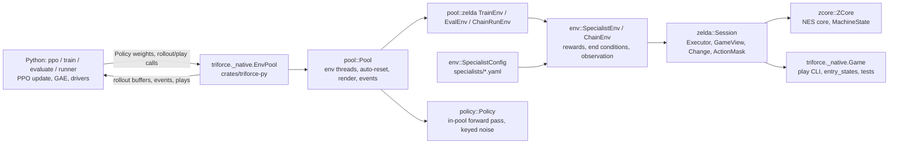

# Triforce v2 architecture and module contracts

Design: `triforce-v2-design.md` (kept outside the repo; decisions that change it go in `docs/decisions.md`).
This file lists the module boundaries and the interfaces between them.

## Crates and Python modules

| Crate / module | Owns |
|---|---|
| `crates/zcore` | Zelda-only NES core (MMC1), cut down from TetaNES (`UPSTREAM.md`), hardware timing. `machine.rs`: `Rom::from_ines`, `ZCore` (`power_on`, `run_frame(buttons, render)`, `pixels`/`rgb`, `ram`/`prg_ram`, `poke`, `snapshot`/`restore` of a `Copy` `MachineState`). `state_file.rs`: `TFZSTATE` `.state` files; gzip (legacy stable-retro) files raise `StateFormatError`. |
| `crates/zelda` | Game model and session, ported from the old Python stack: `vars`/`tables` (RAM variables, game data), `enums.rs` (object ids and `ObjectClass`, the one classifier), `game.rs` (`GameView`: Link, enemies, items, projectiles, hazards), `room`/`room_state`/`tiles` (wavefront, doors, tile grid), `actions.rs` (`Action`, `ActionMask`, `compute_action_mask`), `executor.rs` (option executor: timed options, interrupts, uncontrollable skip), `blocks.rs` (shield collisions), `change.rs` + `ledger.rs` (`Change`, look-ahead `FutureCreditLedger`), `cheats.rs`, `room_entry.rs`, `game_map.rs` (`game.yaml`/`routes.yaml`), `objectives.rs` (`GameCompletion`), `hearts.rs`, `linger.rs`, `visits.rs`, `session.rs` (`Session`). The `Nes` trait (`nes.rs`) abstracts the core so tests can run on zcore or a scripted double. |
| `crates/env` | `config.rs` (`SpecialistConfig`, `GameData`, cross-file validation), `rewards.rs` + `critic.rs`, `end_conditions.rs`, `observation.rs` (`ObservationBuilder`, schema v2), `objective.rs`, `start_states.rs`, `curriculum.rs`, `specialist_env.rs` (`SpecialistEnv`), `chain.rs` (`ChainEnv`, `Route`, `RoomRecord`, `RunResult`), `explore.rs` (`Explorer`, `AcceptSpec`). |
| `crates/pool` | Generic threaded `Pool<E: PoolEnv>` (`pool.rs`), buffer layout (`layout.rs`), frame pacing/render control (`control.rs`); `zelda/` holds the Train/Eval/ChainRun envs and pool events. |
| `crates/triforce-py` | `triforce._native` (PyO3): `Game`, `GameState`, `Change`, `Snapshot`, `Env`, `EnvPool` + `TrainTask`/`EvalTask`/`ChainTask`, `Policy`, `keyed_noise`, `SpecialistConfig`, `CurriculumSpec`, `Explorer`/`AcceptSpec`/`explore_states`, `Replay`/`ReplayPlayer`/`replay_verify|stitch|truncate`, `ReplayFeed`/`ReplayScreen`, `route_steps`, `routes`, `route_alternates`, `game_rooms`, `families`, `specialist_for`, `paths`, `OBS_SPEC` and other constants, exception types. |
| `crates/movie` | `TFMOVIE` input movies and `TFGOLDEN` per-frame digests. |
| `crates/replay` | `TFREPLAY` recordings: the format (`format.rs`), `Recorder`, the reader `Replay`, `stitch`/`truncate` (`edit.rs`) and, with feature `zcore`, `Player`/`verify` (playback on the emulator alone). No dependency on `zelda` or `env`. |
| `crates/theater` | Replays for watching: `queues.rs` (`Queues`: `success`/`stuck`/`died`/`random` first-in-first-out and `best`, the top runs seen), `feed.rs` (`Feed`: the background thread that files every finished run of a `Producer` and pauses it while nothing is wanted), `screen.rs` (`Screen`: one thread per cell playing a replay at a frame rate, one cell heard), `speaker.rs` (`Ring`, `Speaker`: the sound device, `cpal`), `overlay.rs` (the controller drawn into a frame). Knows replays and the emulator only. |
| `crates/policy` | `Policy`: the network's Rust copy that acts inside the pool (forward pass, masked heads, keyed Gumbel noise `noise.rs`). |
| `crates/tools` | The `tf` CLI (below). |
| `triforce/` (Python) | `ppo.py`, `rollout_buffer.py`, `metrics.py`, `model.py`, `train.py`, `evaluate.py`, `runner.py`, `replay.py`, `golden.py`, `provenance.py`, `run.py`, `cli.py`, `play.py`, `play_grid.py`, `play_view.py`, `video.py`, `explore.py`, `entry_states.py`, `chain_hp.py`, `events.py`, `registry.py`, `plr.py`, `best_of_n.py`; thin `observation.py` (gym space from `OBS_SPEC`), `actions.py` (`Action`, `ActionMask` flat-mask view), `zelda_enums.py` (`ActionKind`, `Direction`, `MapLocation`), `specialist.py`, `paths.py` (`STATES_DIR`, `TRAJECTORIES_DIR`). |

## Processes and threads

Everything runs in one process. Each env owns its own `ZCore`; `Pool` pins envs round-robin to persistent OS
threads and steps them without the GIL. The agent acts inside the pool (`docs/rust-actor.md`): each worker picks its
envs' actions with the Rust copy of the network (`crates/policy`, one per specialist; `ZeldaPolicy.to_native()`),
sampling with Gumbel noise keyed to (episode job, decision) or taking each head's argmax. The job is an eval job's
or chain run's seed, or a per-episode key in training, so an episode plays the same on any env or thread.
Training makes one `rollout(policies, T, buffers)` call per rollout: every env steps `T` decisions and the buffers
get, per env, the `T + 1` observations, the actions, the Rust policy's log-prob/entropy/value, rewards, frames,
episode starts and bootstrap values. Evaluation, chains and the watch player's simulations call `play(policies)`:
every env acts
on its own until its jobs run out (`active`, `wait_idle`); with `record='actions'` each finished episode comes
back from `poll_plays()` (actions, per-decision log-prob/entropy/value, optionally the observations), and a pool
built with `record=` reports every finished run as a `replay` event (Replays, below). Envs auto-reset after a
terminal step; terminal infos, eval records,
chain results and room-change events come from `poll_events()`. Env `i` seeds a `ChaCha8Rng` from `(seed, i)`
(seeds < 2**63). A usage error of an actor or planner fails the call, not the env; a `rollout` with no active env is
an error; rollout buffers must be C-contiguous and only known keys are accepted. `close` (or Ctrl-C) stops a
rollout before its next step and a searched rollout between simulations.
Rendering (full 256×240) is off by default and toggled per env with `set_render`; `frame(env, since)` copies the
latest frame. Tools and tests that need a single game use `triforce._native.Game`.

## Core

| Item | Contract |
|---|---|
| `zcore::ZCore` | One NES. `run_frame(buttons, render)` runs one frame with the raw NES button byte; with `render=false` no pixels are written but timing is identical. `ram()` 2 KiB, `prg_ram()` 8 KiB; `poke` only `$0000-$07FF`/`$6000-$7FFF`. |
| `zelda::actions` | `ACTION_SCHEMA_VERSION` (2); `ActionKind` = MOVE, WAIT, SWORD, BEAMS, BOMB, BOOMERANG, ARROW, CLIP; `DIRECTIONS` (N,S,W,E,NW,NE,SW,SE); `DURATIONS` (4,8,16,32). `Action` with index conversion and text parsing (`MOVE N 16`, `CLIP W`: CLIP is directional, cardinal, untimed). `ActionMask` with `kind[K]`, `direction[K,8]`, `duration[K,4]`; flat form bool[`MASK_SIZE`=104] = K + K·8 + K·4. A kind whose direction (or duration) row is all False doesn't use that head. Python `triforce.actions` keeps `Action`/`parse`/index helpers and a read-only `ActionMask.from_flat`. |
| `zelda::executor` | `Executor::execute(action, state) -> OptionResult(frames, interrupt, control_frames, projectile_blocks, clip, menu_frames)`; blocks count confirmed shield collisions in executed frames, including attack/settling/uncontrollable frames. Attacks are played with the controller alone ("Attacks by buttons" below): no memory is written; an attack the buttons can't make from the state presses nothing. An attack press the game didn't read (a lag frame) is held one more frame. A BOMB, BOOMERANG or ARROW whose item isn't the selected one first chooses it on the item sub-screen; those frames are `menu_frames` (inside `frames`). A CLIP runs the grid-point skip macro ("Grid-point skip" below; MOVE never does); `clip` reports its `ClipOutcome`. |
| `zelda::Session` | `load(state, LoadOptions { randomize_rng, fresh_room, controllable, overrides }, rng)`; `randomize_rng` writes a natural RNG state and the spawn draws right after the restore ("Randomness at a start" below), `rng_phase()` reports the phase, `write_rng(phase)` writes one at the current frame (a chain checkpoint's redraw); controllable curriculum frames are not advanced before the first action; normal entries gain control through their transition. `act(action) -> Change`; `state()`, `mask()`, `snapshot()`/`restore()` (restore sets `steps`/`total_frames` from the snapshot and clears the look-ahead ledger; `checkpoint()`/`resume()` also keep the frame counter and the ledger), `set_render`, `set_frame_sink`, `capture_pre_entry`/`last_pre_entry`, `set_disabled_kinds`, `set_clips` (both recompute the mask when they change). `just_exited_cave` is set on any cave or dungeon mouth (live entries and loaded states alike) and clears when Link's tile changes. Python: `triforce._native.Game` (`set_clips(enabled)`, `skip_available(direction)`, `Change.clip`). |
| `zelda::Change` | previous/current `GameView`, action, frames, menu_frames, interrupt, health lost/gained, enemies hit/stunned, items gained, changed location, gained triforce, action mask, executed projectile blocks, the skip's `clip` outcome; `observed.enemies_killed`: slots whose monster died in the step, counted by the game's `RoomKills` or not (a Vire's Red Keese, Gleeok's heads), which restart the room-stall count. `frames` are the frames that count against the action: the option's minus its item sub-screen frames (`menu_frames`, the game paused). Discounting (`StepInfo.frames`, the pool's `Outcome.frames`, `rollout_buffer.py`), the frame penalty, the observation's history `frames`, heart timers and linger use `frames`; counts of frames played (`Session.total_frames`, `episode_frames`, visits, chain records, the pool's emulated frames, replays) add `menu_frames` back (`StepInfo.menu_frames`, Python `Change.menu_frames`, info `menu_frames`). Look-ahead credit via `FutureCreditLedger` does not add simulated blocks; a weapon that finishes drops its unused predictions; the look-ahead keeps the action's last rendered frame (`Game.screen()` works right after it). |
| `triforce-py/describe.rs`, `play.py` | Text dumps (`Game.describe_state/describe_change`) and the interactive `python -m triforce.play` tool. |

Objects are classified once (`zelda::enums::ObjectClass::of`, from the game's `Obj_Update` jump table) and
`GameView`, the executor's interrupts, `room_state` and the observation share it: `enemies` are monsters only;
`projectiles` are monster shots ($53–$5C); `hazards` hold boulders and the boulder generator ($20/$1F), traps
($49/$4A), Bubbles ($2B–$2D), standing fire ($40) and Gleeok's flying heads ($46), which hurt but can't be hurt
and are not fight targets; people, dropped items and tile objects are in none of the lists. The observation's
"hurts on touch" flag follows the classifier; HP, stun and killable are monster-only. The executor interrupts on
anything that can hurt Link except standing fire and the boulder generator. A slot that empties because a hazard
destroyed itself or a Zora dived is not a kill. Gleeok (Nov 12, `zelda::game::gleeok_heads`): his neck base in
slot 1 never dies, so `GameView` files it under `hazards` and the observation marks it not killable; his attached
heads have no slot of their own (slots 2–6 are type 0), so `GameView` and the observation add one enemy per living
neck (id $42, slot 2 + neck) at the head's neck-array position, with slot 5's shared HP; a hit on that HP is
credited once.

The action mask (`zelda::actions::compute_action_mask`) offers only what the game would do. An attack is legal
only where the game would start the weapon (Link's state allows it, the weapon's slot is free, the sword isn't
blocked: `$4C`/`$52E` mask SWORD and BEAMS) and the buttons can make that strike from where Link stands
(`GameView::attack_directions(kind)`, `sword_directions()`; `zelda::attack::plan`, below). A BOMB, BOOMERANG or ARROW
that isn't the selected item also needs the item sub-screen to open (`zelda::submenu::can_open`: a play mode, not
paused, no flute tune or candle brightening).

BOMB follows the acting family's `items: {bombs: MODE}` (`env::config::BombUse`, Lee Nov 11; in `SpecialistEnv` and
chains, recomputed every step): `never`; `tenth`, only for the 10th damage-free kill (`$50` HelpDropCount = 9: a
bomb kill then arms a forced drop of 4 bombs, `asm:Damage_KillMonster`); `required`, in game.yaml `requires_bombs`
rooms and the 10th kill; `free`, in `requires_bombs` rooms, elsewhere while Link holds more than the route's bomb
reserve (routes.yaml `bomb_reserve`, `GameCompletion::bomb_reserve`: 5 from Dungeon 3's entrance, 2 from Dungeon
4's), and the 10th kill (whatever the reserve). Families: `free` goriya, darknut, moldorm, boss-dodongo,
boss-manhandla, vire; `required` ow-tektite, trap-room, stalfos-keese-gel; `never` boss-gleeok; `tenth` the rest.
The game's own rule comes first (bombs held, a free slot, an enemy or a bomb wall) and BOMB stays legal at an
unopened overworld rock wall. MOVE N at the overworld top edge scrolls; a key works only at the
room bound next to the locked door; a push counts only when Link is aligned with the block and the room is clear;
an opened bomb wall is passable. Off the grid on a cave or dungeon mouth only MOVE S is legal (any other move walks
Link back in). MOVE E past the overworld's right bound (X `$F8`, where a screen wrap or an aborted one leaves Link)
reads the tile under him (no look-ahead at X >= `$F0`), and N/S there read column `$1F` and the bytes after the tile
map (`$67F0` on) as column `$20`, as the game does.

### Randomness at a start (`crates/zelda/src/rng.rs`, `room_entry.rs`; round 22)

The game's only random source is the 13-byte shift register `$18-$24` (`zelda-asm/mechanics.md` "# Random
numbers"): one step per NMI frame, seeded at reset (`$40`, then 12 zeros), so its value is the number of frames
since reset. From the seed it runs an 88-step lead-in and then a cycle of 32,767 states, the only values a game in
play holds. `zelda::rng::natural(n)` is the register `n` steps after reset (a `u128` stepped `n` times, ~45 µs for
the longest, against ~1 ms for a start state's load: no table); `rng::PHASES` = 88..=32854, each state of the cycle
once; `rng::phase_of`, `rng::on_cycle` read a value back. `crates/zelda/tests/rng.rs` boots zcore and finds the
game's register equal to `natural(steps)` on every frame (reset seeds it on frame 10; steps 87, 88, 32854, 32855 on
frames 119, 120, 32886, 32887; 32855 is 88 again).

Every write a start makes for randomness, made right after the restore and before any frame runs, so the entry
frames, the spawn clouds and the first monster decisions all run on values the game can hold
(`crates/zelda/tests/rng.rs` reads the register on every frame from the restore to 120 frames into play):

| Write | When | Value |
|---|---|---|
| `$18-$24` RNG register | `Session::load` with `randomize_rng` (start states: training resets, evaluation, a chain's start state); a chain checkpoint with `redraw_rng` (`Session::write_rng`); search futures (`SpecialistEnv::perturb_rng`, phase from the future's key) | `natural(phase)`, the phase drawn uniformly from `PHASES` by the caller's seeded generator; `Session::rng_phase()` reports a start's phase (a recording keeps it, META `rng_phase`) |
| `$524` SpawnCycle | a pre-entry load with `randomize_rng` | 0-8, every value asm:Spawn_AssignPositions stores |
| `$525` CurEdgeSpawnCell | a pre-entry load with `randomize_rng`, any level (the cell persists through dungeons to the next edge-spawn room) | one of `room_entry::EDGE_SPAWN_CELLS` (41): `$40` (reset's) and the ring cells the search stops on in some edge-spawn room (top left tile below `$84`), derived from zelda-asm/data in a test; never the corners `$E0`/`$4F`, from which the search leaves the ring and places the monster off the screen or never ends |
| room flags, `$560+room` | a pre-entry load with `fresh_room`: the pending room's saved kills | overworld bits 0-2 and dungeon bits 6-7 cleared, `LevelKillCounts` 0: a room never cleared; the room history (`$621-$626`) is left as it is (with the kills clear it decides nothing) |

Before round 22 the register got 13 independent bytes 1-255 (almost never a state of the cycle), the edge cell
any of the ring's 50 cells (the two corners included) on the overworld only, and a fresh room `$FF` (no room id)
in its history slots. The reset's `ram_randomization` (hp, bombs, `help_count`) is no game randomness: it is written
after the entry frames, once Link is controllable, and round 22 left it alone. A power-on start writes nothing.
Stored start states were built by the old loads: 132 of the 364 hold `$FF` in their room history (only ever
compared with room ids, so inert) and 120 an off-ring or corner edge cell (`$E0` in 109; `$10`, `$1F`, `$3F` in
11): a randomized load replaces the cell, a load without it keeps it. Their own RNG registers are all on the cycle.

### Attacks by buttons (`crates/zelda/src/attack.rs`, `submenu.rs`; round 21)

The executor never writes Link's facing (`$98`) or the selected item (`$656`): an attack is the button sequence a
player would press (decisions 2026-11-12, "Attacks by buttons"). `attack::next` picks each frame's input from
Link's RAM and the executor plays it closed loop; `attack::plan` plays the same policy on a model of Link's input
handling (`attack::step`: asm:Link_FilterInput, asm:Link_ModifyDirInDoorway, the grid-point and six between-grid
cases, room bounds, asm:Doorway_CheckLink and asm:Door_Touch, the tile test, the screen and cave edges, the laid
ladder, the q-speed move and grid fix-up) and returns the turn frames, or `explain` says why not (`Refusal`).

| Situation | Input | Turn frames |
|---|---|---|
| Sword, on a grid point (or the strike on Link's own axis) | direction+A on one frame: A is read before the turn and the sword takes Link's facing every frame | 0, no step |
| Sword, off the grid across the strike | hold the direction: the game walks Link on to the next grid point (4+ px out) or back to the one he left, then direction+A | 1-3 |
| Bomb, arrow (they take the facing when B is read) | one frame of the direction (Link turns; a step of 1-2 px if the way is open, none against a wall or on the laid ladder), then B | 1 (+1-3 off the grid) |
| Boomerang | direction+B on one frame: it flies along the held directions (diagonals too) | 0 |
| Facing's border band drops the button (asm:Link_FilterInput tests the axis Link faces) | turn first (one frame), then the button | +1; refused (`Band`) where the strike's own facing is in the band: only a walk out (a MOVE) would do |
| Dungeon doorway (`DoorwayDir` set: input forced onto the facing's axis) | facing into the room: hold the sideways direction, the forced step walks Link onto the room's edge, where he turns | up to ~22; facing out of the room: refused (`Doorway`) |
| A Like-Like's hold, knockback | no turn: only Link's facing (the boomerang still follows the held direction under knockback) | `Held` |
| Input that would leave the room | a cave's edge or cellar's stairs (they test the input), the screen edge on a turn step, a door the turn or the press would unlock (a key) or pass out through (false wall, opened bomb wall) | refused (`Leaves`); walking into an open doorway is allowed |

The item sub-screen (`zelda::submenu`, asm:Submenu_UpdateActive): START, 64 frames (dungeon; 65 overworld) to the
first active frame, one step per frame toward the item the shorter way round the ring (the search skips empty
slots and the bow; alternating the direction and the direction with Up makes every frame a new input), START on
the frame that reaches it, 59 frames of scrolling out: 123 + steps frames in a dungeon, 124 + steps in the
overworld (1 or 2 steps among boomerang, bombs and arrows). The game is paused throughout (only the random numbers,
the frame counter and sound run), the sub-screen is always closed and the game back in mode 5 when the action
goes on.

A returning boomerang caught on a turn frame puts Link in the catch pose (`$20` -> `$21` -> `$31` -> 0), during which
the game reads neither A nor B (asm:Link_HandleInput); the executor waits it out with nothing pressed (at most 32
frames) so the press that follows is a new one.

`crates/zelda/tests/attacks.rs` checks it in the real game: every offered strike over ten rooms' start states and
the positions of a walk through their doorways is made with no memory write and no room change, and no refused
one is made by any hold-then-press sequence but where a walk out of a border band would be needed.

### Grid-point skip (`crates/zelda/src/clips.rs`, round 21)

One frame of perpendicular input 5 pixels short of a grid point T, in the right sub-pixel cadence, lets Link cross
T with no frame starting on it (`zelda-asm/mechanics.md`, "Screen wrap (overworld)" and "Grid-point skip"). MOVE
can't do it, so the executor plays it as a macro (`Executor::run_skip`, `clips::Controller`): every frame it reads
`$70`/`$84`, `$394`, `$3A8` and `$98` and follows mechanics.md's decision table (walk on toward the trick state;
on G with the wrong fraction, on T or lost between G and T, walk away until on G' with offset 0; in the trick state
heading toward T, press one perpendicular frame, Up for W/E with the heading released, Right for N/S; then hold the
heading). No RAM is written and no sword is used. It ends where it should (`ClipOutcome { direction, kind, abort,
presses }`, `abort` None) or aborts: `Interrupted` by a hit, a room change or game over (the option's interrupt;
spawns, nearby monsters, items and doors don't stop it), `Missed` (a press that ends on T backs off and retries, 3
presses at most; a crossing that ends on T never holds the heading there), `Stalled` (4 still frames), `FrameCap`
(200 frames), `Unavailable` (nothing pressed). Frames count like any option's.

`skip_target(state, dir)` / `skip_available` is the one availability rule (mask, executor, observation): mode 5,
Link's state 0, no knockback, and
- **wrap** (overworld, W or E; no ladder out): Link on a row line (Y a grid point; a nonzero offset only along the
  row); within 32 pixels of the bound (X <= `$20` going W, `$D0`..`$F0` going E; the bound itself included); the
  macro's run-up columns of his hotspot row (0-3 W, `$1C`-`$1F` E) and the landing columns (`$1E`-`$1F` after a W
  wrap, 0-1 after an E wrap) walkable and no slow tiles (`$74`/`$75`). T is `$00` (W) or `$F0` (E); the macro ends
  at X `$F0` offset 0 after a W wrap and X `$00` after an E wrap, where the opposite edge's room change is one MOVE
  away.
- **block clip** (dungeon, N or S; no ladder out): not in a doorway, X on the column line and inside the X border
  band, T the first grid point ahead (at most 16 pixels) whose N/S test is blocked by a square that also blocks 8
  pixels further (a 16-pixel square of blocks, statues or wall, never water `$F4`: with the ladder one square of
  water is no stop (`Room::ladder_axes`), and wider water is the ladder clip's), G' inside the room bounds, the
  run-up cells open both ways, and the clip useful: from T -+ 8 a MOVE W or E is possible **and** the same move from
  T is blocked (the tile it enters is walled off from T; where it is open from T too, the clip only leads back out:
  half a column off a square, an isolated statue), and no stairs
  spot at G', G or T (the warp would take Link down in the middle of the macro). The macro ends at T -+ 8, offset 0.
  Never W or E (from the side the clip leads nowhere). The G' condition is conservative (the back-off always has
  room): it leaves out squares whose G' is past a bound or solid, where a Link on G with the good fraction could
  still clip. In level 1 room `$22` that is only the south block from below (Y `$B5`-`$BD`, G' = `$C5`), a clip that
  would lead back out anyway; the north block from above has no G at all.
- What is offered, tested in the real game (`crates/zelda/tests/clips.rs`): in `$22` 27 grid points, each zone G'..T
  of a square whose clip leads into the diamond (from below the west, east and lower diagonal blocks; from above
  the upper diagonal, west and east blocks) or out of it (from inside, toward the north block; toward the south
  block G' is the stairs spot); from every start of those zones reached by walking, CLIP completes with one press,
  without damage from the traps, and a walk sideways (to X `$80`, then N or S where needed) takes the stairs. The
  west block is the push block: the clip never starts a push (holding N or S against it on T for 16 frames does,
  as in the game). Level 2 room `$7D`: nothing (its statues stand alone, 16 pixels apart: G' is inside the next
  statue and the tiles beside each are open from T). The way through `$22` with button-free actions: `MOVE W 32`,
  `MOVE W 32`, `MOVE W 8` (the corner of the east block), `MOVE S 8`, `MOVE W 8` twice (Link turns on the next grid
  point; the lower-right block stops him on G = (`$A0`, `$9D`)), `CLIP N` (14 frames),
  `MOVE W 32`: in cellar `$7F` 218 frames after the room's first frame, the stairs' transition included.
- Dungeon 4 (the start states under `triforce/states/`, Link put on every grid point out of the doorway): room `$03`
  offers 6 grid points (the zones under its two inner blocks at X `$60` and `$90`, into the side pockets of the
  triforce's enclosure, which the floor reaches as well), room `$50` 60 (20 squares of its diagonal rows), no other
  room (the water rooms `$21`, `$30`, `$31` and the cellar `$60` none). Each of them, CLIP from the grid point,
  completes with one press and the sideways walk from T -+ 8 goes where Link on T can't. In `$50` (entered E, left
  N) `MOVE W 32` twice stops Link on (`$B0`, `$8D`), G of the square above; `CLIP N` (14 frames) puts him at
  (`$B0`, `$7D`) beyond the right diagonal, and `MOVE W 8`, `MOVE N 32`, `MOVE W 16` twice, `MOVE N 32` take him
  to room `$40`: 318 frames from the room's first frame against 424 for the plain way round the diagonal's bottom
  (14 MOVEs), monsters cleared. No skip is offered in a doorway (every door entry of levels 1-9 walked in frame by
  frame).
- **ladder clip** (dungeon, any heading; Link holds the ladder, `zelda-asm/mechanics.md` "Ladder clip"): not in a
  doorway, the offset zero or along the heading; either no ladder out and a monster slot free (the first ladder is
  an object), or a ladder laid along the heading with Link on its line; Link within 16 pixels of T (the laid
  ladder's distance-0 point, where water two or three squares wide stops the plain ladder), standing on land at the
  lay point; the press outside the dungeon border band. **Up**: exactly two squares of water ahead with land beyond
  (one square is the plain ladder's, three need a second press), G' 8 pixels behind the lay point L on land; Link
  ends at L - `$30` with the second ladder put away (4:`$21`: Y `$55`, 8 pixels past the top bound). **Left, right,
  down**: two squares of water then land (he ends at L -+ `$30`, the relay walking on inside the room's bounds) or
  three (a second ladder; L -+ `$40`). At the end, if a ladder he crossed is still out, the macro holds nothing for
  one frame, which puts it away (holding the heading would lay another over more water); a ladder freshly laid ahead
  of him on arrival is left, as after any walk toward water. A miss stops Link on T on the ladder, backs off and
  retries (3 presses at most); a hit aborts it (the damage interrupt), and the MOVE mask models a laid ladder (back
  always, on unless at its distance-0 point, never sideways; MOVE toward water where the game lays the ladder is
  legal), so Link is never left unable to move. Tested in the game (`crates/zelda/tests/clips.rs`): `$21` N from
  every column of the island X `$50`-`$A0` and every start of the zone (both cadences, mid-cell, stopped on T after
  a miss), W and E on rows Y `$8D`-`$9D`, S from the top row back onto the island, each with one press; with the
  five Gels alive a hit aborts and a retry or a MOVE across completes; every offer in Dungeon 4 completes (`$21`,
  `$20` (its ring row 1, from X `$60` Left to X `$20`), a few two-square spans of `$31`; none in `$30`, whose single
  water row is the plain ladder's, and none with a ladder out over one square). CLIP N from G' takes about 44
  frames, from T (where a MOVE N stops) 56 (a back-off first).
- **The route through 4:`$21`** (round 21, `d2first`: in from `$31`'s N door onto the island, out by bombing the N
  wall; `crates/env/tests/clips.rs`, the stalfos-keese-gel config, Gels emptied): `MOVE N 4`, `MOVE N 32` twice
  (Link stops on T, Y `$7D`), `CLIP N` (to Y `$55`), `MOVE S 8`, `BOMB N`, `WAIT` for the blast, `MOVE N 16` into
  the rupee room `$11`: `exit-correct`, 419 frames in 10 actions (the scroll into `$11` included). From the clip's
  end (Y `$55`) BOMB N is legal and spends the bomb but the wall stays shut (the bomb lies `$18` from the wall's
  hotspot, asm:Bomb_TryOpenWall); the objective's bomb spot is (`$78`, `$5D`) (`bomb_spot` uses the spot against
  the wall where the usual one is water).

A specialist's `clips: true` (YAML; default false; `Session::set_clips`, set by the env every step and, in a chain,
from the family of the room Link is in) offers the CLIP kind in every direction a skip is available
(`clips::allow_clips`); CLIP is masked otherwise. A CLIP action always runs the macro (the mask gates the policy, not
the executor); MOVE never performs a skip. With clips on, the path search behind PBRS, linger and the `target`
observation (`Room::wavefront(..., clips)`, `clips::skip_jumps`) treats every block clip and ladder clip as a jump
from each rest position of its zone to its end, at its frames converted to tiles (1.5 pixels a frame, 8 a tile); the
search becomes Dijkstra only when a room has jumps, and the `target` direction follows a jump on the shortest way.
The overworld wrap is no jump (it ends one MOVE from the opposite edge: a jump would point the way to that edge's
exit out of the entry edge; the round-21 policies learned the wrap without one). So in 1:`$22` the objective targets
the stairs (reached through the clip under the east block) instead of the push spots; in 4:`$50` the way to the N
door goes through the diagonal (CLIP N at X `$B0`); 4:`$21`'s island, which no walk leaves, leads N by the ladder
clip.

## Observation (`crates/env/src/observation.rs`)

`ObservationBuilder::new(objective, target)`, `reset(state, objective, wavefront, mask)`,
`build(change, state, objective, wavefront, mask)` (`state` = `change.state`, or the state a cheat grant rebuilt).
Python sees the layout as
`triforce._native.OBS_SPEC` (`key → {shape, vocab, dtype}`) plus `OBS_SCHEMA_VERSION`, `ROOM_VOCAB`,
`ENTITY_VOCAB`, `NUM_TILE_CLASSES`, `NUM_ENTITY_SLOTS = 12` and the feature-name tuples;
`triforce/observation.py` builds the `gymnasium.spaces.Dict` the policy uses.

| Key | dtype / shape | Notes |
|---|---|---|
| `room_id` | int64 [1] | index < `ROOM_VOCAB` |
| `room_state` | float32 [84] | per-room flags from `docs/ram-catalog.md` |
| `link` | float32 [84] | schema 3 ends with `bomb_usable` (the mask allows BOMB: the mask is no network input), `bomb_reserve`, `bombs_spare` (bombs above it), `help_count` (`$50`/10), `next_kill_arms`, `drop_armed`, `drop_is_bombs`, `fairy_next` (`$627` = 15); schema 4 adds `clip_usable_N/S/W/E` (the skip is available and the specialist has `clips: true`) |
| `entity_types` | int64 [12] | 0 = empty slot |
| `entity_features` | float32 [12, 33] | feature 0 = presence |
| `grid` | int64 [22, 32] | tile class per 8px tile, row-major |
| `history` | float32 [35] | last action kind/dir/duration, frames since |
| `objective` | float32 [10] | all zeros when `objective` is off |
| `target` | float32 [8] | all zeros when `obs.target` is off |
| `action_mask` | bool [104] | flat `ActionMask` |

When the objective block is on, the env attaches the objective (`crates/env/src/objective.rs`) before calling
the builder.

Schema v2 added `target` (`TARGET_FEATURES`), filled only with `obs.target: true` (default false; the key always
exists, so every specialist shares one layout). It reads the PBRS wavefront, which the env computes whenever
`reward.pbrs` or `obs.target` is on (dropped items are targets as `reward.item_targets`/`nearby_items` say):
`target_N/S/W/E` is a one-hot of the neighbour of Link's tile with the lowest distance below his own, over legal
steps only (ties N, S, W, E; all 0 on a target tile, when unreachable or when no legal step goes lower), `target_distance` is Link's wavefront distance / 32 clamped
to 1 (1 when unreachable or without a wavefront), `target_dx`/`target_dy` are the pixel offset from Link to the
target tile the steepest descent reaches (/256, /176; 0 if none) and `target_is_item` says whether that tile
belongs to a dropped item. Chains rebuild the same wavefront (the acting specialist's `reward` decides the item
targets) only for specialists with `obs.target` on. A chain resets the observation builder on every room entry of
a `one_room` specialist (also from a room of its own family), as at a training episode's start. Schema 3 (version
1.3.2.0, Nov 11) replaced `link`'s always-zero `selected_*` slice with the bomb and forced-drop features (the table),
so schema 1 and 2 checkpoints no longer load (their `link` is 81 wide): every family retrained. Schema 4 (version
1.3.3.0, Nov 12) added the CLIP kind (`history` one-hots 8 kinds, the mask is 104 wide) and `link`'s
`clip_usable_*`: no schema 3 checkpoint loads (action schema 2).
Checkpoints saved before r56 carry `model_config.grid_encoder: 'conv'`; the conv encoder is the only one left, so
`ModelConfig.from_dict` drops that key and refuses any other encoder.

Dungeon objectives fight for pending treasure or when every routed exit is closed by a living-monster shutter
trigger (all-dead, ringleader, last-boss or clear-to-drop). An unrelated shutter or an open route exit does not
force combat. The shutter rule excludes block/money triggers and non-foe-only rooms. Live barred-door
classification covers vertical tiles 0xa8–0xab and horizontal tiles 0xac–0xaf. Routing resumes after clearing.
A room's treasure counts as taken from the room's item-taken flag, and a fresh-room load reads the room flags
through the level's room-flag pointer.

`game.yaml` and `routes.yaml` are validated strictly: unknown keys, YAML 1.1 booleans such as `yes`, unquoted hex
ids and route steps whose exit isn't an exit of the room are load errors. Dungeon exits follow one convention,
checked against the ROM's door attributes (the comment block at the top of `game.yaml`); bomb walls are exits
everywhere, and path searches pass a bomb-wall exit only in a `requires_bombs` room or once it is open.

## Specialist task and environment (`crates/env/src/specialist_env.rs`)

`specialists/<name>.yaml` follows design §3.3; it is parsed and validated by `env::SpecialistConfig`
(`crates/env/src/config.rs`, unknown keys rejected); Python loads it as `triforce._native.SpecialistConfig.load(name_or_path)`
(`replace(**fields)` re-validates). Training/evaluation CLIs pass that loaded config to the pool tasks.
`config.name` labels checkpoints and logs; it must not be used to reload the default YAML and discard overrides.

`SpecialistEnv` runs one specialist on one `Session`: `reset`, `step(action)`, `restore(snapshot)`. Pools wrap it
(`TrainTask`, `EvalTask`); `triforce._native.Env` exposes a single env with gym-like `reset`/`step` for tests.
Action space: `MultiDiscrete([NUM_KINDS, NUM_DIRECTIONS, NUM_DURATIONS])`.

`info` keys every step: `frames` (int, frames this step: used for frame-aware discounting), `interrupt`,
`action` (str), `rewards` (dict name → value), `room` (list [level, room, in_cave]), `health`, `max_health`,
`steps`, `total_frames`, `specialist`, `route`; the reset info also has `start_state`. On the last step: `ending`
(end-condition name) and `outcome` (its class: one of `_native.OUTCOMES` = success, hard-failure, soft-failure,
neutral), plus `blocks`, `bombs` ({used}), `cheated` ({bombs, keys, rupees}), `boss` ({stuns, eats}), `clips`
({done, aborted, done_n, done_s, done_w, done_e}: grid-point skips), `target`/`entry` (the route step's exit and
entry, `-` off the route), `start_state`, `start_health`, `hearts`, `linger`, `linger_room` ([level, room, in_cave] of
the episode's entry room), `bootstrap_truncation`, `curriculum`, `episode_steps`, `episode_frames`, `reward_total` and
`episode_rewards` (per-term episode totals; omitted `bootstrap_truncation`/`curriculum` mean false/none). `blocks`
counts confirmed shield collisions over the episode. An end condition that is
not classified raises. Evaluation reports mean `blocks` overall/per room/per state; training separates `blocks`
and `curriculum/blocks`; runner room records retain the visit's count. Historical absence is not a measured zero.

### Heart drops (`crates/zelda/src/hearts.rs`)

`HeartTracker` follows the hearts enemies drop (item 0x22 in monster slots 1–$B; fairies, triforce pieces and heart
containers don't count) through one room visit: `reset(state)`, `update(change)` every step, `finish(state)`,
`summary()` → `dropped`, `taken`, `healed` (real hearts gained), `wasted` (`taken − healed`), `left` (on the floor
when Link left the room, died or the visit ended) and `expired` (timed out). A heart that vanishes while its
lifetime timer (`Item.timer`, counts down once per 2 frames) is above what the step's frames could count down was
taken (by Link, his sword, arrow or boomerang); one near the end of its lifetime counts as taken only if Link's
health rose. A heart heals `min(1, max_health − health)`, so one picked up at full health wastes a whole heart.
"Total" heart change = real change (`health − start_health`) + `wasted`. `SpecialistEnv` puts the summary in the
terminal `info['hearts']`; metrics log `health_change_total` and `hearts/{dropped,taken,left,wasted}` per
episode; `evaluate` keeps it per episode and reports `mean_health_change_total` and `hearts_dropped/taken/left`
overall, per room and per start state; runner `RoomRecord`s carry `hearts_dropped/taken/healed/wasted/left/expired`
and `keys_in/keys_out` (Link's natural keys carried into and out of the room, cheated keys left out; `runner.chain_summary`'s
`arrival_keys` counts milestone arrivals by keys carried, so full key carriage is reported separately from reaching
Dodongo).

### Cheated items (`crates/zelda/src/cheats.rs`)

Bombs ($658), keys ($66E) and rupees ($66D) stay natural (never refilled; `items: {bombs: ...}` only masks the
action, and BOMB is masked outside `requires_bombs` rooms anyway) except where the room Link is in *needs* some
(`cheats::needs`), Lee's Nov 8–9 rule:

- **bombs:** 1 in rooms game.yaml tags `requires_bombs: true` (Dodongo 2:0x0e, the 0x2c rock wall, and off the
  route so far Dungeon 3's bombed wall 3:0x4c and Manhandla's room 3:0x4d);
- **keys:** 1 in a dungeon room whose route step leaves through an edge whose door is still locked (the game's door
  tiles, and no opening animation on it: `$54` 6–8 with `$55`'s bit, the game spends the key as it starts), unless
  Link has the magic key or the room's treasure is a key whose item-taken flag isn't set: that key comes first, and
  the cheated one only appears once it is taken and spent (back to 0). The step is the one
  `GameCompletion::route_edge_exit` picks for the state before the objective follows it, so one-room training (the
  start state's step) and chains (the step of every room entered) agree; off the route there is no key need;
- **rupees:** the game.yaml `requires_rupees: N` amount (a shop the route buys from; no room sets it yet), not while
  a rupee change is pending (`$67D`/`$67E`: the game adds and takes rupees one per frame).

`CheatLedger`, shared by `SpecialistEnv` and `ChainEnv` (one per episode or run), runs at episode/run start and after
every action with one rule for every item, writes any change with `Session::apply_ram` and carries the rebuilt state
on (mask, observation; the action's `Change` keeps what the action did, so a grant is never a pickup to the critic).
Below the need, the count is topped up to it and the top-up is *granted* (outstanding). Every fall of the count is a
use (`used`; bombs placed); a fall uses the grant first, and those units are *cheated* uses (`cheated`; a grant
merely given never counts); while the need holds the floor re-arms. A natural rise (a pickup) leaves the grant alone:
the granted units are used first, so a pickup over a cheated bomb still counts that bomb as cheated when it is placed
(0x2c: Link leaves with exactly the 4 bombs he picked up, 1 cheated). Leaving the room takes back what is still granted, never natural units; elsewhere counts go up and down
naturally. Visits count `keys_gained` on natural keys (`CheatLedger::natural`), so a cheated key is no gain.
Reports (`_native.CHEAT_ITEMS` = bombs, keys, rupees): terminal `info['bombs'] = {used}` and
`info['cheated'] = {bombs, keys, rupees}` → training `bombs/used` and `cheated/bombs`, `cheated/keys`,
`cheated/rupees` per episode (progress events too); eval records `bombs`, `cheated` and per-visit `bombs_used`,
`cheated_bombs`/`cheated_keys`/`cheated_rupees` → `mean_bombs_used`, `mean_cheated_<item>` (overall, per room and
start state) and `visited_rooms` `bombs_used_per_visit`, `cheated_<item>_per_visit` (zelda-map's sidebar shows the
non-zero ones); chain `RoomRecord.bombs_used`, `cheated_bombs/keys/rupees` and `runner.chain_summary`'s `cheated_<item>`
totals and `runs_with_cheated_<item>`; room events carry the run's `cheated` dict, shown in the watch player's
footer (`cheated: 2 bombs, 1 key`, when any): such a game wasn't beaten naturally.

Bomb use (`zelda::bombs::BombStats`, `_native.BOMB_STATS`, Lee Nov 11): `placed`, `hits` (credited to the placing
step: every session looks ahead for bombs), `misses` (placed, no hit), `damage` (dealt by those hits, in wood-sword
hits: an enemy's HP lost, a kill's remaining HP), `tenth_kills` (`$50` 9 → 10, any weapon),
`tenth_tries` (placed while the next kill was the 10th), `armed` (the 10th kill made with a bomb: a forced bomb drop),
`picked_up` (bomb pickups). Terminal `info['bombs']` holds them next to `used` → training `bombs/<stat>` per episode
(progress events too); eval `mean_bomb_<stat>` and per-visit `bomb_<stat>` / `bomb_<stat>_per_visit`; chain
`RoomRecord.bomb_<stat>`.

Boss fights (`crates/env/src/critic.rs` `BossTransitions`): a Dodongo whose ObjState ($AC+slot) enters 2 was
*stunned* by a bomb's smoke (the sword can kill him then; a stun timer that goes up is a new stun); a rise in
Dodongo_ObjBombHits ($437+slot) means he *ate* (swallowed) a bomb. Counted from these, not from the state pair at
the step's ends, since one step can hold a swallow, the bloat and a stun. The critic
pays `reward-boss-stunned` / charges `penalty-boss-ate-bomb` from the same counts, and the envs total them: terminal
`info['boss'] = {stuns, eats}` → training `boss/stuns`, `boss/eats` per episode (progress events too); eval records
`boss` and per-visit `boss_stuns`/`boss_eats` → `mean_boss_stuns`/`mean_boss_eats` and `stun_kill_rate` (share of
successful episodes with a stun and no swallow: stun-and-sword kills, not swallow kills; overall, per room and
start state), `visited_rooms` `boss_stuns_per_visit`/`boss_eats_per_visit` (zelda-map's sidebar, when non-zero);
chain `RoomRecord.boss_stuns/boss_eats`.

### Lingering (`crates/zelda/src/linger.rs`)

`LingerTracker.reset(state)` / `update(change, hearts_taken=0)` measures progress without changing gameplay.
Progress is a hit/kill, pickup, healing (including pond refills), a new best walking distance to the objective,
or leaving a room. Damage alone is not progress. A frozen wavefront prevents enemy movement and Link's round
trips from manufacturing new best approaches; hits/kills/pickups and objective phase changes rebaseline it, and
(outside fights) so do a change of the objective's targets and a frozen wavefront that can't reach Link.
Phase changes alone do not reset the quiet clock. A progress action's frames do not count toward the quiet
interval it closes. `summary()` returns `max_steps/max_frames`, `tail_steps/tail_frames`, elapsed `steps/frames`,
and nullable boss-kill / heart-container-pickup action/frame timestamps.

Terminal env `info['linger']` and `RoomRecord.linger` carry the summary. Training `linger/{max,tail}_{steps,frames}`
are means over completed room-entry episodes; `linger/worst_{steps,frames}` are maxima across the iteration's
envs. `curriculum/linger/*` is separate; `linger/room/<room>/*` groups by episode entry room. These metrics reach
progress events and the GUI. Eval records retain raw summaries and report `linger_{max,tail}_{steps,frames}` means
and `linger_worst_{steps,frames}` maxima overall, per room and per start state. Older absent measurements remain
absent, not zero. Multi-room env episodes reset their tail on each exit and retain the episode's worst gap;
runner records always describe one visit.

### Experimental reward and cutoff controls

`reward.block_reward` (nonnegative, default 1) multiplies `REWARD_MEDIUM` for each confirmed shield collision,
advancing combat decay separately at the collision's room. The detector (`crates/zelda/src/blocks.rs`) checks consecutive executed RAM frames:
projectile transition signature, shield eligibility/facing/proximity and this frame's `$604` parry request.
Delayed `$605` audio, Darknut/immunity clinks, natural boomerang returns and unrelated disappearance are not enough.
The executor does not replace the user's frame callback, change inputs/timing, or collect speculative look-ahead.

`reward.quiet_enemy_penalty` (nonnegative, default 0) adds that cost per action after the shared quiet tail exceeds
the existing room-stall grace, only while living targetable enemies remain. `critique_gameplay` requires the
caller's measured `quiet_steps`; the env passes its already-updated tracker, without a second progress counter.
Hits/pickups/real approach reset the shared tail; damage and round trips do not. Any living, non-dying monster
counts; there is no cost for post-fight pickup time. This is separate from the existing room-stall ramp and
remains default off.

`reward.nearby_items` (default false) adds heart/clock overlap tiles to the objective's PBRS targets alongside
exits. Multi-source walking distance picks the nearer target; the task, accepted exits and observation schema do
not change. This is not the old heart-only objective.

`reward.item_targets` (default false) makes every dropped item (bombs, rupees, clock, heart, fairy; not the room's
treasure) a PBRS target the same way, hearts and fairies only while Link is below max health (they only heal).
`reward.fixed_pickup_reward` (default false) pays `reward-gained-health` a flat `REWARD_MAXIMUM` for any health
gained instead of 0.25–0.75 scaled by how hurt Link was. Both are the round 10 §8 heart experiments' controls.
`reward.boss_ate_bomb_penalty` (default 0.5, ≥ 0; 0 drops the term) is `penalty-boss-ate-bomb` per step in which a
Dodongo swallowed a bomb (round 12).
`clips: true|false` (round 21; default false; "Grid-point skip" above; the removed designs' `{action: ...,
shaping: ...}` block is refused): the CLIP kind where a skip is available, the observation's `clip_usable_*` and the
skips as path-search jumps (PBRS pays the whole wavefront difference of a skip step, as for any position change,
inside the ±1 step clamp). On: `vire`, `stalfos-keese-gel`, `trap-room` and every overworld family. Terminal
`info['clips']` → training `clips/<stat>` per episode (`_native.CLIP_STATS`; progress events too), eval
`mean_clips_<stat>` (overall, per room and state), per-visit `clip_<stat>` / `clip_<stat>_per_visit`, chain
`RoomRecord.clip_<stat>`; eval records carry `target` and `entry`, and `eval.json` `by_state_target` groups by
`<start state>:<target>`.
`reward.exit_health_weight` w (default 0.5, in [0, 1]; better-play §1b) sets how much of the success terminal rides
on the health Link leaves with: `reward-terminal-success` = 20 × ((1 − w) + w × hp/max_hp) (`success_reward_value`;
0.5 is the long-standing 20 × (0.5 + 0.5 × hp/max_hp), bit for bit; 1.0 pays 20 × hp/max_hp, 0 a flat 20).
`reward.shaping_scale` (default 1.0, in [0, 1]) multiplies every term the critic produces each step, rewards and
penalties alike; the terminal terms (`reward-terminal-success`, already health-scaled, and
`penalty-terminal-failure`) are never scaled. `reward.frame_penalty` (default 0, ≥ 0; e.g. 0.001/8) adds an unscaled
`penalty-frames` of −frame_penalty × the step's emulated frames. A train pool shares one scale across its envs
(`ShapingDial`; `EnvPool.shaping` / `EnvPool.set_shaping`), starting at `reward.shaping_scale`;
`triforce.train --shaping-anneal N` (`PPOConfig.shaping_anneal`) lowers it linearly to 0 over the first N iterations
(iteration k rolls out at start × max(0, 1 − (k−1)/N)) and reports it as `charts/shaping_scale` (better-play §1a
outcome fine-tuning: after normal training, the policy optimizes the true outcome).
`triforce.train --ent-anneal SHARE` (`PPOConfig.ent_anneal`) lowers the entropy bonus linearly to 0 over the last
SHARE of a run's iterations (`charts/ent_coeff`; §6b). `--best-of-n RUNS` (`best_of_n.collect_best`; §3) replaces the
demo-regularization batch, at the start and every `--best-every` iterations, with the current policy's best
`--best-keep` successful runs per seed start state out of RUNS (ranked by success, hearts lost, frames; played on a
separate `EvalTask` pool), weighted `--best-coeff`; a batch larger than a minibatch is sampled per minibatch.
`--sil-coeff C` (`PPOConfig.sil_coeff`, self-imitation learning, Oh et al. 2018; §3) is the alternative to best-of-N:
after each rollout `ppo.SilReplay` keeps the rows whose λ = 1 return R (`RolloutBuffer.monte_carlo_returns`:
frame-aware discount to the episode end, bootstrapped exactly like GAE, against the learner's recomputed values)
beat the critic, R > V(s), in a FIFO of `--sil-capacity` rows (default 32768) on the training device. Every PPO
minibatch adds C · (−log π(a|s) · max(0, R − V) + ½ β · max(0, R − V)²) over a minibatch-sized uniform sample (V
from the current network, β = `--sil-value-coeff`, default 0.01; `losses/sil_policy_loss`, `losses/sil_value_loss`,
`charts/sil_rows`, `charts/sil_positive_share` = the rollout's share of rows with R > V). 0 (default) = off.
`--search JSON` (`PPOConfig.search`, Gumbel expert iteration; §2, docs/rust-actor.md "Search") passes the JSON
object to `EnvPool.rollout(search=...)` (e.g. `{"candidates":4,"simulations":8,"futures":2,"depth":3,"fraction":0.25}`):
the pool searches that share of the training decisions, executes the search's choice and writes `search_mask` and
the improved policy `search_policy` π' over the 256 joint actions (`kind * 32 + direction * 4 + duration`), which the
`RolloutBuffer` keeps only with search on. A searched row's action is not a sample of π, so `PPO.optimize` drops it
from the clipped ratio term, its advantage normalization and the KL/clipfrac stats (KL early stop and rollback see
only the sampled rows) and adds `--search-coeff` C (default 1) · CE(π', π_θ) = −Σ_j π'_j log π_θ(j) over the
minibatch's searched rows instead (`ZeldaPolicy.joint_log_probs`: the factorized log-prob of every joint action, the
same as the Rust `Policy.joint_log_probs`). Value loss, entropy bonus and GAE cover every row. Stats after the update,
over the batch's searched rows: `losses/search_ce`, `charts/search_agreement` (argmax π' = argmax π_θ) and
`charts/search_rows` (their share of the batch). Off (default), the update is bit for bit the plain PPO one.
`--plr` (`PPOConfig.plr`, prioritized level replay, Jiang et al. 2021; §5, `triforce/plr.py`) replaces the seed
start-state draw of the start-state pool (`crates/env/src/start_states.rs`: each env's `ProbabilisticSelector`:
round-robin from a random offset until every state has a result, then probability 0.15/N + 0.85·w/Σw, w = the
state's decayed mean badness: success 1, failure ×2, damage ×1.5, decay 0.9) with weights shared by the whole
train pool: `StartWeights` (one
`Arc<RwLock<…>>` handed to every env through `EnvOptions::start_weights`), set by `EnvPool.set_start_weights({state:
weight} | None)` over `EnvPool.start_states` (the seed state labels; ValueError on eval/chain pools, unknown states,
negative or all-zero weights). While set, every seed draw is `weighted_index` over them with the env's RNG; the
selector keeps recording results, and unset its draws are exactly today's. Harvested states, backward-curriculum
starts and the per-reset health/item randomization are untouched: a cell is a seed state, not a (state, health,
items) combination. The scorer attributes rows to episodes by job key (`RolloutBuffer.jobs` from the rollout's `job`
column; `poll_events` episode events carry the `job` and the `info['start_state']`), and scores each finished
room-entry episode by its positive value loss, the mean over its steps of max(GAE advantage, 0) from the learner's
recomputed values (an episode spanning rollouts sums its rows from each). A state's score S is an EMA over its
episodes (α = 0.3), and the weights are (1 − u)·((1 − ρ)·P_S + ρ·P_C) + u/|states| with P_S ∝ rank(S)^(−1/β) (rank 1 =
highest; ties share the best rank; unscored states take the top score) and P_C ∝ episodes scored so far − the count
when the state was last scored (uniform while all are 0); `--plr-beta` β, `--plr-rho` ρ, `--plr-uniform` u default to
0.1 each. `PPO.train` sets them after each rollout's `compute_returns`, before the next rollout starts, so there is one
rollout of lag (the first rollout draws as without PLR; an env resetting at a rollout's last step drew under the
previous weights). Stats: `plr/entropy` (nats), `plr/top_state` (largest weight), `plr/weight/<state>`,
`plr/scored_episodes`.
`--ppg` (`PPOConfig.ppg`, phasic policy gradient, Cobbe et al. 2021; §6a, `ppo.PPGStore`, `PPO.auxiliary_phase`)
keeps the PPO update as the policy phase and copies each consumed rollout's observations, masks and value targets
(the GAE returns) to CPU. After every `--ppg-every` N (default 8) iterations an auxiliary phase runs `--ppg-aux-epochs`
(default 6) epochs over those N rollouts, in minibatches the policy phase's size, with its own Adam (the paper's
separate optimizer; not checkpointed, so a resumed run starts it fresh), loss ½(V − R)² + `--ppg-clone-coeff` C
(default 1) · KL(π_old ‖ π_θ), π_old the joint action distributions recorded before the phase (`joint_kl` over
`ZeldaPolicy.joint_log_probs`, exact over the 256 joint actions), then clears the store. The network has separate
policy and value towers on shared encoders (room embedding, entity transformer, grid CNN), so this is the
single-network variant on the existing value head: the extra value epochs train the value tower and the shared
encoders while the clone term holds the policy. A paper-style auxiliary value head on the policy tower was left out:
it would add a weight the Rust `Policy` and old checkpoints don't know. Stats on the iterations that run a phase
(over every stored row): `ppg/value_loss`, `ppg/kl`, `ppg/explained_variance` after the phase, `ppg/value_loss_start`
and `ppg/explained_variance_start` before it, `ppg/rows`, `ppg/seconds` (also inside `charts/optimize_seconds`);
`losses/explained_variance` stays per iteration. Off (default), training is unchanged.

`no_progress_steps` (positive or null, default null) replaces legacy positional/room timeout with the shared
lingering tail. Training ends `no-room-progress` as a soft-failure **truncation** with no terminal penalty;
success/death keep precedence and the absolute episode cap remains enforced. Its terminal info marks
`bootstrap_truncation=True`: the PPO collector (`ppo.Collector`) adds `gamma**(frames/8) * V(final_observation)` to the
learning reward before reset, while done flags still stop the GAE trace. Logged episode rewards stay unchanged.
The legacy timeout's no-progress limit is the specialist's `max_steps`; legacy max-step truncations retain their
existing nonbootstrapping behavior. Runner uses the per-visit tail for
`stuck` instead of the flat room budget, retaining the global run cap; it resets on every room exit.
Nearby-item shaping and the measured cutoff remain disabled in promoted configs until their experiments.

`no_damage_steps` (positive or null, **default 600**) ends an episode `no-damage` after that many actions in one
room without damage dealt (an observed enemy hit, on the step it lands) or taken: a soft-failure truncation with
`bootstrap_truncation=True`, like `no-room-progress`, so attack loops that never connect stop without a penalty.
It is checked after the other conditions and coexists with the legacy timeout (50 still non-hitting steps →
`stuck`). Chains use the same counter: `RoomRecord.no_damage_max` is each visit's longest such stretch, and
`ChainEnv.stall_steps = N` (off by default; `ChainTask(stall_steps=)`, `ChainPool(stall_steps=)`, the watch
player's `--stall-steps`, default 300) sets `stalled` on the room event after N actions and ends the run `stuck`
at 2N. `eval-chain` leaves it off.

Endings, linger, the chain's stall counter and the visit metrics read `Change.observed` (hits, stuns and pickups
seen in the step itself); only the critic and the bomb counts (`zelda::bombs::BombStats`) read the credited fields,
where the weapon look-ahead credits a beam, bomb, arrow or boomerang hit on its firing step and the ledger keeps the
landing step from crediting it again. So the look-ahead changes rewards and bomb hit counts and nothing else
(tested: the same game, endings, linger and visits with it on or off). It runs only when it can credit something: a
live enemy in the room (for a boomerang or arrow, also an item on the floor); otherwise its prediction would be
empty. `Session.look_ahead` (`zelda::LookAhead`): `All` in training, `Bombs` in evaluation
(`EnvOptions.skip_look_ahead`), chains and exploration (bombs only: their hits are counted, the rest credits only
rewards), `Off` only by request (`Game(look_ahead=False)`).

Bombs (Lee, Nov 11): placing one costs `penalty-bomb-used` (−0.25, also what a bomb that hits nothing costs), each
hit the look-ahead credits to it pays `reward-bomb-hit` (0.5, plus the usual `reward-hit`), a 10th damage-free kill
made with a bomb (it arms a forced drop of 4 bombs) pays `reward-armed-bomb-drop` (0.75) on the step it happens, and
a bomb pickup pays `reward-gained-bombs` (0.5) like other item
pickups (cheat grants don't count); the map/compass reward is not paid on a level change; dropped-item lifetimes
count half-frames; the look-ahead credits only what a prediction adds over the ones still pending. Curriculum
starts take their track's seed state's route step.

PBRS (`critic.rs` `critique_movement`: F = (d(prev tile) − d(curr tile)) / `PBRS_SCALE` on the previous state's
wavefront) telescopes exactly in the exit, treasure and item phases, whose targets don't move. Every step is
shaped from Link's tile before it, the first of an episode and the one after a room change or a hit included; the
step that changes rooms or takes damage itself is not (no cross-room distance, no credit for knockback). In a fight
room it is an approach reward, not potential-based: the targets are the moving enemies and the wavefront is rebuilt
every step, so following an enemy that moves away pays again, and knockback resets the baseline for free.

## Learning (`model.py`, `ppo.py`, `train.py`, `registry.py`)

- Action heads: kind (K), direction (8), duration (4). Direction/duration log-probs and entropies count only
  when the sampled kind uses that head (mask row non-empty).
- GAE discount per step: `gamma ** (frames / 8)`, `gamma = 0.99`; `frames` stored in the rollout buffer.
- Checkpoint (`models/<specialist>/<run-id>/ckpt.pt`): `obs_schema_version`, `action_schema_version`,
  `specialist`, `model_config`, `state_dict`, `optimizer`, `iterations`, `steps`, `metrics`.
  Loading raises `SchemaMismatchError` on a different action schema, a newer observation schema, or an older one
  whose `model_config.obs_spec` isn't a subset of the current `OBS_SPEC` (same shape and vocabulary per key); the
  network reads only the keys of its own `obs_spec` (`ZeldaPolicy._batch`). Training a specialist with
  `obs.target` on from an older checkpoint (`--load` or `warm_start`) widens it to the current layout
  (`model.widen_policy` via `registry.load_model(obs_spec=...)`): every weight is copied and the towers' input
  columns for the new keys start at zero, so it acts exactly as before; the optimizer state starts fresh (the
  iteration/step counters still continue for the same specialist) and the saved checkpoint has the new layout.
- `models/<specialist>/promoted` holds the promoted run id; `triforce promote <specialist> <run-id> [--act MODE]`
  sets it. How a run's model acts is `<run dir>/act` (`registry.act_mode`), one line `<mode> <ckpt.pt sha1>`:
  `sample` (keyed sampling; the default without the file) or `argmax`, chosen by evaluating both (better-play §6b)
  and set with `promote --act` (`registry.set_act_mode`, atomic). The mode is bound to the checkpoint: an `act`
  file of other weights, or one without the hash (old format), means `sample` with a warning until the run is
  re-measured and set again. `set_act_mode` renames an `eval.json` measured in the other mode to
  `eval-<that mode>.json`, so `eval.json` stays the evaluation in the model's act mode.
  Evaluation, chains, `run` and the watch player follow it per model; their `--act sample|argmax` forces one mode
  for every model (`--act model`, the default, follows the registry).
- Metrics (design §12) go to TensorBoard and `metrics.jsonl` in the run directory; `run.json` records the
  arguments and configs, `harvested` ({dir, states, fraction, drawn}) and `curriculum_tracks` (each track loaded,
  with its trajectory.json time); `train_summary.json`
  records `status` (completed | early_stop | interrupted), total and this run's (`iterations_trained`,
  `steps_trained`) iterations/steps, `stopped_early`, wall time and steps/sec (`train.run_status(run_dir)`). An
  interrupted run (SIGINT, or SIGTERM from `python -m triforce.train` / `triforce train`) saves its checkpoint and
  summary and exits 130 (`train.EXIT_INTERRUPTED`), so it never passes for a finished fixed-budget run. Training
  into an existing run dir first moves the earlier training's files to `<run>.prev-N` (`set_aside_previous`); only
  a same-dir `--load` continuation keeps its checkpoint, curriculum and `metrics.jsonl` (appended to). The PPO
  update runs on the GPU (`--device cuda`, the default; without a GPU that is an error): training on the CPU is
  opt-in, `--device cpu` (the tests use it). Round 18: a CPU update next to a running training took 80–170 s.
- Besides the episode metrics, every iteration logs `in_flight/{episodes,mean_steps,max_steps,over_half_budget}`
  (the episodes still running at the rollout's end), `success_rate_pessimistic` (unfinished episodes past the
  budget counted as failures), `started/{success_rate,episodes,iteration}` (the per-start cohort rate: the
  room-entry episodes that started in one rollout, released once all of them ended), `harvested/{success_rate,
  episodes}` and `charts/recompute_seconds` (the learner's torch recompute of the rollout).
- Training collects from one `EnvPool(TrainTask(...), num_envs=--parallel, threads=--threads)` (`ppo.Collector`):
  one `rollout` call per iteration, every env stepping `T = steps_per_update / parallel` decisions with the
  network's Rust copy on its own worker. The learner then recomputes log-probs, entropies and values with torch
  (`RolloutBuffer.recompute`), so the PPO update never mixes Rust and torch numerics; a bootstrapped truncation uses
  the Rust value of its final observation. See `docs/rust-actor.md`.
- `train --seed S` seeds model initialization and PPO RNGs, and the pool: env `i` draws from a `ChaCha8Rng`
  seeded with `(S, i)`, which also keys its episodes' noise. Without `--seed` the pool seed is random. Rollouts
  don't depend on `--threads` (tested bit for bit). On CUDA the PPO update is not bit-reproducible (atomic-add
  backward kernels), so long CUDA runs drift apart after some iterations even with the same seed. Shared
  curriculum progress depends on env completion order; rerunning a whole training run bit for bit is not a goal.
- Live event logs (`events.py`, watched by `training-gui.py`): each training invocation gets
  `logs/<yymmdd>_<NNN>_<what>/` (gitignored; `--logs-dir` / `$TRIFORCE_LOGS_DIR`). `training.json` lists every
  specialist run in order with its status and is rewritten atomically. `<specialist>.jsonl` is an append-only
  stream (`start`, one `progress` per PPO iteration with steps/target/fraction/sps/eta and headline metrics,
  `checkpoint`, `early_stop`, `error`, `train_end`; the round driver adds `eval_start`, `eval_progress` (≤1/s:
  done/episodes/running success_rate), `eval`) whose last line
  is `end`. `<specialist>.log` (rounds only: `scripts/train_round.py` tees the training console there). The log
  folder's `NNN` may have any width; it is allocated under `<logs>/.lock`. `round.jsonl` / `round.log` cover the round (chain,
  `chain_progress`, errors, `end`). SIGTERM is turned into an interrupt, so a killed run still saves and writes
  `end`. Standalone `triforce.evaluate` and `eval-chain` log a folder of their own (`events.logged_job`: plan kind
  `eval` / `chain`; `--no-log` skips it) and end it `interrupted` on SIGTERM. `--events FILE` (train, evaluate,
  eval-chain) writes into a given stream: in a folder with a `training.json` its driver (train_round, eval-batch)
  owns the plan, the stream and its `end`; in a folder without one the job writes its plan there
  (`events.has_plan`), so every job has a plan. Every plan names its checkout (`checkout`, `branch`, `commit`) and
  registers in the machine's job registry (`jobs.py`, below). An evaluation batch (`triforce eval-batch`, below) is
  one folder, plan kind
  `eval-batch`: every evaluation a plan entry (`name`, `kind` chain / eval / report, `events`, `log`, `output`,
  `total` runs or episodes, `command`; status pending → `evaluating` → `ok` / `failed` / `interrupted` with its
  headline `chain_*` or `eval_*` fields and `wall_seconds`), one `<entry>.jsonl` each (the command's `chain_start`
  / `chain_progress` / `chain` or `eval_start` / `eval_progress` / `eval`, then the batch's `error` and `end`), and
  `round.jsonl` (`start`, `entry_start`, `entry_end`, `end`). Plans record the niceness the job runs at (`nice`).
  `training-gui.py`'s [currently running] shows every live job on the machine, wherever it writes: the registry's
  running jobs (pid alive with the recorded start time), its own logs root's, and, for code from before the
  registry, the logs roots the running triforce processes use (`process_log_roots`). Folders from another checkout
  are labelled with its directory and branch. Under a "finished" heading below the live ones: folders whose
  training ended while shown (its plan is no longer `running`, or its process is gone: `plan_is_live`) and the
  registry's jobs that ended in the last 24 hours (`RECENT_SECONDS`; one whose process died without ending its plan
  shows "process gone"); the "Clear finished" button hides those for the rest of the session, and trainings that
  start later still appear. A batch folder is one group with its name and one row per evaluation: waiting,
  running (the bar is the runs or episodes done of the total, from `chain_progress` / `eval_progress`), done (its
  headline: a chain's arrivals and route-end success, an evaluation's success and health change; `resumed` when an
  earlier run had measured it) or failed. Its Eval tab lists every entry's result and, for a selected entry, the
  outcomes with their share of the evaluation, `108× (10.8%)`: of the chain's runs (where the failed runs ended),
  or of the family evaluation's episodes (start room and ending; `eval` event `by_room_failures`).
- Job registry (`jobs.py`): `TrainingPlan` registers every plan at its start (`jobs.register`) as one JSON file in
  `jobs.jobs_dir()` (`$TRIFORCE_JOBS_DIR`, else `$XDG_STATE_HOME/triforce/jobs`, else
  `$HOME/.local/state/triforce/jobs`: per user, outside every checkout), `<host>-<pid>-<process start>-<log
  folder>.json`: `host`, `pid`, `pid_start` (the process start from `/proc`, so a reused pid is told apart),
  `started`, `command`, `cwd`, `checkout`, `branch`, `commit`, `log_dir`, `plan`, `name`, `kind`, `status`
  (`running`, then the plan's final status from `finish`) and `finished`. Writes are atomic; a registry that can't be
  written warns once and the job goes on. Each registration deletes entries that ended (or whose process is gone)
  more than 7 days ago (`PRUNE_SECONDS`). The tests register in a session directory (`tests/conftest.py`).
- CPU priority (`jobs.py`): every training and evaluation entry point (`scripts/train_round.py`, `triforce.train`
  `cli`, `triforce.evaluate` `main`, `cli._cmd_eval_chain`, `eval_batch.main`) calls `jobs.lower_priority(--nice)`
  at start: niceness 15 by default (`$TRIFORCE_NICE` overrides it, 0 leaves it alone), only ever raised, so a
  child of a niced driver keeps its parent's (drivers pass theirs on as `$TRIFORCE_NICE`, `jobs.child_env`).
  Library code never calls it: play and replay tools that share the evaluation code keep normal priority
  (`tests/test_eval_batch.py` checks the call sites). I/O priority is left alone.
- `train --stop-success R [--stop-patience 5]` (`EarlyStop`) proposes a stop once the start-state-balanced
  success rate (`balanced_success_rate`: the mean over the seed start states of each state's exact success over
  its most recent whole per-start cohorts that together cover at least 20 room-entry episodes) is ≥ R for that
  many consecutive iterations. Guards: no proposal before `ceil(max_steps / steps per env) + patience`
  iterations; an iteration that finished no room-entry episode, or whose `in_flight/over_half_budget` exceeds
  1 − R, resets the streak. A proposal stops training only if a confirmation evaluation of the current weights
  (`CONFIRM_EPISODES` = 50 sampled episodes per seed start state on an `EvalTask` pool, seed = pool seed +
  iteration, `--parallel` envs) also reaches R; otherwise the streak restarts. The evaluation ends as soon as its
  failures rule R out (same decision; the event says `aborted`, with `failures` and `rate_upper_bound`). Every check
  is an `early_stop_check` event with its rate. Harvested start states never move the rate (they are logged as
  `harvested/*`). The raw `success_rate` is biased toward the states the start-state pool oversamples
  (failures), so it is not used for stopping.
- `python -m triforce.explore --specialist NAME` (Go-Explore phase A; `crates/env/src/explore.rs`, CLI `explore.py`): per seed start state, an
  archive of cells (level, room, in_cave, tile // 2, whole hearts, living enemies, their total health, keys,
  boomerang, the room's push block still unpushed) with exact `Session`
  snapshots; random legal actions from cells chosen by progress/closeness/novelty; the best success is replayed
  and written as `trajectories/<specialist>/<state>/NNNN.state` + `trajectory.json`. `SpecialistEnv::restore(snapshot)`
  starts an episode from an exact snapshot.
- Backward curriculum (`crates/env/src/curriculum.rs`): on when the specialist's config has `curriculum: {enabled: on}`
  (trajectories default to `trajectories/<specialist>`; `train --curriculum DIR` overrides, `--no-curriculum`
  disables). Half of the resets start
  on a trajectory near its end; each trajectory's start point moves `ceil(len/10)` steps earlier when, in a block of
  10 episodes started in the current stage, at least 6 succeeded (the counters restart after every block), until
  it reaches the room entry; a start is uniform in [point, point + stride). Progress is kept in memory, shared by all
  envs of the pool, and rewritten atomically to `<run dir>/curriculum.json` on every change. It starts fresh with
  each training, except a `--load` continuation on the same trajectories, which resumes the loaded run's progress
  (tracks that changed length or are new start over). Curriculum episodes are reported as `curriculum/*` and excluded
  from the room-entry metrics.
  Saved curriculum frames are already controllable: resets use `Session::load` with `controllable: true`
  without idle input or a second cave-entry cooldown. RNG/HP randomization still applies. Ordinary entry-state
  resets keep transition/fresh-room handling unchanged.
- Chain-matched health (`chain_hp.py`): `python -m triforce.chain_hp <chain jsonl ...>` writes
  `triforce/chain_hp.json`, the hearts Link entered each room with in chain runs (a run's start room isn't counted).
  No profile ships: build one from current-route chains started at the game start. A specialist with
  `ram_randomization: {chain_hp: p}` draws its reset hp from its start room's list in a share `p` of room-entry
  resets (not curriculum starts); the rest keep the `hp` / `full_hp` draw. A config with `chain_hp` and no room
  with at least 5 arrivals is refused.
- Bombs and the kill streak at reset (Lee, Nov 11; every family): `ram_randomization: {bombs: [0, 8], bombs_share:
  0.5, help_count: [0, 9]}` draws Link's bomb count in half the resets (the other half keep the start state's own
  count, what the route carries there: none in Dungeon 2, round 19 §4) and a damage-free kill streak (`$50` =
  `$627` = n, `$51` = 0), so bomb use and the 10th kill's forced bomb drop come up in every family's training.
  Curriculum starts get them too (like hp); harvested starts don't (they keep what the upstream specialist handed
  over).
- `evaluate.evaluate_specialist(specialist, checkpoint, episodes_per_state=100, parallel=1, seed=0,
  deterministic=None, on_episode=None, *, threads=None, states_dir=None, events=None, replays=None, streams=(),
  state='embed', keyframe_frames=600)` plays every seed start state N
  times in one `EnvPool(EvalTask(...))` (episode i seeded `seed + i`; records sorted by seed; `deterministic` None
  follows the run's act mode; `replays`: a folder every episode is recorded into, `--replays DIR`) and
  returns success rate, outcomes/endings and per-room/per-state breakdowns; `python -m triforce.evaluate
  --specialist NAME [--act model|sample|argmax]` (or `triforce evaluate`) writes `eval.json` next to the checkpoint
  only for a canonical run (the model's act mode, 100 episodes per state, seed 0, the checkpoint's specialist);
  otherwise `eval[-<specialist>][-<act>][-e<N>][-s<seed>].json` with each part only where it differs
  (`evaluate.default_output`). Writes are atomic. Results carry `act`, `checkpoint_sha1`, `model_hash`, `config`,
  `code` and `data`, and per-episode records carry `start_max_health` (`mean_start_health_fraction` divides by it).
  `evaluate.read_evaluation(run_dir, mode=None)` is the reader: `eval.json` if it was measured in that mode for the
  current weights, else `eval-<mode>.json`, else LookupError.
- `scripts/train_round.py --round ID` trains every trainable specialist (route order) and evaluates each
  (`evaluate.default_output`), then runs `eval-chain`; summaries go to `models/<round>-summary.json`,
  `models/<round>-chain.jsonl` (written run by run, with its `.meta.json`) and `models/<round>-chain-summary.json`.
  Nothing is promoted unless `--promote` is given: then a run that finished (exit 0, status completed/early_stop)
  and evaluated successfully is promoted, and the summary's `previous_promoted` keeps the replaced run ids and act
  modes. Without `--promote` the chain uses the round's checkpoints for the trained specialists (only finished
  trainings) and the promoted models elsewhere. Exit 0 completed, 1 failed (any specialist not ok, or a chain
  error), 2 unknown or untrainable `--specialists` (before anything runs). One SIGTERM stops training and every
  evaluation and ends open runs `interrupted`. `--train-args` expands only `{name}`; `--models-dir` defaults to
  `$TRIFORCE_MODELS_DIR` or `<repo>/models`. `--skip-existing` skips finished runs only; an unfinished run dir is renamed `<run>.partial-N`
  (`partial_set_aside` event) and the specialist trains fresh.
- `triforce eval-batch NAME [--chains TAG] [--families all|a,b] [--chain '[ENTRY:] ARGS' ...] [--evaluate
  '[ENTRY:] ARGS' ...] [--parallel CORES] [--eval-parallel 4] [--jobs 1] [--nice N] [--redo]` (`eval_batch.py`):
  evaluations as one named batch (log layout above), each its own process (`eval-chain` / `evaluate` with
  `--events <batch>/<entry>.jsonl`), one at a time; `--jobs N` runs family evaluations side by side within
  `--parallel` envs, chains and the report alone. `--chain` takes everything `eval-chain` does but `--append`
  (its output is written as `<output>.tmp` and moved into place when it succeeded; a segment start without
  `--stop-at` also counts arrivals at the next segment's start room); `--evaluate` everything `evaluate` does.
  `--chains TAG` is `r56_chains.sh`: the eight segments into `target/r56-chains/<TAG>-<segment>.jsonl` (+ `.log`),
  then the report entry (`scripts/yardstick.py report`, `triforce room-stats TAG`); `--families` the evaluation of
  each family's promoted (or `--run-id`) run in each of `--acts`. A failed entry is marked and the batch goes on
  (exit 1); SIGTERM / Ctrl-C stops the running ones and marks the rest `interrupted` (exit 130); exit 2 when the
  batch can't run (a bad entry, nothing to run). A rerun skips what is done: a chain whose output exists, an
  evaluation whose result file is the same measurement (`eval_batch.same_measurement`: specialist, act mode,
  episodes per state, seed, checkpoint sha1, code and data versions); `--redo` measures those again.

## Runner and CLI (`crates/env/src/chain.rs`, `runner.py`, `run.py`, `cli.py`)

- The route (`triforce/routes.yaml`, `zelda::game_map`; Python `triforce._native.route_steps()`,
  `_native.DEFAULT_ROUTE`): `d2first`, the route everything plays (Dungeon 2 first, the 0x2c heart, the white
  sword, Dungeon 1 with the bow detour, Dungeon 3 with the raft, then by raft to Dungeon 4, the ladder and Gleeok;
  `docs/routes/d2first.md`, `docs/routes/d3.md`, `docs/routes/d4.md`). A route is a list of steps or
  `{extends: <route above>, steps: [...]}` (a scouted continuation; none today).
  `GameCompletion(route, step)` follows it step by step: the step entering Link's room from the side he came in
  with the route's progress there (triforce pieces, sword, bow, raft, ladder) makes its edge exit the correct one (plus
  alternates replacing its next room); off the route and on
  cave, stairs and triforce steps the key-aware shortest path to the target decides (the route's triforce steps in
  route order; ties, or no shortest way through a route exit, go toward the route exits of the steps there that
  Link plays with his progress, so without the sword the way leads back to the sword cave, not along the route),
  and `waypoint:` steps are targets while they apply (`heart`: a cave's
  heart container, game.yaml `treasure_tile`; leaving its room other than into the cave before the heart, or taking
  the other ware, is `missed`: no exit is correct any more; `bow`, `raft`, `ladder`: a cellar's item). A step's `retreat` exit
  (0x0a S before the white sword) is no wrong exit: a one-room episode ends `retreat` (outcome from the specialist's
  `endings:`, default `neutral`: no terminal reward or penalty), a chain records the room as `retreat` and goes on.
  A step's `treasure:` (`game_map::TreasureRule`: absent = take, `skip`, `clear`, `{if_bombs_below: N}` read live)
  says whether the room's treasure is fought for and picked up on that visit (D3's 0x69 and 0x5b); `clear` fights
  until the room is empty even without a treasure (no correct exit until then) and takes the drops (D2's 0x5e). A
  step leaving through an intact game.yaml bomb wall targets `objectives::bomb_spot` (facing the wall 16 px short of its
  hotspot (`asm:Bomb_WallHotspotsX`, `asm:Bomb_WallHotspotsY`), so the bomb lands on it); the map objective's
  cache key holds the intact walls, so the doorway is the target once it opens.
  game.yaml `raft_exits` (the docks of 0x55 and 0x3f, the piers of 0x45 and 0x2f) are exits too (`RoomExit::raft`):
  a step leaving through one targets its `dock:` tile (`asm:Dock_Update` sails from there), and path searches use a
  raft crossing only while Link holds the raft.
  An overworld cave hidden behind a rock wall (game.yaml `bomb_secret`) is entered through that wall's tiles.
  Training episodes take their step from the start state's name and Link's progress
  (`zelda::objectives::start_route`, `env::start_states::state_entry`).
- **Underworld item cellars** (mode 9; Dungeon 1's bow cellar 0x7f under 0x22, Dungeon 3's raft cellar 0x0f under
  0x69) are sub-rooms like caves:
  `GameView::full_location` sets `in_cave` in a cave (mode $B) or a cellar (`in_cellar`, mode 9), whose
  `MapLocation` keeps the cellar's own room id (game.yaml/routes.yaml `in_cave: true`, state files
  `1_7fcave_N`). Entering one is route entry `S`, leaving it `cave`; `direction_to` from a cellar is N (up its
  ladder) and into any sub-room None. The executor treats mode 9 before IsUpdatingMode turns on (the cellar laid out
  over the old room's tiles, Link walking down the ladder) as uncontrollable, so no state is observed mid-entry. A
  cellar is side view, but its walkways ($24) and ladders ($6F) are ordinary walkable tiles, so the grid, wavefront
  and action mask need nothing new; `can_link_move` skips the underworld doorway/bound rules there (the game does).
  With the ladder (`GameView::ladder`), an underworld room's `Room` also marks the water ($F4) the ladder crosses:
  a run exactly one square (2 tiles) long between walkable tiles is passable along its axis only
  (`Room::ladder_axes`, asm:Ladder_CheckAndDraw), for the wavefront and `can_link_move` alike (Dungeon 4's 0x30).
  `Room` gives a cellar one exit, N: the walkable top-row tiles of its ladder. In a sub-room the objective is its
  treasure while the route wants it there (the sword, the heart, the bow, the raft), else that exit (a cellar's game.yaml
  `N` room). Underworld stairs ($70 top-left tiles, `Room::stairs_tiles`) are the targets into a cellar. A pending
  push block the objective needs moved (`GameCompletion::push_wanted`) replaces the targets by the tiles Link
  pushes it from: game.yaml `push_block: [dirs]` for stairs the block walls in (Dungeon 1's 0x22: N or S only) or
  reveals (Dungeon 4's Breakfast Room: any way; the map objective's cache key holds whether the room has stairs),
  `push_block_opens: E` for a shutter on the step's exit side (Dungeon 4's 0x12: any way). A block moves only once
  the room's monsters are dead (`IsRoomAllDead` $34D; Bubbles don't count), so until then the objective is to fight.
  `reward-pushed-block` pays for a push in a listed direction.
- **Room names**: game.yaml `name:` (`GameRoom::name`, `_native.game_rooms()[...]['name']`) is what people call a
  room (4:0x32 is the Breakfast Room); the viewer's strip shows it. `dark: true` (attr E bit 7) is recorded and
  read by nothing.
- **Overworld mazes** (`zelda::game_map::MAZES`, `asm:Maze_CheckStep`; `docs/routes/overworld.md`): 0x1b (N, N, N, N to
  0x0b; W leaves) and 0x61 (N, W, S, W to 0x60; E leaves). They live in code; game.yaml's `maze:` blocks must match
  them (load error otherwise) and list the looping edges as exits back into the room. A maze room gets a synthetic
  exit `maze` to its destination costing the sequence's length in the Dijkstra; `GameMap::exit_direction` turns
  "toward the destination" into the sequence's next direction for `MazeStep` ($52F), used by the objective's exit
  targets (no route cache in a maze room) and the observation's objective direction. A routes.yaml step leaving
  through a maze's sequence is a load error: the envs don't model a room visit that loops back into itself.
- `Route.load(name, stop_at=None, start_from=None, states_dir=None, *, stop_step=None, power_on=None,
  checkpoint=None)` reads `triforce/routes.yaml`. A route starts at the `start` savestate, or at one of:
  `start_from` (a savestate); `power_on` (`{'name', 'delay', 'max_delay'}`: console power on, the game booted by
  controller inputs alone, `zelda::power_on`; the delay, the idle frames on the file-select screen, 0..=32766, is
  the run's only randomness and is drawn from the run seed when None; no memory is written and the load
  randomization is skipped; the idle is skipped through `triforce/states/power_on/idle_<frames>.state` when the
  files are there); `checkpoint` (`{'state': TFZSTATE bytes, 'step', 'granted'}`: the state another run ended
  in, restored as is on its route step with the cheat ledger's grants, no frame run and nothing redrawn; an
  entry of a recording's `Replay.states()` is one). It ends on taking its last step's triforce (d2first:
  Dungeon 3's, since Nov 9); `stop_at` (`L:0xRR[:cave]`) ends it on entering that room instead, `stop_step`
  (`--stop-at step:N`) on entering route step N's room by the route's own exit from the room before it (a
  wrong exit that lands there with the step's progress doesn't count; reason `reached route step N (...)`).
  All are checked up front: `start_from` must exist, the three starts and the two stops are exclusive, and a
  stop must be after the start's route step. A missed `heart` waypoint ends
  the run as a failure (room outcome `missed`); so does a retreat beyond `MAX_RETREATS` (3) per run
  (`retreat-limit`; `RunResult.retreats` counts them). The 20th wrong exit into a tagged room ends the run `stuck`
  (`wrong-exit-limit: ...`; `RunResult.wrong_exits` counts them), and so does the 5th return in a row into the room
  before the last, back and forth between two rooms whatever the exits (`bounce-limit: ...`, `MAX_BOUNCES`;
  crossings through a `retreat` exit don't count).
- `env::ChainEnv` plays one route run; `runner.Runner(models_dir=None, checkpoints=None, deterministic=None,
  max_steps=50000, specialist_configs=None, networks=None, parallel=1, threads=None, states_dir=None,
  harvest=None)` lets a `ChainTask` pool play
  (`EnvPool.play` with each specialist's Rust network and its act mode, `Policies.deterministic`; sampled actions
  use Gumbel noise keyed to (run seed, decision), so a seed's run doesn't depend on `--parallel` or `--threads`;
  argmax is each head's argmax; `deterministic` True/False forces one mode for all):
  `run(route, seed) -> RunResult`, `run_many(route, seeds, on_result=None, record=None, replays=None)` (`record`:
  `replay.record_options(runner.record_meta(route), ...)`, `replays`: a `replay.ReplayDir`; every run recorded as
  `<seed>-<ending>.tfreplay`). On each
  room entry: `game.yaml` tag → specialist → promoted checkpoint. Untagged room or missing model →
  `result='error'` with the reason. Per-room outcomes:
  `exit-correct`, `exit-wrong`, `retreat`, `retreat-limit`, `missed`, `death`, `stuck` (the room budget:
  `max(specialist max_steps, 2000)` steps in one room, or its `no_progress_steps` quiet tail when set; the opt-in
  stall budget, 2 × `stall_steps`; the run cap `max_steps`, default 50,000; the wrong-exit or bounce limit), `milestone`.
  Taking a triforce (2:0x0d, 1:0x36) is `exit-correct`.
  Finalizing a room captures live ending health together with dropped-heart counts, including room/run budgets
  and measured cutoffs; death remains zero. `health_out` is never left at entry health on a timed-out visit.
- `python -m triforce.run [--route d2first] [--seed N] [--render [--fps F] | --video PATH] [--from STATE]
  [--stop-at L:0xRR] [--checkpoint S=PATH] [--act MODE]` prints one line per room and appends a JSON line to
  `runs/runner.jsonl`; `--from`/`--stop-at` are checked as for `Route.load`. `--render` shows one chain env with
  rendering on; `--video` checks its folder first, records the run's inputs, then renders them through `ffmpeg`
  (`-r 60.0988`, H.264) and fails with `ffmpeg not found on PATH` without it.
- `triforce eval-chain [--route d2first] --runs 20 [--parallel N] [--threads T] [--from STATE | --power-on
  [--name NAME] [--delay N|random]] [--stop-at L:0xRR | step:N]
  [--act MODE] [--checkpoint S=PATH] [--output PATH [--append]] [--replays DIR [--streams LIST]
  [--keyframe-frames N] [--state embed|path]] [--harvest [DIR]]
  [--logs-dir DIR | --no-log]` → success
  rate and per-room failure counts (`runner.chain_summary`); `--from` starts mid-route at a route entry state (e.g.
  `2_7ds_0` Dungeon 2, `0_3cc_0` after it, `1_73s_0` Dungeon 1). Runs go to `--output` (default
  `runs/eval-chain-<yymmdd-HHMMSS>.jsonl`) as they finish, with the provenance (models, checkpoints, act modes,
  route, code, data) in `<output>.meta.json` (the batch is marked `finished` at the end), in the summary and in
  the `chain_start` event; an existing `--output` is refused unless `--append` with the same provenance.
  `--checkpoint` must name a known specialist and an existing checkpoint. Exit 2 on a bad `--from`, `--stop-at` or
  `--checkpoint`; exit 1 if any run ends `error`. `triforce promote <specialist> <run-id>`; `triforce list`;
  `triforce train|run|play|evaluate|eval-batch|room-stats ...` forward to the module CLIs (`triforce --models-dir DIR
  train|run|evaluate|eval-batch|room-stats` forwards the models dir). `eval-chain --events FILE` appends its events to a
  caller's stream (no folder of its own); `--nice N` (CPU priority, above).
- `scripts/yardstick.py report --run RUN [--mode sample|argmax] [--chain NAME=PATH[@L:0xRR] ...] --output OUT.json`
  reads each specialist's evaluation in the run's act mode (`evaluate.read_evaluation`; a missing one is an error
  unless `--allow-mode-mismatch`) and the chain files, and reports success (Wilson intervals), hearts and chain
  arrivals; it refuses appended chain files and `@` targets that aren't route rooms. `compare BASE NEW` marks rows
  `better`/`worse`/`~`, refuses rows measured in different act modes (unless `--allow-mode-mismatch`) and labels
  one-sided rows `missing`.
- `triforce room-stats TAG [--chains-dir DIR] [--output FILE] [--route NAME]` (`room_stats.py`) writes
  `<chains-dir>/<TAG>-room-stats.json` (default `target/r56-chains`, beside the chain files it reads;
  `scripts/experiments/r56_chains.sh report` writes it after the yardstick): per-room statistics in every **scope**
  (`room_stats.SCOPES`), one entry per room (`L:0xRR[:cave]`) with the same fields everywhere. `full`: the
  `<TAG>-full` runs (game start to the D4 triforce); `death_rate` = runs that died in the room / runs started.
  Segments, the route cut at the dungeon exits: `to-d2` (start → out of Dungeon 2, 0:0x3c; `<TAG>-full`), `to-d1`
  (0:0x3c → out of Dungeon 1, 0:0x37; `post-d2`), `to-d3` (0:0x37 → out of Dungeon 3, 0:0x74; `post-d1`), `to-d4`
  (0:0x74 → the triforce; `post-d3`): each file's runs up to their first entry into the next segment's start step
  (the chain files play on to the route's end), `death_rate` per run started on the segment. `d2`..`d4`: the
  dungeon files, cut the same way. `room`: the single-room evaluations (`visited_rooms`) of the models that played
  the chains (the chain meta's checkpoints, each in its chain act mode), merged per room by visits; a run there is
  an isolated episode that entered the room. Fields: `runs`, `entered`, `visits`, `reach_rate`, `deaths`/`death_rate`,
  `stuck`/`stuck_rate`, `endings`/`end_rate`, `death_rate_entered`, `through_rate`, per visit `hearts_lost`
  (chains: net, `max(0, in − out)`), `hearts_gained`, `hearts_change`, `hearts_healed`, `hits` (evaluations only:
  chain records don't count hits), `steps`, `frames`, `clips` (`clip_done`), `bombs`, `cheated_bombs`, then
  `wrong_exits`, `outcomes`, `specialists` and, in chain scopes, `steps` (the same per route step through the
  room, `off` for visits the route doesn't explain). Chain records name no route step: `assign_steps` follows the
  route from the start state's step (`state_step`, as `chain.rs` `start_step`), a visit taking the step of its
  room nearest the cursor (2 back, 8 ahead) and a correct exit moving the cursor on. The file records `format` (1),
  `tag`, `version`, `route`, `team` (the chains' runs and act modes), `promoted` (the models dir's promoted runs
  when written), the scope definitions (`segments`) and each scope's `source` (file, runs, start, act modes,
  code, data, version). `zelda-map.py` draws the scopes (Full run, Segment: the `to-*` segments and the dungeons
  alone, rooms off the segment dimmed; Room only), each with its own death-rate colour scale (`DEATHS_BAD`), and
  its sidebar tabulates a room's scopes side by side; it reads the newest `*-room-stats.json` by mtime
  (`room_stats.newest()`) or `--stats FILE`, and without one shows Room only from the promoted models' evaluations.
- Chain config overrides: repeat `eval-chain --specialist-config /path/to/arm.yaml`. Each YAML's `name` selects
  its family. `Runner` / `eval_chain(..., specialist_configs={name: loaded_config})` accept the same loaded
  objects; the chain pool uses them instead of reloading canonical YAML. Runtime item masks, observations
  and room/cutoff budgets use these configs. Route selection and carried inventory/health remain chain-owned.
  Other families retain canonical configs; checkpoint overrides and promoted pointers are independent.
- Handoff harvesting (better-play §1b): `eval-chain --harvest [DIR]` (`Runner(harvest=)`, `ChainPool(harvest=)`,
  `ChainTask(harvest=)`, `ChainEnv::set_harvest`) turns on the session's pre-entry capture and, at every **handoff**
  (a room entry through a correct exit where the acting specialist changes; not same-family entries, retreats,
  wrong exits or the run's first room), saves the entry's pre-entry snapshot (the same kind of state
  `entry_states` writes: the frame before the room entry, so a load replays the entry and
  redraws the spawn) as `DIR/<new specialist>/<level>_<room><side>_h<seed>_<n>.state` (`harvest_filename`: `side`
  is the routes.yaml entry, `zelda::objectives::route_entry`, spelled like the seed states: n/s/e/w, `s` down a
  level's stairs, `c` out of a cave, cellar or level, `cave` a cave or cellar interior; `n` = the room's index in the
  run; a Wallmaster drag is no entry and isn't saved). Names depend on the run seed and room index only, so the
  files are the same for any `--parallel`/`--threads`; a rerun of a seed overwrites its files. `DIR` defaults to
  `paths.HARVESTED_DIR` (`<states dir>/harvested`), which is where every specialist's `harvested_dir`
  (`harvested_states`, default `<states dir>/harvested/<name>`) reads, so a plain `--harvest` feeds training
  directly; elsewhere, point a config at `DIR/<name>` with `harvested_states:`. Training
  envs draw harvested states only when `harvested_fraction` > 0 (default 0: opt-in) or the specialist has no seed
  states; then they mix them with seed states at that fraction (the pool rescans the dir every 64 resets, drops
  it when empty and redraws once if a drawn file vanished; training warns and logs `harvested` when the folder
  holds states), `state_entry` reads the `_h<seed>_<n>` names like seed states (route step from the entry side and
  progress), and a harvested start skips `ram_randomization`: it keeps the true health, keys and bombs the upstream
  specialist handed over (positions too; enemies spawn as the entry draws them). Units granted in the previous room
  are taken out of the saved snapshot, as the game takes them back on leaving; entry-state builds do the same.
  Refresh the harvest after promoting an upstream specialist.

## Replays (`crates/replay`, `crates/pool/src/zelda`, `replay.py`)

A replay (`.tfreplay`, `TFREPLAY`, `REPLAY_VERSION` 0) is one run or episode, exact enough to play back bit for
bit on the emulator alone: no env, reward or model code is needed, so a replay outlives changes to all three.
The file layout is in `crates/replay/src/lib.rs`. It holds:

| Section | What |
|---|---|
| META | JSON: what played (`triforce` version, `code`, `data`, `kind` chain/eval/train, `route`, `stop_at`, `models`), `seed`, `source`, `ending` (`kind`, `result`, `outcome`, `reason`), `rng_phase` (the natural RNG state a start state or redrawn checkpoint wrote, steps from reset; a stitch keeps each segment's), and the tables the streams index (`buttons`, `cheat_items`, `reward_terms`, `actions`) |
| SOURCE | where the machine starts: console power on (name, idle delay), a state file by name (and its hash), or the embedded START state |
| INPUTS | the controller byte of every frame, run-length encoded |
| EDITS | every memory write that was not the game's: `(frame, address, previous byte, new byte)` (load randomization, hp draws, cheat grants, anything poked) |
| CHEATS | cheated items spent: `(frame, item, count)` |
| STATES | `TFZSTATE` blobs: START (embedded source), END (always), KEYFRAME (optional, every N frames), CHECKPOINT (a stitch boundary); each with its route step and the cheat grants still held, so a chain can continue from it |
| EVENTS | CONTROL (the models take over), ROOM (level, room, route step, acting policy), OUTCOME (a room visit's), EPISODE (a training-style episode's ending), SEGMENT (a stitch boundary) |
| REWARDS (optional) | every reward term of every step, scored by the code training uses (`rewards::score_step`, `env::RewardTrack`; chains are cut into the acting specialist's episodes) |
| DECISIONS (optional) | every model decision: policy, action, value and the whole factored distribution (104 log-probabilities: kind[8], direction[kind][8], duration[kind][4]; META `actions` describes the space, so replays recorded with 7 kinds and 91 still read) |

A record at frame `k` applies after input frame `k - 1` and before input frame `k`.

- **Recording.** `PoolNes` (`crates/pool/src/zelda/nes.rs`) is the one place every real frame and poke of a pool
  env passes; with `EnvPool(record=replay.record_options(meta, streams, state, keyframe_frames))` it feeds a
  `replay::Recorder` (look-ahead frames are cut back out), the envs add cheats, events, keyframes, rewards and
  decisions, and each finished run or episode is reported as a `replay` event (`{'type': 'replay', 'env', 'job',
  'data'}`; a run that ends in an error once its start has loaded, e.g. a room without a model, is recorded
  too, with ending `error`; one whose start can't be loaded records nothing). `state='embed'` carries the start state,
  `'path'` names it. `replay.ReplayDir(path, only=None)` writes them as `<seed:08d>-<ending>.tfreplay`
  (`ending`: `win`, `death`, `stuck`, `other`, `error`; `only` keeps the named endings). Command lines:
  `--replays DIR [--streams rewards,decisions,keyframes] [--keyframe-frames N] [--state embed|path]` on
  `triforce eval-chain`, `triforce.evaluate` and `play-zelda.py`; `zelda-headless.py OUT` always records.
  Recording rewards turns the look-ahead on for that run (rewards need it), so its steps are scored as training
  scores them; a chain run's observations, inputs, edits and result are the same with rewards on or off
  (`crates/pool/tests/zelda.rs`).
- **Reading.** `_native.Replay(data)`: `version`, `frames`, `ending`, `meta`, `source`, `inputs()`, `edits()`,
  `cheats()`, `events()`, `rewards()`, `decisions()`, `states()`, `end_ram()`. `tf replay info FILE` prints the
  same, and `rng:` the start's RNG phase read back from the frame-0 edits of `$18-$24` (checked against META
  `rng_phase`; replays recorded before round 22 show 13 bytes the game never holds).
- **Playing.** `_native.ReplayPlayer(data, states_dir=None)` (`step(frames, render)`, `seek(frame)`: from the
  nearest state at or before it, `ram()`, `screen()`, `save_state()`); `replay_verify(data)` / `tf replay verify
  FILE...` plays the whole replay and compares the machine with every recorded state (`ReplayError` naming the
  frame where it diverges). `run.write_video` renders a replay to mp4.
- **Cutting and joining.** `replay_truncate(data, state_index)` ends a replay at one of its keyframes or
  checkpoints; a chain started from that state (`Route.load(checkpoint=replay.states()[i])`) records a replay
  whose embedded START is that state; `replay_stitch(a, b)` joins the two (frames shifted, a SEGMENT event and a
  CHECKPOINT state at the boundary, reward terms renumbered) when `b` starts in the machine `a` ends in and both
  were played by the same models with the same streams.
- **Compatibility.** `REPLAY_VERSION` is its own integer, bumped only when an existing replay can no longer be
  replayed bit for bit; a reader refuses a newer version by name. `corpus/replays/` holds recorded replays that
  must keep verifying (`AGENTS.md`, Versioning).

## Headless play and the golden path (`zelda-headless.py`, `golden.py`)

- `zelda-headless.py OUT [COUNT] [--wins-only | --deaths-only | --stuck-only] [--parallel N] [--first-seed S]
  [--max-runs M] [--route R] [--from STATE | --power-on [--name NAME] [--delay N|random]]
  [--stop-at ROOM|step:N] [--act sample|argmax|model] [--streams LIST] [--keyframe-frames N]
  [--state embed|path] [--golden [--attempts A]] [--models-dir DIR] [--allow-incompatible-models]` plays the
  route in one chain pool without a window or rendering and writes replays into `OUT`
  (`<seed>-<ending>.tfreplay`). Without a filter it plays seeds `S .. S+COUNT-1` and saves them all; with one
  it plays on (at most `--max-runs`, default 1000 × COUNT) until COUNT runs ended that way and drops the
  others. It prints one line per saved file (`path  ending  frames  seed`) and a JSON summary (`saved`, `runs`,
  `endings`, `out`). Exit 0 when COUNT replays were saved and no run ended in an error, 1 otherwise, 2 on a
  bad command line, route or model set. Play samples by default (`--act`), so every seed is another game.
- **The golden path** (`--golden`; `golden.golden_path(policies, route, parallel, first_seed, record, ...)`):
  the route is cut at its checkpoints, the overworld rooms Link stands in right after a triforce that is not the
  route's last (`golden.checkpoints('d2first') == [24, 68]`: outside Dungeon 2 and Dungeon 1). For each segment
  `parallel` games race from the same state to the segment's stop (`golden.race`: a `ChainPool` of the
  segment's seeds with `stop_step`, every run recorded). The first success seen wins (of several in one poll:
  the fewest frames, then the lowest seed), the other games are dropped, and the winner's end state is the
  checkpoint every game of the next segment starts from (`Route.load(checkpoint=...)`: no frame run, nothing
  written). The winners are joined with `replay_stitch` into one replay from the start to the route's last
  triforce, `OUT/golden-<first seed>-<ending>.tfreplay`. With every model sampling (the default) the games of a
  segment differ only by the models' sampling noise (keyed to the run seed). Models that act by argmax would
  play one game from a checkpoint, so unless all sample (`--act argmax`, `--act model`) each game of a later
  segment has the game's random numbers redrawn from its seed when the checkpoint is restored
  (`checkpoint={..., 'randomize_rng': True}`, `Route::redrawing_rng`: the natural RNG state a start state's load
  writes, "Randomness at a start" above), recorded as edits at the checkpoint and META `rng_phase` in the
  segment. A segment without a success in
  `--attempts` runs (default 320) ends the path as a failure: its part is the run that got furthest (most
  rooms, then most frames), and the file is saved under that run's ending. Besides that redraw, a golden
  replay's memory edits are what any chain run's are: the action executor's writes of Link's facing (`$98`) and
  the selected B item (`$656`), and cheat grants; from power on there is no other write.

## Watching (`play-zelda.py`, `play_grid.py`, `play_view.py`, `crates/theater`)

`play-zelda.py [COLUMNSxROWS] [PATH]` shows a grid of cells, and every cell plays a replay: nothing on screen is
a live game. `play_grid.ReplayGrid` decides what each cell plays next; `_native.ReplayScreen` (`theater::Screen`)
plays it, one thread per cell on the emulator alone, paced at the frame rate (keys `u`, `+`, `-`; `p` pauses).
`play_view.Window` is the Qt window (cells, strips, keys), shared with `create-video.py`.
A power-on run is shown from the frame the models took over. When a replay ends its result stays up
`RESULT_PAUSE` (3 s) while the cell's next replay loads behind it (`play(hold=True)`, then `release`).

- **The queues** (no PATH; `--show best|success|stuck|died|random`, keys `b w k d r`). The promoted models play
  the route in a chain pool (`--parallel` games, no picture, unpaced, every run recorded) and
  `_native.ReplayFeed` (`theater::Feed`, a Rust thread) takes every finished run off the pool: into its ending's
  queue, a copy of any run into `random`, and into `best`, which keeps the best runs seen and not yet watched (a
  win, then the furthest route step, then the most hearts at the end, then the fewest frames from the moment the
  models took over). Each queue holds `--capacity` (32) runs. A cell on `best` takes the top one, which owes
  `best` `--parallel` candidate runs per missing entry; `best` hands out runs once it was half full. The feed
  pauses the pool (`Pool::set_paused`) while no queue wants a run and resumes it when a cell takes one. A queue
  that would never fill (an ending that hardly happens) does not keep the simulations running: after
  `--patience` (64) finished runs in a row that no queue took they wait for the next take (0: never).
  `--replays DIR` saves every simulated run. `--from`, `--power-on`, `--stop-at`, `--stall-steps` and `--act`
  shape the runs as in `zelda-headless.py`.
- **Acting** (`--act`, chosen at startup): `sample` (default) draws every action from the model's
  probabilities, `argmax` takes the most likely one, `model` follows each model's registered mode. Runs that
  don't sample differ by the game's random numbers alone: those are redrawn from the run seed when a start
  state is loaded (the game start, `--from`) and at a golden path's checkpoints; from power on they come from
  the idle delay, so `--act argmax` with a fixed `--delay` is refused.
- **Golden paths** (`--show golden`, key `g`): `play_grid.GoldenSource` makes golden paths one after another
  on a Python thread while fewer than one per cell wait; failed paths are dropped.
- **Replay files** (PATH): one file plays on loop (in one cell unless a grid is given); a folder's top-level
  `*.tfreplay` files go round in name order, each cell taking the next one no other cell shows, and the folder
  is read again each time round. More cells than files leaves the rest dark.
- `n` sends every cell to its next replay. The title shows the source, the queues' stock, the runs simulated
  and how they ended, whether the simulations run, the cells' frame rate and the sound; a cell's strip shows
  the run's seed, the room, the acting specialist and cheated items used. `--benchmark SECONDS` prints
  the frame rate as JSON and quits (silent).
- **Sound.** One cell is heard: the top left one at first, a click on a cell moves it, `s` turns it off and on
  (`--no-sound` starts off). In a grid of several cells the heard one has a yellow frame while it sounds.
  `ReplayScreen.set_sound(cell)` opens the default sound device (`theater::Speaker`, `cpal`) and the cell's
  thread pushes each frame's samples into its `Ring`; the ring tells the cell what rate to make samples at
  (the device's ± 0.5%) to stay about 60 ms ahead, since the frame clock and the device's drift apart. Sound is
  made as frames are played, so it is on only at the console's frame rate: at any other cap, or uncapped, no
  cell is heard and the frame is hidden. No sound device: the title says why, the picture plays on.
- **The controller** (`--controller`, off by default): `theater::overlay::draw_controller` draws the pad into
  each frame at the console's resolution, top right over the HUD's `-LIFE-` (x 182–243, y 14–37; the hearts
  start at y 40): a translucent grey plate, idle buttons dark, the buttons held on that frame opaque white.

## Sound (`crates/zcore/src/sound.rs`)

The emulated APU keeps only what the CPU can observe and `MachineState` holds no sound state, so states, replays
and training are untouched by sound. It is computed beside the machine: the bus notes every write to
`$4000–$4017` and every sample byte the DMC fetches (`sound::Tap`: the last value of each register always; the
frame's timed events while `ZCore::set_sound(true)`), and a `sound::Synth` replays a frame's events
(`ZCore::sound()`) through its own two pulse channels, triangle, noise and DMC output unit, frame sequencer,
the lookup mixer and the console's output filters (high-pass 90 Hz and 440 Hz, low-pass 14 kHz), averaging the
1.79 MHz signal down to four times the output rate and decimating with a 64-tap low-pass. `Synth::run` makes
`cycles × rate / CPU_HZ` mono float samples per frame (about 798.7 at 48 kHz); `set_rate` nudges that for a
device. The machine is bit-identical with sound on or off (`crates/zcore/tests/sound.rs`).

- **Joining mid-run** (`Synth::resume`, used when the heard cell changes and after a seek): the synth takes the
  registers the tap has seen and the machine's length counters and frame-sequencer position, so held notes go
  on; envelopes restart and the oscillators' phase is new.
- **After a restore** (`ZCore::restore`, so every replay that starts from a savestate) the registers are
  unknown: each channel is silent until the game writes it again, which its music driver does with the next
  note. A power-on replay has everything from the first frame.
- `replay::Player::set_sound(Some(rate))` / `audio()` / `buttons()` and `_native.ReplayPlayer.set_sound(rate)` /
  `audio()` / `buttons` / `screen(controller=True)` expose it per replay.

## Videos (`create-video.py`, `video.py`)

`create-video.py OUT [COLUMNSxROWS] REPLAY... [--scale N] [--sound] [--controller] [--states-dir DIR]` films
replays as `play-zelda.py` shows them (the same `play_view.Window`, rendered offscreen without its title bar)
into `OUT`: H.264 yuv420p (CRF 18) at 39375000/655171 fps (the NES's 60.0988), with `--sound` AAC 48 kHz mono,
in the container the file name asks for (`.mp4`, `.mkv`, `.mov`); it needs `ffmpeg`. The grid defaults to 1x1;
the replays (files, or folders: their top-level `*.tfreplay` in name order) must be at least one per cell.
`video.VideoGrid` is `ReplayGrid`'s counterpart stepped one frame per `step()`: the first replays start in the
cells in order, a finished one's result stays `RESULT_PAUSE`, then the cell takes the next replay not yet
played, and when none is left it keeps its last picture and result; the film ends when every replay has played
and the last result has had its pause. `--sound` adds the sound of the middle cell (both sides odd: 3x3, 5x3),
else of the top left one; `VideoGrid.audio()` hands out each film frame's exact share of samples (silence while
that cell shows a result), so sound and picture stay together. In a grid of several cells that cell has the
yellow frame. The picture is piped to ffmpeg as it is made; the sound goes to a temporary WAV beside `OUT` and
is joined at the end. It prints a JSON summary (`out`, `frames`, `seconds`, `width`, `height`, `replays`,
`sound`, `heard`, `took`); exit 1 when a replay can't be played or ffmpeg fails, 2 on a bad command line.

## Entry states (`entry_states.py`)

Start states are `TFZSTATE` files in `triforce/states/` (`paths.STATES_DIR`, `$TRIFORCE_STATES_DIR`), listed in
`triforce/states/entry_states.json`. `python -m triforce.entry_states start` writes `start.state` from the base
movie `corpus/movies/power_on_to_start.tfmovie` at its first controllable frame; `build [--chains 0,1,2]
[--start-step N --source STATE]` follows the route; `path --source STATE --rooms 1:0x33,... [--chain C]
[--route R]` enters off-route rooms in order. `start`, `build` and `path` write into a staging directory (`--out`,
default `target/entry-states/<yymmdd-HHMMSS>`), merging each file's manifest entry into `<out>/entry_states.json`
(atomically) as soon as the file is written, and exit 1 when a crossing failed; `install DIR [--partial]` copies a
finished build into the states dir and merges its manifest. `audit [--dir DIR | --specialist S | --states GLOB]`
checks start states against Lee's rules and exits 1 on any flag: NAME, MISNAMED, ENTRY, POST-ENTRY, SHORT, HEARTS,
HP, OFFROUTE, BOSS-ENTRY and, for a whole directory, MISSING and ORPHAN (meanings in the module docstring). All
use `Game`, `Explorer` and `AcceptSpec` from `triforce._native`.

`build` follows route steps; `path` accepts explicit off-route destinations. `build` and `path` use `cross_room`: arriving
in the target is insufficient when the source room declares a key. The source room's persistent item-taken
flag must be set in the same level. Carried keys must retain the source inventory plus its newly required key,
minus the cost of the direct target door if initially locked; opening an unrelated side door is not an allowed
cost. Discovery and exact replay both enforce these requirements before returning captured pre-entry bytes.
This preserves intended off-route traversal without accepting premature key-room exits or depleted inventory.
`step_config` turns bombs on only in `requires_bombs` rooms and masks them everywhere else. Route changes still require rebuilding and auditing
downstream inventories and refreshing affected curriculum snapshots; old filenames alone do not prove progress.

## Emulator verification (`tf`, `corpus/`)

`cargo run --release -p triforce-tools --bin tf -- <command>` (`--rom` defaults to `$TRIFORCE_ROM`, else
`roms/zelda.nes`); every command runs zcore. `movie {script,random,info,rebase}` records/inspects `TFMOVIE` files
(scripts in `corpus/scripts/`, movies in `corpus/movies/`, `corpus/manifest.toml`); `ladder-golden [--short] -o DIR`
writes `TFGOLDEN` digests of all 11 domains per frame and `ladder-diff [DIR]` replays each golden's movie and reports
the first diverging frame and domains (no DIR: the committed `corpus/golden/` of the seven `short` movies); this
self-diff is zcore's regression suite (README, "Emulator regression suite"). `trace MOVIE --frame K [--count N]`
prints every instruction of records K..K+N-1 for diffing two builds; `corpus {sync,check}` rebuilds the manifest
and checks its frame counts, the 1M-frame total and the presence of a `power-on-to-d2` movie; `bench` reports
frames/s with render on and off.
