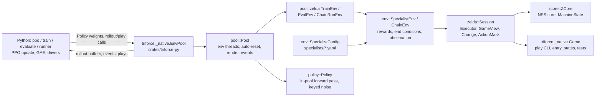

# Triforce v2 architecture and module contracts

Design: `triforce-v2-design.md` (kept outside the repo; decisions that change it go in `docs/decisions.md`).
This file lists the module boundaries and the interfaces between them.

## Crates and Python modules

| Crate / module | Owns |
|---|---|
| `crates/zcore` | Zelda-only NES core (MMC1), cut down from TetaNES (`UPSTREAM.md`), hardware timing. `machine.rs`: `Rom::from_ines`, `ZCore` (`power_on`, `run_frame(buttons, render)`, `pixels`/`rgb`, `ram`/`prg_ram`, `poke`, `snapshot`/`restore` of a `Copy` `MachineState`). `state_file.rs`: `TFZSTATE` `.state` files; gzip (legacy stable-retro) files raise `StateFormatError`. |
| `crates/zelda` | Game model and session, ported from the old Python stack: `vars`/`tables` (RAM variables, game data), `enums.rs` (object ids and `ObjectClass`, the one classifier), `game.rs` (`GameView`: Link, enemies, items, projectiles, hazards), `room`/`room_state`/`tiles` (wavefront, doors, tile grid), `actions.rs` (`Action`, `ActionMask`, `compute_action_mask`), `executor.rs` (option executor: timed options, interrupts, uncontrollable skip), `blocks.rs` (shield collisions), `change.rs` + `ledger.rs` (`Change`, look-ahead `FutureCreditLedger`), `cheats.rs`, `room_entry.rs`, `game_map.rs` (`game.yaml`/`routes.yaml`), `objectives.rs` (`GameCompletion`), `hearts.rs`, `linger.rs`, `visits.rs`, `session.rs` (`Session`). The `Nes` trait (`nes.rs`) abstracts the core so tests can run on zcore or a scripted double. |
| `crates/env` | `config.rs` (`SpecialistConfig`, `GameData`, cross-file validation), `rewards.rs` + `critic.rs`, `end_conditions.rs`, `observation.rs` (`ObservationBuilder`, schema v2), `objective.rs`, `start_states.rs`, `curriculum.rs`, `specialist_env.rs` (`SpecialistEnv`), `chain.rs` (`ChainEnv`, `Route`, `RoomRecord`, `RunResult`), `explore.rs` (`Explorer`, `AcceptSpec`). |
| `crates/pool` | Generic threaded `Pool<E: PoolEnv>` (`pool.rs`), buffer layout (`layout.rs`), frame pacing/render control (`control.rs`); `zelda/` holds the Train/Eval/ChainRun envs and pool events. |
| `crates/triforce-py` | `triforce._native` (PyO3): `Game`, `GameState`, `Change`, `Snapshot`, `Env`, `EnvPool` + `TrainTask`/`EvalTask`/`ChainTask`, `Policy`, `keyed_noise`, `SpecialistConfig`, `CurriculumSpec`, `Explorer`/`AcceptSpec`/`explore_states`, `Replay`/`ReplayPlayer`/`replay_verify|stitch|truncate`, `ReplayFeed`/`ReplayScreen`, `route_steps`, `routes`, `route_alternates`, `game_rooms`, `families`, `specialist_for`, `paths`, `OBS_SPEC` and other constants, exception types. |
| `crates/movie` | `TFMOVIE` input movies and `TFGOLDEN` per-frame digests. |
| `crates/replay` | `TFREPLAY` recordings: the format (`format.rs`), `Recorder`, the reader `Replay`, `stitch`/`truncate` (`edit.rs`) and, with feature `zcore`, `Player`/`verify` (playback on the emulator alone). No dependency on `zelda` or `env`. |
| `crates/theater` | Replays for watching: `queues.rs` (`Queues`: `success`/`stuck`/`died`/`random` first-in-first-out and `best`, the top runs seen), `feed.rs` (`Feed`: the background thread that files every finished run of a `Producer` and pauses it while nothing is wanted), `screen.rs` (`Screen`: one thread per cell playing a replay at a frame rate, one cell heard), `speaker.rs` (`Ring`, `Speaker`: the sound device, `cpal`), `overlay.rs` (the controller drawn into a frame). Knows replays and the emulator only. |
| `crates/policy` | `Policy`: the network's Rust copy that acts inside the pool (forward pass, masked heads, keyed Gumbel noise `noise.rs`). |
| `crates/tools` | The `tf` CLI (below). |
| `triforce/` (Python) | `ppo.py`, `rollout_buffer.py`, `metrics.py`, `model.py`, `train.py`, `evaluate.py`, `runner.py`, `replay.py`, `golden.py`, `provenance.py`, `run.py`, `cli.py`, `play.py`, `play_grid.py`, `play_view.py`, `video.py`, `explore.py`, `entry_states.py`, `chain_hp.py`, `heart_value.py`, `events.py`, `registry.py`, `plr.py`, `best_of_n.py`, `eval_batch.py`, `select_checkpoint.py`, `jobqueue.py` / `job.py` / `jobs.py` (the job queue, `triforce job`), `testlog.py` (the test suites' timing logs, `triforce test-times`), `inputs.py` (a task's declared inputs, each checked before a run starts) and `build.py` (the sources the built module was built from), round 40; thin `observation.py` (gym space from `OBS_SPEC`), `actions.py` (`Action`, `ActionMask` flat-mask view), `zelda_enums.py` (`ActionKind`, `Direction`, `MapLocation`), `specialist.py`, `paths.py` (`STATES_DIR`, `TRAJECTORIES_DIR`). |

## Processes and threads

Everything runs in one process. Each env owns its own `ZCore`; `Pool` pins envs round-robin to persistent OS
threads and steps them without the GIL. The agent acts inside the pool (`docs/rust-actor.md`): each worker picks its
envs' actions with the Rust copy of the network (`crates/policy`, one per specialist; `ZeldaPolicy.to_native()`),
by its act mode (`docs/rust-actor.md` "Act modes": `sample`, `argmax`, or a rule over the joint distribution such
as `floor:0.03`, optionally another for low health, `+low:H:MODE`, read from Link's hearts before each decision, and
foresight, `+guard:K` / `+plan:K:S[:R]`: the decision's action tried in the emulator first (`Session::trial`) and
replaced by the next of K when it would lose health; every draw uses Gumbel noise keyed to (episode job,
decision)). The job is an eval job's or chain run's seed, or a per-episode key in training, so an episode plays the
same on any env or thread.
Training makes one `rollout(policies, T, buffers)` call per rollout: every env steps `T` decisions and the buffers
get, per env, the `T + 1` observations, the actions, the Rust policy's log-prob/entropy/value, rewards, frames,
episode starts and bootstrap values. Evaluation, chains and the watch player's simulations call `play(policies)`:
every env acts
on its own until its jobs run out (`active`, `wait_idle`); with `record='actions'` each finished episode comes
back from `poll_plays()` (actions, per-decision log-prob/entropy/value, optionally the observations), and a pool
built with `record=` reports every finished run as a `replay` event (Replays, below). Envs auto-reset after a
terminal step; terminal infos, eval records,
chain results and room-change events come from `poll_events()`. Env `i` seeds a `ChaCha8Rng` from `(seed, i)`
(seeds < 2**63). A usage error of an actor or planner fails the call, not the env; a `rollout` with no active env is
an error; rollout buffers must be C-contiguous and only known keys are accepted. `close` (or Ctrl-C) stops a
rollout before its next step and a searched rollout between simulations.
Rendering (full 256×240) is off by default and toggled per env with `set_render`; `frame(env, since)` copies the
latest frame. Tools and tests that need a single game use `triforce._native.Game`.

## Core

| Item | Contract |
|---|---|
| `zcore::ZCore` | One NES. `run_frame(buttons, render)` runs one frame with the raw NES button byte; with `render=false` no pixels are written but timing is identical. `ram()` 2 KiB, `prg_ram()` 8 KiB; `poke` only `$0000-$07FF`/`$6000-$7FFF`. |
| `zelda::actions` | `ACTION_SCHEMA_VERSION` (3); `ActionKind` = MOVE, WAIT, SWORD, BEAMS, BOMB, BOOMERANG, ARROW, CLIP, RECORDER, FOOD, CANDLE (head indices 0-10; round 24 added the last three after CLIP, every older index kept); `DIRECTIONS` (N,S,W,E,NW,NE,SW,SE); `DURATIONS` (4,8,16,32). `Action` with index conversion and text parsing (`MOVE N 16`, `CLIP W`: CLIP is directional, cardinal, untimed; `RECORDER` takes no direction and no duration; `FOOD W`, `CANDLE N` are cardinal, untimed). `ActionMask` with `kind[K]`, `direction[K,8]`, `duration[K,4]`; flat form bool[`MASK_SIZE`=143] = K + K·8 + K·4 (K = 11). A kind whose direction (or duration) row is all False doesn't use that head. Python `triforce.actions` keeps `Action`/`parse`/index helpers and a read-only `ActionMask.from_flat`. |
| `zelda::executor` | `Executor::execute(action, state) -> OptionResult(frames, interrupt, control_frames, projectile_blocks, clip, menu_frames)`; blocks count confirmed shield collisions in executed frames, including attack/settling/uncontrollable frames. Attacks are played with the controller alone ("Attacks by buttons" below): no memory is written; an attack the buttons can't make from the state presses nothing. An attack press the game didn't read (a lag frame) is held one more frame. A BOMB, BOOMERANG, ARROW, RECORDER, FOOD or CANDLE whose item isn't the selected one first chooses it on the item sub-screen; those frames are `menu_frames` (inside `frames`). RECORDER then presses B and waits out the tune's freeze (`FluteTimer` `$3C`, 151 frames without a play update after the press: also `menu_frames`; "Item kinds" below). A CLIP runs the grid-point skip macro ("Grid-point skip" below; MOVE never does); `clip` reports its `ClipOutcome`. |
| `zelda::Session` | `load(state, LoadOptions { randomize_rng, fresh_room, controllable, overrides }, rng)`; `randomize_rng` writes a natural RNG state and the spawn draws right after the restore ("Randomness at a start" below), `rng_phase()` reports the phase, `write_rng(phase)` writes one at the current frame (a chain checkpoint's redraw); controllable curriculum frames are not advanced before the first action; normal entries gain control through their transition. `act(action) -> Change`; `state()`, `mask()`, `snapshot()`/`restore()` (restore sets `steps`/`total_frames` from the snapshot and clears the look-ahead ledger; `checkpoint()`/`resume()` also keep the frame counter and the ledger), `set_render`, `set_frame_sink`, `capture_pre_entry`/`last_pre_entry`, `set_disabled_kinds`, `set_clips` (both recompute the mask when they change). `just_exited_cave` is set on any cave or dungeon mouth (live entries and loaded states alike) and clears when Link's tile changes. Python: `triforce._native.Game` (`set_clips(enabled)`, `skip_available(direction)`, `Change.clip`). |
| `zelda::Change` | previous/current `GameView`, action, frames, menu_frames, interrupt, health lost/gained, enemies hit/stunned, items gained, changed location, gained triforce, action mask, executed projectile blocks, the skip's `clip` outcome; `observed.enemies_killed`: slots whose monster died in the step, counted by the game's `RoomKills` or not (a Vire's Red Keese, Gleeok's heads), which restart the room-stall count. `frames` are the frames that count against the action: the option's minus its paused or frozen frames (`menu_frames`: the item sub-screen, the recorder's tune). Discounting (`StepInfo.frames`, the pool's `Outcome.frames`, `rollout_buffer.py`), the frame penalty, the observation's history `frames`, heart timers and linger use `frames`; counts of frames played (`Session.total_frames`, `episode_frames`, visits, chain records, the pool's emulated frames, replays) add `menu_frames` back (`StepInfo.menu_frames`, Python `Change.menu_frames`, info `menu_frames`). Look-ahead credit via `FutureCreditLedger` does not add simulated blocks; a weapon that finishes drops its unused predictions; the look-ahead keeps the action's last rendered frame (`Game.screen()` works right after it). |
| `triforce-py/describe.rs`, `play.py` | Text dumps (`Game.describe_state/describe_change`) and the interactive `python -m triforce.play` tool. |

Objects are classified once (`zelda::enums::ObjectClass::of`, from the game's `Obj_Update` jump table) and
`GameView`, the executor's interrupts, `room_state` and the observation share it: `enemies` are monsters only;
`projectiles` are monster shots ($53–$5C); `hazards` hold boulders and the boulder generator ($20/$1F), traps
($49/$4A), Bubbles ($2B–$2D), standing fire ($40) and Gleeok's flying heads ($46), which hurt but can't be hurt
and are not fight targets; people, dropped items and tile objects are in none of the lists. The observation's
"hurts on touch" flag follows the classifier; HP, stun and killable are monster-only. The executor interrupts on
anything that can hurt Link except standing fire and the boulder generator. A slot that empties because a hazard
destroyed itself or a Zora dived is not a kill. Gleeok (Nov 12, `zelda::game::gleeok_heads`): his neck base in
slot 1 never dies, so `GameView` files it under `hazards` and the observation marks it not killable; his attached
heads have no slot of their own (slots 2–6 are type 0), so `GameView` and the observation add one enemy per living
neck (id $42, slot 2 + neck) at the head's neck-array position, with slot 5's shared HP; a hit on that HP is
credited once.

The action mask (`zelda::actions::compute_action_mask`) offers only what the game would do. An attack is legal
only where the game would start the weapon (Link's state allows it, the weapon's slot is free, the sword isn't
blocked: `$4C`/`$52E` mask SWORD and BEAMS) and the buttons can make that strike from where Link stands
(`GameView::attack_directions(kind)`, `sword_directions()`; `zelda::attack::plan`, below). A B item (BOMB, BOOMERANG,
ARROW, RECORDER, FOOD, CANDLE) that isn't the selected item also needs the item sub-screen to open
(`zelda::submenu::can_open`: a play mode, not paused, no flute tune or candle brightening).

### Item kinds: RECORDER, FOOD, CANDLE (round 24, version 1.4.2.0)

Three B items, each chosen on the real sub-screen by buttons (slots 5, 6 and 4) and used with B like a bomb; no
memory is written (decisions 2026-11-14 "Three item kinds and the model conversion"):

- **RECORDER** (no direction, no duration). Offered where `actions::recorder_wanted`: a dungeon room in play that
  holds a big Digdogger (`$38`/`$39`) and hasn't heard the recorder since Link came in (`FluteUsedState` `$51B` = 0),
  with the recorder held (`$65C`), no tune playing, the sub-screen able to open (or the recorder selected) and B
  surviving Link's facing's border band (no turn: in a doorway it isn't offered). The executor selects it, presses
  B and waits while `FluteTimer` runs: the big one starts its shrink inside the freeze and splits on the first play
  frame (B+152, scout D5Boss); the 151 frames without a play update are `menu_frames` (no input, no movement, no
  hit: only the NMI's frame timers run, so a bomb's fuse burns meanwhile). On the overworld it summons the
  whirlwind or drains 0x42's pond: there only a route step offers it (round 26, "The leg to Dungeon 7" below).
- **FOOD** `<N|S|W|E>`: the bait in slot `$0F`, `$10` px ahead of Link once he faces the direction (one turn
  frame, as BOMB). Offered with the food held, slot `$0F` empty (no boomerang out, no bait down) and (round 26) a
  Grumble waiting for it (`actions::food_wanted`: slot 1 type `$36` in its state 1, its text typed); never used up.
  While placed food lies (slot `$0F`'s state bit 7, `actions::food_lies`) BOOMERANG is not offered: the throw would
  take the food away (asm:Boomerang_Wield).
- **CANDLE** `<N|S|W|E>`: a fire in slot `$10`/`$11` ahead of Link that moves on 16 px and stands (about 94
  frames). Offered with a candle held, a free fire slot and, blue, no fire yet in this room (`HasUsedCandle` `$513`).

Every family has them off: `items: {recorder: true, food: true, candle: true}` (`env::config::ItemsConfig`, default
false) turns one on. `penalty-attack-miss` charges none of them (CANDLE's fire hits later, like a bomb); no
look-ahead or other critic term was added. The observation spells their mask bits out (`link`'s
`recorder_usable`, `food_usable`, `candle_usable`), as `bomb_usable` and `clip_usable_*` do: whether the room heard
the recorder or a blue candle's fire was used, and the family's switch, are visible nowhere else.

BOMB follows the acting family's `items: {bombs: MODE}` (`env::config::BombUse`, the owner Nov 11; in `SpecialistEnv` and
chains, recomputed every step): `never`; `tenth`, only for the 10th damage-free kill (`$50` HelpDropCount = 9: a
bomb kill then arms a forced drop of 4 bombs, `asm:Damage_KillMonster`); `required`, in game.yaml `requires_bombs`
rooms and the 10th kill; `free`, wherever Link holds more bombs of his own than the route's bomb reserve (routes.yaml
`bomb_reserve`, `GameCompletion::bomb_reserve`: 6 from Dungeon 3's entrance, 2 from Dungeon 4's, 3 from Dungeon
7's; 0 on the steps of the fights the bombs are kept for: 3:0x5b's last pass, Manhandla, the Olive Garden,
Digdogger, Dungeon 7's Aquamentus), at the wall of a `requires_bombs` room whatever he holds, in Dodongo's room
(`requires_bombs`, no wall) always, and the 10th kill (whatever the reserve). Families: `free` goriya, darknut,
moldorm, boss-dodongo, boss-manhandla, boss-digdogger, vire; `required` ow-tektite, ow-octorok, trap-room,
stalfos-keese-gel, gibdo, dodongo-crossing; `never` boss-gleeok; `tenth` the rest.

**BOMB kept to the wall** (`ItemsConfig::bomb_targets`, `Session::set_bomb_targets`; round 22): BOMB only where the
bomb lands in reach of what the objective leaves through (`zelda::objectives::route_bomb_targets`: the intact bomb
wall of the route's exit, 0x2c's and 0x67's rock walls; nothing while the objective fights first or leaves another
way; `zelda::bombs::landing`, `BombTarget::in_reach`: a dungeon wall within `$18` px of its hotspot, a rock wall
within `$10`) and, since round 23, not while one of Link's bombs (slot `$10`/`$11` in state `$11`-`$14`,
`zelda::bombs::live_bombs`) already lies in reach of that wall: the wall test comes once, when that bomb's blast ends
(`asm:Bomb_TryOpenWall`), so a second bomb only spends a bomb (`BombTarget::awaits_bomb`). It holds in a
`requires_bombs` room, in every mode but `never`:

- for a `required` family (round 22);
- for a `free` family while Link holds no more bombs of his own than the reserve, in a room whose bomb is for a wall
  (`zelda::cheats::bomb_opens`), the wall open or shut (round 26: the reserve means the same inside a bomb-wall room
  as outside; before, such a room was free ground whatever the reserve);
- for every family while the cheat ledger holds a granted bomb there (`CheatLedger::granted`; round 26, decisions
  2026-11-17 "A granted bomb opens the wall and does nothing else"): the granted bomb opens the wall and does
  nothing else. Not in Dodongo's room (no wall: the granted bomb is the weapon, the owner's Nov 8 rule).

The 10th damage-free kill lifts the first two limits (that bomb pays itself back), not the third: a granted bomb is
not spent on a monster even for a forced drop. The game's own rule comes first (bombs held, a free slot, an enemy or a bomb wall) and BOMB stays legal at an
unopened overworld rock wall. MOVE N at the overworld top edge scrolls; a key works only at the
room bound next to the locked door; a push counts only when Link is aligned with the block and the room is clear;
an opened bomb wall is passable. Off the grid on a cave or dungeon mouth only MOVE S is legal (any other move walks
Link back in). MOVE E past the overworld's right bound (X `$F8`, where a screen wrap or an aborted one leaves Link)
reads the tile under him (no look-ahead at X >= `$F0`), and N/S there read column `$1F` and the bytes after the tile
map (`$67F0` on) as column `$20`, as the game does.

### The leg to Dungeon 7 (round 26; `docs/routes/d7.md` §11; steps 209-247 of `d2first`)

The whirlwind, the shops, the Armos and the pond are no executor macros: the model presses the buttons through its
own actions (MOVE, RECORDER, FOOD), and the rules live in the mask (an action is offered only where and when the
route step wants it) and in the objective (targets, outcomes).

- **Step types** (routes.yaml): `exit: recorder` (0x0b, out of Dungeon 5) and the next step's `entry: recorder`
  (0x45, where the whirlwind sets Link down; `game_map::WHIRLWIND_LANDINGS`, `check_whirlwinds`). Its target is
  Link's own tile on the coming whirlwind's row, the landing room the correct exit; a whirlwind that came and went
  (`zelda::whirlwind::Plan::Missed`) comes again only on a new room entry, so then the room's edges are retreats.
  `waypoint: arrows` / `waypoint: food` on a shop's cave step: buy the cave room's game.yaml `treasure` at its
  `treasure_tile` (the target; `path_costs` keep the path off the other wares' squares, which a walk across buys);
  done once Link holds it (`InvArrow` `$659`, `InvFood` `$65D`), `missed` on leaving the room without it or when the
  shop's flag is set during the visit without it (another ware bought). `waypoint: candle` (7:0x4a's cellar) as the
  bow. game.yaml `entrance: {how: armos|recorder, tile}` is the room's `Secret`: an `exit: cave` there targets the
  Armos statue's W and E stand tiles (tile ± 2 columns), or the pond's shore (`objectives::pond_shore`: its stairs lie
  in the water, out of the path search's reach), until the stairs show, then the stairs.
- **Dock warps** (round 36, `d3first` since 2.0.0.5; round36.md "How the warps are played"): unlike the whirlwind
  above, an executor macro. A step `exit: recorder` in a dock room (`game_map::DOCK_ROOMS`: 0x55, 0x3f) followed by `entry:
  recorder` into its landing (`game_map::dock_landing`: 0x34, 0x31, one row above the level's
  `Whirlwind_PrevRoomIds` stand-in room; `check_whirlwinds` accepts it after a dock room, `objectives::route_entry`
  maps the jump to `recorder`) is a dock-warp step (`GameCompletion::warp` gives `whirlwind::Warp::Dock`;
  `Session::set_warp`, set every step by chain and specialist envs). Its mask (`zelda::session::dock_warp_mask`)
  leaves MOVE S on the dock below its trigger (SWORD S instead while a monster stands on the land below), CLIP N where
  the block clip into the water is legal (`zelda::clips::dock_clip_at`), and RECORDER on the water spot
  (`clips::dock_spot`: 0x55 X `$78`, 0x3f X `$58`; WAIT instead while a shot is in the air); elsewhere the family's own
  mask, and a MOVE W/E on the step stops on the clip's column. RECORDER there is `Executor::run_warp` (in the water):
  the plays the index needs from `whirlwind::plays` (N for a step up, W for a step down, a one-frame turn before the
  B), then nothing pressed until the pickup (`$522`), the whirlwind gone, or an interrupt. The objective targets the
  clip's G tile. A whirlwind out of a dock room into any other room ends a chain run `stuck` (`dock-warp-missed`).
- **Engine macros by route** (round 40, the fresh generation; routes.yaml's top-level `macros:`, `game_map::Macros`,
  docs/routes/d3first.md "The engine's macros"; the owner's rule: a fixed button sequence offered as one choice,
  masked by Link's position only, never by a monster or a shot). Both off on `d3first` as landed (today's networks
  were trained without them). `whirlwinds: [rooms]`: on those `exit: recorder` steps (not a dock) `GameCompletion::warp`
  gives `Warp::Whirlwind`; the session offers RECORDER wherever `whirlwind::macro_facing` finds the sequence playable
  from where Link stands (plays to make, the recorder playable, a facing that starts the sequence reached by the input
  model `attack::plan`, Link's own first, else the fewest turn frames, left or right first), whatever he faces; the
  executor turns him (`attack::next`'s RECORDER with a direction turns as FOOD), plays, and `Executor::run_warp` (on
  land: no turn while his facing makes the play, else E or W) plays the rest and waits for the pickup.
  `unaided_docks: true`: `Warp::Dock { unaided }` swaps `dock_warp_mask` for `unaided_dock_mask`: the same plays added
  to the family's own mask where Link's position lets them work (MOVE N/W/E taken off the dock below its trigger), no
  give-way. Tests: `crates/zelda/tests/whirlwind_macro.rs`.
- **Masks.** RECORDER (`Session::set_recorder_facings`, set every step from `GameCompletion::recorder_facings`):
  on the whirlwind step only facing the way the next play must step the game's counter (`TeleportingLevelIndex`
  `$523`: +1 facing right or up, -1 left or down, then on past the levels whose piece Link lacks; only the first play
  of a room entry makes a whirlwind, `$508`), while plays remain (`whirlwind::plan`, computed from the counter, never
  assumed: out of Dungeon 5 with the counter at 0, two plays facing down); at the pond while the objective heads for
  its stairs and the pond is full (it fills again on every visit); in a dungeon only while the objective fights a big
  Digdogger that hasn't heard it (5:0x24, 7:0x1c; never 7:0x39, which Link only crosses). FOOD and BOOMERANG as in
  "Item kinds" above. MOVE E or W into a secret Armos (`GameView::is_secret_armos_direction`: a room with a `cave`
  exit, the statue's tiles `$C0`-`$C3` still standing, Link on a grid point pressing into it from its side; from
  above it wakes too but costs a heart, and the statue is a wall to `can_link_move`). ARROW is off in every family
  (`items: {arrows: false}` default, `env::config::ItemsConfig`); a family that turns it on shoots only while Link
  holds more rupees than the route's `rupee_reserve`.
- **Reserves.** routes.yaml `rupee_reserve: N` (as `bomb_reserve`; `GameCompletion::rupee_reserve`): rupees kept
  for the route's arrows, 2 from the arrow shop on.
- **The room view** (`GameView::room`): the game's raised walkable limit (`RoomFirstUnwalkableTile` `$34A` = `$99`
  after 0x42's drain, `Room::with_first_unwalkable`; every start state holds the defaults) makes the drained pond
  walkable; an opened bomb hole is a doorway whatever its rim tile (`Room::with_open_doorways`: the game lets Link
  through by its door type, asm:Doorway_CheckLink; the N and W rims are unwalkable tiles). The doorway changes the
  path search and so the `target` input and PBRS after a bomb in every N or W bomb wall (7:0x69 N; on `d2first`
  4:0x21 N, 4:0x11 N).
- **States and segments.** The entry side `r` names a state entered by the whirlwind (`0_45r_<chain>`; the dock
  landings `0_34r`, `0_31r`, whose first frame faces N with the whirlwind still in the room: `entry_states.entry_side`
  reads any level-0 entry with a whirlwind in the room as `r`;
  `entry_states.ENTRY_SIDES`, `StateName`). The stretch is part of `d2first` (decisions 2026-11-17: the scouting
  route `d7` was merged before any state was built), so its segments are two more of `eval_batch.SEGMENTS`:
  `post-d5` from `0_0bc_0` (arrival: 7:0x79) and `d7` from `7_79s_0` (the D7 triforce; arrival 0:0x42 entered after
  7:0x2b since round 27 runs on); `d5` arrives
  at 0:0x0b entered after 5:0x14, and a run of round 25's full route is `--stop-at step:209`. Room-stats has the
  scopes `to-d7` and `d7`. The start states of steps 209-247 (114: 38 a chain) come from
  `scripts/experiments/r26_d7_states.py sources` (the D5 triforce-room states with the bombs a run brings: 3, 4
  and none) and `entry_states build --start-step 208 --source ... --skip-fights 7:0x1b:W` (the one fight the
  explorer cannot clear; the 21 states after it are `fight_skipped`), the plain way of `dock-44` by `entry_states
  path`; their curriculum tracks from `scripts/experiments/r26_d7_curricula.sh` (`docs/experiments/round26.md` §7-8).
- **goriya's clips.** `clips: true` on goriya is for 7:0x1a's block clip to the candle cellar's stairs. `clips:`
  has no room list, so CLIP is offered wherever `zelda::clips::skip_target` finds a skip in the family's rooms: by
  `scripts/experiments/r26_clip_scan.py` nowhere in its Dungeon 1 and 2 rooms, and in 7:0x1a, 7:0x29 (the same
  diamond), 7:0x18 (ladder clips over its water) and 7:0x2b (round26.md §9).
- **Walked** (`crates/zelda/tests/d7.rs`, from `5_14s_0`, monsters removed): every step and its rule asserted, to the
  D7 triforce; beside it a wrong ware is `missed`, the rupee top-up, the whirlwind mask for seven counter and piece
  cases, the Armos from either side.

### The magic sword and Dungeon 6 (round 27; `docs/routes/d6.md` §14; steps 248-280 of `d2first`)

The same rule as for the leg to Dungeon 7: no macros. The gravestone, the sword, the doorways and Gohma's arrow are
played by MOVE, BOMB and ARROW; what is new lives in the objective (targets, outcomes), in the mask, and in where a
MOVE ends.

- **Route** (routes.yaml): steps 248-280 of `d2first`, which ended on the D6 triforce until 1.9.0.0 (built as the
  scouting route `d6` = `{extends: d2first}`, merged in round 27; decisions 2026-11-19; segments `post-d7` from
  `0_42c_0`, arrival 6:0x79, and `d6` from `6_79s_0`, arrival 0:0x22). The steps (the stretch `woods`: the wrap
  exit out of 0x51 into 0x50, or 0x51 S, the Lost Woods by `exit: maze`, 0x60, 0x50 from S; the graveyard; 0x21 and
  its cave; 0x31, 0x32, 0x22; Dungeon 6's sixteen steps). `waypoint: sword` on the magic sword's cave step
  (`objectives::WAYPOINT_SWORD`): done once Link holds the cave's sword, `missed` on leaving the overworld room
  without it or on standing in the cave with fewer heart containers than `SWORD_UPGRADES` asks (the old man refuses
  under 12). `GameCompletion::sword_target` (the sword milestone that leads a Link who may take a better sword to its
  cave from anywhere) keeps to sword caves the route enters by a step without a waypoint (`sword_caves`: the wood and
  white swords); a waypoint cave is a stop in route order, and a sword cave the route never enters is no target.
- **The pushed gravestone** (`game_map::Secret::Push(tile)`, game.yaml `entrance: {how: push, tile}` in a room with a
  `cave` exit: 0:0x21). `GameCompletion::cave_tiles`: the stairs once they show, before that Link's tile two rows
  under the stone. `GameView::is_secret_push_direction(N)` (the stone's four tiles `$BC`-`$BF` still there, Link on
  the grid point under it on its column) makes the mask offer MOVE N there. `Executor::run_timed` holds the press as
  for a push block while the stone slides (`GameView::secret_push_sliding`: tile object `$65` in slot `$0B` off its
  square) and **ends the MOVE when Link stands on the uncovered stairs square** (a MOVE N from the stairs presses
  nothing either): two frames later the game takes him down. The stairs are not kept by the game (the stone is back
  on every entry, room flag `$20` notwithstanding), and nothing here remembers them.
- **Where a MOVE ends without another frame of its direction** (`Executor::run_timed`, before every frame of a MOVE):
  (1) on an overworld grid point whose next tiles in that direction are gravestone tiles (`game::is_gravestone_tile`;
  one frame of pressing there releases a flying Ghini, asm:Spawn_CheckTouchedArmosOrGravestone; the secret stone
  from below is the one exception, on the action's first frame); (2) on the stone's stairs; (3) at the mouth of a
  dungeon doorway the session vetoes (`Executor::vetoed_doorways`, `game::at_doorway_mouth`: at the room's bound on
  the doorway's line, on a grid point, not in a doorway). The interrupt is `Wall`. None of the three can happen in a
  room of `d2first` before step 248 (no gravestone tiles, no Push secret, no `keep_out` exit).
- **Masks** (`Session::compute_mask`; the env sets both every step in `update_disabled_kinds`, training and chains):
  `set_vetoed_doorways(objectives::doorways_kept_out(map, state, objective))`: game.yaml exits with `keep_out: true`
  (6:0x28 N into Gleeok's room, 6:0x29 N, a key door that takes a key on one frame of pressing, 6:0x2c S into a room
  of five Wizzrobes that shuts) whose room the objective neither leaves toward nor counts as a retreat: no MOVE into
  them from the mouth. `set_arrow_facings(GameCompletion::arrow_facings(state))`: N while a Gohma lives
  (`objectives::gohma`), None elsewhere; the family switch (`items.arrows`, on for boss-gohma only) and the rupee
  reserve apply as before. Which frame to shoot on is the model's (the eye's state and Gohma's offset are schema 6
  columns); a miss costs its rupee.
- **Gohma's target** (`objectives::gohma_stand`, used by `dungeon_room_objective`'s fight): the tile on the row Y
  `$AD` that holds X = Gohma's X − 3, every X of which is inside the walked kill window (Link's X − Gohma's X in
  [−10, +5]); it follows Gohma. After the kill the heart container and the N shutter by the room's `treasure` rule.
- **Data** (game.yaml): 0:0x21's `cave` exit, its cave room with `treasure: magic-sword`, and `path_costs` (out of
  the cave by row Y `$7D` and column X `$20`: the room's Ghini is made under the exit spot); 6:0x28
  `requires_bombs` (BOMB for the `required` wizzrobe family only in reach of its E wall); 6:0x1c
  `requires_rupees: 2` (`cheats::rupee_need`: in a dungeon room the need lasts while its Gohma lives). Reserves
  (routes.yaml): bombs 2 from 0x42, 1 from 6:0x29; rupees 2, 1 from 6:0x1c.
- **Families**: new `ow-ghini` (the graveyard and the sword cave), `wizzrobe` (6:0x78, 0x28, 0x29, 0x2c, 0x38,
  0x3a), `boss-gohma` (6:0x1c), with start states since the states step (round27.md §5-6); the
  stretch's other rooms joined ow-moblin, ow-lynel, stalfos-keese-gel, zol, trap-room, vire, like-like and
  equipment-room.
- **Walked** (`crates/zelda/tests/d6.rs`, from `7_2bw_0`, monsters removed but Gohma): to the D6 triforce by the
  objective and the masks, each step's rule asserted; beside it the plain way of `woods`, the cave's refusal, a
  gravestone never pressed, the three doorways.

### The leg to Dungeon 8 and Dungeon 8 (round 28; `docs/routes/d8.md` §15, scouting route `d8`)

The same rule again: no macros. The whirlwind, the tree and the walls are played by RECORDER, CANDLE and BOMB; what
is new lives in the objective (targets), in the mask, and in which bomb mode a step plays under.

- **Route** (routes.yaml): `d8` = `{extends: d6}` plus steps 281-296, one way (no stretch). A step may carry
  `bombs: never|tenth|required|free` (`game_map::STEP_BOMBS`, `RouteStep::bombs`): its own bomb mode, see below.
- **The burned tree** (`game_map::Secret::Burn(tile)`, game.yaml `entrance: {how: burn, tile}` in a room with a
  `cave` exit: 0:0x6d). `GameCompletion::cave_tiles`: the stairs once they show, before that the three tiles E and
  the three W of the tree on its row. `GameView::secret_burn` is the tree while it stands (no stairs tile in the
  room); `GameView::burn_facings` the facing a fire made where Link stands would burn it from (W from the tree's X
  + `$18`..`$2F`, E from − `$28`..− `$11`, within 8 pixels of its row; walked, `d8-walks.md` §1.3);
  `GameView::link_fire_burning` whether a fire of his is out (slots `$10`/`$11`, state `$2x`). The room flag keeps
  the stairs; nothing here remembers them.
- **Masks** (`Session::compute_mask`; the env sets them every step in `update_disabled_kinds`, training and chains).
  `set_candle_facings(GameCompletion::candle_facings(state))`: on the overworld `burn_facings` while the objective
  heads for the stairs (`ObjectiveKind::Cave`) and no fire of Link's burns, else nothing; in a dungeon None (the
  family's `items.candle` alone). The bomb mode in force is `ItemsConfig::on_step(GameCompletion::step_bombs(state))`:
  the step's `bombs:` while Link is in the step's room, else the family's; `disabled_kinds` and `bomb_targets` read
  that (8:0x6e: boss-manhandla, `free`, plays the room under `required`: BOMB only in reach of the N wall).
  RECORDER at 0x22, ARROW in 8:0x4c and the two `keep_out` key doors (8:0x5e E, 8:0x4e W) are the rules of rounds
  26 and 27 with new data.
- **`stuck` under a hold** (`env::end_conditions::EndCondition::Timeout`, single-room episodes): a decision made or
  ended while a Like-Like holds Link (`GameView::link_held`: `IsLinkParalyzed` `$512`) neither counts toward the 50
  decisions in one place nor starts the count anew. `ChainEnv` has no position limit (a chain room ends by its step
  count or its family's no-progress limit; the stall budget is the player's), so chains are untouched.
- **Data** (game.yaml): level 8's ten rooms tagged; `requires_bombs` on 8:0x6e and 8:0x4c; `keep_out` on 8:0x5e E
  and 8:0x4e W; the note on 0:0x5d's S exit corrected (both openings reach the tree; the `span` stays the right
  one). Reserves (routes.yaml): bombs 1 from 0:0x22, 2 from 8:0x5e, 1 from 8:0x3c; rupees 8 from 8:0x4c.
- **Families**: no new one. darknut +8:0x5e, 0x4e, 0x3e, 0x3f; boss-manhandla +8:0x6e; pols-voice +8:0x4c with
  `items: {bombs: required, arrows: true}`; boss-gleeok +8:0x3c; stalfos-keese-gel +8:0x7e, 0x2c; equipment-room
  +8:0x2f; ow-lynel `recorder: true`; ow-moblin `candle: true`. None of the stretch's rooms has start states yet.
- **Walked** (`crates/zelda/tests/d8.rs`): from the D6 triforce (staged by walking round 27's steps from
  `7_2bw_0`) to the D8 triforce by the objective and the masks, each step's rule asserted, Gleeok's heads cut by
  the walk's own swings; beside it CANDLE at both trees, 0x3f at 5 and 4 bombs, the two key doors, 0x6e's BOMB mask,
  0x4c's ARROW at the rupee reserve.
- **Demonstrations** (`scripts/experiments/r28_demos.py`): the walks' scripts as rules over env actions, with a
  scaffold of staged states under `d8` until the stretch has its own (`docs/experiments/round28.md` §5).

### The leg to Dungeon 9, Dungeon 9 and the end (round 29; `docs/routes/d9.md` §13, scouting route `d9`)

No macros here either: the whirlwind, the tree, the walls and Ganon's arrow are RECORDER, CANDLE, BOMB and ARROW;
the new things are an exit kind, step keys, targets and masks.

- **Route** (routes.yaml): `d9` = `{extends: d8}` plus steps 297-354, one way (no stretch). New step keys
  (`game_map::STEP_KEYS`, `RouteStep`): `exit: end` (`END_EXIT`; `check_ends`: the route's last step, a dungeon
  room, on no stretch), `banked_kills: 1-15` (a dungeon room an earlier step of the route is in), `sword: false`;
  new waypoints `ring` and `silver-arrow` (`WAYPOINTS`).
- **The end of the game** (`objectives::game_ended`: game mode `MODE_END` = `$13`, the first frame after Link stood
  in front of Zelda). `GameCompletion::ends_game` is the step with `exit: end`; its objective (`end_objective`) is
  a move to `zelda_tiles`: the tiles on the row 13 pixels under Zelda (object type `$37`), within 8 pixels of her
  X. After the route's last waypoint the end room is the objective's last target (`end_target`), so a return visit
  with nothing left to fetch still has one. `env::end_conditions::EndCondition::GameCompleted` is the ending
  `game-completed` (a success where the family lists it: ganon); `env::chain::Route::final_end` ends a chain run
  "the game ended in ..." as `final_triforce` ends one on a piece; `triforce/runner.py` accepts a route that ends
  on `end`. A replay of such a run is a `win` (`pool::zelda::envs::chain_ending`: by the run's result).
- **What a step is matched by** (`objectives::StepProgress`): the red ring (`GameView::red_ring`) and the silver
  arrow (`GameView::silver_arrow`) join pieces, sword, bow, raft, ladder and recorder. A state that holds one of
  them where the route does not is off the route, as with any of the others.
- **Kept kills** (`objectives::start_banked_kills`): the `banked_kills` of the step a start state's name spells
  (room, side, visit). `SpecialistEnv::reset` and a chain's `--from` write them into the level's kill count for
  the start room after the fresh-room write, so the room's entry makes what the game makes on that visit; without
  the key a start room is fresh as before. The entry-state audit loads fresh and sees the full room.
- **Doors and rooms** (game.yaml): an exit's `never_opens: true` (a shutter with no trigger: `GameMap`'s path
  search does not leave through it); `keep_out` (round 27) on four more key doors; a room's `requires_pieces: N`
  (9:0x66: with fewer pieces the objective is `missed`, as a refused sword cave).
- **Secrets**: `GameView::burn_facings` answers S from within 8 pixels of the tree's X, one to two squares above
  its row (0:0x47); `GameCompletion::cave_tiles` targets those tiles when the tree is entered from above.
  `objectives::route_bomb_targets` knows a rock wall whose cave is a level's entrance (0:0x05: the next room is
  the level's first, which `MapLocation::direction_to` calls S of every overworld room, so it is asked first).
  0:0x17 carries a `path_costs` row under its top water.
- **Fights** (`objectives`): `patra_children`: while a child lives the children are the targets, then the body.
  `ganon` reads his slot and `GanonPhase` (Hidden, Shown, Brown, Dying; from `ObjState`, `ObjTimer`, the scene
  phase `$445` and the dying count `$42C`); `ganon_tiles`: hidden, the tiles a stab reaches a 16-pixel monster at
  his position + 8 from; shown, both jump spots (asm:Ganon_StartXs); brown, `ganon_stand`: the tiles of his row
  and column two squares clear of him; dying, his ashes. The Triforce of Power is the room's treasure (the
  frozen-frames rule takes the fanfare).
- **Masks** (`Session::compute_mask`, set every step by the env, training and chains):
  `set_arrow_facings(ganon_arrow_facings(...))`: ARROW only while he is brown, toward him, with Link's Y − his in
  0..=20 (sideways) or Link's X − his in −3..=17 (up or down), never in Zelda's room; SWORD and BEAMS off on a
  step with `sword: false` (`GameCompletion::step_sword`); `cheats::rupee_need`: game.yaml `requires_rupees: 1` in
  9:0x42 counts only while Ganon lives. BOMB by the rules of round 22 and 28 (`requires_bombs` on 0:0x05 and the
  eight wall rooms; 0:0x07 and 0:0x05 name their step's mode).
- **Data** (game.yaml): 39 rooms of level 9 and the leg tagged; `bomb_secret` on 0:0x05; 0:0x47's cave room.
  Reserves (routes.yaml): bombs 5 from 0:0x6d, one fewer after each wall, 4 again from 9:0x06, 0 after 0x04's;
  rupees 1 from 9:0x76, 0 in 9:0x42.
- **Families**: lanmola, patra, ganon (new, `trainable: false`, no start states); wizzrobe, like-like,
  stalfos-keese-gel, zol, equipment-room and six overworld families widened; ow-zora `candle: true`.
- **Walked** (`crates/zelda/tests/d9.rs`): from the D8 triforce to mode `$13` by the objective and the masks, and
  six side tests (kept kills, the potion, seven pieces, 0x63's doors, the arrow mask, the end).
- **Demonstrations** (`scripts/experiments/r29_demos.py`): the walks' fighters asked once per env action, with a
  scaffold of staged states under `d9` (`docs/experiments/round29.md` §6). **Clips**
  (`scripts/experiments/r29_clips.py`): the engine's skip search offers the block clip in the five ring rooms; no
  level 9 family has `clips:` yet (`d9.md` §13.4).

### Randomness at a start (`crates/zelda/src/rng.rs`, `room_entry.rs`; round 22)

The game's only random source is the 13-byte shift register `$18-$24` (`zelda-asm/mechanics.md` "# Random
numbers"): one step per NMI frame, seeded at reset (`$40`, then 12 zeros), so its value is the number of frames
since reset. From the seed it runs an 88-step lead-in and then a cycle of 32,767 states, the only values a game in
play holds. `zelda::rng::natural(n)` is the register `n` steps after reset (a `u128` stepped `n` times, ~45 µs for
the longest, against ~1 ms for a start state's load: no table); `rng::PHASES` = 88..=32854, each state of the cycle
once; `rng::phase_of`, `rng::on_cycle` read a value back. `crates/zelda/tests/rng.rs` boots zcore and finds the
game's register equal to `natural(steps)` on every frame (reset seeds it on frame 10; steps 87, 88, 32854, 32855 on
frames 119, 120, 32886, 32887; 32855 is 88 again).

Every write a start makes for randomness, made right after the restore and before any frame runs, so the entry
frames, the spawn clouds and the first monster decisions all run on values the game can hold
(`crates/zelda/tests/rng.rs` reads the register on every frame from the restore to 120 frames into play):

| Write | When | Value |
|---|---|---|
| `$18-$24` RNG register | `Session::load` with `randomize_rng` (start states: training resets, evaluation, a chain's start state); a chain checkpoint with `redraw_rng` (`Session::write_rng`); search futures (`SpecialistEnv::perturb_rng`, phase from the future's key) | `natural(phase)`, the phase drawn uniformly from `PHASES` by the caller's seeded generator; `Session::rng_phase()` reports a start's phase (a recording keeps it, META `rng_phase`) |
| `$524` SpawnCycle | a pre-entry load with `randomize_rng` | 0-8, every value asm:Spawn_AssignPositions stores |
| `$525` CurEdgeSpawnCell | a pre-entry load with `randomize_rng`, any level (the cell persists through dungeons to the next edge-spawn room) | one of `room_entry::EDGE_SPAWN_CELLS` (41): `$40` (reset's) and the ring cells the search stops on in some edge-spawn room (top left tile below `$84`), derived from zelda-asm/data in a test; never the corners `$E0`/`$4F`, from which the search leaves the ring and places the monster off the screen or never ends |
| room flags, `$560+room` | a pre-entry load with `fresh_room`: the pending room's saved kills | overworld bits 0-2 and dungeon bits 6-7 cleared, `LevelKillCounts` 0: a room never cleared; the room history (`$621-$626`) is left as it is (with the kills clear it decides nothing) |

Before round 22 the register got 13 independent bytes 1-255 (almost never a state of the cycle), the edge cell
any of the ring's 50 cells (the two corners included) on the overworld only, and a fresh room `$FF` (no room id)
in its history slots. The reset's `ram_randomization` (hp, bombs, `help_count`) is no game randomness: it is written
after the entry frames, once Link is controllable, and round 22 left it alone. A power-on start writes nothing.
Stored start states were built by the old loads: 132 of the 364 hold `$FF` in their room history (only ever
compared with room ids, so inert) and 120 an off-ring or corner edge cell (`$E0` in 109; `$10`, `$1F`, `$3F` in
11): a randomized load replaces the cell, a load without it keeps it. Their own RNG registers are all on the cycle.

### Attacks by buttons (`crates/zelda/src/attack.rs`, `submenu.rs`; round 21)

The executor never writes Link's facing (`$98`) or the selected item (`$656`): an attack is the button sequence a
player would press (decisions 2026-11-12, "Attacks by buttons"). `attack::next` picks each frame's input from
Link's RAM and the executor plays it closed loop; `attack::plan` plays the same policy on a model of Link's input
handling (`attack::step`: asm:Link_FilterInput, asm:Link_ModifyDirInDoorway, the grid-point and six between-grid
cases, room bounds, asm:Doorway_CheckLink and asm:Door_Touch, the tile test, the screen and cave edges, the laid
ladder, the q-speed move and grid fix-up) and returns the turn frames, or `explain` says why not (`Refusal`).

| Situation | Input | Turn frames |
|---|---|---|
| Sword, on a grid point (or the strike on Link's own axis) | direction+A on one frame: A is read before the turn and the sword takes Link's facing every frame | 0, no step |
| Sword, off the grid across the strike | hold the direction: the game walks Link on to the next grid point (4+ px out) or back to the one he left, then direction+A | 1-3 |
| Bomb, arrow (they take the facing when B is read) | one frame of the direction (Link turns; a step of 1-2 px if the way is open, none against a wall or on the laid ladder), then B | 1 (+1-3 off the grid) |
| Boomerang | direction+B on one frame: it flies along the held directions (diagonals too) | 0 |
| Facing's border band drops the button (asm:Link_FilterInput tests the axis Link faces) | turn first (one frame), then the button | +1; refused (`Band`) where the strike's own facing is in the band: only a walk out (a MOVE) would do |
| Dungeon doorway (`DoorwayDir` set: input forced onto the facing's axis) | facing into the room: hold the sideways direction, the forced step walks Link onto the room's edge, where he turns | up to ~22; facing out of the room: refused (`Doorway`) |
| A Like-Like's hold, knockback | no turn: only Link's facing (the boomerang still follows the held direction under knockback) | `Held` |
| Input that would leave the room | a cave's edge or cellar's stairs (they test the input), the screen edge on a turn step, a door the turn or the press would unlock (a key) or pass out through (false wall, opened bomb wall) | refused (`Leaves`); walking into an open doorway is allowed |

The item sub-screen (`zelda::submenu`, asm:Submenu_UpdateActive): START, 64 frames (dungeon; 65 overworld) to the
first active frame, one step per frame toward the item the shorter way round the ring (the search skips empty
slots and the bow; alternating the direction and the direction with Up makes every frame a new input), START on
the frame that reaches it, 59 frames of scrolling out: 123 + steps frames in a dungeon, 124 + steps in the
overworld (1 or 2 steps among boomerang, bombs and arrows). The game is paused throughout (only the random numbers,
the frame counter and sound run), the sub-screen is always closed and the game back in mode 5 when the action
goes on.

A returning boomerang caught on a turn frame puts Link in the catch pose (`$20` -> `$21` -> `$31` -> 0), during which
the game reads neither A nor B (asm:Link_HandleInput); the executor waits it out with nothing pressed (at most 32
frames) so the press that follows is a new one.

`crates/zelda/tests/attacks.rs` checks it in the real game: every offered strike over ten rooms' start states and
the positions of a walk through their doorways is made with no memory write and no room change, and no refused
one is made by any hold-then-press sequence but where a walk out of a border band would be needed.

### Grid-point skip (`crates/zelda/src/clips.rs`, round 21)

One frame of perpendicular input 5 pixels short of a grid point T, in the right sub-pixel cadence, lets Link cross
T with no frame starting on it (`zelda-asm/mechanics.md`, "Screen wrap (overworld)" and "Grid-point skip"). MOVE
can't do it, so the executor plays it as a macro (`Executor::run_skip`, `clips::Controller`): every frame it reads
`$70`/`$84`, `$394`, `$3A8` and `$98` and follows mechanics.md's decision table (walk on toward the trick state;
on G with the wrong fraction, on T or lost between G and T, walk away until on G' with offset 0; in the trick state
heading toward T, press one perpendicular frame, Up for W/E with the heading released, Right for N/S; then hold the
heading). No RAM is written and no sword is used. It ends where it should (`ClipOutcome { direction, kind, abort,
presses }`, `abort` None) or aborts: `Interrupted` by a hit, a room change or game over (the option's interrupt;
spawns, nearby monsters, items and doors don't stop it), `Missed` (a press that ends on T backs off and retries, 3
presses at most; a crossing that ends on T never holds the heading there), `Stalled` (4 still frames), `FrameCap`
(200 frames), `Unavailable` (nothing pressed). Frames count like any option's.

`skip_target(state, dir)` / `skip_available` is the one availability rule (mask, executor, observation): mode 5,
Link's state 0, no knockback, and
- **wrap** (overworld, W or E; no ladder out): Link on a row line (Y a grid point; a nonzero offset only along the
  row); within 32 pixels of the bound (X <= `$20` going W, `$D0`..`$F0` going E; the bound itself included); the
  macro's run-up columns of his hotspot row (0-3 W, `$1C`-`$1F` E) and the landing columns (`$1E`-`$1F` after a W
  wrap, 0-1 after an E wrap) walkable and no slow tiles (`$74`/`$75`). T is `$00` (W) or `$F0` (E); the macro ends
  at X `$F0` offset 0 after a W wrap and X `$00` after an E wrap, where the opposite edge's room change is one MOVE
  away.
- **wrap exit** (overworld, E only; round 22): the E wrap's zone, row line and run-up, but with the landing columns
  0-1 solid, so the plain wrap is not offered, and only on the rows of the room's game.yaml W exit with `wrap:
  true` (its `span`, Link's tile rows; `Room::wrap_exit`, `GameView::room`). The macro is the E wrap's, then Left
  on the landing frame (X `$00`, offset 0, `Phase::Exit`): on the bound the overworld fires the W edge test whatever
  the tile, and the room changes; the skip completes with that room change (`run_skip`'s carried-on rule) and ends
  on the new room's first controllable frame, like any room change. The only one is room 0x75 into 0x74 (Dungeon 3's
  entrance, from E), on rows Y `$65`-`$AD`: 0x74's column 29, which the arrival at X `$F0` reads going W, is open
  there; on Y `$55`, `$5D`, `$B5`, `$BD` it is solid and Link would go back and forth between the two rooms (a
  softlock), so those rows are not in the span (`zelda-asm/mechanics.md` "After the wrap, edge by edge"). The session
  has no tile map of a room it isn't in (the zelda crate reads tiles only from RAM; no overworld layout decoder
  exists in the crates), so the safe rows are game.yaml data, every one played by `crates/zelda/tests/wrap_exit.rs`
  (each start of the zone on each safe row into 0x74 and walking on, the softlock rows by buttons, a hit on every
  frame, the action sequence from 0x76's E edge into Dungeon 3: 779 frames, monsters removed). A hit before the
  bound aborts as for the wrap; past it Link stays on the row (X `$F1`-`$00`), never stuck: MOVE W walks back into
  the zone (or, from X `$00`, leaves by the W edge, which finishes the cut skip: `OpenClip::finished_by`). The
  mirrored shape (a W wrap onto a solid right edge, then Right) is not offered: no route needs it. Round 24: 0x51,
  0x3e, 0x0c and 0x60 have wrap exits too; 0x60's is round the world (room id - 1: `MapLocation::direction_to`
  makes 0x5f its W neighbour, entered from E) and lands on 0x5f's water, on rows 9-10 only.
  `wraps_into_wrong_exits` vetoes the wrap exit unless the room behind the W exit is one of the objective's next
  rooms. The room-to-room search (`GameMap::find_all_routes`) never takes a `wrap` exit; a route step may.
- **wrap in** (overworld, round 24): a game.yaml W or E exit with `wrap_in: [lo, hi]` (0x55's W part, cut off by
  the river) is reached only by the plain wrap toward it on those rows (`Room::wrap_in`): the path search jumps from
  the wrap's zone to the landing tile at the opposite edge (`clips::skip_jumps`), the one plain overworld wrap that
  is a jump.
- **overworld ladder clip** (round 24; W, E): in the game's ladder rooms (asm:Ladder_RoomIdsOW, `Room::ladder`), the
  dungeon ladder clip's reach with the screen bounds, no border band and a lay point allowed on water: 0x5f from
  the arrival at X `$F0` (L), T `$E0`, the relay at `$D0` onto the heart's platform, Link ends at `$C0`; 38 frames,
  the heart container taken at `$C8` on the way (`crates/zelda/tests/d5_leg.rs`). The plain overworld ladder works
  as in a dungeon there (overworld water `$8D`-`$98` but `$8D`/`$91`: `Room::is_water`, crossings,
  `GameView::lays_ladder`). Room 0x1f's wall gap (X `$80`, Y < `$56`, asm:Tile_GetAtObjOffset@SetTile) is in the room
  model and the mask. The run-time switch off waits while `objectives::stranded` (no exit walkable, one with the
  skips: 0x5f's water), so the clip way holds there.
- **block clip** (dungeon, N or S; no ladder out): not in a doorway, X on the column line and inside the X border
  band, T the first grid point ahead (at most 16 pixels) whose N/S test is blocked by a square that also blocks 8
  pixels further (a 16-pixel square of blocks, statues or wall, never water `$F4`: with the ladder one square of
  water is no stop (`Room::ladder_axes`), and wider water is the ladder clip's), G' inside the room bounds, the
  run-up cells open both ways, and the clip useful: from T -+ 8 a MOVE W or E is possible **and** the same move from
  T is blocked (the tile it enters is walled off from T; where it is open from T too, the clip only leads back out:
  half a column off a square, an isolated statue), and no stairs
  spot at G', G or T (the warp would take Link down in the middle of the macro). The macro ends at T -+ 8, offset 0.
  Never W or E (from the side the clip leads nowhere). The G' condition is conservative (the back-off always has
  room): it leaves out squares whose G' is past a bound or solid, where a Link on G with the good fraction could
  still clip. In level 1 room `$22` that is only the south block from below (Y `$B5`-`$BD`, G' = `$C5`), a clip that
  would lead back out anyway; the north block from above has no G at all.
- What is offered, tested in the real game (`crates/zelda/tests/clips.rs`): in `$22` 27 grid points, each zone G'..T
  of a square whose clip leads into the diamond (from below the west, east and lower diagonal blocks; from above
  the upper diagonal, west and east blocks) or out of it (from inside, toward the north block; toward the south
  block G' is the stairs spot); from every start of those zones reached by walking, CLIP completes with one press,
  without damage from the traps, and a walk sideways (to X `$80`, then N or S where needed) takes the stairs. The
  west block is the push block: the clip never starts a push (holding N or S against it on T for 16 frames does,
  as in the game). Level 2 room `$7D`: nothing (its statues stand alone, 16 pixels apart: G' is inside the next
  statue and the tiles beside each are open from T). The way through `$22` with button-free actions: `MOVE W 32`,
  `MOVE W 32`, `MOVE W 8` (the corner of the east block), `MOVE S 8`, `MOVE W 8` twice (Link turns on the next grid
  point; the lower-right block stops him on G = (`$A0`, `$9D`)), `CLIP N` (14 frames),
  `MOVE W 32`: in cellar `$7F` 218 frames after the room's first frame, the stairs' transition included.
- Dungeon 4 (the start states under `triforce/states/`, Link put on every grid point out of the doorway): room `$03`
  offers 6 grid points (the zones under its two inner blocks at X `$60` and `$90`, into the side pockets of the
  triforce's enclosure, which the floor reaches as well), room `$50` 60 (20 squares of its diagonal rows), no other
  room (the water rooms `$21`, `$30`, `$31` and the cellar `$60` none). Each of them, CLIP from the grid point,
  completes with one press and the sideways walk from T -+ 8 goes where Link on T can't. In `$50` (entered E, left
  N) `MOVE W 32` twice stops Link on (`$B0`, `$8D`), G of the square above; `CLIP N` (14 frames) puts him at
  (`$B0`, `$7D`) beyond the right diagonal, and `MOVE W 8`, `MOVE N 32`, `MOVE W 16` twice, `MOVE N 32` take him
  to room `$40`: 318 frames from the room's first frame against 424 for the plain way round the diagonal's bottom
  (14 MOVEs), monsters cleared. No skip is offered in a doorway (every door entry of levels 1-9 walked in frame by
  frame).
- **ladder clip** (dungeon, any heading; Link holds the ladder, `zelda-asm/mechanics.md` "Ladder clip"): not in a
  doorway, the offset zero or along the heading; either no ladder out and a monster slot free (the first ladder is
  an object), or a ladder laid along the heading with Link on its line; Link within 16 pixels of T (the laid
  ladder's distance-0 point, where water two or three squares wide stops the plain ladder), standing on land at the
  lay point; the press outside the dungeon border band. **Up**: exactly two squares of water ahead with land beyond
  (one square is the plain ladder's, three need a second press), G' 8 pixels behind the lay point L on land; Link
  ends at L - `$30` with the second ladder put away (4:`$21`: Y `$55`, 8 pixels past the top bound). **Left, right,
  down**: two squares of water then land (he ends at L -+ `$30`, the relay walking on inside the room's bounds) or
  three (a second ladder; L -+ `$40`). At the end, if a ladder he crossed is still out, the macro holds nothing for
  one frame, which puts it away (holding the heading would lay another over more water); a ladder freshly laid ahead
  of him on arrival is left, as after any walk toward water. A miss stops Link on T on the ladder, backs off and
  retries (3 presses at most); a hit aborts it (the damage interrupt), and the MOVE mask models a laid ladder (back
  always, on unless at its distance-0 point, never sideways; MOVE toward water where the game lays the ladder is
  legal), so Link is never left unable to move. Tested in the game (`crates/zelda/tests/clips.rs`): `$21` N from
  every column of the island X `$50`-`$A0` and every start of the zone (both cadences, mid-cell, stopped on T after
  a miss), W and E on rows Y `$8D`-`$9D`, S from the top row back onto the island, each with one press; with the
  five Gels alive a hit aborts and a retry or a MOVE across completes; every offer in Dungeon 4 completes (`$21`,
  `$20` (its ring row 1, from X `$60` Left to X `$20`), a few two-square spans of `$31`; none in `$30`, whose single
  water row is the plain ladder's, and none with a ladder out over one square). CLIP N from G' takes about 44
  frames, from T (where a MOVE N stops) 56 (a back-off first).
- **The route through 4:`$21`** (round 21, `d2first`: in from `$31`'s N door onto the island, out by bombing the N
  wall; `crates/env/tests/clips.rs`, the stalfos-keese-gel config, Gels emptied): `MOVE N 4`, `MOVE N 32` twice
  (Link stops on T, Y `$7D`), `CLIP N` (to Y `$55`), `MOVE S 8`, `BOMB N`, `WAIT` for the blast, `MOVE N 16` into
  the rupee room `$11`: `exit-correct`, 419 frames in 10 actions (the scroll into `$11` included). From the clip's
  end (Y `$55`) BOMB N is legal and spends the bomb but the wall stays shut (the bomb lies `$18` from the wall's
  hotspot, asm:Bomb_TryOpenWall); the objective's bomb spot is (`$78`, `$5D`) (`bomb_spot` uses the spot against
  the wall where the usual one is water).

A specialist's `clips: true` (YAML; default false; `Session::set_clips`, set by the env every step and, in a chain,
from the family of the room Link is in) offers the CLIP kind in every direction a skip is available
(`clips::allow_clips`); CLIP is masked otherwise. A CLIP action always runs the macro (the mask gates the policy, not
the executor); MOVE never performs a skip. With clips on, the path search behind PBRS, linger and the `target`
observation (`Room::wavefront(..., clips)`, `clips::skip_jumps`) treats every block clip and ladder clip as a jump
from each rest position of its zone to its end, at its frames converted to tiles (1.5 pixels a frame, 8 a tile); the
search becomes Dijkstra only when a room has jumps or `path_costs` (below), and the `target` direction follows a
jump on the shortest way.
The overworld wrap is no jump (it ends one MOVE from the opposite edge: a jump would point the way to that edge's
exit out of the entry edge; the round-21 policies learned the wrap without one). The wrap exit is one: the wrap
rows' W edge tiles are W exit tiles of the room (`Room::with_wrap_exit`; solid, walking never reaches them) and its
jumps lead from G', G and the bound on those rows to them, so an objective leaving W points PBRS and the `target`
direction at the E edge on a safe row (never a softlock row); with clips off nothing reaches that exit (no PBRS, no
`target` direction; the room-stall penalty runs on, and leaving any other way is a wrong exit). So in 1:`$22` the
objective targets the stairs (reached through the clip under the east block) instead of the push spots; in 4:`$50`
the way to the N door goes through the diagonal (CLIP N at X `$B0`); 4:`$21`'s island, which no walk leaves, leads N
by the ladder clip.

### The run-time clips switch, route stretches and re-planning (round 22)

Beside the family's `clips:` there is one run-time switch, `clips_allowed` (default on): CLIP is offered only when
the family has clips enabled **and** the switch is on (`Session::set_clips_allowed` / `clips_allowed` /
`clips_effective`, `GameCompletion::set_clips_allowed`, `SpecialistEnv::set_clips_allowed(Option<bool>)`: `Some`
fixes it, `None` draws it per episode; `ChainEnv::set_clips_allowed(bool)`; Python `Game.set_clips_allowed`,
`Env.set_clips_allowed(True|False|None)`). A flip in an env or a chain takes effect at the next decision it builds,
so the observation and mask already handed out stay valid; the mask, the `clip_usable_*` bits (read from the mask:
the switch and the wrap veto are in them, the layout is unchanged), the objective, PBRS, `target` and linger follow
it. Off, the objective takes the plain way inside a room too: 1:`$22` targets the push spots (as a `clips: false`
family) instead of the stairs; 4:`$50` keeps its exit, its `target` features differ (no jump). Tests
(`crates/env/tests/clips_switch.rs`): a flip mid-room gives the decisions of a switch fixed from the start (0x77's
wrap zone, 1:`$22` and 4:`$50` before and after the clip).

**Stretches.** Where the clip way and the plain way go through different rooms, routes.yaml has a stretch: one list
element `- stretch: NAME` with `parts` (the step both ways start from), `rejoins` (the shared step right after),
`clips:` and `plain:` step lists. `zelda::game_map` flattens it into the one numbered route (the clip way's steps
first, then the plain way's, then the rejoin), each step tagged with its `way` and `stretch` (Python
`route_steps()` dicts; `route_stretches()`). Checked at load: both ways start at `parts` and leave it by different
exits, each is a walk of game.yaml exits into the next step, both reach the rejoin with the same progress and bomb
reserve, and no waypoint or triforce lies inside. `d3-approach` (0x67 out of its secret cave, round 22): clips
0x67 S, 0x77 N→W, 0x76 E→W, 0x75 E→W (the wrap exit, `CLIP E`), 0x74 E→cave; plain 0x67 W, 0x66, 0x65, 0x64 E→W,
0x63 E→S, 0x73 N→E, 0x74 W→cave; rejoin 3:0x7c from S (`docs/routes/overworld.md`). `d4-island` (4:`$31` E):
clips `$31` E→N, `$21` S→N; plain `$31` E→W, `$30` E→N, `$20` S→E, `$21` W→N; rejoin `$11` from S
(`docs/routes/d4.md`). `Route::with_clips(map, on, Option<ClipsFlip::{Step, Room}>)` picks the way a run starts
on; `--from` picks the step of the run's way first, then any way (`4_31e` leaves N with clips, W without; `0_67c`
S or W); a `--stop-at` room or `step:N` the run's way never reaches is refused unless the switch flips on the way.
A start state the route enters on one way only fixes the switch (`objectives::start_clips`: `0_77n`, `0_76e`,
`0_75e`, `0_74e`, `4_21s` on; `0_66e`, `0_65e`,
`0_64e`, `0_63e`, `0_73n`, `0_74w`, `4_30e`, `4_20s`, `4_21w` off); a chain `--from` such a state with the other
switch starts as a flip there. `entry_states build` follows the clip way; the plain way's states come from
`entry_states path` (the audit expects both). Exploration (curricula) keeps the switch on unless the state fixes
it, so a plain-only state's track is explored, and replayed, with it off.

**Re-planning.** Off while on the clip way: the plain step of Link's room for the side he came in takes over
(`$31` from E turns W). Where no plain step fits, the objective leads through the exits he can walk to without a
skip, choosing the one nearest by map path to a room of the plain way or the rejoin, and adopts a plain step as
soon as he is in its room and can walk to its exit (0x21's island: back through its S door into `$31`, then W).
No walkable exit leads back: the ordinary off-route objective. On while on the plain way: the plain way holds to
the rejoin (no turning back mid-stretch); anywhere else the clip way at once. Chain `RoomRecord`s carry
`clips_allowed` (the switch at the visit's first decision) and `clips_flips` (`{step, clips}`, step 0 = at the
entry); `RunResult.clips` is the switch the run started with (`crates/env/tests/chain_clips.rs`).

**Counters.** A block or ladder clip whose crossing runs on into the next room counts as `done` (4:`$21`'s CLIP N
through the opened wall into `$11`). An aborted clip that a later MOVE along the same line carries past the clip's
end point counts once in `ClipStats::finished_by_move` (it stays in `aborted`, not in `done`; tested in the game: a
ladder clip cut by a Gel or Keese hit, then `MOVE N 16`). `CLIP_STATS` has 7 fields.

**Wrap veto.** `objectives::wraps_into_wrong_exits` drops a wrap when the objective leaves by the landing edge only
within its game.yaml `span` and the landing row is outside it (0x5b: rows `$B5` and `$BD` vetoed, `$55` and `$5D`
kept); a wrap whose landing edge the objective doesn't use (it goes S) stays.

## Observation (`crates/env/src/observation.rs`)

`ObservationBuilder::new(objective, target)` (`.with_hidden_positions(mode)`, `obs.hidden_positions`, below),
`reset(state, objective, wavefront, mask)`, `build(change, state, objective, wavefront, mask)` (`state` =
`change.state`, or the state a cheat grant rebuilt); the env sets `bomb_reserve` and `rupee_reserve` (the route
step's) before each. `_native.observe(state, rupee_reserve=0)` is one observation of a probe's state from a fresh
builder (no objective, mask or previous action), for probes and tests.
Python sees the layout as
`triforce._native.OBS_SPEC` (`key → {shape, vocab, dtype}`) plus `OBS_SCHEMA_VERSION`, `OLDEST_OBS_SCHEMA` (the
oldest schema whose checkpoints still load, "Checkpoint" below), `ROOM_VOCAB`,
`ENTITY_VOCAB`, `NUM_TILE_CLASSES`, `NUM_ENTITY_SLOTS = 12` and the feature-name tuples;
`triforce/observation.py` builds the `gymnasium.spaces.Dict` the policy uses.

| Key | dtype / shape | Notes |
|---|---|---|
| `room_id` | int64 [1] | index < `ROOM_VOCAB` |
| `room_state` | float32 [89] | per-room flags from `docs/ram-catalog.md`; schema 5 ends with `maze_step` (`MazeStep` / 4 in a maze room, else 0: which loop of the Lost Hills this is); schema 6 adds 4 at its end (below) |
| `link` | float32 [93] | schema 3 ends with `bomb_usable` (the mask allows BOMB: the mask is no network input), `bomb_reserve`, `bombs_spare` (bombs above it), `help_count` (`$50`/10), `next_kill_arms`, `drop_armed`, `drop_is_bombs`, `fairy_next` (`$627` = 15); schema 4 adds `clip_usable_N/S/W/E` (the skip is available and the specialist has `clips: true`); schema 5 `recorder_usable`, `food_usable`, `candle_usable` (the mask allows the kind); schema 6 adds 6 at its end (below) |
| `entity_types` | int64 [12] | 0 = empty slot |
| `entity_features` | float32 [12, 41] | feature 0 = presence; schema 6 adds 33-40 (below) |
| `grid` | int64 [22, 32] | tile class per 8px tile, row-major |
| `history` | float32 [38] | last action kind (11)/dir/duration, frames since |
| `objective` | float32 [10] | all zeros when `objective` is off |
| `target` | float32 [8] | all zeros when `obs.target` is off |
| `action_mask` | bool [143] | flat `ActionMask` |
| `entity_rel` | float32 [12, 10] | schema 7: Link-relative geometry per entity slot (below) |
| `entity_contact` | float32 [12, 23] | schema 7: velocity, the touch rule and its extrapolation per entity slot (below) |
| `entity_threat` | float32 [12, 15] | schema 8: range-aware contact, the shooter's threat lane, the bomb carrier per entity slot; all zero unless `obs.threat` (below) |

When the objective block is on, the env attaches the objective (`crates/env/src/objective.rs`) before calling
the builder.

Schema v2 added `target` (`TARGET_FEATURES`), filled only with `obs.target: true` (default false; the key always
exists, so every specialist shares one layout). It reads the PBRS wavefront, which the env computes whenever
`reward.pbrs` or `obs.target` is on (dropped items are targets as `reward.item_targets`/`nearby_items` say):
`target_N/S/W/E` is a one-hot of the neighbour of Link's tile whose distance plus the step's cost (1, plus the
room's `path_costs` on that tile) is lowest and no more than his own, over legal steps only (ties N, S, W, E; all 0
on a target tile, when unreachable or when no legal step goes lower), `target_distance` is Link's wavefront distance / 32 clamped
to 1 (1 when unreachable or without a wavefront), `target_dx`/`target_dy` are the pixel offset from Link to the
target tile the steepest descent reaches (/256, /176; 0 if none) and `target_is_item` says whether that tile
belongs to a dropped item. Chains rebuild the same wavefront (the acting specialist's `reward` decides the item
targets) only for specialists with `obs.target` on. A chain resets the observation builder on every room entry of
a `one_room` specialist (also from a room of its own family), as at a training episode's start. Schema 3 (version
1.3.2.0, Nov 11) replaced `link`'s always-zero `selected_*` slice with the bomb and forced-drop features (the table),
so schema 1 and 2 checkpoints no longer load (their `link` is 81 wide): every family retrained. Schema 4 (version
1.3.3.0, Nov 12) added the CLIP kind (`history` one-hots 8 kinds, the mask is 104 wide) and `link`'s
`clip_usable_*`: no schema 3 checkpoint loads (action schema 2). Schema 5 (version 1.4.2.0, Nov 14) added RECORDER,
FOOD and CANDLE (`history` one-hots 11 kinds, the new ones after `kind_CLIP`; the mask is 143 wide; action schema 3)
and `link`'s `recorder_usable`, `food_usable`, `candle_usable` at its end, and `room_state`'s `maze_step` at its end
(round 24, the maze slice). Schema 6 (version 1.5.1.0, Nov 16, round 26: the one input change for Dungeon 7 to
Ganon, `docs/observation-next.md`, decisions 2026-11-16) adds columns only, each at the end of its block; no
schema 5 column changes its meaning or its value (`tests/test_obs_legacy.py` hashes every schema 5 column over
every family's start states and 50 seeded steps each, recorded on 1.5.0.0). A 1.5.0 checkpoint is widened by
`triforce convert-model` (`triforce/convert.py`, below), not retrained.

**Schema 6's columns.** The per-type rules are `zelda::object_rules` (one function, beside `ObjectClass`, so that
`GameView`, the objective and the critic can use the same answers); values are 1, 0 or 0.5, 0.5 where the game
tests or draws the object on every other frame only. `hurts_on_touch` (14), `killable` (15), `active` (20) and
`hidden` (24) keep their schema 5 computation, frozen; the corrections are the new columns.

| Block, index | Name | Value |
|---|---|---|
| entity 33 | `touch_harms` | it harms Link when they overlap this frame (Link's own invincibility, halt and Like-Like hold are in `link`); per-type table below |
| entity 34 | `weapon_target` | some weapon can damage it in its current phase (which one: `immune_*`; its post-hit flash is `invincibility`) |
| entity 35 | `touch_damage` | hearts a touch costs after the ring, / 4, clamped: asm:Damage_ObjTypeDamageToLink (low nibble hearts, high nibble sixteenths) halved per ring grade (`$662`); Gleeok's synthesized heads the type-0 entry (3/8 heart); 0 for types `$5D` and up, items, the treasure |
| entity 36 | `visible` | the game draws it every frame 1, every other frame 0.5, not at all 0 |
| entity 37, 38 | `phase`, `phase_time` | the type's phase, normalised, and frames to its next event / 512, clamped (table below; 0 elsewhere) |
| entity 39 | `in_line` | Link's 16×16 box is in the 16-px lane ahead of a shooter (Lynels, Moblins, Goriyas, Octoroks `$01-$0A`, Wizzrobes `$23/$24`) along its cardinal ObjDir, or of a flying straight shot (`$53`, `$57-$59`, `$5B`, `$5C` in ObjState `$10-$1F`) along its direction; 0 when `visible` is 0 |
| entity 40 | `ringleader` | the living monster in NES slot 1 of a room whose secret trigger is 2 (killing it kills every monster, asm:Secret_Trigger2Ringleader) |
| link 87, 88 | `sword_blocked`, `sword_blocked_time` | `GameView::is_sword_blocked` (`$4C` ≠ 0 or `$52E` ≠ 0); `$4C` / 16 (a Bubble's touch loads `$10`, one down every 10 frames) |
| link 89 | `arrow_usable` | the mask's ARROW bit |
| link 90-92 | `rupee_reserve`, `rupees_spare`, `rupees_few` | the route step's rupee reserve / 16, rupees above it / 16, min(rupees, 16) / 16 (all clamped; the reserve is `GameCompletion::rupee_reserve`, set beside the bomb reserve in both envs' `update_disabled_kinds`: 0 on all of `d2first`, 2 from the arrow shop on along `d7`) |
| room_state 85, 86 | `frame_phase_32`, `frame_phase_64` | (FrameCounter `$15` & `$1F`) / 32, (& `$3F`) / 64: the Blue Wizzrobes' and Ganon's shot beats |
| room_state 87 | `wallmaster_cooldown` | with a `$27` in the room: min(ObjTimer of slot 1 `$29` / `$60`, 1) (one hand per `$60` frames, the timer shared whatever slot 1 holds); else 0 |
| room_state 88 | `wallmaster_lure` | a `$27` waits in the wall (state 0) and Link stands where asm:Wallmaster_Update lets one out: X `$20` or `$D0` with Y in `$6D-$B4`, or Y `$5D` or `$BD` with X in `$29-$C7` (the shared timer and Link not halted are the game's other conditions) |

The per-type rows of `touch_harms` / `weapon_target` / `visible` / `phase` / `phase_time` (first match;
`legacy_touch` = `hurts_on_touch`, `legacy_target` = `killable` ∧ `active` ∧ ¬dying ∧ ¬spawning; `s` = ObjState;
walked = seen in the game by `scripts/experiments/r26_obs_probes.py`, Nov 16):

| Types | `touch_harms` | `weapon_target` | `visible` | `phase` | `phase_time` (frames) |
|---|---|---|---|---|---|
| Red Wizzrobe `$24`, clock held | 0 | 1 | 1 | s/255 | 0 |
| Red Wizzrobe `$24` | solid `$80-$BF` 1, fading `$40-$7F`/`$C0-$FE` 0.5, hidden `$00-$3F`/`$FF` 0 (walked) | as `touch_harms` | as `touch_harms` | s/255 | to its shot at `$B0` (a lower bound: a rejected spot repeats `$00`) |
| Blue Wizzrobe `$23` | teleporting (ObjRemDistance `$394` ≠ 0) 0.5, else 1, also flashing (walked); 0 under the clock | teleporting and no clock 0.5, else 1 | as `weapon_target` | teleporting 1, standing (ObjTimer < `$10`) 0.5, walking 0 | ObjRemDistance or ObjTimer |
| Gohma `$33/$34` | `legacy_touch` | eye state (`$46B`) = 3 | 1 | eye / 3 | open timer `$444`, else 2 × `$42C` |
| Ganon `$3E`, `$445` < 2 (the entry scene) | 0 | 0 | 1 | 0 | 0 |
| Ganon dying (`$42C` ≠ 0) | 0 (walked) | 0 | count < `$50` 1, else 0 | 1 | `$A0` − count |
| Ganon brown (s ≠ 0) | 1 | 1 (silver arrow) | s ≥ `$30` 1, else 0.5 | 0.75 | 2·s |
| Ganon blue, shown after a hit (ObjTimer ≠ 0) | 1 | 0 | 1 | 0.5 | ObjTimer |
| Ganon blue, invisible | 1 | 1 (sword) | 0 | 0.25 | 0 |
| Patra `$47/$48` | `legacy_touch` | 0 while a `$25/$26` is in slots 2-9, else `legacy_target` | 1 | min(s, 1) | 0 |
| Patra child `$25/$26` | `legacy_touch` once Patra's s ≠ 0, else 0 (walked) | the same with `legacy_target` | own s ≠ 0 (walked) | min(s, 1) | 0 |
| Lanmola `$3A/$3B` with ObjDir 0 | 0 (walked) | 0 | 0 | 0 | 0 |
| Wallmaster `$27` | `legacy_touch` | s = 1 | s = 1 | min(s, 1) | 0 |
| Manhandla `$3C` in slot 5 (the base) | `legacy_touch` | 0 | 1 | 0 | 0 |
| Gleeok's neck base (slot 1, `$42-$45`), big Digdogger `$38/$39`, flying Ghini `$22` | `legacy_touch` | 0 | 1 | 0 | 0 |
| Goriya `$05/$06` | `legacy_touch` | `legacy_target` | 1 | 1 while s bit 7 (waiting for its boomerang) | 0 |
| Leever `$0F/$10`, Zora `$11` | `legacy_touch` | `legacy_target` | `active` | 0 | 0 |
| shots `$53-$5C` | s & `$F0` = `$10` and no clock (a boomerang coming home harms nothing) | 0 | 1 | 0 | 0 |
| guard fire `$3F` | `legacy_touch` | `active` ∧ ¬dying ∧ ¬spawning | 1 | 0 | 0 |
| other monsters; Gleeok's synthesized heads (`legacy_target` 1) | `legacy_touch` | `legacy_target` | 1 | 0 | 0 |
| hazards (the boulder spawner `$1F`: `visible` 0) | `legacy_touch` | 0 | 1 | 0 | 0 |
| items, the treasure (`visible` = its `active`), persons, other, tile objects | 0 | 0 | 1 | 0 | 0 |

**Hidden positions** (`obs: {hidden_positions: ram | last_seen | zero}`, default `ram`,
`env::config::HiddenPositions`): for an entity of `zelda::object_rules::HIDDEN_POSITION_TYPES` (a Red Wizzrobe,
Ganon) whose `visible` is 0, `ram` shows the RAM position (more than a player sees), `last_seen` where it was at
its last observation with a nonzero `visible` in this room (0 if never) with `dx`/`dy` relative to Link now, `zero`
nothing; in both, its velocity is 0 while hidden and on its first visible observation after. Every other type and
column is the same in every mode. The owner chooses the mode when round 27 (Wizzrobes) starts; no promoted family
meets these types.

**Schema 7 (round 36, `docs/experiments/round36.md` "Observation v7 and the hit network").** Two NEW keys, after
`action_mask`; no schema 6 key or column changes (`tests/test_obs_legacy.py` still hashes every schema 5 column, the
new keys left out). A `ZeldaPolicy` and the Rust actor never read them (`model.TOKEN_KEYS`, `model.policy_spec`:
its `obs_spec` leaves them out, so a network built on schema 7 has the layout of one built on schema 6 and today's
checkpoints load and play bit for bit); the token networks (`triforce/nets/hitnet.py`) do. Both are
`env::observation::danger_blocks` (`_native.danger_blocks(ram [N, 2048], grid [N, 22, 32], entity_features [N, 12,
41])` computes them for recorded RAM) with the touch rule's pieces in `zelda::contact`: **arithmetic on the current
state only** (the RAM, the tile grid, the entity block), no emulator step and nothing looked ahead; experiment 2
chose them as the game's own touch test put in Link's terms (whether the owner counts the straight-line
extrapolation as a "small calculation" is asked in round36.md). Observation slot `i` is RAM object slot `i + 1`;
positions are the entity block's (`x`, `y` back in pixels), so the treasure slot and Gleeok's heads have their
observation positions; an empty slot is all 0. `tests/test_obs_v7.py` checks every column against the numpy of
experiment 2's bench (`scripts/experiments/r36_hit_bench.py` `token_features`) on 20,000 recorded decisions of each
of goriya, Gleeok and darknut, bit for bit.

| Key, columns | Names | Value |
|---|---|---|
| `entity_rel` 0, 1 | `dx`, `dy` | middle-to-middle offset / 8, clipped to ±12: the object's middle is asm:Obj_GetMiddle's (x + 8, or + 4 with ObjAttr `$4BF` bit `$40`; y + 8), Link's his corner (`$70`, `$84`) + 8 |
| `entity_rel` 2-4 | `gap_x`, `gap_y`, `gap` | max(\|d\| − 8, 0) / 8 per axis (pixels before the 9-pixel touch test passes on it) and the larger, clipped to 0-12 |
| `entity_rel` 5-7 | `touching`, `in_row`, `in_column` | both \|d\| under 9; \|dy\| under 9; \|dx\| under 9 |
| `entity_rel` 8, 9 | `dx_coarse`, `dy_coarse` | the offset / 64 |
| `entity_contact` 0, 1 | `vx`, `vy` | pixels a frame from ObjDir `$98` (1 right, 2 left, 4 down, 8 up) and ObjQSpeedFrac `$3BC` / 64 (0 for the treasure slot) |
| `entity_contact` 2 | `harms` | asm:Link_CheckMonsterTouch_NoReset's condition: ObjType `$34F` ≠ 0, ObjMetastate `$405` 0, ObjStunTimer `$3D` 0, a shot (`$53` up) only in ObjState `$10-$1F`; the treasure slot and Gleeok's heads their `touch_harms` |
| `entity_contact` 3-7 | `contact_{stand,N,S,W,E}` | Link standing or walking that way at 1.5 px a frame, the object moving straight on at its velocity: how soon both middles come within 9 px on both axes in frames 0-32, (33 − t) / 33, 0 never; 0 when it does not harm |
| `entity_contact` 8-12 | `closest_{stand,N,S,W,E}` | the smallest gap (max(\|dx\|, \|dy\|) − 9) over those frames, clipped to 0-64, / 32; 2 when it does not harm |
| `entity_contact` 13-22 | `wall_contact_*`, `wall_closest_*` | the same with both stopped at walls: Link where his lower half (rows 8-15 of his 16 × 16 box) meets a tile class he cannot cross (all but walkable, the door corridors, stairs) or the play area's edge, searched up to 48 px; a walking monster likewise along its velocity; shots and fliers (Keese, Gleeok, Peahat) never |

**Schema 8 (round 40, `docs/experiments/round40.md` "Observation v7's danger block"; the fresh generation's).** One NEW
key, `entity_threat`, after `entity_contact`; no schema 7 key or column changes, so `OLDEST_OBS_SCHEMA` stays 6 and
every schema 6 and 7 checkpoint loads and plays as before (a `ZeldaPolicy` and the Rust actor never read it:
`model.TOKEN_KEYS`; `hitnet` reads it with the token group `threat`). It is filled only with **`obs.threat: true`** in
the task's yaml (`env::config::ObsConfig::threat`, default false: zeros, as `target`), so today's teams compute
nothing new. `env::observation::threat_block` computes it from the RAM, the tile grid and the entity block (the same
positions, RAM velocities, touch rule and wall stops as `danger_blocks`, shared through `EntityMotion`) and
`zelda::threat` (the horizon, the shooters, the lane): **arithmetic on the current state only**, no emulator step.
`_native.threat_blocks(ram, grid, entity_features, horizon=, lane_slack=, invincibility=)` computes it for recorded
RAM (the hit bench screens those choices; `bomb_carrier` reads 0 there). **Range-aware** (the owner, Nov 23): a touch
later than the horizon `H` (`zelda::threat::HORIZON`, 16 frames) reads "not soon" (0), never a far-away hit; `H` was
chosen on the hit bench (round40.md). `crates/env/tests/threat.rs` checks the columns on hand-built states (a monster
walking at Link, one across the room, a shot in flight and a bouncing one, a wall between, a shooter facing Link with
and without its shot out, in a corridor, behind a wall, walking, a Goriya waiting for its boomerang, Link's
invincibility); `tests/test_obs_threat.py` that the env's block is `threat_blocks` and that the switch changes nothing
else.

| Key, columns | Names | Value |
|---|---|---|
| `entity_threat` 0-4 | `soon_{stand,N,S,W,E}` | Link standing or walking that way at 1.5 px a frame, the object moving on at its RAM velocity, both stopped at walls (`danger_blocks`' wall rule): the first frame `t` at which both middles are within 9 px on both axes, searched from Link's invincibility timer `$4F0` on (no touch harms him before it runs out) to `H`; `(H + 1 − t) / (H + 1)`, 0 when none or when the object does not harm |
| `entity_threat` 5-9 | `near_{stand,N,S,W,E}` | the smallest gap before the test passes (max(\|dx\|, \|dy\|) − 9, at least 0) over frames 0-`H`, / 16, at most 1; 1 when it does not harm |
| `entity_threat` 10 | `lane_ready` | a shooter whose shot flies straight along its facing (`zelda::threat::shooter`: Lynels `$01/$02` sword shot 3 px a frame, Moblins `$03/$04` arrow 2, Goriyas `$05/$06` boomerang 2.5 for `$51` px, Octoroks `$07-$0A` rock 3, stopped by walls) can fire: live, not stunned, its shot not flying (a Goriya: ObjState bit 7 clear; the others: ObjShootTimer `$451` 0 or above `$10`) |
| `entity_threat` 11 | `lane_wait` | frames until its next shot can leave, / 32, at most 1: a Goriya's ObjTimer `$28`; a standing shooter's `$451` − `$10`; a walking one 33 (it must stand 32 frames first, asm:Shooter_RunShootTimer); 0 when not ready |
| `entity_threat` 12 | `lane_in` | ready, and Link's middle is ahead along its facing (ObjDir `$98`), within 9 px across, within the shot's reach (the rock's to the first tile it cannot cross) |
| `entity_threat` 13 | `lane_soon` | the owner's threat lane: in the lane, the shot's arrival `t` = wait + 1 + (distance − 8) / speed as `(H + 1 − ⌈t⌉) / (H + 1)`, kept only while `t` ≤ `H` and `t` ≤ the frames Link needs to step 9 px out of the lane sideways (the nearer side a wall leaves open; never where both are walled) + `zelda::threat::LANE_SLACK`; 0 otherwise: where he can still leave, a shot is no threat this decision |
| `entity_threat` 14 | `bomb_carrier` | this monster's death may drop bombs now: while `zelda::bomb_windows::bomb_carrier_window` (the owner's Metric B) is open, each monster `is_bomb_carrier` names; Link's own bombs the bag, the bomb rule the mask's BOMB, kill-all a FIGHT objective (`observation::bomb_carriers`) |

Aimed shots (Zora, Aquamentus, Gleeok, Gohma fireballs) and the Wizzrobes' magic have no lane: their shots are seen
by `soon_*` once they exist. The treasure slot and Gleeok's heads have no RAM slot and so no lane.

Checkpoints saved before r56 carry `model_config.grid_encoder: 'conv'`; the conv encoder is the only one left, so
`ModelConfig.from_dict` drops that key and refuses any other encoder.

Dungeon objectives fight for pending treasure or when every routed exit is closed by a living-monster shutter
trigger (all-dead, ringleader, last-boss or clear-to-drop). An unrelated shutter or an open route exit does not
force combat. The shutter rule excludes block/money triggers and non-foe-only rooms. Live barred-door
classification covers vertical tiles 0xa8–0xab and horizontal tiles 0xac–0xaf. Routing resumes after clearing.
A room's treasure counts as taken from the room's item-taken flag, and a fresh-room load reads the room flags
through the level's room-flag pointer.
A room whose block the objective needs pushed fights first (the block moves only with the room clear). A fight's
targets are the active monsters (a Wallmaster only while it is out of its wall), else every monster's position;
but where every monster is a Wallmaster in its wall they are the spots that bring one out (round 26, 7:0x0d;
`object_rules::wallmaster_lure_tiles`: Link's tiles against the four walls outside the corners), because a hidden
hand's RAM position is a spawn spot the game never uses, in the middle of the room, and none comes out while Link
stands there.

`game.yaml` and `routes.yaml` are validated strictly: unknown keys, YAML 1.1 booleans such as `yes`, unquoted hex
ids and route steps whose exit isn't an exit of the room are load errors. Dungeon exits follow one convention,
checked against the ROM's door attributes (the comment block at the top of `game.yaml`); bomb walls are exits
everywhere, and path searches pass a bomb-wall exit only in a `requires_bombs` room or once it is open.

## Specialist task and environment (`crates/env/src/specialist_env.rs`)

`specialists/<name>.yaml` follows design §3.3; it is parsed and validated by `env::SpecialistConfig`
(`crates/env/src/config.rs`, unknown keys rejected); Python loads it as `triforce._native.SpecialistConfig.load(name_or_path)`
(`replace(**fields)` re-validates). Training/evaluation CLIs pass that loaded config to the pool tasks.
`config.name` labels checkpoints and logs; it must not be used to reload the default YAML and discard overrides.

`SpecialistEnv` runs one specialist on one `Session`: `reset`, `step(action)`, `restore(snapshot)`. Pools wrap it
(`TrainTask`, `EvalTask`); `triforce._native.Env` exposes a single env with gym-like `reset`/`step` for tests.
Action space: `MultiDiscrete([NUM_KINDS, NUM_DIRECTIONS, NUM_DURATIONS])`.

`info` keys every step: `frames` (int, frames this step: used for frame-aware discounting), `interrupt`,
`action` (str), `rewards` (dict name → value), `room` (list [level, room, in_cave]), `health`, `max_health`,
`steps`, `total_frames`, `specialist`, `route`; the reset info also has `start_state`. On the last step: `ending`
(end-condition name) and `outcome` (its class: one of `_native.OUTCOMES` = success, hard-failure, soft-failure,
neutral), plus `blocks`, `bombs` ({used}), `cheated` ({bombs, keys, rupees}), `boss` ({stuns, eats}), `clips`
({done, aborted, done_n, done_s, done_w, done_e}: grid-point skips), `target`/`entry` (the route step's exit and
entry, `-` off the route), `start_state`, `start_health`, `hearts`, `linger`, `linger_room` ([level, room, in_cave] of
the episode's entry room), `bootstrap_truncation`, `curriculum`, `episode_steps`, `episode_frames`, `reward_total` and
`episode_rewards` (per-term episode totals; omitted `bootstrap_truncation`/`curriculum` mean false/none). `blocks`
counts confirmed shield collisions over the episode. An end condition that is
not classified raises. Evaluation reports mean `blocks` overall/per room/per state; training separates `blocks`
and `curriculum/blocks`; runner room records retain the visit's count. Historical absence is not a measured zero.

### Heart drops (`crates/zelda/src/hearts.rs`)

`HeartTracker` follows the hearts enemies drop (item 0x22 in monster slots 1–$B; fairies, triforce pieces and heart
containers don't count) through one room visit: `reset(state)`, `update(change)` every step, `finish(state)`,
`summary()` → `dropped`, `taken`, `healed` (real hearts gained), `wasted` (`taken − healed`), `left` (on the floor
when Link left the room, died or the visit ended) and `expired` (timed out). A heart that vanishes while its
lifetime timer (`Item.timer`, counts down once per 2 frames) is above what the step's frames could count down was
taken (by Link, his sword, arrow or boomerang); one near the end of its lifetime counts as taken only if Link's
health rose. A heart heals `min(1, max_health − health)`, so one picked up at full health wastes a whole heart.
"Total" heart change = real change (`health − start_health`) + `wasted`. `SpecialistEnv` puts the summary in the
terminal `info['hearts']`; metrics log `health_change_total` and `hearts/{dropped,taken,left,wasted}` per
episode; `evaluate` keeps it per episode and reports `mean_health_change_total` and `hearts_dropped/taken/left`
overall, per room and per start state; runner `RoomRecord`s carry `hearts_dropped/taken/healed/wasted/left/expired`
and `keys_in/keys_out` (Link's natural keys carried into and out of the room, cheated keys left out; `runner.chain_summary`'s
`arrival_keys` counts milestone arrivals by keys carried, so full key carriage is reported separately from reaching
Dodongo).

### Supply (`crates/zelda/src/supply.rs`, round 25)

`SupplyTracker` follows the same room visit for the chain's `RoomRecord`: `kills` (increments of `$627`
WorldKillCount; a step whose hit to Link cleared it counts what remains), `streak_in` / `streak_max` (`$627` on
entering and its highest value in the visit; the game drops a fairy for a drop-capable death that ends while it
reads 16, `zelda-asm/enemies.md` "Drop tables"), `fairies_dropped` / `fairies_taken`, and `drops`: one entry per
heart or fairy that fell during the visit (`kind`, `step` into the visit, `deficit` = max − health then,
`to_drop` / `to_objective` = Link's walking distance in tiles to it and to the route objective's targets then, None
when unreachable, `fate` taken | expired | left | death, `after` = actions until then, `hits` = actions in that
time that cost health). Drops already on the floor on entry are not followed. Fates follow the hearts rule above
(lifetime timer, else a health rise).

### Cheated items (`crates/zelda/src/cheats.rs`)

Bombs ($658), keys ($66E) and rupees ($66D) stay natural (never refilled; `items: {bombs: ...}` only masks the
action) except where the room Link is in *needs* some (`cheats::needs`), the owner's Nov 8–9 rule:

- **bombs:** 1 in rooms game.yaml tags `requires_bombs: true` (Dodongo 2:0x0e; the rock walls of 0x2c and 0x67; the
  bomb-wall rooms 3:0x5b, 3:0x4c, 4:0x21, 4:0x11, 5:0x66, 5:0x65, 7:0x69, 7:0x19, 7:0x1a, 7:0x0c, 7:0x29;
  Manhandla's 3:0x4d, whose only bomb wall is the one Link comes in through, so it grants none), until what the room
  is bombed for is open (an overworld rock wall's secret; every bomb wall
  of a dungeon room, also one the route never opens: 7:0x69's W, 4:0x11's E and W; `cheats::bomb_need`). The
  granted bomb only opens the wall: while it is outstanding the envs offer BOMB only in reach of what the objective
  leaves through ("BOMB kept to the wall" above; round 26), so every cheated bomb of such a room was laid at the
  route's wall. Dodongo's room has no wall (`cheats::bomb_opens` is false): there the granted bomb is the weapon;
- **keys:** 1 in a dungeon room whose route step leaves through an edge whose door is still locked (the game's door
  tiles, and no opening animation on it: `$54` 6–8 with `$55`'s bit, the game spends the key as it starts), unless
  Link has the magic key or the room's treasure is a key whose item-taken flag isn't set: that key comes first, and
  the cheated one only appears once it is taken and spent (back to 0). The step is the one
  `GameCompletion::route_edge_exit` picks for the state before the objective follows it, so one-room training (the
  start state's step) and chains (the step of every room entered) agree; off the route there is no key need;
- **rupees:** the game.yaml `requires_rupees: N` amount of a shop's cave the route buys from (round 26: 0x44's cave
  80 for the wood arrow, 0x34's cave 60 for the food), until a ware is bought there (the overworld room's item flag
  `$10`, set by any purchase) and not while a rupee change is pending (`$67D`/`$67E`: the game adds and takes rupees
  one per frame). Walked (`crates/zelda/tests/d7.rs`): from 30 rupees the two shops cheat 50 and 60. In a dungeon
  room, while the monster its arrows are for lives (a rupee a shot): Gohma's 6:0x1c (round 27, 2: the reserve of 1
  and a shot), Ganon's 9:0x42 until he begins to die (round 29, 1; ARROW is offered only in his brown phase), the
  Pols Voices of 8:0x4c (round 32, 9: the reserve of 8 and a shot; `d3first` arrives with 1-10 rupees, `d2first`
  with 22-38).

**Route grants** (round 32, routes.yaml `grant: {bombs: N}`, `RouteStep::grant`; **no route has one since 2.0.0.3**:
the owner, Nov 21, "don't blindly add 8 bombs: the goal is a win without a cheated bomb"; the mechanism and the
replay fields stay, since recorded replays carry them): the first time a run
reaches a step with a grant (`CheatLedger::follow_route`, after the objective has followed the action; at a run's or
episode's start for its start step) the item's *bag* (its count without a room's grant) is topped up to N and the
units added are *route-granted*. The ledger keeps the two kinds as two tallies per item, never mixed: `granted` (a
room's need: taken back on leaving the room, reported by `CheatLedger::granted`, the one `ItemsConfig::bomb_targets`
reads, so a room's bomb still only opens the wall) and `route` (`CheatLedger::route_granted`: outlives the room,
outstanding until used, not bound to a wall: it is the weapon the route gives, kept by the route's `bomb_reserve`
until the fight it is for). A fall uses a room's grant first, then the route's, then Link's own; every granted unit
used is cheated in the room where it is used, and what is still route-granted when a run ends counts nothing. While
a route grant of an item is outstanding, a room's need for it is met by the room's own grant alone (the bag is set
aside): round 32's one grant, 8 bombs at `d3first`'s Dungeon 5 entrance (step 97), reached the Olive Garden whole
while 5:0x66's and 5:0x65's walls granted and took their own bomb. Without it Link opens those two walls with the
bombs he brings and enters the Garden with what is left (`crates/env/tests/d3first_d5_bombs.rs`).
Chain records carry `route_bombs_in` (the route's bombs on entering; `bombs_in` + it is the bag), and a state's
context carries both kinds (`cheats::Grants`: `ChainEnv::context`, a replay STATES record, a chain checkpoint's
`granted` and `route_granted`), so a golden path's next segment continues the bag. A state saved from a run (a
harvest's pre-entry, `CheatStep::left_with`) holds the route's units as Link's own.

`CheatLedger`, shared by `SpecialistEnv` and `ChainEnv` (one per episode or run), runs at episode/run start and after
every action with one rule for every item, writes any change with `Session::apply_ram` and carries the rebuilt state
on (mask, observation; the action's `Change` keeps what the action did, so a grant is never a pickup to the critic).
Below the need, the count is topped up to it and the top-up is *granted* (outstanding). Every fall of the count is a
use (`used`; bombs placed); a fall uses the grant first, and those units are *cheated* uses (`cheated`; a grant
merely given never counts); while the need holds the floor re-arms. A natural rise (a pickup) leaves the grant alone:
the granted units are used first, so a pickup over a cheated bomb still counts that bomb as cheated when it is placed
(0x2c: Link leaves with exactly the 4 bombs he picked up, 1 cheated). Leaving the room takes back what the room still
grants, never natural units nor a route's (above); elsewhere counts go up and down
naturally. Visits count `keys_gained` on natural keys (`CheatLedger::natural`), so a cheated key is no gain.
Reports (`_native.CHEAT_ITEMS` = bombs, keys, rupees): terminal `info['bombs'] = {used}` and
`info['cheated'] = {bombs, keys, rupees}` → training `bombs/used` and `cheated/bombs`, `cheated/keys`,
`cheated/rupees` per episode (progress events too); eval records `bombs`, `cheated` and per-visit `bombs_used`,
`cheated_bombs`/`cheated_keys`/`cheated_rupees` → `mean_bombs_used`, `mean_cheated_<item>` (overall, per room and
start state) and `visited_rooms` `bombs_used_per_visit`, `cheated_<item>_per_visit` (zelda-map's sidebar shows the
non-zero ones); chain `RoomRecord.bombs_used`, `cheated_bombs/keys/rupees` and `runner.chain_summary`'s `cheated_<item>`
totals and `runs_with_cheated_<item>`; room events carry the run's `cheated` dict, shown in the watch player's
footer (`cheated: 2 bombs, 1 key`, when any): such a game wasn't beaten naturally.

Bomb use (`zelda::bombs::BombStats`, `_native.BOMB_STATS`, the owner Nov 11): `placed`, `hits` (credited to the placing
step: every session looks ahead for bombs), `misses` (placed, no hit), `damage` (dealt by those hits, in wood-sword
hits: an enemy's HP lost, a kill's remaining HP), `tenth_kills` (`$50` 9 → 10, any weapon),
`tenth_tries` (placed while the next kill was the 10th), `armed` (the 10th kill made with a bomb: a forced bomb drop),
`picked_up` (bomb pickups), and (round 25) the dropped bombs: `dropped` (bomb drops that appeared), `drop_taken`
(gone with lifetime left, or with Link's count up), `drop_left` (on the floor when Link left the room),
`drop_expired`. Terminal `info['bombs']` holds them next to `used` → training `bombs/<stat>` per episode
(progress events too); eval `mean_bomb_<stat>` and per-visit `bomb_<stat>` / `bomb_<stat>_per_visit`; chain
`RoomRecord.bomb_<stat>`. Chain records also carry `bombs_in` / `bombs_out` (natural bombs on entering and leaving)
and `route_bombs_in` (a route grant's bombs on entering).

Boss fights (`crates/env/src/critic.rs` `BossTransitions`): a Dodongo whose ObjState ($AC+slot) enters 2 was
*stunned* by a bomb's smoke (the sword can kill him then; a stun timer that goes up is a new stun); a rise in
Dodongo_ObjBombHits ($437+slot) means he *ate* (swallowed) a bomb. Counted from these, not from the state pair at
the step's ends, since one step can hold a swallow, the bloat and a stun. The critic
pays `reward-boss-stunned` / charges `penalty-boss-ate-bomb` from the same counts, and the envs total them: terminal
`info['boss'] = {stuns, eats}` → training `boss/stuns`, `boss/eats` per episode (progress events too); eval records
`boss` and per-visit `boss_stuns`/`boss_eats` → `mean_boss_stuns`/`mean_boss_eats` and `stun_kill_rate` (share of
successful episodes with a stun and no swallow: stun-and-sword kills, not swallow kills; overall, per room and
start state), `visited_rooms` `boss_stuns_per_visit`/`boss_eats_per_visit` (zelda-map's sidebar, when non-zero);
chain `RoomRecord.boss_stuns/boss_eats`.

Digdogger (round 24): RECORDER is offered only where a big Digdogger ($38/$39) has not heard the tune
(`zelda::actions::recorder_wanted`; the family needs `items: {recorder: true}`, boss-digdogger has it). The play that
starts his split (FluteUsedState $51B rising from 0 with a big one in the room) pays `reward-recorder-split` (0.75)
once per room and episode; a recorder use is never `penalty-attack-miss`. The small Digdogger ($18) is in
`enemy::BOSS_KINDS`: its hits pay `reward-boss-hit`, and its death is the boss kill for linger's `boss_kill_steps`.

### Lingering (`crates/zelda/src/linger.rs`)

`LingerTracker.reset(state)` / `update(change, hearts_taken=0)` measures progress without changing gameplay.
Progress is a hit/kill, pickup, healing (including pond refills), a new best walking distance to the objective,
or leaving a room. Damage alone is not progress. A frozen wavefront prevents enemy movement and Link's round
trips from manufacturing new best approaches; hits/kills/pickups and objective phase changes rebaseline it, and
(outside fights) so do a change of the objective's targets and a frozen wavefront that can't reach Link.
Phase changes alone do not reset the quiet clock. A progress action's frames do not count toward the quiet
interval it closes. `summary()` returns `max_steps/max_frames`, `tail_steps/tail_frames`, elapsed `steps/frames`,
and nullable boss-kill / heart-container-pickup action/frame timestamps.

Terminal env `info['linger']` and `RoomRecord.linger` carry the summary. Training `linger/{max,tail}_{steps,frames}`
are means over completed room-entry episodes; `linger/worst_{steps,frames}` are maxima across the iteration's
envs. `curriculum/linger/*` is separate; `linger/room/<room>/*` groups by episode entry room. These metrics reach
progress events and the GUI. Eval records retain raw summaries and report `linger_{max,tail}_{steps,frames}` means
and `linger_worst_{steps,frames}` maxima overall, per room and per start state. Older absent measurements remain
absent, not zero. Multi-room env episodes reset their tail on each exit and retain the episode's worst gap;
runner records always describe one visit.

### Aimless walking (`crates/zelda/src/aimless.rs`, round 38)

The owner (Nov 22): Link walking back and forth with nothing to fight and nowhere to go but the goal (the opening
screen before the sword, Dungeon 8's 0x4c after its wall is bombed). Measurement only: nothing acts on it but
`reward.aimless_penalty` (default 0, below).

- **Calm decision.** As it is taken: nothing in the room can hurt Link (`aimless::threatened`: no monster, living
  or spawning and not dying, which takes in a Wallmaster in its wall, a Zora under water, a Leever under the sand;
  no monster shot; no hazard but the cave's standing fires, which hurt only on touch, never move and are walked
  round, and the boulders' invisible generator: traps, boulders, Bubbles and Gleeok's flying heads count); the
  objective is a place that does not go away (`aimless::fixed_goal`: kind `MOVE` (an exit side, the stairs out of a
  cellar, Zelda's tiles), `CAVE` (a cave, stairs, a level entrance) or `TREASURE` (a room's treasure, a heart
  container, the triforce, a key, a shop's ware, the sword in its cave), with targets; never `FIGHT`, whose targets
  move); no dropped item pulls him (`env::objective::pulled`: one the family's shaping makes a target, or one he
  wants, a heart or fairy below full health, bombs below his maximum: dropped items vanish, and walking to one is no
  aimless walk: "walking towards a heart that disappears shouldn't count"); and the objective's own wavefront (no
  dropped items; `linger_wavefront` without the PBRS one) reaches him at a distance above 0.
- **Stretch.** Consecutive calm decisions in one room visit and one objective phase (room, kind, targets, next
  rooms, keys); its wavefront is frozen at its first decision. It ends when a decision is not calm (a monster
  appears, a shot flies in, a pickup starts to pull), the phase changes (a bombed wall opens, the treasure is
  taken), Link reaches the goal (distance 0) or leaves the room, or the visit ends.
- **Per stretch.** *Lasted*: the frames Link had control in its decisions (`Change::control_frames` minus the item
  sub-screen's and the recorder's `menu_frames`). *Needed*: the tiles gained (start distance minus end distance,
  never below 0; leaving by the objective's exit or maze loop ends at 0, any other exit gains nothing on the last
  step) at walking speed, `FRAMES_PER_TILE` = 6 (8 pixels at 4/3 a frame, measured on the env's MOVEs: 64 pixels in
  48 frames in the sword's cave, 16 tiles in 96 frames out of it to 0x77's west edge); a stretch cut by a monster is
  scored to that point by the ground it gained. *Aimless frames* = lasted − needed − `STRETCH_ALLOWANCE`, never
  below 0. The allowance (16 frames, under three tiles' walk) covers lining up on the 8-pixel grid to turn and the
  last MOVE's frames past the tile that ends the stretch: a scripted shortest walk scores 0 (`tests/test_aimless.py`).
- **Companions.** `calm_reversals`: MOVEs opposite to the stretch's previous MOVE; `calm_away`: calm decisions that
  ended farther from the goal than they began, beside `calm_decisions`; `calm_stretches`.
- **Not calm, and why** (each a wait the game forces or a frame Link does not control): the frames after a decision's
  control ends (`frames − control_frames`: a room scroll, the stairs, a pickup's fanfare, the cave's text typing,
  Link frozen by the triforce); the item sub-screen and the recorder's tune (`menu_frames`); standing on a goal tile
  (a block's push time, the whirlwind's spot, a dock warp's spot: distance 0); a shutter still opening or a wall not
  yet blown open (the wavefront cannot reach Link); the old man's text before Link may move (inside the cave's entry
  step); fights, and everything while a monster or shot is in the room.

Carried per room visit as `_native.AIMLESS_FIELDS` (`aimless_frames`, `calm_frames`, `calm_needed_frames`,
`calm_stretches`, `calm_decisions`, `calm_away`, `calm_reversals`) in evaluation visits (and `visited_rooms`'
`<field>_per_visit`) and chain `RoomRecord`s (`ChainEnv`: its tracker resets with each room record, the acting
family's shaping decides `pulled`); `triforce room-stats` adds them per visit, `aimless_frames` summed per room and
`aimless_frames_per_run` per scope, and lists the rooms that waste most. Per decision (`StepInfo.aimless`, the pool's
`Outcome`, `EnvPool.rollout`'s `calm`, `progress`, `waste`; the lab's `calm`, `progress`, `waste` targets): calm,
the frames of progress toward the goal (tiles gained × 6, negative when ground is lost) and the frames the decision
added to its stretch's waste (the rise of lasted − needed so far). The bench reports `aimless_frames_per_visit`.
Simulated env steps (`step_sim`) leave the tracker alone; `_native.Env.aimless` reads the visit so far.

### Bomb windows (`crates/zelda/src/bomb_windows.rs`, `crates/env/src/bomb_windows.rs`; the owner, Nov 23)

The owner's two bomb metrics, for every 250 test, measured before the observation learns "next kill may drop bombs"
and after. His principle: "We are testing behavior based on the obs flags we tell the agent, not on magic unknown
knowledge to it." **A calculation over a replay, nothing more** (the owner, Nov 23): no live counting, nothing
written into the replay; the same rules score every version's replays. The game's rules are in zelda-asm
(asm:Drop_SetUpItem, asm:Obj_EndMetastate, asm:Damage_KillMonster): `$50` HelpDropCount counts damage-free kills
when the hit lands (to 10; harm zeroes it, `$51` and `$627`); `$51` is set by the bomb kill that takes `$50` to 10;
`$52A` WorldKillCycle moves on (0-9) when a death sparkle ends, for every type but a child Gel, a Red Keese and the
dead dummy, and that death's drop is then a fairy (`$627` = 16), else the forced drop (`$50` ≥ 10: bombs if `$51`,
else 5 rupees), else `Drop_ItemTable[group × 10 + cycle]` if the slot's random byte is below the group's rate. Drop
group 2 (blue Octoroks, Moblin `$03`, Lynel `$01`, Vire, Goriya `$06`, Darknut `$0B`, Red Wizzrobe, Gibdo) has bombs
in columns 1, 6 and 8 at 41%; a Stalfos or Gibdo in slot 1 (the room item's carrier) drops nothing.

- **Metric A, the 10th-kill bomb** (`tenth_bomb_window`): `$50` = 9, a bomb of Link's own in the bag (the bag less
  the cheated wall bombs not yet spent: a replay's EDITS raising `$658`), and the bomb mode is not `never` (every
  other mode allows the 10th kill's bomb). Today's observation shows it (`next_kill_arms`, `help_count`).
  Resolution, the first event wins: the 10th kill by a bomb (`$51` set) → **armed**; a bomb placed in the window
  that ends (explodes, or is in the air when Link leaves the room) with no 10th kill and no wall opened (a dungeon
  bomb door turned open, an overworld secret flag `$80`) → **missed**, and a new window opens if Link is still on 9
  with bombs ("each new chance counts"); a bomb that opened a wall → ignored, the window stays; the 10th kill by any
  other weapon → **other**, whatever it killed (a Keese, a Gel: the record names it). Leaving a room is nothing (the
  streak carries on). No bomb of his own left (the last one spent on a wall) or the mode `never` while still on 9:
  the window **pauses** and resumes as the same window (a 10th kill or harm while paused: `paused-out`). Harm first:
  `lost`. **Full bag** (Metric A): the bag on the frame before the resolving action (before the bomb was placed,
  before the other weapon's 10th kill landed), the bag Link chose with: it answers "was spending a bomb worth
  anything" (the owner, Nov 23): with a full bag a bomb 10th kill goes 8 → 7 → 8 (the forced four capped at the
  bag), nothing gained and the 5 rupees lost. Judged at the close it would never read full after a bomb (8 → 7). The
  forced drop is followed (`drop`: `pending`, `fell`, `taken`, `wasted` (expired or left), `lost` (harm or the
  fairy before it fell)).
- **Metric B, the bomb carrier** (`bomb_carrier_window`: the future observation flag, written for it to call; the
  observation does not use it yet): the cycle reads 0, 5 or 7 and no death sparkle that will move it is under way
  (else the cycle speaks for a kill already made; with it a kill streak of 16 and a death pending, a forced fairy,
  is out like 15); no forced drop overrides the table (`$50` < 9 and `$627` ≠ 15); the bag is not full; an
  **eligible carrier** lives (a group-2 type, not slot 1's Gibdo, a Vire only with the magic sword or with BOMB
  allowed by the rule and a bomb of his own: else it splits into Keese); and a **choice** exists: the objective Link
  was given at that moment is not FIGHT (MOVE through 3:0x5b or 0x69 on a crossing counts like 6:0x78), or a monster
  whose death moves the cycle and is no carrier lives too. Bubbles, traps, fires and Gleeok's flying heads are no
  monsters on either side. An open window stays open through a pending death. Resolution: the next death that moves
  the cycle (attributed by slot: the slot turned into a dropped item, whose Item_ObjMonsterType `$412` names the
  type, or its sparkle ended) is a carrier's → **hit** (one step killing a carrier and another: hit), anyone else's
  → **miss**; Link leaves the room first (another room, or any transition frame: a maze loop) → **left**, credited
  to the room left; harm changes nothing. A window whose conditions end with no death pending: `closed`. Full bag:
  at the close (the kill does not change the bag; the carrier's drop comes after). `drop` follows a hit's bombs.
- **Dodongo's rooms** are outside both metrics (his own bomb rules): nothing opens or closes there; a window open
  on entering (or when he appears) is `suspended`, and after Link leaves a new one may open.
- **Frames, not steps.** `zelda::bomb_windows::BombWindows` takes every frame of a replay: play frames (modes 5, 9,
  11, dying, game over) are counted, each pair of consecutive ones a `Step`; transition frames (a dungeon's entry, a
  scroll, stairs, a cave door) end Link's stay in the room; the rest are skipped. Link's death ends the counting; a
  window open at the replay's end is `open-at-end`. What RAM does not hold is what the env told the agent at each
  decision, from the replay's targets stream (`env::bomb_windows::StepFacts`: the objective is FIGHT; BOMB not
  blocked by a bomb-rule reason, `never`, `tenth`, `required` or `reserve`, for a Vire; the mode is `never`, for
  Metric A, since a decision taken on 8 kills holds for the frames on 9 within its action), in force from the
  decision's frame to the next.
- **The output is a list of windows**, one record each (`_native.replay_bomb_windows(data, facts)`,
  `triforce.bomb_metrics.score_replay`): `metric` (`tenth` | `carrier`), `open_frame`, `open_room`, `close_frame`,
  `close_room` (the credit: the room where it closed), `outcome` (`armed`, `missed`, `other`; `hit`, `miss`,
  `left`; not opportunities: `lost`, `paused-out`, `closed`, `suspended`, `open-at-end`), `killed_type` and
  `killed_slot`, `full_bag`, `drop`, and the run's `seed` and `replay`. Counts are sums over the list, per run, per
  room and per batch, always with and without the full-bag windows (`python -m triforce.bomb_metrics REPLAY...
  --out bomb_windows.jsonl`, beside the 250 test's JSON).

### Experimental reward and cutoff controls

`reward.block_reward` (nonnegative, default 1) multiplies `REWARD_MEDIUM` for each confirmed shield collision,
advancing combat decay separately at the collision's room. The detector (`crates/zelda/src/blocks.rs`) checks consecutive executed RAM frames:
projectile transition signature, shield eligibility/facing/proximity and this frame's `$604` parry request.
Delayed `$605` audio, Darknut/immunity clinks, natural boomerang returns and unrelated disappearance are not enough.
The executor does not replace the user's frame callback, change inputs/timing, or collect speculative look-ahead.

`reward.quiet_enemy_penalty` (nonnegative, default 0) adds that cost per action after the shared quiet tail exceeds
the existing room-stall grace, only while living targetable enemies remain. `critique_gameplay` requires the
caller's measured `quiet_steps`; the env passes its already-updated tracker, without a second progress counter.
Hits/pickups/real approach reset the shared tail; damage and round trips do not. Any living, non-dying monster
counts; there is no cost for post-fight pickup time. This is separate from the existing room-stall ramp and
remains default off.

`reward.nearby_items` (default false) adds heart/clock overlap tiles to the objective's PBRS targets alongside
exits. Multi-source walking distance picks the nearer target; the task, accepted exits and observation schema do
not change. This is not the old heart-only objective.

`reward.item_targets` (default false) makes every dropped item (bombs, rupees, clock, heart, fairy; not the room's
treasure) a PBRS target the same way, hearts and fairies only while Link is below max health (they only heal). A
lying clock is none while a Wallmaster lives, and the wavefront goes round the tiles on which Link would touch it,
so no lure spot under it is a target (`objective::clock_is_a_trap`, round 26: under the clock a hand that comes out
stays two squares inside its wall, out of the sword's reach, and the room can't be cleared).
`reward.fixed_pickup_reward` (default false) pays `reward-gained-health` a flat `REWARD_MAXIMUM` for any health
gained instead of 0.25–0.75 scaled by how hurt Link was. Both are the round 10 §8 heart experiments' controls.
`reward.drops_first` (round 25, boss-manhandla; default false): once the objective is no fight, the wanted drops
(bombs below Link's bomb maximum, a heart or fairy below max health; `objective::wanted_drop`) replace the
objective's PBRS and `target` destinations until they are taken or gone, so Link takes them before the treasure and
the exits (chains build the `target` wavefront the same way); with it, dropped bombs at the maximum are no target.
`reward.left_drop_penalty` (default 0) is `penalty-left-drop` per wanted drop with 16+ lifetime ticks left on the
floor when Link leaves the room.
`reward.heal_targets` (default false; round 25) makes dropped hearts and fairies alone PBRS targets while Link is
below max health (`item_targets` includes them): for the overworld families, whose rupees and bombs `item_targets`
would chase.
`reward.boss_ate_bomb_penalty` (default 0.5, ≥ 0; 0 drops the term) is `penalty-boss-ate-bomb` per step in which a
Dodongo swallowed a bomb (round 12).
`reward.sword_blocked_penalty` (round 38; default `REWARD_TINY` = 0.05 in every family, ≥ 0; 0 drops the term) is
`penalty-sword-blocked` per step in which a Bubble's touch landed (`zelda::Change::bubble_touched`: the flashing
Bubble's `SwordBlockedLongTimer` `$4C` rose, 0 → `$10` or reloaded to `$10` while it ran down, or the red one's
`IsSwordBlocked` `$52E` was set). A touch costs no health, so `penalty-lost-health` never saw it; it blocks the sword
151-160 frames, shoves Link and makes him invincible `$18` frames (asm:Bubble_Update, asm:Link_HarmByObjType), so
two touches are at least 24 frames apart: one payment a touch, a second touch while blocked pays again (it restarts
the block), two inside one step pay once. Flat, not priced by the heart value: the touch changes no hearts, the
hits it leads to are priced when they land. Counted beside the hits: the visits' and chain records'
`bubble_touches` and `sword_blocked_frames` (frames of the steps begun with the sword blocked), the evaluation's
`bubble_touches_per_visit`, the pool's `Outcome.blocked` (the lab's `blocked`, `tried_blocked`).
`reward.aimless_penalty` (round 38; default 0, ≥ 0) is `penalty-aimless`, per frame a calm decision adds to its
stretch's waste ("Aimless walking" above: lasted − needed so far, never charged while anything in the room can hurt
Link), times the shaping scale; over a stretch it sums to about the stretch's aimless frames before the allowance.
Training envs only (`SpecialistEnv`; a chain's `RewardTrack` does not record it).
The sword-shot terms (round 38, "Beams at range"; `zelda::beams`; each ≥ 0, 0 drops it, defaults in every family):
`reward.beam_kill_reward` (default `REWARD_MEDIUM` = 0.5) is `reward-beam-kill` on a step that fires a sword shot
(`beams::fired`: BEAMS from a state with the beams ready, the shot's slot flying after) when a hit credited to it (the
look-ahead's, on the firing step) kills a monster, not a boss, that stood out of melee range (`beams::MELEE_REACH`,
32 pixels corner to corner: the swing reaches about 29), decayed with the room's combat rewards; beside
`reward-beam-hit`'s 0.5 it fills the step's clamp, where a melee kill pays `reward-hit`'s 0.25.
`reward.beam_timed_reward` (default 0.1) is `reward-beam-timed` on a shot fired in a direction the decision's
projection had meet a monster out of melee range, hit or not (the owner: "reward timing beams that WOULD intersect
even if the enemy turns the other way"), decayed on its own count per room after 8. `reward.beam_unfired_penalty`
(default 0.02) is `penalty-beam-unfired` on a MOVE or WAIT from a decision lined up so with the shot ready: 25 of them
cost what one hit does (`penalty-lost-health` 0.25 a half heart plus `penalty-lost-beams` 0.25), so a dodge always
pays more than a shot that walks into a hit. The projection (`beams::shot_meets`, `lined_up`): per cardinal the
attack's turn frames and Link's place at the press (`attack::press`), the shot made 12 frames later 16 pixels ahead,
3 pixels a frame to the room's weapon bounds (asm:Room_BoundDir), its hit point within 12 pixels of a monster's
middle on both axes (asm:SwordShot_CheckMonsterCollision); each monster carried straight on at its ObjDir and
q-speed (`contact::velocity`), a walker stopped where a wall stops it (`contact::travel`); only monsters the shot can
hurt (active, not dying, sword bit clear in ObjInvincibilityMask `$4B2`, not a Darknut facing the shot, not the big
Digdogger). Counted in the visits and chain records as `beam_<field>` (`beams::BeamStats`: shots, shots lined up,
decisions lined up and those that moved or waited, kills far / near / other with their summed distance, hearts lost,
steps that cost the beams; round 40: `shots_hit`, `held_frames`, `lost_frame`, "Run statistics" below);
`scripts/experiments/r38_beams.py` tabulates them per family or room.
`reward-gained-rupees` (round 38, the owner: "what should ACTUALLY be awarded for getting rupees is the 'rupees to
add' counter getting set once") pays once per pickup, on the step `InvRupees + InvRupeesToAdd − InvRupeesToSubtract`
rises, by the amount: under 5 `REWARD_MEDIUM`, 5-9 `REWARD_LARGE`, 10 or more `REWARD_MAXIMUM`; nothing while
asm:Inv_ChangeRupees counts it in (1 a second frame). Before, it paid 0.5 on every step `InvRupees` rose, so 0:0x0f's
100-rupee gift paid about a dozen steps and Link waited in the cave for the count.
`clips: true|false` (round 21; default false; "Grid-point skip" above; the removed designs' `{action: ...,
shaping: ...}` block is refused): the CLIP kind where a skip is available, the observation's `clip_usable_*` and the
skips as path-search jumps (PBRS pays the whole wavefront difference of a skip step, as for any position change,
inside the ±1 step clamp). On: `vire`, `stalfos-keese-gel`, `trap-room` and every overworld family. Terminal
`info['clips']` → training `clips/<stat>` per episode (`_native.CLIP_STATS`; progress events too), eval
`mean_clips_<stat>` (overall, per room and state), per-visit `clip_<stat>` / `clip_<stat>_per_visit`, chain
`RoomRecord.clip_<stat>`; eval records carry `target` and `entry`, and `eval.json` `by_state_target` groups by
`<start state>:<target>`.
The round 22 form is `clips: {enabled: BOOL, off_share: SHARE}` (`env::config::ClipsConfig`; `true`/`false` still
mean `{enabled: ...}`): the **training mix**. `off_share` (in [0, 1]; default `DEFAULT_CLIPS_OFF_SHARE` 0.5 for a
clip family, 0 otherwise) is the share of episodes that start with the run-time switch off, so a clip family learns
the plain way as well as the skips. An episode's switch: a start state that fixes it wins, then
`Env.set_clips_allowed`, then a draw from the env's seeded generator (`ClipsConfig::draw`); curriculum starts and
exploration keep it on (their tracks were explored with it on), and the entry-state builder never draws. Terminal
`info['clips_allowed']` / `info['clips_fixed']` → training metrics `clips/enabled_share` and per switch state
`clips/on|off/{episodes, success_rate, health_change, hearts_at_exit}` (`metrics.RolloutMetrics`; the training
GUI draws `clips on` / `clips off` on the success chart and names them in the progress line). The early stop
counts a state played with the switch off as its own start state
(`<state>:clips-off`, `clips.label`), so the balanced rate is the mean over both and one switch state can't carry
the stop while the other fails (`clips_balanced/on|off`: the balanced rate of each switch state's labels alone);
its confirmation evaluation plays both.
`reward.exit_health_weight` w (default 0.5, in [0, 1]; better-play §1b) sets how much of the success terminal rides
on the health Link leaves with: `reward-terminal-success` = 20 × ((1 − w) + w × hp/max_hp) (`success_reward_value`;
0.5 is the long-standing 20 × (0.5 + 0.5 × hp/max_hp), bit for bit; 1.0 pays 20 × hp/max_hp, 0 a flat 20).
`reward.heart_value` (round 25; `crates/env/src/heart_value.rs`; all off by default, today's reward exactly) prices
hearts by what they are worth to the run. `triforce/heart_value.json` holds V(step, hearts) for every route step at
every half heart, per way (`clips`: the run-time clips switch on, `plain`: off; a step on one way only has no curve
on the other): the chance that a run entering the step's room with that many hearts is alive when it takes the next
triforce (which refills him). `python -m triforce.heart_value <chain jsonl>...` fits it from chain runs, clips on and
off, the full route's with the segments' (each arrival bin's own transitions mixed with 20 pseudo-visits of a prior
that assumes the damage a room deals does not depend on the hearts brought, a Kaplan-Meier estimate over the step's
visits; backwards from each triforce; made non-decreasing in hearts); refit it after a round that changes the team
or the route. The table names each step's room, entry, exit and visit, and a family that reads it refuses to load
when they no longer match the route the table names (`GameData::check_heart_values`); a family that doesn't read it
ignores it. A table prices its own route and every route whose steps are its first ones (`HeartValues::prices`;
round 27: a table fitted on a scouting route that extends `d2first` prices both, and its rows 0-247 are the
`d2first` fit's; since `d6` was merged the table is `d2first`'s, 281 rows; round 28: fitted with `--route d8`, which
extends `d2first`, Dungeon 8's steps have curves; round 29: fitted with `--route d9`, rows 0-296 as before, it prices
all three and level 9's steps have curves, V after the route's last step, the ending, being 1); on a route it does
not price the family is paid the plain health reward. The terms: `exit: true` makes the success terminal's health
part V(next step, hearts out) / V(next step, max hearts) instead of hp/max_hp (still weighted by w); `potential: S`
pays S × (V(step, after) − V(step, before)) for every
change of hearts in a room (a hit or a pickup; not the triforce's refill or a heart container) at the room's route
step, as `reward-heart-value` / `penalty-heart-value`, beside the flat `penalty-lost-health` /
`reward-gained-health`; `low_health: F` adds F × (1 − hearts after / max) × the step's `penalty-lost-health` to the
same term. The heart-value term is added after the step's ±1 clamp (so it can price a heart at more than 1), and
scaled by `shaping_scale` like the critic's terms. Training and a chain's reward recording build the same
`HeartContext` (the route step before and after the action, the clips switch) for `score_step`.
`reward.shaping_scale` (default 1.0, in [0, 1]) multiplies every term the critic produces each step, rewards and
penalties alike; the terminal terms (`reward-terminal-success`, already health-scaled, and
`penalty-terminal-failure`) are never scaled. `reward.frame_penalty` (default 0, ≥ 0; e.g. 0.001/8) adds an unscaled
`penalty-frames` of −frame_penalty × the step's emulated frames. A train pool shares one scale across its envs
(`ShapingDial`; `EnvPool.shaping` / `EnvPool.set_shaping`), starting at `reward.shaping_scale`;
`triforce.train --shaping-anneal N` (`PPOConfig.shaping_anneal`) lowers it linearly to 0 over the first N iterations
(iteration k rolls out at start × max(0, 1 − (k−1)/N)) and reports it as `charts/shaping_scale` (better-play §1a
outcome fine-tuning: after normal training, the policy optimizes the true outcome).
`triforce.train --ent-coeff C` sets the entropy bonus (`PPOConfig.ent_coeff`, default 0.01); `--ent-anneal SHARE`
(`PPOConfig.ent_anneal`) lowers it linearly to 0 over the last
SHARE of a run's iterations (`charts/ent_coeff`; §6b). `--best-of-n RUNS` (`best_of_n.collect_best`; §3) replaces the
demo-regularization batch, at the start and every `--best-every` iterations, with the current policy's best
`--best-keep` successful runs per seed start state out of RUNS (ranked by success, hearts lost, frames; played on a
separate `EvalTask` pool), weighted `--best-coeff`; a batch larger than a minibatch is sampled per minibatch.
`--demos FILE... [--demo-coeff C]` (`triforce/demos.py`; not with best-of-N) fills the same term for the whole run
with demonstration rows a scripted rule recorded through the env (`DemoRecorder`: observation, action mask, action;
`.npz`; a rare decision can be written several times to weigh more). A row whose duration is `demos.ANY_DURATION`
(-1) leaves the duration head's term out (`ppo.demo_log_prob`, `PolicyOutput.head_log_prob`): kind and direction are
cloned, the pace stays the policy's. Round 25 §5: `scripts/experiments/r25_d5_37_tracks.py --demos` for 5:0x37.
The rows go to the device once when they fit there (`ppo.DEMO_DEVICE_BYTES`, 4 GiB, and on CUDA a quarter of the
free memory), else they stay in host memory and each minibatch's sample moves as it is drawn (drawn on the device
either way, so a seed's draws are unchanged). `charts/demo_bc_accuracy` reads every row of a batch of at most
`ppo.DEMO_ACCURACY_ROWS` (8192) rows and a sample of that many of a larger one, drawn by a generator of its own.
Round 28: `gleeok.npz`'s 106k rows are 0.87 GiB; the accuracy pass over all of them at once asked for 4.5 GiB more
and died out of memory, and made a minibatch at a time it took most of an update (darknut's 196k rows: 8.7 s an
update against 1-2 s without demonstrations, 460 steps a second against 1100).
`--sil-coeff C` (`PPOConfig.sil_coeff`, self-imitation learning, Oh et al. 2018; §3) is the alternative to best-of-N:
after each rollout `ppo.SilReplay` keeps the rows whose λ = 1 return R (`RolloutBuffer.monte_carlo_returns`:
frame-aware discount to the episode end, bootstrapped exactly like GAE, against the learner's recomputed values)
beat the critic, R > V(s), in a FIFO of `--sil-capacity` rows (default 32768) on the training device. Every PPO
minibatch adds C · (−log π(a|s) · max(0, R − V) + ½ β · max(0, R − V)²) over a minibatch-sized uniform sample (V
from the current network, β = `--sil-value-coeff`, default 0.01; `losses/sil_policy_loss`, `losses/sil_value_loss`,
`charts/sil_rows`, `charts/sil_positive_share` = the rollout's share of rows with R > V). 0 (default) = off.
`--search JSON` (`PPOConfig.search`, Gumbel expert iteration; §2, docs/rust-actor.md "Search") passes the JSON
object to `EnvPool.rollout(search=...)` (e.g. `{"candidates":4,"simulations":8,"futures":2,"depth":3,"fraction":0.25}`):
the pool searches that share of the training decisions, executes the search's choice and writes `search_mask` and
the improved policy `search_policy` π' over the 256 joint actions (`kind * 32 + direction * 4 + duration`), which the
`RolloutBuffer` keeps only with search on. A searched row's action is not a sample of π, so `PPO.optimize` drops it
from the clipped ratio term, its advantage normalization and the KL/clipfrac stats (KL early stop and rollback see
only the sampled rows) and adds `--search-coeff` C (default 1) · CE(π', π_θ) = −Σ_j π'_j log π_θ(j) over the
minibatch's searched rows instead (`ZeldaPolicy.joint_log_probs`: the factorized log-prob of every joint action, the
same as the Rust `Policy.joint_log_probs`). Value loss, entropy bonus and GAE cover every row. Stats after the update,
over the batch's searched rows: `losses/search_ce`, `charts/search_agreement` (argmax π' = argmax π_θ) and
`charts/search_rows` (their share of the batch). Off (default), the update is bit for bit the plain PPO one.
`--plr` (`PPOConfig.plr`, prioritized level replay, Jiang et al. 2021; §5, `triforce/plr.py`) replaces the seed
start-state draw of the start-state pool (`crates/env/src/start_states.rs`: each env's `ProbabilisticSelector`:
round-robin from a random offset until every state has a result, then probability 0.15/N + 0.85·w/Σw, w = the
state's decayed mean badness: success 1, failure ×2, damage ×1.5, decay 0.9) with weights shared by the whole
train pool: `StartWeights` (one
`Arc<RwLock<…>>` handed to every env through `EnvOptions::start_weights`), set by `EnvPool.set_start_weights({state:
weight} | None)` over `EnvPool.start_states` (the seed state labels; ValueError on eval/chain pools, unknown states,
negative or all-zero weights). While set, every seed draw is `weighted_index` over them with the env's RNG; the
selector keeps recording results, and unset its draws are exactly today's. Harvested states, backward-curriculum
starts and the per-reset health/item randomization are untouched: a cell is a seed state, not a (state, health,
items) combination. The scorer attributes rows to episodes by job key (`RolloutBuffer.jobs` from the rollout's `job`
column; `poll_events` episode events carry the `job` and the `info['start_state']`), and scores each finished
room-entry episode by its positive value loss, the mean over its steps of max(GAE advantage, 0) from the learner's
recomputed values (an episode spanning rollouts sums its rows from each). A state's score S is an EMA over its
episodes (α = 0.3), and the weights are (1 − u)·((1 − ρ)·P_S + ρ·P_C) + u/|states| with P_S ∝ rank(S)^(−1/β) (rank 1 =
highest; ties share the best rank; unscored states take the top score) and P_C ∝ episodes scored so far − the count
when the state was last scored (uniform while all are 0); `--plr-beta` β, `--plr-rho` ρ, `--plr-uniform` u default to
0.1 each. `PPO.train` sets them after each rollout's `compute_returns`, before the next rollout starts, so there is one
rollout of lag (the first rollout draws as without PLR; an env resetting at a rollout's last step drew under the
previous weights). Stats: `plr/entropy` (nats), `plr/top_state` (largest weight), `plr/weight/<state>`,
`plr/scored_episodes`.
`--ppg` (`PPOConfig.ppg`, phasic policy gradient, Cobbe et al. 2021; §6a, `ppo.PPGStore`, `PPO.auxiliary_phase`)
keeps the PPO update as the policy phase and copies each consumed rollout's observations, masks and value targets
(the GAE returns) to CPU. After every `--ppg-every` N (default 8) iterations an auxiliary phase runs `--ppg-aux-epochs`
(default 6) epochs over those N rollouts, in minibatches the policy phase's size, with its own Adam (the paper's
separate optimizer; not checkpointed, so a resumed run starts it fresh), loss ½(V − R)² + `--ppg-clone-coeff` C
(default 1) · KL(π_old ‖ π_θ), π_old the joint action distributions recorded before the phase (`joint_kl` over
`ZeldaPolicy.joint_log_probs`, exact over the 256 joint actions), then clears the store. The network has separate
policy and value towers on shared encoders (room embedding, entity transformer, grid CNN), so this is the
single-network variant on the existing value head: the extra value epochs train the value tower and the shared
encoders while the clone term holds the policy. A paper-style auxiliary value head on the policy tower was left out:
it would add a weight the Rust `Policy` and old checkpoints don't know. Stats on the iterations that run a phase
(over every stored row): `ppg/value_loss`, `ppg/kl`, `ppg/explained_variance` after the phase, `ppg/value_loss_start`
and `ppg/explained_variance_start` before it, `ppg/rows`, `ppg/seconds` (also inside `charts/optimize_seconds`);
`losses/explained_variance` stays per iteration. Off (default), training is unchanged.

`no_progress_steps` (positive or null, default null) replaces legacy positional/room timeout with the shared
lingering tail. Training ends `no-room-progress` as a soft-failure **truncation** with no terminal penalty;
success/death keep precedence and the absolute episode cap remains enforced. Its terminal info marks
`bootstrap_truncation=True`: the PPO collector (`ppo.Collector`) adds `gamma**(frames/8) * V(final_observation)` to the
learning reward before reset, while done flags still stop the GAE trace. Logged episode rewards stay unchanged.
The legacy timeout's no-progress limit is the specialist's `max_steps`; legacy max-step truncations retain their
existing nonbootstrapping behavior. Runner uses the per-visit tail for
`stuck` instead of the flat room budget, retaining the global run cap; it resets on every room exit.
Nearby-item shaping and the measured cutoff remain disabled in promoted configs until their experiments.

`no_damage_steps` (positive or null, **default 600**) ends an episode `no-damage` after that many actions in one
room without damage dealt (an observed enemy hit, on the step it lands) or taken: a soft-failure truncation with
`bootstrap_truncation=True`, like `no-room-progress`, so attack loops that never connect stop without a penalty.
It is checked after the other conditions and coexists with the legacy timeout (50 still non-hitting steps →
`stuck`). Chains use the same counter: `RoomRecord.no_damage_max` is each visit's longest such stretch, and
`ChainEnv.stall_steps = N` (off by default; `ChainTask(stall_steps=)`, `ChainPool(stall_steps=)`, the watch
player's `--stall-steps`, default 300) sets `stalled` on the room event after N actions and ends the run `stuck`
at 2N. `eval-chain` leaves it off.

A training config may name a truncation (`max-steps`, `no-damage`, `no-room-progress`) in `endings:`, and only as a
failure (`hard-failure` or `soft-failure`; anything else is refused): the episode then *terminates* as that failure,
with the terminal failure penalty and no bootstrap (round 34: a boss that waits out the budget is not paid for
surviving). No shipped family yaml does; chains and evaluation classify as before.

Endings, linger, the chain's stall counter and the visit metrics read `Change.observed` (hits, stuns and pickups
seen in the step itself); only the critic and the bomb counts (`zelda::bombs::BombStats`) read the credited fields,
where the weapon look-ahead credits a beam, bomb, arrow or boomerang hit on its firing step and the ledger keeps the
landing step from crediting it again. So the look-ahead changes rewards and bomb hit counts and nothing else
(tested: the same game, endings, linger and visits with it on or off). It runs only when it can credit something: a
live enemy in the room (for a boomerang or arrow, also an item on the floor); otherwise its prediction would be
empty. `Session.look_ahead` (`zelda::LookAhead`): `All` in training, `Bombs` in evaluation
(`EnvOptions.skip_look_ahead`), chains and exploration (bombs only: their hits are counted, the rest credits only
rewards), `Off` only by request (`Game(look_ahead=False)`).

Bombs (the owner, Nov 11): placing one costs `penalty-bomb-used` (−0.25, also what a bomb that hits nothing costs), each
hit the look-ahead credits to it pays `reward-bomb-hit` (0.5, plus the usual `reward-hit`), a 10th damage-free kill
made with a bomb (it arms a forced drop of 4 bombs) pays `reward-armed-bomb-drop` (0.75) on the step it happens, and
a bomb pickup pays `reward-gained-bombs` (0.5) like other item
pickups (cheat grants don't count), but the room treasure of a route step with `treasure: refuse` (round 24, 5:0x65
westbound) costs `penalty-refused-treasure` (−0.75) instead (`Objective::treasure_refused`; its item-taken flag
rising); the map/compass reward is not paid on a level change; dropped-item lifetimes
count half-frames; the look-ahead credits only what a prediction adds over the ones still pending. Curriculum
starts take their track's seed state's route step.

PBRS (`critic.rs` `critique_movement`: F = (d(prev tile) − d(curr tile)) / `PBRS_SCALE` on the previous state's
wavefront) telescopes exactly in the exit, treasure and item phases, whose targets don't move. Every step is
shaped from Link's tile before it, the first of an episode and the one after a room change or a hit included; the
step that changes rooms or takes damage itself is not (no cross-room distance, no credit for knockback). In a fight
room it is an approach reward, not potential-based: the targets are the moving enemies and the wavefront is rebuilt
every step, so following an enemy that moves away pays again, and knockback resets the baseline for free.

## Learning (`model.py`, `ppo.py`, `train.py`, `registry.py`)

- Action heads: kind (K), direction (8), duration (4). Direction/duration log-probs and entropies count only
  when the sampled kind uses that head (mask row non-empty).
- GAE discount per step: `gamma ** (frames / 8)`, `gamma = 0.99`; `frames` stored in the rollout buffer.
- Checkpoint (`models/<specialist>/<run-id>/ckpt.pt`): `obs_schema_version`, `action_schema_version`,
  `specialist`, `model_config`, `state_dict`, `optimizer`, `iterations`, `steps`, `metrics`.
  Whether a model loads is decided by these alone, never by the run's `version` (AGENTS.md "Versioning", the
  owner's rule of Nov 23; `registry.schema_problem`): loading raises `SchemaMismatchError` (the path, what differs,
  the version that trained it) on a different action schema, a network architecture (`model_config['arch']`) that
  `triforce.nets` doesn't build, an observation schema outside `OLDEST_OBS_SCHEMA` (6) to `OBS_SCHEMA_VERSION` (7;
  both `crates/env/src/observation.rs`), or an older one whose `model_config.obs_spec` isn't a subset of the current
  `OBS_SPEC` (same shape and vocabulary per key); a change to what an existing column means raises
  `OLDEST_OBS_SCHEMA`. The run dir's `version` (the code that saved it) is provenance only. The
  network reads only the keys of its own `obs_spec` (`ZeldaPolicy._batch`). Training a specialist with
  `obs.target` on from an older checkpoint (`--load` or `warm_start`) widens it to the current layout
  (`model.widen_policy` via `registry.load_model(obs_spec=...)`): every weight is copied and the towers' input
  columns for the new keys start at zero, so it acts exactly as before; the optimizer state starts fresh (the
  iteration/step counters still continue for the same specialist) and the saved checkpoint has the new layout.
- **Converting a 1.5.0 checkpoint** (round 26; round 24 converted 1.4.1 runs to its new action kinds the same
  way): `triforce convert-model RUN_DIR... --out DIR` or `triforce --models-dir MODELS convert-model --promoted --out
  DIR` (`triforce/convert.py`) writes `DIR/<specialist>/<run>/`, a full copy of the run dir with the widened
  `ckpt.pt`, the source untouched. Schema 6's added features (`convert.ADDED`, matched by feature name) get zero
  columns in the first tower layers (`link`, `room_state`) and in the entity encoder's `input_proj` (the entity
  features, before the type embedding's columns); the Adam moments are padded with zeros (so `--load` continues as
  from the source). The copy's `version` is this code's, its `act` file re-bound to the new sha1 (same
  mode), `promoted` copied, and `convert.json` names the source sha1 and version and the added features; `eval.json`
  stays the source's (bound to its sha1). Anything but exactly the schema 5 layout is refused; loading an
  unconverted schema 5 run says how to convert it, and `model.widen_policy` (new vector keys only) refuses a changed
  key with the same pointer. The Rust policy drops input columns no weight reads, of the towers' first layers
  (`Policy::live`) and of `input_proj` (`Policy::entity_live`): a zero column changes no output but would move later
  columns into other lanes of the fixed-order dot product, so a widened model computes bit for bit what its source
  did (`zero_input_columns_change_no_bit`, `zero_entity_columns_change_no_bit`, `tests/test_convert.py`).
- `models/<specialist>/promoted` holds the promoted run id; `triforce promote <specialist> <run-id> [--act MODE]`
  sets it. How a run's model acts is `<run dir>/act` (`registry.act_mode`), one line `<mode> <ckpt.pt sha1>`:
  an act mode (`docs/rust-actor.md` "Act modes"; without the file `registry.DEFAULT_ACT`, the project's rule
  `temperature:0.5+relax:16` since round 23), set with `promote --act` (`registry.set_act_mode`, atomic;
  `registry.parse_act` gives the canonical spelling). Since round 23 every promoted run carries the rule
  (`docs/decisions.md` 2026-11-14 "One act mode"; before it a per-family `sample` or `argmax`). The mode is bound to
  the checkpoint: an `act` file of other weights, or one without the hash (old format), means `DEFAULT_ACT` with a
  warning until the run is set again. `set_act_mode` renames an `eval.json` measured in another mode to
  `eval-<that mode>.json`, so `eval.json` stays the evaluation in the model's act mode.
  Evaluation, chains and `run` follow it per model; their `--act MODE` forces one mode for every model (`--act
  model`, their default, follows the registry; `eval-batch --chains` and `r56_chains.sh` too). The play tools
  (`play-zelda.py` with its live cell, `zelda-headless.py`, the golden path) default to the one constant
  `registry.PLAY_ACT` (the same rule), never argmax. `registry.PLAN_ACT` (`temperature:0.5+relax:16+plan:16:1`,
  the honest planner; the owner, Nov 16) is the labelled second mode beside the models alone, for chain reports, the
  golden path, play and teaching, never a default. `train --confirm-act` and `train_round.py --eval-act`
  default to `DEFAULT_ACT`. The act modes and the run-time clips switch (round 22) are independent: every tool
  that takes `--act` takes `--clips` beside it, and a record carries both its switch fields and its decision
  statistics.
- **Numbered checkpoints** (round 25): `train --checkpoint-every N` (`train_round.py --checkpoint-every N`, passed
  to every training; off by default) also keeps the checkpoint of every Nth iteration of the run as
  `<run dir>/checkpoints/it<iteration:06d>/` (`registry.snapshot_checkpoint`, `snapshot_dir`, `list_snapshots`):
  a byte copy of `ckpt.pt` as saved at that iteration, with its own `version` and an `act` bound to the copy's sha1
  (the run's mode), so the dir goes wherever a run dir does (`eval-chain --checkpoint FAMILY=DIR`, `evaluate
  --checkpoint DIR`, `--load DIR`). `--checkpoint-keep K` keeps the newest K. A run without the option trains as
  before; with it the weights, optimizer and metrics are the same for the same seed (tested on the CPU). Provenance
  records a numbered checkpoint as `<family>/<run>/checkpoints/it<N>/ckpt.pt`. A new training into the run dir sets
  `checkpoints/` and `selection.json` aside with the rest (`PREVIOUS_RUN_FILES`).
- Metrics (design §12) go to TensorBoard and `metrics.jsonl` in the run directory; `run.json` records the
  arguments and configs, `parent` (round 40, `triforce.lineage.identity`: the checkpoint the weights came from as
  `{family, run, iterations, sha1}`, never a path; `null` from scratch; a same-dir continuation keeps its first
  training's; the lab's trainer also `teacher_ids`), `harvested` ({dir, states, fraction, drawn}) and
  `curriculum_tracks` (each track loaded, with its trajectory.json time); `triforce lineage [--route R]` prints each
  promoted pointer's chain back to its origin (run dirs in the models dir and `/backup/triforce/models/runs`; older
  runs by their recorded `source` path or `args.load`, a family's name being a promoted run with no run id);
  `train_summary.json`
  records `status` (completed | early_stop | interrupted), total and this run's (`iterations_trained`,
  `steps_trained`) iterations/steps, `stopped_early`, wall time and steps/sec (`train.run_status(run_dir)`). An
  interrupted run (SIGINT, or SIGTERM from `python -m triforce.train` / `triforce train`) saves its checkpoint and
  summary and exits 130 (`train.EXIT_INTERRUPTED`), so it never passes for a finished fixed-budget run. Training
  into an existing run dir first moves the earlier training's files to `<run>.prev-N` (`set_aside_previous`); only
  a same-dir `--load` continuation keeps its checkpoint, curriculum and `metrics.jsonl` (appended to). The PPO
  update runs on the GPU (`--device cuda`, the default; without a GPU that is an error): training on the CPU is
  opt-in, `--device cpu` (the tests use it). Round 18: a CPU update next to a running training took 80–170 s.
- Besides the episode metrics, every iteration logs `in_flight/{episodes,mean_steps,max_steps,over_half_budget}`
  (the episodes still running at the rollout's end), `success_rate_pessimistic` (unfinished episodes past the
  budget counted as failures), `started/{success_rate,episodes,iteration}` (the per-start cohort rate: the
  room-entry episodes that started in one rollout, released once all of them ended), `harvested/{success_rate,
  episodes}` and `charts/recompute_seconds` (the learner's torch recompute of the rollout).
- Training collects from one `EnvPool(TrainTask(...), num_envs=--parallel, threads=--threads)` (`ppo.Collector`):
  one `rollout` call per iteration, every env stepping `T = steps_per_update / parallel` decisions with the
  network's Rust copy on its own worker. The learner then recomputes log-probs, entropies and values with torch
  (`RolloutBuffer.recompute`), so the PPO update never mixes Rust and torch numerics; a bootstrapped truncation uses
  the Rust value of its final observation. See `docs/rust-actor.md`.
- `train --seed S` seeds model initialization and PPO RNGs, and the pool: env `i` draws from a `ChaCha8Rng`
  seeded with `(S, i)`, which also keys its episodes' noise. Without `--seed` the pool seed is random. Rollouts
  don't depend on `--threads` (tested bit for bit). On CUDA the PPO update is not bit-reproducible (atomic-add
  backward kernels), so long CUDA runs drift apart after some iterations even with the same seed. Shared
  curriculum progress depends on env completion order; rerunning a whole training run bit for bit is not a goal.
- Live event logs (`events.py`, watched by `training-gui.py`): each training invocation gets
  `logs/<yymmdd>_<NNN>_<what>/` (gitignored; `--logs-dir` / `$TRIFORCE_LOGS_DIR`). `training.json` lists every
  specialist run in order with its status and is rewritten atomically. `<specialist>.jsonl` is an append-only
  stream (`start`, one `progress` per PPO iteration with steps/target/fraction/sps/eta and headline metrics,
  `checkpoint`, `early_stop`, `error`, `train_end`; the round driver adds `eval_start`, `eval_progress` (≤1/s:
  done/episodes/running success_rate), `eval`) whose last line
  is `end`. `<specialist>.log` (rounds only: `scripts/train_round.py` tees the training console there). The log
  folder's `NNN` may have any width; it is allocated under `<logs>/.lock`. `round.jsonl` / `round.log` cover the round (chain,
  `chain_progress`, errors, `end`). SIGTERM is turned into an interrupt, so a killed run still saves and writes
  `end`. Standalone `triforce.evaluate` and `eval-chain` log a folder of their own (`events.logged_job`: plan kind
  `eval` / `chain`; `--no-log` skips the folder) and end it `interrupted` on SIGTERM. A lab training
  (`triforce.lab.train`) writes `<yymmdd>_<NNN>_lab-<name>`, plan kind `lab-train`, a run entry and a
  `<family>.jsonl` stream a family, all trained at once (docs/lab.md "What a lab job writes"); the lab's bench and
  recorder, and an experiment script running as a job, use `events.progress_job`: a folder whose one
  run's `progress.jsonl` has `eval_start` / `eval_progress` (done of the total in its `unit`, the success so far) /
  `end`, drawn as an evaluation's row. `--events FILE`
  (train, evaluate, eval-chain) writes into a given stream: in a folder with a `training.json` its driver
  (train_round, eval-batch) owns the plan, the stream and its `end`; in a folder without one the job writes its plan
  there
  (`events.has_plan`), so every job has a plan. Every plan names its checkout (`checkout`, `branch`, `commit`), and
  a job's first plan is recorded in its row of the job queue (`jobs.record_plan`, below). An evaluation batch
  (`triforce eval-batch`, below) is one folder, plan kind
  `eval-batch`: every evaluation a plan entry (`name`, `kind` chain / eval / report, `events`, `log`, `output`,
  `total` runs or episodes, `command`; status pending → `evaluating` → `ok` / `failed` / `interrupted` with its
  headline `chain_*` or `eval_*` fields and `wall_seconds`), one `<entry>.jsonl` each (the command's `chain_start`
  / `chain_progress` / `chain` or `eval_start` / `eval_progress` / `eval`, then the batch's `error` and `end`), and
  `round.jsonl` (`start`, `entry_start`, `entry_end`, `end`). Plans record the niceness the job runs at (`nice`).
  `training-gui.py`'s [currently running] shows every job of the machine's job queue, whatever checkout runs it
  (`read_queue`: the live jobs and those that ended in the last 60 minutes, after `jobqueue.sweep` marked the dead):
  each by its card (`job_view`), drawn with widgets (Nov 23, the owner: the 250 test's progress was "essentially a
  tqdm progress bar"; the ASCII bar of `jobqueue.describe` is `triforce job list`'s alone): who, the description,
  its state, a progress bar a counter (`JobCard`/`CounterBar`: done of total, rate, time left; a counter without a
  total its number and rate), its steps each with its state (`StepList`: a build's and a test's), its verb, kind,
  branch and command. A job whose log folder holds its plan (in its row: `jobs.record_plan`) shows that plan's full
  view under its card (its header, its runs' rows, its eval-chain card), and leaves off its card the counters its
  rows show (done, ended, or not reported for 5 minutes: `COUNTER_STALE`); one without (a script, a golden race, a
  `--no-log` evaluation, an old tree's command) is drawn from its row alone, "no progress reported" when it reports
  none: a job in the queue is never invisible (Nov 22, after the lab's trainings ran unseen). An eval-chain's card
  (a standalone chain, the 250-run test's, a round's; a batch's chain rows the same) draws its runs by how they
  ended (`OutcomeBar`: wins blue, stuck purple, deaths red, errors grey, a block a run up to 120), how many took
  each dungeon's triforce in the route's order (`TriforceTiles`) and the furthest route step with its room
  (`ReachBar`), from each `chain_progress`'s `runner.ChainTally` fields; its runs a second and time left. A live log
  folder under the logs root that no job owns (a run the owner started at a terminal) is listed among the running
  ones.
  Folders from another checkout are labelled with its directory and branch. Order (window and web view, Nov 17):
  what runs now is on top, the job that began to run last first (`admitted_ts`; never the folder's name, each
  checkout numbers its own), so a job that starts is added at the top and pushes the others down; then the queued
  ones, each lane's line in the order they will start (`jobqueue.line`) with its place; then what ended, the last
  to end first (`plan_ended`), so a job that ends joins that list at its top and nothing below the running ones
  changes places. Under a "finished" heading below the live ones: the queue's jobs that ended in the last 60
  minutes (`RECENT_SECONDS`; a `dead` one, whose wrapper is gone, shows "process gone") and the folders whose
  training ended while shown (its plan is no longer `running`, or its process is gone: `plan_is_live`). A finished
  one leaves the list by itself 60 minutes after it ended (after the window saw it end, for one that was shown
  live: `Window._expire_finished`), so the list never piles up; the "Clear finished" button hides them at once for
  the rest of the session, and jobs that start later still appear. The 30-a-second frame timer steps and repaints
  only what moves (`Header.animating`, `RunRow.animating`): a running plan's header and its training or evaluating
  rows every frame, a waiting job's header once a second, a finished folder not at all once its bars have eased to
  their fill (`settled`, cleared when the folder's data changes: `FolderView.poll` repaints it then); the queue is
  read at each scan (`Window._scan`), not in every paint, and a row's sparkline draws a point a pixel. A batch
  folder is one group with its name and one row
  per evaluation: waiting,
  running (the bar is the runs or episodes done of the total, from `chain_progress` / `eval_progress`), done (its
  headline: a chain's arrivals and route-end success, an evaluation's success and health change; `resumed` when an
  earlier run had measured it) or failed. Its Eval tab lists every entry's result and, for a selected entry, the
  outcomes with their share of the evaluation, `108× (10.8%)`: of the chain's runs (where the failed runs ended),
  or of the family evaluation's episodes (start room and ending; `eval` event `by_room_failures`).
- Web view (`training-gui.py`, `WebState`/`WebServer`): beside the window (or alone, `--web-only`, no display
  needed) a stdlib `ThreadingHTTPServer` on `--web-host` (default `0.0.0.0`, every interface) port `--web-port`
  (default 22222; `--no-web` off) answers GET `/` (one page, no external assets, its first snapshot inlined) and
  `/api/state` (JSON), 404 for anything else; nothing reaches the filesystem from a request. Its own thread builds a
  snapshot a second from its own `Training` models, found as [currently running] finds folders, so the window and
  the server never wait for each other; the window's widgets and the page share the Qt-free presentation code
  (`plan_meta`, `row_phase`, `row_badge`, `job_view`, `chain_outcomes`, `chain_tally`, `CHARTS`/`run_chart_data`/`chart_bounds`,
  `run_eval_sections`). No selection: a card per run (training run, batch evaluation, eval-chain), the running
  ones on top (newest start first), the ended ones below them (newest end first); pending runs only in their live
  plan's queue line; a run that ended stays 60 s after its end
  (`WEB_EXPIRE`; a run seen running whose process died, from when that was seen), so runs that ended before the
  server started never show. A taken port (a second training-gui) is an error: one line on stderr and exit 1, with
  or without a window; `--no-web` is the only way to run without the web view.
- The job queue (`jobqueue.py` the scheduler, `job.py` the `triforce job` command, `jobs.py` what a tool does; the
  owner's design, Nov 23; until Nov 23 every tool registered itself in a per-user registry of JSON files and waited
  its own turn after loading, which let 17 chains load their teams outside the line). Every heavy job and every
  build or test suite runs as the child of a `triforce job` wrapper (verbs `run`, `golden`, `build`, `test`,
  `setup`, `list`, `progress`; AGENTS.md "The job queue"), which takes the job's place in line before the command
  starts, waits for a free place, runs it and records how it ended; the tools never wait. No daemon: a server is one
  more thing that can be down while the owner is away; with one database and kernel locks the queue works as long
  as the wrappers do, and a wrapper that dies takes only its own job with it. `triforce job` imports neither
  `triforce._native` nor torch (it works before the first build), and a waiting job is only its wrapper: no model,
  no GPU memory, a check a second (`POLL_SECONDS`).
- State (`jobqueue.py`): one SQLite database, `queue_dir()/queue.db` (`$TRIFORCE_QUEUE_DIR`, else
  `$XDG_STATE_HOME/triforce`, else `$HOME/.local/state/triforce`: per user, outside every checkout, shared by every
  worktree), in WAL mode; every decision (join, sweep, admit, finish) is one `BEGIN IMMEDIATE` transaction, so two
  wrappers never decide at once. `jobs` has a row per job: who (`agent`, `task`, `subtask`, `description`), what
  (`verb`, `kind`, `command`, `work`, `estimate`), where it stands (`status` `queued` → `running` → `completed` /
  `failed` / `interrupted` / `timeout` / `dead`, `place`, `queued_ts` / `admitted_ts` / `finished_ts`, `exit_code`,
  `result`) and its progress (`log_dir`, `plan`, `progress`, `steps`); `history` a row per finished job (kind, work,
  estimate, the seconds it actually ran). The tests run in a session directory with `$TRIFORCE_JOB_ID=0` (a job
  without a row: the tools start, their reports change nothing; `tests/conftest.py`).
- Places are kernel `flock`s in `queue_dir()/locks`: each place (`PLACES`: `regular-1`, `regular-2`, `express-1` in
  the jobs lane, `tools-1`, `tools-2` in the tools lane) is a lock file, and a job runs only while its wrapper holds
  that place's lock; the lock is handed to the command too (`pass_fds`), so a place is never free while anything of
  its work runs. Each wrapper also holds its job's lock (`job-<id>`) for its lifetime: a live job whose lock can be
  taken has lost its wrapper, and `sweep` marks it `dead` at every decision (the kernel freed its place already). No
  /proc heuristics, no stale entries, nothing to clean up for the line to move.
- The command (`job.py`): the wrapper's child, in its own process group, killed when the wrapper dies
  (`PR_SET_PDEATHSIG`; `jobqueue.child_setup`), at niceness 15 (`RUN_NICE`: `run`, `golden`) or 10 (`TOOL_NICE`:
  `build`, `test`, `setup`, with `CARGO_BUILD_JOBS=4`), only ever raised. Its stdout and stderr pass through and the
  exit code is the command's; the wrapper's own lines go to stderr (`triforce job: ...`). SIGTERM, SIGINT and SIGHUP
  to the wrapper are forwarded to the group (a job stopped while it waits ends `interrupted`). `--timeout D` sends
  SIGTERM, then SIGKILL after 30 s (`GRACE_SECONDS`): status `timeout`, exit 124 (a golden race's timeout is its
  result, exit 0). Priority, time limits and the cargo job count are the queue's: `nice`, `ionice`, `renice`,
  `chrt`, `timeout` and `CARGO_BUILD_JOBS=` (and the queue's own variables) after `--` are refused (exit 2). A
  command from an old version's tree runs under `run --timeout D` like any script; the wrapper sets
  `TRIFORCE_NO_WAIT=1` (`OLD_QUEUE_OFF`), which switches that tree's own line off.
- Work and estimates: for a queued tool (`triforce train|evaluate|eval-chain|eval-batch|select-checkpoint`,
  `train_round.py`, `full_runs.py`, `triforce.lab.train|record|bench`, `zelda-headless.py --golden`; `job.tool_of`)
  the wrapper first makes a dry call with `$TRIFORCE_JOB_ESTIMATE` set: the tool checks its arguments and
  `jobs.announce` writes its kind and `work` there and exits 0 before anything loads (an argument error fails before
  the wait, the estimate never needs a loaded model); a script's `jobs.require_job` answers `script` with no work.
  Work is three coarse units (`UNITS`): `train_steps` (a round's specialists x iterations x steps per update,
  `--train-args` winning as in the training's command, `train_round.effective_schedule`; a training's iterations x
  steps per iteration), `eval_episodes` (`evaluate.episode_count`; a round's evaluation of each specialist; a
  batch's evaluation entries) and `chain_steps` (runs x the route steps a run plays, `runner.steps_played`: a
  full-route run is ~200, a Dungeon 5 run 23); a batch sums the entries an earlier run hasn't measured. The
  estimate is work x rates, each rate (seconds per unit, `jobqueue.rates`) refitted from the `history` table over
  the 20 latest completed jobs that did some of that unit (`RATE_WINDOW`; their seconds less their other work at the
  other units' rates, a total over the amounts, so a big job weighs as its size), else `DEFAULT_RATES` (Nov 15:
  0.00044 s per training step, 0.046 s per evaluation episode, 0.0026 s per chain run-step). **A chain is
  estimated by its segment** (the owner, Nov 23: "Fix the estimate [...] It would have been fine if not for
  estimating 37 hours": a batch of the full route and 17 segments at 1000 runs was estimated at 37 hours; one rate
  per asked step can't fit a Dungeon 3 segment's 18 steps of long fights and the full route's 290, most never
  played): a chain tool announces `chains` in its work (`runner.chain_entry`: `shape` = `<route>:<start>-<end
  step>[:power-on]`, runs, parallel, asked steps; a batch one per chain entry, named for it), the wrapper records
  the seconds each took when the job ends (`jobqueue.chain_seconds`: a lone chain's run time, a batch entry's
  `wall_seconds` from its plan, an interrupted batch's finished entries too), and `jobqueue.chain_model` turns
  them into run-seconds per shape, `(seconds - CHAIN_START_SECONDS) x parallel / runs`, the median of the last
  `SHAPE_WINDOW` = 3 (a short window: the machine's load moves a segment's time 2-3x within a day). A chain of a
  known shape takes `CHAIN_START_SECONDS` (10) + runs x run-seconds / parallel; an unseen one its asked steps at
  the `chain_steps` rate. When a job with chains ends, every live job whose work names its chains is estimated
  again (`refresh_estimates`); a job an older tool announced keeps its estimate. Measured on the 64 chains and
  batches of the history before this (each estimated from the chains that ended before it): within 2x 39 against
  33, median actual / estimate 1.13 against 1.46, the jobs over 15 minutes 0.19-2.4x against 0.23-9.9x; a segment
  run twice under different loads or teams takes 2-6x apart, which no estimate from the shape can follow. A command
  the queue can't measure (a script, an old version's tool) needs `--timeout`, which is its estimate; a golden race's
  `--timeout` is too. `triforce job list --calibration`: per kind, over its 20 latest completed jobs, the median and
  the worst actual / estimate, and the rates; a running job past twice its estimate is `OVERRUN` (`OVERRUN`,
  `jobqueue.overrun`).
- The lanes (`jobqueue.line`): the jobs lane orders its waiting jobs by score, `estimate − 0.5 × seconds waited`
  (`AGING`; lowest first, ties by join time): a short job goes before a long one and a long one moves up as it
  waits, passing fresh short jobs once it has waited about twice its own estimate, so nothing starves. In that
  order they take the free places: a job estimated at most 600 s (`EXPRESS_SECONDS`) or run with `--express` takes
  the express place while it is free, else a regular one, so a short chain or a 250 test doesn't wait for the
  hour-long trainings that usually hold both regular places (two at a time is a bit faster than one, more are not:
  load averages of 120 when they piled up). The tools lane (`build`, `test`, `setup`) is first come first served on
  its two places and never waits behind a training or a chain. A waiting wrapper prints `triforce job: #12 A-T-S
  waits for a place: estimated 40 minutes; 2 jobs are running (...)` at first and every 5 minutes
  (`UPDATE_SECONDS`), then `... starts (regular-1, nice 15, ...)`.
- Moving a job up (the owner, Nov 23: "a right click in the gui that goosed something to the top of the fast or slow
  queue"; `jobqueue.move_to_top`, `triforce job top ID [--undo]`, the training GUI's right click on a waiting job's
  box, "Move to the top of its line" / "Back to its own place"): a waiting job goes to the top of its own line (the
  jobs line or the tools line), ahead of every job not moved; several moved: the one moved last first; the rest in
  their usual order. Only the order changes: nothing running stops, the lane, the estimate and whether the job may
  take the express place stay (a long job moved up still waits for a regular place, and an express-sized job behind
  it still takes a free express place). The row's `top_ts` is the mark (cleared by `--undo`), `moved_ts` and
  `history.moved` keep that it was moved; `job list`, `job history` and the GUI say "moved to the top by the
  owner"; the web view shows the mark and offers no control. Mixed code: the columns are added in place by the
  first connection of this code (an older wrapper never reads them and runs on); each waiting wrapper orders the
  line itself, so only wrappers of this code honour a move: a job queued by older code can't be moved (its row has
  no `top_aware`; the command and the menu say so) and doesn't see a moved job, so it may start ahead of one. Places
  are still one holder each (their file locks). Agents don't move their own jobs.
- Progress: a tool's log folder is named for the job, `<yymmdd>_<NNN>_<agent>-<task>-<subtask>` (`jobs.label`, from
  `$TRIFORCE_JOB_LABEL`), and its first plan is recorded in the job's row (`jobs.record_plan`), where `triforce job
  list` and the training GUI draw its runs. A command reports its movement into the row's `progress` JSON (one
  counter per label: done, total, unit, the rate over the last minute) with `jobs.progress(done, total, unit)` (at
  most a write every 2 s), a shell script with `triforce job progress DONE [TOTAL] --unit U`, any command with `run
  --progress-lines FILE --total N` (the wrapper counts the file's lines); `build`, `test` and `setup` show their
  steps (`steps`). `triforce job list [--all]`: what runs, what waits in which order, what ended in the last hour.
- The test suites (`triforce job test`, `job.test_steps`; the owner, Nov 23): the Python suite runs in
  `PYTEST_WORKERS` = 8 processes (pytest-xdist, `--dist worksteal`: a test to whichever is free; 410-433 s in one
  process, about a minute in eight, on a quiet machine; 12 were slower than 8, and the tools lane runs two suites at
  once). `tests/conftest.py` runs in every worker (its own states dir, queue dir and session fixtures); the
  controller runs no test and reports the suite's tests done of collected into the job's row (the total from
  `pytest_xdist_node_collection_finished`, each test's end forwarded by xdist). **Timing logs** (`testlog.py`, a
  pytest plugin that `pyproject.toml` loads for every run of the repo): the reporting process (the controller, or
  the one process) writes `<logs>/<yymmdd>_<NNN>_tests-<suite>[-<job label>]/tests.jsonl` (`events.EventLog`;
  `<logs>` is `$TRIFORCE_LOGS_DIR`, else the main checkout's `logs/`, so a worktree's runs join one history; no
  `training.json`: the training GUI does not list it): `start`, a `test` line per test as it ends (`id`,
  `outcome`, `seconds`, `setup` / `call` / `teardown`, `worker`) and `summary` (checkout, branch, commit, `job`:
  id, label, agent, task, subtask; `workers`, `load` at the start, `wall`, `collected`, `counts`, `test_seconds`,
  `exit`). The Rust suite runs as `python -m triforce.cargo_tests -- cargo test ...` (the owner, Nov 23: "Test rust
  is now the extremely long leg of testing"), built with the `release-tests` profile (Cargo.toml: release without
  link-time optimisation; under `release`'s thin LTO each of the 60 test programs re-optimised the whole crate
  graph, 2459 of the build's 2621 CPU seconds on Nov 23): `cargo test --no-run --message-format=json-render-diagnostics` builds
  and lists the test programs (`compiler-artifact` messages of test profile), each program's `--list` counts its
  tests (the job's progress: `Rust tests` done of that total, a program's counted as it ends, the doc tests added
  when they end), and the programs run `cargo_tests.JOBS` = 6 at a time, the longest first (each one's median
  over the last five whole Rust suites of the timing logs; a program without history first), each with the
  harness's own threads (Nov 23, load 11-30: the test phase is the longest program, 141 s; `--test-threads=3` a
  program made it 170 s: `bomb_mask`'s and `attacks`' ten long tests waited for each other), each as cargo runs
  it (its package's folder, `CARGO_MANIFEST_DIR`, the build scripts' library folders on `LD_LIBRARY_PATH`), the
  doc tests (`cargo test --doc`) as one more entry. Every program runs whatever another did (cargo stops at the
  first failing program); each one's output is printed whole under cargo's `Running` line when it ends, the
  failed ones named again at the end with the `-p PACKAGE --test NAME` that reruns each; the exit code is cargo's
  (101 when a test failed). A `test` line per program (`<package> tests/cli.rs`, `<package> unittests
  src/lib.rs`, `<crate> doctests`; `seconds` its wall time; the counts of its `test result:`; stable Rust has no
  per-test times) and a summary with `compile` (the build's seconds) and `test_wall`. `--no-run` or `--doc` run
  cargo itself, read line by line. `triforce test-times`
  (`testlog.report_main`) reads every folder with a summary: per suite the wall time run by run, each test's median
  and worst over the last `--last` runs, the `--top` slowest, the tests whose newest time is 1.5x and 1 s over the
  median of the runs before; plain text or `--json`.
- Enforcement (`jobs.ENFORCE`, the owner, Nov 23): `announce` and `require_job` return inside a job
  (`$TRIFORCE_JOB_ID`, inherited by every child: a batch's chains, a round's trainings) or with a terminal attached
  (`jobs.attended`: the owner at a shell); otherwise they print the `triforce job run ...` form of the same command
  and exit 2. Every script that plays, trains, collects or crunches calls `jobs.require_job()` first. Library code
  calls neither, so the play, replay and build tools that share the evaluation code (play-zelda, zelda-headless
  without `--golden`, create-video, zelda-map, `tf replay`) are not queued.
- **Missing is an error, never "none"** (round 40, the owner: two results of Nov 23 were void because a run drew
  nothing from an input that was not there; `docs/data-layout.md` "Silent defaults found"). Every input a run
  declares is checked before the job waits its turn, and a refusal names where it looked (exit 2):
  - `triforce.inputs` (`triforce train`, `triforce evaluate`, the lab's `parse_families`): every `start_states` glob
    matches a state file (`check_start_states`; a glob that matched nothing was dropped); a task with
    `harvested_fraction > 0` finds harvested states of its namespaces (`check_harvested`; the lab's trainings drew
    none silently); with the curriculum on, a track for every seed state except those the task declares in
    `curriculum.untracked` (globs of state names; `check_curriculum`: a seed state without a track trained without
    one, seen only in `run.json`). `untracked` is read by these checks only (the Rust config keeps it, the env never
    reads it); the refusal prints the declaration to add.
  - The native start-state pool (`crates/env/src/start_states.rs`): a pool that draws harvested states and finds
    none is refused when it is built, and a harvested file removed under a running pool is an error (F159 had the
    resets fall back to the seed states).
  - `train --load` / a task's `warm_start` (`train.resolve_warm_start`): a checkpoint file, a run dir holding one,
    or a family with a promoted run; anything else is named (a mistyped run dir was read as a family name). A
    continuation of a run whose `run.json` does not record its curriculum's trajectories needs
    `--curriculum-unrecorded resume|fresh` (such runs counted as the same trajectories).
  - Chains (`runner.check_team`, `check_configs`, `Policies._check_heads`): a policy key the runs reach with no
    network refuses the chain (until then only the runs that got there ended `error`); a `--specialist-config` of a
    family no step of the run plays is refused; a `--checkpoint KEY=PATH` without a hit head that replaces a team
    network with one needs `--headless KEY` (`select-checkpoint --headless`), and a `--headless` that declares
    nothing is refused. `eval-chain --harvest` takes a DIR (a bare `--harvest` wrote into the shared harvested
    states every training draws).
  - The built module (`triforce.build`): `triforce job build` (and `test --build`, `setup`) stamps
    `triforce/_native.build.json` with the fingerprint of the sources it built (the index entries, working-tree
    changes and untracked files of `crates/`, `Cargo.toml`, `Cargo.lock`, `pyproject.toml`) and the module's
    SHA-1; `jobs.announce` refuses a queued tool when the module has no stamp or the sources changed since (a
    module rebuilt from the same sources, `uv run` after a landing, is fine). About 25 ms a start.
  - The test suites read the main checkout's `models/` whatever a worktree's own holds (`job.test_steps`; a
    partial one gave the tests a partial team).
  Left as declared rules, not refusals: a run dir without an `act` file plays `DEFAULT_ACT` and one whose `act` was
  set for other weights plays it with a warning (F064; the act played is in every chain's provenance); a family
  without `promoted.<route>` plays its `promoted` there (the team rule of phase X; the key that played is in the
  provenance).
- **The manifest** (`triforce.manifest`, round 40, the lead's design): one resolved description of what a run
  consumed, built before it starts and written under `manifest` into a training's `run.json`, a chain's
  `<output>.meta.json` and an evaluation's `<output>.meta.json`: `code` (commit, `describe`, the tracked files that
  differ from HEAD, branch, version, the module's stamp and any `build.problem`), `rom` (SHA-1), `task` (family, yaml
  label and SHA-256, the effective config after defaults; a chain: its route and every network's config SHA-256),
  `data` (per data set where it came from, how many files and a content hash: the seed states per `start_states`
  glob, the harvested states with the fraction drawn, the curriculum's files with `untracked`, demonstration files;
  a chain's start state and game data), `networks` (per policy key: family, run, iterations, checkpoint SHA-1,
  architecture, hit head, act mode, file), `models` (`legacy`: the models dir, until the store), `arguments` (paths
  labelled), `seeds`, `job`. No absolute path of a checkout: `label` writes a path relative to the checkout of this
  repository it lies in (main or a worktree, so arms in two worktrees compare), else `~/...`. Hashing is by content
  (zol@d3first's 3,396 harvested states 0.17 s, wizzrobe's 17,410 curriculum files 2.1 s, warm cache).
- **Diffs and arms** (`triforce manifest diff A B [--json]`, `show X`): A and B are run dirs, `run.json` files, chain
  outputs or their `.meta.json`, or statistics files; every difference one line, grouped (code, task, data, networks,
  arguments, then the run's own fields). A record from before manifests is read for what it holds (`legacy_train`:
  the args, the harvested count, the curriculum's tracks, the warm start; `legacy_chain`: the provenance's networks
  and route) and lists what it cannot say (`unknown`). `train --same-recipe-as RUN [--except KEY,...]` refuses (exit
  2) a training whose manifest differs from RUN's but for the run's own fields (seed, run id, outputs, logs, its
  module's build time) and the excepted keys (a key names every path whose dotted parts it matches: `sil_coeff`,
  `harvested`, `reward.firing_lines`), printing every difference; what the reference never recorded is printed as
  unknown and does not refuse. `eval-chain --same-team-as OUTPUT [--except FAMILY,...]` does the same for a chain's
  team (every network and task config; a family names its route keys too).
- **Red flags** (`jobs.flag(code, text, level='red'|'note')`): appended to the job's row (`flags`, a JSON list of
  `{'level', 'code', 'text'}`) and printed; `triforce job list` and `history` print them under the job, the training
  GUI draws a badge (red: the bad colour; a note: the in-between purple) with the sentence under it on the job's
  card, its detail pane and the web view. Every job start adds its checkout's (`job.checkout_flags`): the main
  checkout's tracked files differing from HEAD beyond `uv.lock` (red `main-edited`, the files named), and for a
  checkout running this code a worktree behind main (note `behind-main`), a legacy worktree's missing data link (red
  `data-missing`), a module that is not the build of its sources (red `module-stale`; not for builds and suites).
  `triforce job doctor [PATH]` prints the same checks for any checkout (exit 1 on a red flag).
- `train --stop-success R [--stop-patience 5]` (`EarlyStop`) proposes a stop once the start-state-balanced
  success rate (`balanced_success_rate`: the mean over the seed start states of each state's exact success over
  its most recent whole per-start cohorts that together cover at least 20 room-entry episodes) is ≥ R for that
  many consecutive iterations. Guards: no proposal before `ceil(max_steps / steps per env) + patience`
  iterations; an iteration that finished no room-entry episode, or whose `in_flight/over_half_budget` exceeds
  1 − R, resets the streak. A proposal stops training only if a confirmation evaluation of the current weights
  (`CONFIRM_EPISODES` = 50 episodes per seed start state on an `EvalTask` pool, seed = pool seed + iteration,
  `--parallel` envs, acting by `--confirm-act MODE`, default `sample`; `scripts/train_round.py --eval-act MODE`
  passes its mode) also reaches R; otherwise the streak restarts. The rollouts always sample from the unmodified
  policy (PPO needs it). The evaluation ends as soon as its failures rule R out (same decision; the event says
  `aborted`, with `failures` and `rate_upper_bound`). Every check is an `early_stop_check` event with its rate and
  `act`. Harvested start states never move the rate (they are logged as
  `harvested/*`). The raw `success_rate` is biased toward the states the start-state pool oversamples
  (failures), so it is not used for stopping.
- `python -m triforce.explore --specialist NAME` (Go-Explore phase A; `crates/env/src/explore.rs`, CLI `explore.py`): per seed start state, an
  archive of cells (level, room, in_cave, tile // 2, whole hearts, living enemies, their total health, keys,
  boomerang, the room's push block still unpushed) with the env's exact checkpoints (`SpecialistEnv::save`/`load`:
  a cell continues the episode its path played, as the replay from the start does: the cheat ledger's grants, the
  route step, the critic's and the end conditions' counts; round 32: restarting an episode at a cell made a granted
  bomb Link's own, and d3first's 3:0x5b W -> E, entered with no bombs, got tracks the replay refused); random legal
  actions from cells chosen by progress/closeness/novelty; the best success is replayed
  and written as `trajectories/<specialist>/<state>/NNNN.state` + `trajectory.json`. `SpecialistEnv::restore(snapshot)`
  starts an episode from an exact snapshot.
- Backward curriculum (`crates/env/src/curriculum.rs`): on when the specialist's config has `curriculum: {enabled: on}`
  (trajectories default to `trajectories/<specialist>`; `train --curriculum DIR` overrides, `--no-curriculum`
  disables). Half of the resets start
  on a trajectory near its end; each trajectory's start point moves `ceil(len/10)` steps earlier when, in a block of
  10 episodes started in the current stage, at least 6 succeeded (the counters restart after every block), until
  it reaches the room entry; a start is uniform in [point, point + stride). Progress is kept in memory, shared by all
  envs of the pool, and rewritten atomically to `<run dir>/curriculum.json` on every change. It starts fresh with
  each training, except a `--load` continuation on the same trajectories, which resumes the loaded run's progress
  (tracks that changed length or are new start over). Curriculum episodes are reported as `curriculum/*` and excluded
  from the room-entry metrics.
  Saved curriculum frames are already controllable: resets use `Session::load` with `controllable: true`
  without idle input or a second cave-entry cooldown. RNG/HP randomization still applies. Ordinary entry-state
  resets keep transition/fresh-room handling unchanged.
- Chain-matched health (`chain_hp.py`): `python -m triforce.chain_hp <chain jsonl ...>` writes
  `triforce/chain_hp.json`, the hearts Link entered each room with in chain runs (a run's start room isn't counted).
  The profile shipped is round 29's (the second Dungeon 9 team's `post-d8` and `d9` chains: the leg's and level 9's
  rooms; wizzrobe, patra, ganon and like-like draw from it at `chain_hp: 0.5`). A specialist with
  `ram_randomization: {chain_hp: p}` draws its reset hp from its start room's list in a share `p` of room-entry
  resets (not curriculum starts); the rest keep the `hp` / `full_hp` draw. A config with `chain_hp` and no room
  with at least 5 arrivals is refused.
- Bombs and the kill streak at reset (the owner, Nov 11; every family): `ram_randomization: {bombs: [0, 8], bombs_share:
  0.5, help_count: [0, 9]}` draws Link's bomb count in half the resets (the other half keep the start state's own
  count, what the route carries there: none in Dungeon 2, round 19 §4) and a damage-free kill streak (`$50` =
  `$627` = n, `$51` = 0), so bomb use and the 10th kill's forced bomb drop come up in every family's training.
  Curriculum starts get them too (like hp); harvested starts don't (they keep what the upstream specialist handed
  over).
- A room's own bombs (round 39; darknut@d3first at 3:0x5b): `ram_randomization: {room_bombs: {'(3, 0x5b)': [8, 8]},
  room_bombs_share: 0.5}` draws the bombs of a reset into a listed room from that room's range in a share of those
  resets (absent: all), in place of the `bombs` draw (`start_states::apply_room_values`); a reset into any other room
  draws nothing more. Like `bombs`, every reset that randomizes RAM gets it (training, evaluation, curriculum
  starts), harvested starts don't. Round 40: a room key may name the side its starts enter by, `'(3, 0x5b, S)'`
  (`config::parse_room_key`; the start state's route entry, a curriculum start's track seed's), read by `room_kills`,
  `room_bombs` and two sets: `room_bomb_counts: {'(3, 0x59, N)': [4, 8]}` holds one of the listed bomb counts, each
  as likely, in place of the `bombs` and `room_bombs` draws; `room_kill_cycle: {'(3, 0x5b, S)': [0, 1]}` holds the
  game's drop cycle (`$52A`, asm:Drop_SetUpItem) at one of the listed values (darknut@d3first's fresh-generation
  starts: 0x5b's first pass at 0, one Darknut's death drops bombs, or 1, it drops none).
- A forced bomb drop (round 25; boss-manhandla): `ram_randomization: {drop_bombs: P}` arms the game's help drop as
  bombs (`HelpDropCount` $0A, `IsHelpDropBomb` 1, asm:Drop_SetUpItem) in a share P of resets, at the reset and again
  after every step while a monster is in the room (harm to Link clears both), so the room's next drop (Manhandla's
  last hand) is 4 bombs, unless it is the 16th damage-free kill (a fairy). Only a training env draws it
  (`EnvOptions::forced_drops`, set by the training pool; Python `Env(..., forced_drops=True)`, `Env.drop_bombs`).
- Staged starts (round 24; darknut): `ram_randomization: {room_kills: {'(5, 0x05)': [1, 5]}, room_kills_share: 0.5}`
  banks k kills in `LevelKillCounts` before a pre-entry start's dungeon room is entered (`LoadOptions::banked_kills`,
  asm:RoomHistory_ModifyObjCountUW), so the game makes k fewer monsters and clearing the rest clears the room. Only a
  training env draws it (`EnvOptions::staged_kills`, set by the training pool; Python `Env(..., staged_kills=True)`,
  `Env.banked_kills`); evaluation, chains, exploration, state builds and play never stage. The explorer stages by
  request: `python -m triforce.explore --room-kills 5:0x05=K` writes the track `<state>~k<K>`; `--clips off` explores
  with the run-time switch off (`<state>~plain`, 5:0x64's plain way).
- `evaluate.evaluate_specialist(specialist, checkpoint, episodes_per_state=100, parallel=1, seed=0,
  act=None, on_episode=None, *, threads=None, states_dir=None, events=None, replays=None, streams=(),
  state='embed', keyframe_frames=600)` plays every seed start state N
  times in one `EnvPool(EvalTask(...))` (episode i seeded `seed + i`; records sorted by seed; `act` None
  follows the run's act mode; `replays`: a folder every episode is recorded into, `--replays DIR`) and
  returns success rate, outcomes/endings and per-room/per-state breakdowns, plus the decision statistics (round
  23, `triforce/variety.py`): `risk` (moves under 1%/5% under the policy per episode, the share followed by a hit
  or death within 4 decisions, the acting entropy per decision), `by_room`/`by_state` `risk` and `variety`
  (distinct action sequences, first diverging decision, frames spread from the same start) and per visited room
  the per-visit decision means and `variety`; `python -m triforce.evaluate
  --specialist NAME [--act model|MODE]` (or `triforce evaluate`) writes `eval.json` next to the checkpoint
  only for a canonical run (the model's act mode, 100 episodes per state, seed 0, the checkpoint's specialist);
  otherwise `eval[-<specialist>][-<act>][-e<N>][-s<seed>][-clips<mode>].json` with each part only where it differs
  (`evaluate.default_output`). Writes are atomic. Results carry `act`, `checkpoint_sha1`, `model_hash`, `config`,
  `code` and `data`, and per-episode records carry `start_max_health` (`mean_start_health_fraction` divides by it).
  `evaluate.read_evaluation(run_dir, mode=None)` is the reader: `eval.json` if it was measured in that mode for the
  current weights, else `eval-<mode>.json`, else LookupError.
  **Clips** (round 22, `triforce.clips`): `--clips on|off|both` (default `both` for a family with clips enabled,
  `on` for the others; `evaluate_specialist(clips=...)`, `eval-batch --families ... --clips`) plays each start
  state in the switch states the mode names and the state allows (`clips.episode_jobs`: a state the route enters on
  one way only, e.g. vire's `4_30e` and `4_20s`, plays only with clips off; the switch-on half of `both` is exactly
  the `on` evaluation). The default mode is the canonical `eval.json`; another is `eval[-…]-clips<mode>.json`. The
  top-level figures and
  every group are over both switch states together, the headline a model weak without clips can't hide behind;
  `by_clips` (`{on: ..., off: ...}`) holds the whole summary per switch state (`by_room`, `by_state`,
  `visited_rooms` and `risk` included), `clips` the mode, and every record `clips_allowed` and `clips_fixed`
  beside its visits' `decisions`. `clips` is part of what makes two evaluations the same measurement
  (`eval_batch`). The `eval` event carries `act`, `risk` (per episode), `clips` and a compact `by_clips`
  (`episodes`, `success_rate`, `health_change`, `by_room`, `by_state` per switch state): the training GUI's Eval
  tab titles the figures with the act mode ("Evaluation · act escape:16"), shows a "Clips switch" section (each
  state's success and heart change, the evaluated mode), each start room's success per state under the combined
  figures, and a "Decisions" section (moves under 1%/5% per episode, the share followed by a hit or a death
  beside every move's, the acting entropy).
- `scripts/train_round.py --round ID` trains every trainable specialist (route order) and evaluates each
  (`evaluate.default_output`; `--eval-act MODE`: in that act mode, and the training's early-stop confirmation
  acts by it too, `train --confirm-act`; default `model`, the run's own, with a sampling confirmation), then runs
  `eval-chain`; summaries go to `models/<round>-summary.json`,
  `models/<round>-chain.jsonl` (written run by run, with its `.meta.json`) and `models/<round>-chain-summary.json`.
  Nothing is promoted unless `--promote` is given: then a run that finished (exit 0, status completed/early_stop)
  and evaluated successfully is promoted, and the summary's `previous_promoted` keeps the replaced run ids and act
  modes. Without `--promote` the chain uses the round's checkpoints for the trained specialists (only finished
  trainings) and the promoted models elsewhere. Exit 0 completed, 1 failed (any specialist not ok, or a chain
  error), 2 unknown or untrainable `--specialists` (before anything runs). One SIGTERM stops training and every
  evaluation and ends open runs `interrupted`. `--train-args` expands only `{name}`; `--models-dir` defaults to
  `$TRIFORCE_MODELS_DIR` or `<repo>/models`. `--skip-existing` skips finished runs only; an unfinished run dir is renamed `<run>.partial-N`
  (`partial_set_aside` event) and the specialist trains fresh.
- `triforce eval-batch NAME [--chains TAG] [--families all|a,b] [--chain '[ENTRY:] ARGS' ...] [--evaluate
  '[ENTRY:] ARGS' ...] [--parallel CORES] [--eval-parallel 4] [--jobs 1] [--redo]`
  (`eval_batch.py`):
  evaluations as one named batch (log layout above), each its own process (`eval-chain` / `evaluate` with
  `--events <batch>/<entry>.jsonl`), one at a time; `--jobs N` runs family evaluations side by side within
  `--parallel` envs, chains and the report alone. `--chain` takes everything `eval-chain` does but `--append`
  (its output is written as `<output>.tmp` and moved into place when it succeeded; a segment start without
  `--stop-at` also counts arrivals at the next segment's start room); `--evaluate` everything `evaluate` does.
  `--chains TAG` is `r56_chains.sh`: the fourteen segments into `target/r56-chains/<TAG>-<segment>.jsonl` (+ `.log`),
  then the report entry (`scripts/yardstick.py report`, `triforce room-stats TAG`); `--families` the evaluation of
  each family's promoted (or `--run-id`) run in each of `--acts` (`model` or act mode spellings; `--clips` for
  every one; `--output-dir DIR` writes `DIR/<family>-<act>[-clips<mode>].json` instead of into the run dir). A
  failed entry is marked and the batch goes on
  (exit 1); SIGTERM / Ctrl-C stops the running ones and marks the rest `interrupted` (exit 130); exit 2 when the
  batch can't run (a bad entry, nothing to run). A rerun skips what is done: a chain whose output exists, an
  evaluation whose result file is the same measurement (`eval_batch.same_measurement`: specialist, act mode,
  episodes per state, seed, checkpoint sha1, code and data versions); `--redo` measures those again.
- `triforce select-checkpoint FAMILY RUN (--segment NAME | --from STATE [--stop-at X] [--target L:0xRR]) [--runs
  1000] [--clips on|off] [--confirm 1000] [--confirm-top K] [--only LABELS] [--apply]` (`select_checkpoint.py`,
  round 25): a run's numbered checkpoints (`it<N>`), its `ckpt.pt` (`last`) and the family's promoted run
  (`promoted`, the reference; the run promoted when the selection starts, played by `--checkpoint` like the others
  so a promotion while the batch waits or plays changes nothing in it, and not needed for the ranking: round 26's
  Dungeon 6 selections failed on a mid-batch promotion) each play the same chain seeds in place of the family's
  promoted model, the rest of
  the team as promoted, as one `eval-batch` job (`run_batch`; entries `screen-<label>`, then `confirm-top<k>`,
  `confirm-last`, `confirm-promoted`, whose candidate is picked from the screen when they start). The screen ranks
  the run's checkpoints by arrivals (a segment's: the next segment's start room, `eval_batch.TARGETS`; the last
  segment's: the route's end), then hearts on arrival, with standard errors and paired differences (same seeds)
  against `last` and `promoted`; the winner, the next K-1 best other than `last`, `last` and `promoted` are played
  again on fresh seeds (`--confirm` runs after the screen's), and that is the number to report (the best of N noisy
  measurements is biased up). `chosen` is the winner if its confirmed paired arrival difference against `last` is
  above zero, else `last`. `<run>/selection.json` holds every candidate's training metrics of its iteration, both
  scores and the differences; chains go to `target/select/<family>-<run>-<segment>[...]-clips<on|off>/` and are
  reused by a rerun when played by the same weights (sha1), act mode, start, clips switch and seeds.
  `--apply` makes `chosen` the run's `ckpt.pt`: the old file and its `eval*.json` move into its own numbered dir,
  the chosen bytes are copied in as a new file (never through a hard link), `version` and `act` (the run's mode)
  follow; the run then needs a new canonical evaluation.

## Runner and CLI (`crates/env/src/chain.rs`, `runner.py`, `run.py`, `cli.py`)

- The route (`triforce/routes.yaml`, `zelda::game_map`; Python `triforce._native.route_steps()`,
  `_native.DEFAULT_ROUTE`): `d2first`, the route everything plays (Dungeon 2 first, the 0x2c heart, the white
  sword, Dungeon 1 with the bow detour, Dungeon 3 with the raft, then by raft to Dungeon 4, the ladder and Gleeok;
  `docs/routes/d2first.md`, `docs/routes/d3.md`, `docs/routes/d4.md`). A route is a list of steps or
  `{extends: <route above>, steps: [...]}` (a scouted continuation; none today).
  `GameCompletion(route, step)` follows it step by step: the step entering Link's room from the side he came in
  with the route's progress there (triforce pieces, sword, bow, raft, ladder) makes its edge exit the correct one (plus
  alternates replacing its next room); off the route and on
  cave, stairs and triforce steps the key-aware shortest path to the target decides (the route's triforce steps in
  route order; ties, or no shortest way through a route exit, go toward the route exits of the steps there that
  Link plays with his progress, so without the sword the way leads back to the sword cave, not along the route),
  and `waypoint:` steps are targets while they apply (`heart`: a cave's
  heart container, game.yaml `treasure_tile`; leaving its room other than into the cave before the heart, or taking
  the other ware, is `missed`: no exit is correct any more; `bow`, `raft`, `ladder`: a cellar's item). A step's `retreat` exit
  (0x0a S before the white sword) is no wrong exit: a one-room episode ends `retreat` (outcome from the specialist's
  `endings:`, default `neutral`: no terminal reward or penalty), a chain records the room as `retreat` and goes on.
  A step's `treasure:` (`game_map::TreasureRule`: absent = take, `skip`, `clear`, `{if_bombs_below: N}` read live)
  says whether the room's treasure is fought for and picked up on that visit (D3's 0x69 and 0x5b); `clear` fights
  until the room is empty even without a treasure (no correct exit until then) and takes the drops (D2's 0x5e). A
  step leaving through an intact game.yaml bomb wall targets `objectives::bomb_spot` (facing the wall 16 px short of its
  hotspot (`asm:Bomb_WallHotspotsX`, `asm:Bomb_WallHotspotsY`), so the bomb lands on it); the map objective's
  cache key holds the intact walls, so the doorway is the target once it opens.
  game.yaml `raft_exits` (the docks of 0x55 and 0x3f, the piers of 0x45 and 0x2f) are exits too (`RoomExit::raft`):
  a step leaving through one targets its `dock:` tile (`asm:Dock_Update` sails from there), and path searches use a
  raft crossing only while Link holds the raft.
  An overworld cave hidden behind a rock wall (game.yaml `bomb_secret`) is entered through that wall's tiles.
  Training episodes take their step from the start state's name (its entry and visit, "Entry states" below) and
  Link's progress (`zelda::objectives::start_route`, `env::start_states::StateName`).
- **Underworld item cellars** (mode 9; Dungeon 1's bow cellar 0x7f under 0x22, Dungeon 3's raft cellar 0x0f under
  0x69) are sub-rooms like caves:
  `GameView::full_location` sets `in_cave` in a cave (mode $B) or a cellar (`in_cellar`, mode 9), whose
  `MapLocation` keeps the cellar's own room id (game.yaml/routes.yaml `in_cave: true`, state files
  `1_7fcave_N`). Entering one is route entry `S`, leaving it `cave`; `direction_to` from a cellar is N (up its
  ladder) and into any sub-room None. The executor treats mode 9 before IsUpdatingMode turns on (the cellar laid out
  over the old room's tiles, Link walking down the ladder) as uncontrollable, so no state is observed mid-entry. A
  cellar is side view, but its walkways ($24) and ladders ($6F) are ordinary walkable tiles, so the grid, wavefront
  and action mask need nothing new; `can_link_move` skips the underworld doorway/bound rules there (the game does).
  With the ladder (`GameView::ladder`), an underworld room's `Room` also marks the water ($F4) the ladder crosses:
  a run exactly one square (2 tiles) long between walkable tiles is passable along its axis only
  (`Room::ladder_axes`, asm:Ladder_CheckAndDraw), for the wavefront and `can_link_move` alike (Dungeon 4's 0x30).
  `Room` gives a cellar one exit, N: the walkable top-row tiles of its ladder. In a sub-room the objective is its
  treasure while the route wants it there (the sword, the heart, the bow, the raft), else that exit (a cellar's game.yaml
  `N` room). Underworld stairs ($70 top-left tiles, `Room::stairs_tiles`) are the targets into a cellar. A pending
  push block the objective needs moved (`GameCompletion::push_wanted`) replaces the targets by the tiles Link
  pushes it from: game.yaml `push_block: [dirs]` for stairs the block walls in (Dungeon 1's 0x22: N or S only) or
  reveals (Dungeon 4's Breakfast Room: any way; the map objective's cache key holds whether the room has stairs),
  `push_block_opens: E` for a shutter on the step's exit side (Dungeon 4's 0x12: any way). A block moves only once
  the room's monsters are dead (`IsRoomAllDead` $34D; Bubbles don't count), so until then the objective is to fight.
  `reward-pushed-block` pays for a push in a listed direction.
- **Path costs** (round 25): game.yaml `path_costs: [{cols: [c0, c1], rows: [r0, r1], cost: N}]` on a room
  (`GameRoom::path_costs`, `Room::with_path_costs` in `GameView::room`) charges every step of the path search onto
  one of those Link tiles (inclusive rectangles, the wavefront's tile grid: X / 8, (Y - `$3D`) / 8, his feet on the
  row below) `1 + N` instead of 1, so the objective's way (PBRS, the `target` observation, linger) goes round them
  when that is cheaper; every tile keeps a distance (a Link standing in the band is led out of it), and walkability,
  the action mask and the executor don't change. Dungeon 5's 0x37 charges columns 15-16 (X `$78`-`$87`) in rows
  6-15: its S-to-N way goes up X `$70` (one ladder crossing, the owner's column) instead of `$78` (two crossings,
  through the middle pocket where the way back's Darknuts spawn; `docs/routes/d5.md`).
- **Room names**: game.yaml `name:` (`GameRoom::name`, `_native.game_rooms()[...]['name']`) is what people call a
  room (4:0x32 is the Breakfast Room); the viewer's strip shows it. `dark: true` (attr E bit 7) is recorded and
  read by nothing.
- **Overworld mazes** (`zelda::game_map::MAZES`, `asm:Maze_CheckStep`; `docs/routes/overworld.md`): 0x1b (N, N, N, N to
  0x0b; W leaves) and 0x61 (N, W, S, W to 0x60; E leaves). They live in code; game.yaml's `maze:` blocks must match
  them (load error otherwise) and list the looping edges as exits back into the room. A maze room gets a synthetic
  exit `maze` to its destination costing the sequence's length in the Dijkstra; `GameMap::exit_direction` turns
  "toward the destination" into the sequence's next direction for `MazeStep` ($52F), used by the objective's exit
  targets (no route cache in a maze room) and the observation's objective direction.
- **Routes through a maze** (round 24): a routes.yaml step leaves a maze room by `exit: maze` (its sequence, into the
  destination: `d2first`'s 0x1b entered from E on the mountain stretch's plain way, then 0x0b entered from S) or by its free edge; a step leaving through a
  looping edge, or `exit: maze` on a room that is no maze, is a load error. A **maze loop** (`zelda::MazeLoop`,
  `Change::maze_loop`: Link stays in the maze room and either `MazeStep` rose or the step ended on a room
  transition; its edge is Link's facing, the direction the game tests) is a room transition though the room id
  doesn't change (`Change::entered_room`). It is correct (`MazeLoop::correct`) when it advanced the sequence and the
  objective leads toward the maze's destination; any other loop (an edge that reset `MazeStep`, or any loop when the
  objective leaves by the free edge, as `d2first`'s 0x1b W) is a wrong exit of the room. Endings: a correct loop goes
  on, a wrong one ends a training episode `exit-wrong`; the no-progress and no-damage counters restart. Rewards: a
  correct loop pays `reward-new-location` once per maze step (`reward-revisit-location` again), a wrong one
  `penalty-wrong-location`; no PBRS or stall penalty on the loop step (Link lands at the far edge). Linger: a correct
  loop is progress, a wrong one only a new baseline. Observation: `room_changed`, `entered_from` the edge Link
  stands at, fresh velocities, and `room_state` `maze_step` (`MazeStep` / 4 in a maze room, else 0; schema 5). Visits and chain records go on through a loop; `RoomRecord.maze_loops` /
  `maze_wrong_loops` count them and each wrong loop is one of the run's wrong exits (`wrong-exit-limit`); the heart
  tracker counts the floor's hearts as left. Go-Explore's cell key holds the maze step (`env::explore::maze_step`)
  and a loop that advances it is progress, so `explore`, `entry_states build --route R` and `path --route R`
  (whose explored objective now follows R) cross the maze. Tests: `crates/env/tests/maze.rs`.
- **Terminal steps**: `exit: terminal` (a scouting route's last room, run with `--stop-at`) is only entered, so its
  room needs no family.
- **The leg's clips switch** (round 24): a switch off on a stretch's clip way past its `wrap_in` exit (0x55's river:
  in 0x55's W part, which Link can walk to the W exit from, and 0x54 .. 0x5f of `coast-heart`) waits for the
  rejoin 0x4f (`GameCompletion::past_wrap_in`): from W of the river no walk leads back to the plain way, and the
  map's room graph, which treats 0x55 as one room, would send Link E into 0x55's W part and back. On entering a
  room the step he plays there is picked before the hold is asked, so the switch is off from the rejoin's first
  frame. Turned off in 0x55 on the dock side (before the wrap) the plain way takes over at once; elsewhere it
  re-plans to the plain way from the nearest room (`crates/zelda/tests/d5_leg.rs` `the_switch_off_in_*`: the coast
  stretch turned off in each of its clip-way rooms). Cheated bombs (`zelda::cheats::bomb_need`): none in a
  `requires_bombs` room once what it is bombed for is open (0x2c's rock wall on the leg, 5:0x66 and 5:0x65 on the
  way back). `eval-chain --stop-at` refuses a room only the other way plays (exit 2; 0:0x59 with clips on).
- `Route.load(name, stop_at=None, start_from=None, states_dir=None, *, stop_step=None, power_on=None,
  checkpoint=None, clips=True, clips_off_from=None)` reads `triforce/routes.yaml` (`clips`: the run-time switch a
  run starts with; `clips_off_from`: a route step (int) or room where it turns off; "The run-time clips switch"
  above). A route starts at the `start` savestate, or at one of:
  `start_from` (a savestate); `power_on` (`{'name', 'delay', 'max_delay'}`: console power on, the game booted by
  controller inputs alone, `zelda::power_on`; the delay, the idle frames on the file-select screen, 0..=32766, is
  the run's only randomness and is drawn from the run seed when None; no memory is written and the load
  randomization is skipped; the idle is skipped through `triforce/states/power_on/idle_<frames>.state` when the
  files are there); `checkpoint` (`{'state': TFZSTATE bytes, 'step', 'granted'}`: the state another run ended
  in, restored as is on its route step with the cheat ledger's grants, no frame run and nothing redrawn; an
  entry of a recording's `Replay.states()` is one). It ends on taking its last step's triforce, or on the end of
  the game for a last step `exit: end` (d2first since 1.9.0.0); `stop_at` (`L:0xRR[:cave]`) ends it on entering
  that room instead, `stop_step` (`--stop-at step:N`) on entering route step N's room by the route's own exit from
  the room before it (a wrong exit that lands there with the step's progress doesn't count; reason `reached route
  step N (...)`).
  All are checked up front: `start_from` must exist, the three starts and the two stops are exclusive, and a
  stop must be after the start's route step. A missed `heart` waypoint ends
  the run as a failure (room outcome `missed`); so does a retreat beyond `MAX_RETREATS` (3) per run
  (`retreat-limit`; `RunResult.retreats` counts them). The 20th wrong exit into a tagged room ends the run `stuck`
  (`wrong-exit-limit: ...`; `RunResult.wrong_exits` counts them), and so does the 5th return in a row into the room
  before the last, back and forth between two rooms whatever the exits (`bounce-limit: ...`, `MAX_BOUNCES`;
  crossings through a `retreat` exit don't count).
- `env::ChainEnv` plays one route run; `runner.Runner(models_dir=None, checkpoints=None, act=None,
  max_steps=50000, specialist_configs=None, networks=None, parallel=1, threads=None, states_dir=None,
  harvest=None)` lets a `ChainTask` pool play
  (`EnvPool.play` with each specialist's Rust network and its act mode, `Policies.acts`; drawn actions use
  Gumbel noise keyed to (run seed, decision), so a seed's run doesn't depend on `--parallel` or `--threads`;
  `act` forces one mode for all; every room record carries `decisions`, `zelda::decisions`):
  `run(route, seed) -> RunResult`, `run_many(route, seeds, on_result=None, record=None, replays=None)` (`record`:
  `replay.record_options(runner.record_meta(route), ...)`, `replays`: a `replay.ReplayDir`; every run recorded as
  `<seed>-<ending>.tfreplay`). On each
  room entry: `game.yaml` tag → specialist → promoted checkpoint. Untagged room or missing model →
  `result='error'` with the reason. Per-room outcomes:
  `exit-correct`, `exit-wrong`, `retreat`, `retreat-limit`, `missed`, `death`, `stuck` (the room budget:
  `max(specialist max_steps, 2000)` steps in one room, or its `no_progress_steps` quiet tail when set; the opt-in
  stall budget, 2 × `stall_steps`; the run cap `max_steps`, default 50,000; the wrong-exit or bounce limit), `milestone`.
  Taking a triforce (2:0x0d, 1:0x36) is `exit-correct`.
  Finalizing a room captures live ending health together with dropped-heart counts, including room/run budgets
  and measured cutoffs; death remains zero. `health_out` is never left at entry health on a timed-out visit.
- `python -m triforce.run [--route d2first] [--seed N] [--render [--fps F] | --video PATH] [--from STATE]
  [--stop-at L:0xRR] [--checkpoint S=PATH] [--act MODE]` prints one line per room and appends a JSON line to
  `runs/runner.jsonl`; `--from`/`--stop-at` are checked as for `Route.load`. `--render` shows one chain env with
  rendering on; `--video` checks its folder first, records the run's inputs, then renders them through `ffmpeg`
  (`-r 60.0988`, H.264) and fails with `ffmpeg not found on PATH` without it.
- `triforce eval-chain [--route d2first] --runs 20 [--parallel N] [--threads T] [--from STATE | --power-on
  [--name NAME] [--delay N|random]] [--stop-at L:0xRR | step:N]
  [--act MODE] [--checkpoint S=PATH] [--output PATH [--append]] [--replays DIR [--streams LIST]
  [--keyframe-frames N] [--state embed|path]] [--harvest [DIR]] [--clips on|off] [--clips-off-from ROOM|step:N]
  [--logs-dir DIR | --no-log]` → success
  rate and per-room failure counts (`runner.chain_summary`); `--from` starts mid-route at a route entry state (e.g.
  `2_7ds_0` Dungeon 2, `0_3cc_0` after it, `1_73s_0` Dungeon 1). Runs go to `--output` (default
  `runs/eval-chain-<yymmdd-HHMMSS>.jsonl`) as they finish, with the provenance (models, checkpoints, act modes,
  route, code, data) in `<output>.meta.json` (the batch is marked `finished` at the end), in the summary and in
  the `chain_start` event; an existing `--output` is refused unless `--append` with the same provenance.
  `--clips on|off` is the run-time switch every run starts with, `--clips-off-from ROOM|step:N` turns it off on
  entering that room or route step (round 22; the meta records both; `RunResult.clips`, `RoomRecord.clips_allowed`
  / `clips_flips`); `CLIPS=on|off` passes `--clips` in `scripts/experiments/r56_chains.sh`.
  `--checkpoint` must name a known specialist and an existing checkpoint. Exit 2 on a bad `--from`, `--stop-at` or
  `--checkpoint`; exit 1 if any run ends `error`. `triforce promote <specialist> <run-id>`; `triforce list`;
  `triforce train|run|play|evaluate|eval-batch|room-stats|convert-model|select-checkpoint ...` forward to the module
  CLIs (`triforce --models-dir DIR ...` forwards the models dir to all but `play`). `eval-chain --events FILE` appends its events to a
  caller's stream (no folder of its own).
- `scripts/yardstick.py report --run RUN [--mode sample|argmax] [--chain NAME=PATH[@L:0xRR] ...] --output OUT.json`
  reads each specialist's evaluation in the run's act mode (`evaluate.read_evaluation`; a missing one is an error
  unless `--allow-mode-mismatch`) and the chain files, and reports success (Wilson intervals), hearts and chain
  arrivals; it refuses appended chain files and `@` targets that aren't route rooms. `compare BASE NEW` marks rows
  `better`/`worse`/`~`, refuses rows measured in different act modes (unless `--allow-mode-mismatch`) and labels
  one-sided rows `missing`.
- `triforce room-stats TAG [--noclips [TAG2]] [--chains-dir DIR] [--output FILE] [--route NAME]` (`room_stats.py`)
  writes `<chains-dir>/<TAG>-room-stats.json` (default `target/r56-chains`, beside the chain files it reads;
  `scripts/experiments/r56_chains.sh report` writes it after the yardstick): per-room statistics in every **scope**
  (`room_stats.SCOPES`), one entry per room (`L:0xRR[:cave]`) with the same fields everywhere. `full`: the
  `<TAG>-full` runs (game start to the D4 triforce); `death_rate` = runs that died in the room / runs started.
  Segments, the route cut at the dungeon exits: `to-d2` (start → out of Dungeon 2, 0:0x3c; `<TAG>-full`), `to-d1`
  (0:0x3c → out of Dungeon 1, 0:0x37; `post-d2`), `to-d3` (0:0x37 → out of Dungeon 3, 0:0x74; `post-d1`), `to-d4`
  (0:0x74 → the triforce; `post-d3`): each file's runs up to their first entry into the next segment's start step
  (the chain files play on to the route's end), `death_rate` per run started on the segment. `d2`..`d4`: the
  dungeon files, cut the same way. `room`: the single-room evaluations (`visited_rooms`) of the models that played
  the chains (the chain meta's checkpoints, each in its chain act mode), merged per room by visits; a run there is
  an isolated episode that entered the room. Fields: `runs`, `entered`, `visits`, `reach_rate`, `deaths`/`death_rate`,
  `stuck`/`stuck_rate`, `endings`/`end_rate`, `death_rate_entered`, `through_rate`, per visit `hearts_lost`
  (chains: net, `max(0, in − out)`), `hearts_gained`, `hearts_change`, `hearts_healed`, `hits` (chains: the
  records' `hits`, round 22; None for older files), `steps`, `frames`, `clips` (`clip_done`), `bombs`, `cheated_bombs`,
  then `wrong_exits`, `outcomes`, `specialists`, `risk` (`variety.risk` per visit: moves under 1%/5% under the
  policy, the share followed by a hit or death within 4 decisions, the acting entropy; the room scope's from the
  evaluations' per-visit means), `variety` (chain scopes: distinct action sequences of the room's visits, mean
  first diverging decision, frames spread) and, in chain scopes, `steps` (the same per route step through the
  room, `off` for visits the route doesn't explain); each chain scope also has `risk` per run (and per switch state
  in its `by_clips`). A chain visit's route step is its record's `step` (round 22; None, or a step that isn't this
  route's for the room: off the route); for older records without the field `assign_steps` infers it, following
  the route from the start state's step (`state_step`, as `chain.rs` `start_step`), a visit taking the step of its
  room nearest the cursor (2 back, 8 ahead) and a correct exit moving the cursor on. The file records `format` (2;
  format-1 files still read, as clips on),
  `tag`, `version`, `route`, `team` (the chains' runs and act modes), `promoted` (the models dir's promoted runs
  when written), the scope definitions (`segments`) and each scope's `source` (file, runs, start, act modes,
  code, data, version). `zelda-map.py` draws the scopes (Full run, Segment: the `to-*` segments and the dungeons
  alone, rooms off the segment dimmed; Room only), each with its own death-rate colour scale (`DEATHS_BAD`), and
  its sidebar tabulates a room's scopes side by side; it reads the newest `*-room-stats.json` by mtime
  (`room_stats.newest()`) or `--stats FILE`, and without one shows Room only from the promoted models' evaluations.
  **Clips** (round 22): every room entry keeps the combined numbers and adds `by_clips: {on: {...}, off: {...}}`
  with the same fields over the visits played with the switch on / off (a chain visit's switch is its record's
  `clips_allowed`, else the run's `clips`, else the file's `.meta.json` `clips`, else on; the room scope uses each
  evaluation's `by_clips[switch]['visited_rooms']`, an evaluation without it counting as on). A chain scope also
  has `by_clips` totals (`runs`: the runs that played a visit with that switch, so a run flipped by
  `--clips-off-from` counts in both; `arrived` / `endings` under the switch of the run's last visit). The switch-off
  runs come from the same files or from a second tag: `--noclips` reads `<TAG>-noclips-*.jsonl` (the
  `CLIPS=off TAG=<TAG>-noclips scripts/experiments/r56_chains.sh` convention; `--noclips TAG2` names another tag;
  put it after `TAG`) with `<TAG>-*.jsonl` and writes `<TAG>-both-room-stats.json` (`tags`, per scope `files`; a
  file linked from both tags counts once). `zelda-map.py` has a Clips selector (Both / On / Off) beside Scope: the
  overlays, the dimming and the scope line show the selected switch state's numbers, the sidebar's by-scope table
  lists the combined row, `· clips on` and `· clips off` under each scope; with `--route`, On draws the clip way of
  each stretch, Off the plain way, Both both (the clip way dashed and offset, step numbers marked `c` / `p`).
  `--clips/--scope/--level/--overlay/--select/--screenshot FILE` render one view to a PNG without a display
  (`QT_QPA_PLATFORM=offscreen`).
- Chain config overrides: repeat `eval-chain --specialist-config /path/to/arm.yaml`. Each YAML's `name` selects
  its family. `Runner` / `eval_chain(..., specialist_configs={name: loaded_config})` accept the same loaded
  objects; the chain pool uses them instead of reloading canonical YAML. Runtime item masks, observations
  and room/cutoff budgets use these configs. Route selection and carried inventory/health remain chain-owned.
  Other families retain canonical configs; checkpoint overrides and promoted pointers are independent.
- Handoff harvesting (better-play §1b): `eval-chain --harvest [DIR]` (`Runner(harvest=)`, `ChainPool(harvest=)`,
  `ChainTask(harvest=)`, `ChainEnv::set_harvest`) turns on the session's pre-entry capture and, at every **handoff**
  (a room entry through a correct exit where the acting specialist changes; not same-family entries, retreats,
  wrong exits or the run's first room), saves the entry's pre-entry snapshot (the same kind of state
  `entry_states` writes: the frame before the room entry, so a load replays the entry and
  redraws the spawn) as `DIR/<new specialist>/<level>_<room><side>[_v<visit>]_h<seed>_<n>.state`
  (`harvest_filename`: `side` is the routes.yaml entry, `zelda::objectives::route_entry`, spelled like the seed
  states: n/s/e/w, `s` down a level's stairs, `c` out of a cave, cellar or level, `cave` a cave or cellar interior;
  `_v<visit>` the visit of the route step Link plays there, "Entry states" below; `n` = the room's index in the
  run; a Wallmaster drag is no entry and isn't saved). Names depend on the run seed and room index only, so the
  files are the same for any `--parallel`/`--threads`; a rerun of a seed overwrites its files. `DIR` defaults to
  `paths.HARVESTED_DIR` (`<states dir>/harvested`), which is where every specialist's `harvested_dir`
  (`harvested_states`, default `<states dir>/harvested/<name>`) reads, so a plain `--harvest` feeds training
  directly; elsewhere, point a config at `DIR/<name>` with `harvested_states:`. Training
  envs draw harvested states only when `harvested_fraction` > 0 (default 0: opt-in) or the specialist has no seed
  states; then they mix them with seed states at that fraction (the pool rescans the dir every 64 resets, drops
  it when empty and redraws once if a drawn file vanished; training warns and logs `harvested` when the folder
  holds states), `state_entry` reads the `_h<seed>_<n>` names like seed states (route step from the entry side and
  progress), and a harvested start skips `ram_randomization`: it keeps the true health, keys and bombs the upstream
  specialist handed over (positions too; enemies spawn as the entry draws them). Units granted in the previous room
  are taken out of the saved snapshot, as the game takes them back on leaving; entry-state builds do the same.
  Refresh the harvest after promoting an upstream specialist.

## Run statistics (`run_stats.py`; round 40)

The owner (Nov 23): every training and every big evaluation leaves "a robust, standard set of statistics" in one
place, so anyone can look at any agent's runs without that agent's own script; and a run that saw none of an input
its reference saw thousands of is said out loud. One pure function per kind of output turns its records into one
file; the tools write it themselves, nobody runs anything for it.

- **Where.** `<output>.stats.json` beside a chain's jsonl (`cli.ChainOutput.finish`: `eval-chain`, each chain of an
  `eval-batch`, `select-checkpoint`'s, a round's, the 250 test's; a batch's chain is written as `<output>.tmp` and
  its statistics move with it, `run_stats.move_chain`) and an evaluation's json (`evaluate.write_result`, so
  `eval.json.stats.json`), and `<run dir>/train.stats.json` when `triforce train` ends (written again with the
  evaluation's headline when the run's `eval.json` is written; set aside with the run's stale files). Each is also
  put into the store by `run_stats.register(stats, agent=None, task=None) -> Path` as `<job id>-<name>.stats.json`,
  its `job` block (id, agent, task, subtask, description, commit, branch, checkout, command) from the queue row of
  `$TRIFORCE_JOB_ID`. The store's place, `run_stats.store_path()`, is a placeholder (`$XDG_STATE_HOME/triforce/stats`)
  until the shared store files a job's outputs under `jobs/<job id>-<label>/`. A failure to compute is printed, never
  raised: the records stand, and `triforce stats ingest` makes the file later.
- **A chain's file** (`chain_stats(runs, meta, steps, own_until)`): `rate` (n, successes, rate, binomial se);
  `endings` (wins, deaths, stuck, errors; stuck runs by reason: `bounce-limit`, `wrong-exit-limit`, `max-steps`,
  `left-route`...; deaths and stuck runs by room); `triforces` (runs that left each dungeon's triforce step by its
  exit), `game_ended`, `furthest_step`; `all`, `by_step`, `by_room`, `by_family`, each: visits, runs, exits, wrong
  exits, deaths, stuck, other endings, and per visit `{n, sum, sq, mean, se}` (`sq` the sum of squares: a query over
  many files forms any mean and se from the sums; the store's tables take these keys as their column names) of hits,
  hearts lost, health in and out,
  linger (longest quiet stretch, tail), bombs used, keys used, cheated bombs, keys and rupees, shots, shots lined up,
  lined-up decisions and those not fired, kills far / near / other, kill distance, shots that hit, beams lost,
  frames holding the beams and visits that lost them; frames and the frame the beams were lost as `{n, sum, sq, mean,
  se, median, p90}`; a step's group also `enter` (frames from the start to entering it, the same shape) and the
  `network` that played it most (its policy key) with the team's `network_run` and `network_sha1`. `beams`: rooms
  cleared still within half a heart of full and the frames to the entry of the room that
  took them (any record; a won run's arrival counts one room), runs that never lost them, where they were lost
  first, and with round 40's counters the run frame they were lost and the frames held. `time`: frames from the
  start to entering each step and to the end. `runs`: per run, aligned with `seeds`, `result` (one letter: w win, d
  death, s stuck, e error), `furthest` (route step), frames, hearts at the end, hearts lost, hits, shots, shots that
  hit, kills far and near,
  the beams measures, `enter` (step -> frames to entering it, null where not entered) and `end`: what pairing two
  files by seed needs. `records` (the counters the records carry: `round40`, `round38`, `older`; runs played and
  asked; seeds), `provenance` (route, `segment`, start, stop, clips, `overrides`: the chain's `--checkpoint` overrides
  as `KEY = run`, the team by name: run, act, checkpoint SHA-1), `description` (one line: segment, start to end,
  runs, overrides), `manifest`
  (the meta's, else null), `flags`. A number the records lack is null, never zero. Cost: 3.5 s and 0.2 MB for a
  1000-run Dungeon 3 chain (33 MB of records), 4 s and 1.2 MB for the 250 full runs.
- **An evaluation's** (`eval_stats`): the same groups over its episodes' room visits (`by_room`, `by_family`, `all`;
  hearts lost is the visit's `health_lost`), the rate over episodes and `by_state`, `runs` keyed `<start state>#<seed>`.
  **A training's** (`train_stats`): the last 20 iterations' training figures (success, balanced success, health
  change, hearts at exit, hearts taken and dropped, linger, episode frames and steps, harvested success, SPS) with
  their se, the iteration and step each threshold of the early-stop rate (0.5, 0.8, 0.9, 0.95, 0.99, the run's
  `--stop-success`) was first reached, steps a second, harvested states and episodes drawn from them, curriculum
  tracks, the evaluation's rate, hits and hearts.
- **Flags** (`{level, code, text}`, the shape of `jobs.flag`; red: something is wrong with the run's inputs or its
  recording, look before using any number; note: worth knowing): `run-error` (red, any run ending `error`);
  `rate-extreme` (note, exactly 0% or 100% over 100 runs or more); `stuck-share` (red, more than 5% of the runs and at
  least 5 ended stuck: chains of record end stuck in 0-1%, the 250 test in 4 of 250; a route or model fault, a 9:0x56
  with 616 of 1000, shows as stuck; chains only: an evaluation's wrong exits and cutoffs are its task's ordinary
  failures); `runs-short` (red, fewer runs than the meta asked, or a batch never finished);
  `seeds-duplicate` (red) and `seeds-nonstandard` (note: not 0..N-1, pairs only with a file on the same seeds);
  `records-old` (note: records before round 40's counters); `route-renumbered` (note: a visited step's room is not
  this checkout's step of that number, the records come from another route version, and the route canaries below are
  not run); `step-never-entered` (red: a route step on the chain's
  way, between the first step visited and the last before the `--stop-at` step (reached, never played), that no run
  entered though 20 or more visits left the step before
  it by its exit); `family-never-played` (red: a family with route steps there and not one visit);
  `network-no-decisions` (red: a network the team lists for steps the chain played, `family@route` before
  `own_models_until`, else the family's key, that made no decision while its family played 20 visits or more);
  `family-room-never-played` (red, an evaluation of 20 episodes or more: a room of the family's config no episode
  entered); `no-visits` (note: a format 1 evaluation); `harvested-none` (red, a training with `harvested_fraction`
  above 0, no `--start-state`, and not one episode drawn from a harvested state); `curriculum-empty` (red: a
  curriculum with no track); `interrupted` (note); an evaluation's flags inside its training's as `eval-<code>`.
- **Reading.** `triforce stats list [--agent A] [--task T] [--since 24h]` (each row's id, owner, what it is, rate,
  red flags and notes); `triforce stats show ID|PATH [--rooms N]
  [--family F]` (markdown: the headline, the flags, the route steps, families, the N rooms with most deaths);
  `triforce stats compare BASE ARM... [--min-pairs 20]`: paired by seed, a one-screen summary first in the owner's
  order (AGENTS.md "What decides, in order"): the rate, hearts lost, beams held, shots that hit, kills from range and
  the time to the last step both files entered in `--min-pairs` runs, each with its paired difference ± se and
  "better", "worse" or "within noise" (2 standard errors); then one table a metric: the rate, hearts lost a run,
  hearts at the end (runs won in
  both), hits, beams held (rooms, frames to the room that took them, frames held), shots that hit, kills from range,
  shots, the shooting totals, frames to entering each step over the runs that entered it in both (steps with fewer
  than `--min-pairs`). `triforce stats ingest FILE... [--agent A --task T]` computes the file of
  any existing chain jsonl, evaluation json or run dir (a job: it reads the records), registers it with the data's
  owner (default: the agent and task of the queue job whose command wrote the file, whose `--checkpoint` overrides
  also name the arm) and writes nothing beside the source. ID is a store id or a unique part of one; PATH a
  statistics file or an output with one beside it.
- **The new counters** (`zelda::beams`, round 40; additive, nothing a network sees or a reward pays): `shots_hit`, a
  step on which Link's flying sword shot stopped (slot $0E left state $10: asm:SwordShot_CheckMonsterCollision ends a
  shot on any monster it overlaps through asm:SwordShot_HandleBlocked, and the room bounds stop it the same way,
  asm:SwordShot_UpdateOrMagicShot) while a monster lost hit points (asm:Damage_DealToMonster, `Change::observed`)
  out of the sword's own reach (`MELEE_REACH`) or on a step that did not swing it, and no other weapon of Link's
  (`beams::OTHER_WEAPONS`: a bomb, a fire, an arrow, the boomerang, the rod's shot) live before or after the step:
  the records know the hit points lost, not the weapon, so such a step counts no hit (an undercount; a weapon live
  only inside one step is still not seen); `held_frames`, the frames of the
  visit's steps begun holding the beams (`GameView::holds_beams`: a sword and the hearts asm:SwordShot_Make needs);
  `lost_frame`, the visit's frame at the end of the first step that began holding them and ended without (null:
  not lost in the visit). The step entering the next room counts nothing (as for the other beam counters).

## Replays (`crates/replay`, `crates/pool/src/zelda`, `replay.py`)

A replay (`.tfreplay`, `TFREPLAY`, `REPLAY_VERSION` 2; versions 0 and 1 still read) is one run or episode, exact enough to play back bit for
bit on the emulator alone: no env, reward or model code is needed, so a replay outlives changes to all three.
Since version 2 (the owner, Nov 23) it also says on its own what the agent was steered to, what it could do and
what it chose, named by its own META, so it can be shared and filmed without route data, networks or this code.
The file layout is in `crates/replay/src/lib.rs`. It holds:

| Section | What |
|---|---|
| META | JSON: what played (`triforce` version, `code`, `data`, `commit`, `kind` chain/eval/train, `route`, `stop_at`, `models`: each network described without a path: name, family, run, iterations, steps, act mode, obs/action schema, checkpoint SHA-1, architecture and parameters, and the names of its `outputs` (distribution, value, hit), each described once in META `outputs` (stream, shape, labels, meaning, units)), `seed`, `source`, `ending` (`kind`, `result`, `outcome`, `reason`), `rng_phase` (the natural RNG state a start state or redrawn checkpoint wrote, steps from reset; a stitch keeps each segment's), the tables the streams index (`buttons`, `cheat_items`, `reward_terms`, `actions` with which kinds are directional and timed, `tables`: objective kinds, target roles with their fields, mask reasons, draws, routes, stretches), a chain run's `run` (its chain record without rooms) and `chain` (route, start state by name, max steps, missing families, the route's step count and triforce steps). No filesystem path (`tests/test_replay.py`) |
| SOURCE | where the machine starts: console power on (name, idle delay), a state file by name (and its hash), or the embedded START state |
| INPUTS | the controller byte of every frame, run-length encoded |
| EDITS | every memory write that was not the game's: `(frame, address, previous byte, new byte)` (load randomization, hp draws, cheat grants, anything poked) |
| CHEATS | cheated items spent: `(frame, item, count)` |
| STATES | `TFZSTATE` blobs: START (embedded source), END (always), KEYFRAME (optional, every N frames), CHECKPOINT (a stitch boundary); each with its route step and the cheat grants still held, a room's and (version 1, round 32) a route step's, so a chain can continue from it |
| EVENTS | CONTROL (the models take over), ROOM (level, room, route step, acting policy), OUTCOME (a room visit's), EPISODE (a training-style episode's ending), SEGMENT (a stitch boundary), VISIT (version 2: a room visit's record as the chain wrote it, at its close) |
| REWARDS (optional) | every reward term of every step, scored by the code training uses (`rewards::score_step`, `env::RewardTrack`; chains are cut into the acting specialist's episodes) |
| DECISIONS (always, version 2) | every model decision: policy, action, value, how the act mode drew it (META `tables.draws`), the factored distribution (143 log-probabilities: kind[11], direction[kind][8], duration[kind][4]; version 2 keeps the finite ones, a bitmap and one byte each, -byte/16 nats; META `actions` describes the space, so replays recorded with 7 kinds and 91, or 8 kinds and 104, still read), the hit head's P(Link is hit) per legal action where the network has one, and the planner's vetoes when the act mode plans |
| TARGETS (version 2) | on change: the objective kind, its targets as (role, entity) (exit direction, monster slot and type, floor item slot and id, key, bomb wall tile and direction, push block, stairs, cave mouth, triforce, tile spot), each `obs` (in the observation's target) or `reward-only` (priced by the reward alone: drops, bag drops, heal targets), the rooms Link may leave to and the retreat rooms, the step's flags (treasure refused, drops first, bag drops, clips known), and a provenance label (route, step, way, stretch) no metric may depend on |
| MASKS (version 2) | on change: the legal action kinds with their directions and durations, and the rule behind each blocked kind (e.g. BOMB by `tenth`, `never`, the reserve) |

A record at frame `k` applies after input frame `k - 1` and before input frame `k`.

- **Recording.** `PoolNes` (`crates/pool/src/zelda/nes.rs`) is the one place every real frame and poke of a pool
  env passes; with `EnvPool(record=replay.record_options(meta, streams, state, keyframe_frames))` it feeds a
  `replay::Recorder` (look-ahead frames are cut back out), the envs add cheats, events, keyframes, rewards and
  decisions, and each finished run or episode is reported as a `replay` event (`{'type': 'replay', 'env', 'job',
  'data'}`; a run that ends in an error once its start has loaded, e.g. a room without a model, is recorded
  too, with ending `error`; one whose start can't be loaded records nothing). `state='embed'` carries the start state,
  `'path'` names it. `replay.ReplayDir(path, only=None)` writes them as `<seed:08d>-<ending>.tfreplay`
  (`ending`: `win`, `death`, `stuck`, `other`, `error`; `only` keeps the named endings). Command lines:
  `--replays DIR [--streams rewards,keyframes] [--keyframe-frames N] [--state embed|path]` on
  `triforce eval-chain`, `triforce.evaluate` and `play-zelda.py`; `zelda-headless.py OUT` always records.
  DECISIONS, TARGETS and MASKS are always recorded. Size (Nov 23, the 200-run Dungeon 8 chain from `8_7es_0`,
  1,604,093 frames, 102,208 decisions): 6.80 MB before version 2 (no decisions), 28.4 MB with them: META 9.35 MB
  (47 KB a replay: 54 networks described), DECISIONS 8.48 MB (83 bytes a decision; dense u8 distributions were
  18.5 MB), EVENTS 4.44 MB (the VISIT records a report reads), MASKS 0.78 MB, TARGETS 0.29 MB. Roles are attached
  where targets are made (`zelda::objectives`, `env::objective`) without changing what the observation or reward
  compute: that chain played the same 200 runs before and after (results, frames and steps, and the INPUTS,
  EDITS, CHEATS, STATES and SOURCE sections byte for byte).
  Recording rewards turns the look-ahead on for that run (rewards need it), so its steps are scored as training
  scores them; a chain run's observations, inputs, edits and result are the same with rewards on or off
  (`crates/pool/tests/zelda.rs`).
- **Reading.** `_native.Replay(data)`: `version`, `frames`, `ending`, `meta`, `source`, `inputs()`, `edits()`,
  `cheats()`, `events()`, `rewards()`, `decisions()`, `choices(top)` (each decision's chosen action with its
  probability and danger, the `top` most likely, the vetoed ones, as text), `targets()`, `masks()` (records
  with their `text`), `states()`, `end_ram()`. `tf replay info FILE` prints the same, the models, `act:` how the
  models acted (META `models[].act`: one mode for every model, or each mode with its models; recordings from
  before round 23 say `deterministic`, read as argmax or sample), and `rng:` the start's RNG phase read back from
  the frame-0 edits of `$18-$24` (checked against META `rng_phase`; replays recorded before round 22 show 13 bytes
  the game never holds). `tf replay targets FILE [--room L:RR] [--masks] [--decisions]` lists for people what
  the agent was steered to at each change (`8:0x4c frame 140,213: MOVE {bomb wall N}`), with the masks and every
  decision. `triforce.thoughts.Thoughts(recording).at(frame)` is the overlay `play-zelda.py --thoughts` and
  `create-video.py --thoughts` draw. A chain's records and provenance come from its replays alone:
  `replay.chain_records(files)` gives what `eval-chain` wrote to its JSON lines and `.meta.json`,
  `replay.chain_route(files)` the route facts a report needs, so `scripts/full_runs.py report --from-replays`
  is the same report as from `runs.jsonl`, and `stats --from-replays` the same runs-250 record (the wall times
  and the job line's lane, which no replay knows, from the folder's files when it has them). META `models` describes in full only the networks that made a
  decision in the replay; the others by `replay.BRIEF_MODEL_KEYS` (index, name, family, run, checkpoint SHA-1,
  hash, act mode, version); a stitch keeps the full description either part has.
- **Playing.** `_native.ReplayPlayer(data, states_dir=None)` (`step(frames, render)`, `seek(frame)`: from the
  nearest state at or before it, `ram()`, `screen()`, `save_state()`); `replay_verify(data)` / `tf replay verify
  FILE...` plays the whole replay and compares the machine with every recorded state (`ReplayError` naming the
  frame where it diverges). `run.write_video` renders a replay to mp4.
- **Cutting and joining.** `replay_truncate(data, state_index)` ends a replay at one of its keyframes or
  checkpoints; a chain started from that state (`Route.load(checkpoint=replay.states()[i])`) records a replay
  whose embedded START is that state; `replay_stitch(a, b)` joins the two (frames shifted, a SEGMENT event and a
  CHECKPOINT state at the boundary, reward terms renumbered) when `b` starts in the machine `a` ends in and both
  were played by the same models with the same streams.
- **Compatibility.** `REPLAY_VERSION` is its own integer, bumped by every format change (the owner, Nov 23:
  replays never need to be readable by older readers); a reader refuses a newer version by name and reads every
  older one. `corpus/replays/` holds recorded replays that must keep verifying (`AGENTS.md`, Versioning).

## Headless play and the golden path (`zelda-headless.py`, `golden.py`)

- `zelda-headless.py OUT [COUNT] [--wins-only | --deaths-only | --stuck-only] [--parallel N] [--first-seed S]
  [--max-runs M] [--route R] [--from STATE | --power-on [--name NAME] [--delay N|random]]
  [--stop-at ROOM|step:N] [--act MODE|model] [--streams LIST] [--keyframe-frames N]
  [--state embed|path] [--golden [--attempts A]] [--clips on|off] [--models-dir DIR]` plays the route in one
  chain pool without a window or rendering and writes
  replays into `OUT`
  (`<seed>-<ending>.tfreplay`). Without a filter it plays seeds `S .. S+COUNT-1` and saves them all; with one
  it plays on (at most `--max-runs`, default 1000 × COUNT) until COUNT runs ended that way and drops the
  others. It prints one line per saved file (`path  ending  frames  seed`) and a JSON summary (`saved`, `runs`,
  `endings`, `out`). Exit 0 when COUNT replays were saved and no run ended in an error, 1 otherwise, 2 on a
  bad command line, route or model set. Play draws its actions by default (`--act`, `registry.PLAY_ACT`), so
  every seed is another game. `--clips off` starts every run with the run-time clips switch off (CLIP masked, the
  plain way through every stretch); golden paths always play with clips on.
- **The golden path** (`--golden`; `golden.golden_path(policies, route, parallel, first_seed, record, ...)`):
  the route is cut at its checkpoints, the overworld rooms Link stands in right after a triforce that is not the
  route's last step (`golden.checkpoints('d2first') == [24, 68, 105, 134, 209, 248, 281, 297]`: outside each of
  the eight dungeons; the ninth segment plays Dungeon 9 to the ending). For each segment
  `parallel` games race from the same state to the segment's stop (`golden.race`: a `ChainPool` of the
  segment's seeds with `stop_step`, every run recorded). The first success seen wins (of several in one poll:
  the fewest cheated items, then the fewest frames, then the lowest seed), the other games are dropped, and the winner's end state is the
  checkpoint every game of the next segment starts from (`Route.load(checkpoint=...)`: no frame run, nothing
  written). The winners are joined with `replay_stitch` into one replay from the start to the route's end (d2first:
  the ending), `OUT/golden-<first seed>-<ending>.tfreplay`; it carries one CHECKPOINT state per boundary (about
  11 KB each: a d2first golden path from power on is about 144 KB). With every model drawing its actions (the default,
  `registry.draws`) the games of a segment differ only by the models' draws (keyed to the run seed). Models that
  act by argmax (or `escape`) could play one game from a checkpoint, so unless all draw (`--act argmax`, `--act
  model`) each game of a later
  segment has the game's random numbers redrawn from its seed when the checkpoint is restored
  (`checkpoint={..., 'randomize_rng': True}`, `Route::redrawing_rng`: the natural RNG state a start state's load
  writes, "Randomness at a start" above), recorded as edits at the checkpoint and META `rng_phase` in the
  segment. A segment without a success in
  `--attempts` runs (default 320) ends the path as a failure: its part is the run that got furthest (most
  rooms, then most frames), and the file is saved under that run's ending. Besides that redraw, a golden
  replay's memory edits are what any chain run's are: the action executor's writes of Link's facing (`$98`) and
  the selected B item (`$656`), and cheat grants; from power on there is no other write.

## Watching (`play-zelda.py`, `play_grid.py`, `play_view.py`, `crates/theater`)

`play-zelda.py [COLUMNSxROWS] [PATH]` shows a grid of cells, and every cell plays a replay; only a `--live` cell
(below) is a live game. `play_grid.ReplayGrid` decides what each cell plays next; `_native.ReplayScreen`
(`theater::Screen`) plays it, one thread per cell on the emulator alone, paced at the frame rate (keys `u`, `+`,
`-`; `p` pauses).
`play_view.Window` is the Qt window (cells, strips, keys), shared with `create-video.py`.
A power-on run is shown from the frame the models took over. When a replay ends its result stays up
`RESULT_PAUSE` (3 s) while the cell's next replay loads behind it (`play(hold=True)`, then `release`).

- **The queues** (no PATH; `--show best|success|stuck|died|random`, keys `b w k d r`). The promoted models play
  the route in a chain pool (`--parallel` games, no picture, unpaced, every run recorded) and
  `_native.ReplayFeed` (`theater::Feed`, a Rust thread) takes every finished run off the pool: into its ending's
  queue, a copy of any run into `random`, and into `best`, which keeps the best runs seen and not yet watched (a
  win, then the furthest route step, then the fewest cheated items (bombs, keys and rupees together, from the
  replay's ledger; Nov 17), then the most hearts at the end, then the fewest frames from the moment the models took
  over). Each queue holds `--capacity` (32) runs. A cell on `best` takes the top one, which owes
  `best` `--parallel` candidate runs per missing entry; `best` hands out runs once it was half full. The feed
  pauses the pool (`Pool::set_paused`) while no queue wants a run and resumes it when a cell takes one. `stuck`
  never asks for a run (stuck runs are rare: it holds those that came by, and its cells wait once they are
  watched), so with `best`, `success`, `died` and `random` full the simulations stop. A queue of the others
  that would never fill (an ending that hardly happens) does not keep them running either: after
  `--patience` (64) finished runs in a row that no queue took they wait for the next take (0: never).
  `--replays DIR` saves every simulated run. `--from`, `--power-on`, `--stop-at`, `--stall-steps` and `--act`
  shape the runs as in `zelda-headless.py`.
- **Acting** (`--act`, Options > Act mode while watching; the simulations and the live cell alike):
  `registry.PLAY_ACT`
  (default, `temperature:0.5+relax:16` since round 23: a sharpened draw at every decision, a plain one while Link
  is stalled) draws every action, an act mode applies to every model (`argmax` takes the most likely one; `sample`
  draws from the whole policy), `model` follows each model's registered mode. Runs
  that don't draw every action differ by the game's random numbers alone: those are redrawn from the run
  seed when a start state is loaded (the game start, `--from`) and at a golden path's checkpoints; from power on
  they come from the idle delay, so a mode that doesn't draw (`argmax`, `escape`) with a fixed `--delay` is
  refused.
- **Golden paths** (`--show golden`, key `g`): `play_grid.GoldenSource` makes golden paths one after another
  on a Python thread while fewer than one per cell wait; failed paths are dropped.
- **Replay files** (PATH): one file plays on loop (in one cell unless a grid is given); a folder's top-level
  `*.tfreplay` files go round in name order, each cell taking the next one no other cell shows, and the folder
  is read again each time round. More cells than files leaves the rest dark.
- `n` sends every cell to its next replay. The title shows the source, the queues' stock, the runs simulated
  and how they ended, whether the simulations run, the cells' frame rate and the sound; a cell's strip shows
  the run's seed, the room, the acting specialist and cheated items used. `--benchmark SECONDS` prints
  the frame rate as JSON and quits (silent).
- **Menus** (`Window.add_menus`): Show (the sources, the next replay, the live cell on or off), Playback (pause,
  uncapped, faster, slower), Options (clips, the act mode: `play-zelda.py` `MENU_ACTS` and the one given with
  `--act`), View (sound, the controller drawing: `ReplayGrid.set_controller`, the cells' scale). An item names its
  key and is not a shortcut: the window's key handling stays the only one, and the check marks are read back
  from the window after every change. The act mode and the live cell remake the grid (`Window.remake`: the old
  grid stops, a new one starts on the same source, cap, clips, controller, pause and sound, with empty queues).
- **Clips** (round 22). `--clips on|off` is the run-time switch the simulations start with (default on); key `c`
  turns it off and on (`ReplayGrid.set_clips`: `EnvPool.set_clips_allowed` on the simulations' pool, so every run
  started afterwards; the runs already queued keep theirs). Each feed entry carries the switch its run was played
  with (`theater::Finished::clips`, `Entry::clips`: from the pool's `run` event, `RunResult.clips`; a live run
  counts as without clips if the switch was ever off during it). The title says where the switch stands ("clips
  OFF for new runs (c)") and, per queue, how many runs were played without clips (`ReplayFeed.stats()
  ['without_clips']`); a cell whose run was played without clips says "no clips" at the right of its strip
  (`CellState.clips_text`). Golden paths always play with clips on; replay files know no switch. The keys are also
  in `--help`.
- **The live cell** (`--live`; not with a PATH). The top left cell is `play_grid.LiveCell`: the models play one
  run after another in it while it is watched, on a one-env `ChainPool` (`num_envs=1`, rendering on, paced at the
  cells' frame rate: `u`, `+`, `-` and `p` apply; `hold_finished_frame=True`, so each result stays up
  `RESULT_PAUSE` on the run's last picture while the next run waits; `clips_live=True`). Its runs take seeds in
  order from `--first-seed` + 1,000,000 (`SEEDS`), after the simulations' own. Key `c` reaches the run in
  progress from its next decision (`ChainRunEnv::set_clips_switch`, a `ClipsSwitch` generation per set) and the
  route re-plans from where Link stands ("The run-time clips switch" above): the strip says "no clips from L4
  0x31" (the room it went off in), "clips again (off in L4 0x31)" when turned back on. Each finished live run is
  filed into the queues like a simulated one (`ReplayFeed.file(seed, data, clips)`, `theater::Feed::file`: saved
  with `--replays`, offered to the queues, counted), so the simulations start with the live cell. The live cell
  has no sound and no `--controller` drawing (its frames come from the pool, `EnvPool.frame`, not a
  `ReplayScreen`); the sound starts on the next cell. `n` and the source keys leave it playing.
- **Sound.** One cell is heard: the top left one at first, a click on a cell moves it, `s` turns it off and on
  (`--no-sound` starts off). In a grid of several cells the heard one has a yellow frame while it sounds.
  `ReplayScreen.set_sound(cell)` opens the default sound device (`theater::Speaker`, `cpal`) and the cell's
  thread pushes each frame's samples into its `Ring`; the ring tells the cell what rate to make samples at
  (the device's ± 0.5%) to stay about 60 ms ahead, since the frame clock and the device's drift apart. Sound is
  made as frames are played, so it is on only at the console's frame rate: at any other cap, or uncapped, no
  cell is heard and the frame is hidden. No sound device: the title says why, the picture plays on. Keys `m`,
  `e` and `h` (and `--no-music`, `--no-sound-effects`, `--no-heart-beep`; View menu) switch the music, the
  sound effects and the low-hearts beep ("Sound" below; `play_grid.Mix`, `Window.toggle_part`,
  `ReplayScreen.set_mix`): at once, without a break in what stays on (the heard cell keeps both tracks running,
  `Player::set_split(_, warm=true)`); the title says what is off ("sound on (no music, no beep)").
- **The controller** (`--controller`, off by default): `theater::overlay::draw_controller` draws the pad into
  each frame at the console's resolution, top right over the HUD's `-LIFE-` (x 182–243, y 14–37; the hearts
  start at y 40): a translucent grey plate, idle buttons dark, the buttons held on that frame opaque white.
- **The thoughts** (`--thoughts`, off by default): each replayed cell sends a `thoughts` message whenever its
  `triforce.thoughts.Thoughts.at(frame)` lines change (`Show.thoughts_at`), and `play_view.CellView` draws them on
  a dark band over the bottom of the picture, each cut to the width: the objective with its targets and the rooms
  they lead to (`FIGHT: monster slot 3 type 0x2a -> 8:0x3c`), the legal actions and the rule behind each blocked
  kind (`can: MOVE[N,S,W,E] WAIT SWORD[N,S,W,E] BOMB blocked: tenth`), and the network that acted with the action
  it chose, its probability, the hit head's danger, the act mode's draw and the next most likely actions
  (`boss-gleeok: SWORD N 62% hit 3% (temperature) | MOVE S 16 21%`). All of it comes from the replay alone
  (version 2); an older replay shows none.

## Sound (`crates/zcore/src/sound.rs`, `crates/zcore/src/tracks.rs`)

The emulated APU keeps only what the CPU can observe and `MachineState` holds no sound state, so states, replays
and training are untouched by sound. It is computed beside the machine: the bus notes every write to
`$4000–$4017` and every sample byte the DMC fetches (`sound::Tap`: the last value of each register always; the
frame's timed events while `ZCore::set_sound(true)`), and a `sound::Synth` replays a frame's events
(`ZCore::sound()`) through its own two pulse channels, triangle, noise and DMC output unit, frame sequencer,
the lookup mixer and the console's output filters (high-pass 90 Hz and 440 Hz, low-pass 14 kHz), averaging the
1.79 MHz signal down to four times the output rate and decimating with a 64-tap low-pass. `Synth::run` makes
`cycles × rate / CPU_HZ` mono float samples per frame (about 798.7 at 48 kHz); `set_rate` nudges that for a
device. The machine is bit-identical with sound on or off (`crates/zcore/tests/sound.rs`).

- **Joining mid-run** (`Synth::resume`, used when the heard cell changes and after a seek): the synth takes the
  registers the tap has seen and the machine's length counters and frame-sequencer position, so held notes go
  on; envelopes restart and the oscillators' phase is new.
- **After a restore** (`ZCore::restore`, so every replay that starts from a savestate) the registers are
  unknown: each channel is silent until the game writes it again, which its music driver does with the next
  note. A power-on replay has everything from the first frame.
- `replay::Player::set_sound(Some(rate))` / `set_mix(Mix)` / `set_split(split, warm)` / `audio()` /
  `buttons()` and `_native.ReplayPlayer.set_sound(rate, split=False)` / `set_mix(music, effects, heart_beep)` /
  `audio()` (mono, or `(samples, 2)` music and effects with `split`) / `buttons` / `screen(controller=True)`
  expose it per replay.

### Music and sound effects (`zcore::tracks`, the owner's division, Nov 23)

The owner wants the sound in two parts that switch off apart: **the music** (the songs: overworld `$01`, Ganon
`$02`, Zelda's song `$06`, the ending `$10`, level 9 `$20`, dungeon `$40`, the title `$80`) and **the sound
effects** (everything else: the square-0 tunes, the square-1 tunes, the noise effects, the DMC samples, looping
ones too, and two pieces the game plays through its song driver, the end-of-level tune `$04` and the item fanfare
`$08`), with **the low-hearts beep** (`Tune0Request` `$40`) on its own switch. With the effects off the music keeps
every voice, also the ones an effect would have taken over in the game (the owner's choice over holes).

The game's driver (`asm:Audio_Drive`, bank 0, run from `asm:Nmi_Isr` once a frame) takes the five request bytes
(`asm:SongRequest` .. `asm:Tune0Request`), runs tune 1, the noise effect, the sample, the song and tune 0, and
zeroes the requests; while a square tune plays the song keeps time but writes nothing to that square. So the
tracks are not made by sorting the machine's writes: `Tracks` runs the driver's own code again beside the
machine. A `Driver` is a private copy of the driver's RAM (zero page `$66-$6F`, `$5F0-$61F`, and
`asm:PauseState`, the one other byte it reads) run on a small 6502 of its own (zcore's CPU clocks the PPU and APU
on every access and cannot run over another bus) over the ROM's bank 0 and fixed bank:

- **the mirror** gets every request; it is the machine's driver again. Before each frame (`Tracks::prepare`,
  called by `Player` after the frame's edits) whatever byte of the driver's state the machine holds and the mirror
  does not was written by the game itself: the requests, `asm:Audio_SilenceAll` clearing `CurTune0` and
  `CurTune1`, the menu clearing `CurTune1`, `SongEnvelopeSelector`, a reset. Those writes go to every driver. The
  NMI, and with it the driver, runs at the start of a frame (zcore's frames end at vblank, `ppu.rs`
  `start_vblank`), before the game's code that writes requests, so the RAM before the frame is what the driver
  is given.
- **the music driver** gets the songs' requests; `Tune0Request` `$80` (silence) as the game does; a jingle's
  request or `Tune1Request` bit 7 runs `asm:Song_Silence` before its driver (the game replaces the song, or
  silences it before Link's death tune), so the music is silent during the fanfare as in the game and the game
  starts its song again itself. Tunes, effects and samples never reach it, so no voice is ever taken from it. It
  does get `EffectRequest` `$80` (`asm:Sample_Silence`, which stops only samples and tune 1, both always idle in
  it): skipping it put the music's writes of the frame where the game silences everything (`asm:Audio_SilenceAll`
  on a room or mode change) about 50 cycles off the game's, enough to differ from the full mix by up to 0.14 there.
- **the effects driver** gets both tunes, the effects, the samples and the two jingles; a song's request over a
  playing jingle only ends it (its squares go to volume 0 as a tune's end writes them, the triangle as a rest).
  A jingle starting takes from the game the song bytes `asm:Song_PrepPhrase` does not set (the triangle's note
  period, which the vibrato writes until the jingle's first triangle note, the repeated passage, the phrase index).
  With the beep off its requests lose bit `$40`; a beep playing when it is switched off ends at once (the writes
  of a tune 0 script's end).
- **the quiet driver** (beep off, music and effects on) gets everything but the beep: the game's sound without
  it, mixed as the console mixes (a clone of the mirror and of the game's synth when the beep goes off).

Each driver runs when the machine's did: the frame's first sound write is the driver's (`$4017 = $FF`, or
`$4015 = 0` while paused), and each copy's writes are placed as many cycles after it as its own first write. A
copy starts with the registers `asm:Nmi_Isr` leaves: X = $25 (its random-number loop), A = Y = 0. The driver reads
X once: restarting a looping background sample, `asm:Sample_Drive` jumps from `@CheckBgSample` to the
`STX DmcCounter` of a new sample, so the game sets the DMC's level to $25 there (with X = 0 the mirror differed
from the machine on 7-9 frames per 80,000 and the effects track's DMC level was wrong).
The writes after the machine driver's (the game's own: `$4015 = $0F` on unpausing, a reset's) go to every synth;
the DMC's fetched sample bytes to the effects and quiet synths (the effects driver starts the same samples at the
same frames). The music synth's DMC rests at the game synth's resting level between samples, since the console
mixes triangle and noise against it. **With everything on the sound is the machine's writes through one synth,
as before** (the console mixes its voices non-linearly, so the two tracks added up are not the mix); `Tracks`
then runs no driver unless it is `warm` (play-zelda's heard cell, so a switch is heard at once).
`Tracks::resume` (a seek, a cell that starts being heard) seeds every driver from the machine's RAM and each synth
with the voices it plays at that moment (`Synth::resume_only`); after a restore that is silence, as before.
`tf replay sound FILE [--out DIR] [--from F] [--frames N] [--check]` writes `full.wav`, `music.wav`,
`effects.wav`, `effects-no-beep.wav` and with `--check` prints the proofs below as JSON; `crates/zcore/tests/tracks.rs`
checks the mirror's writes and cycles against the machine's, the default path sample for sample, the music on
the title screen equal to the game's sound, and switching while playing.

**The proofs** (Nov 23, `tf replay sound --check` in pieces of 40,000 frames, on the corpus's whole game
`single-run-d3first-2.0.0.13-55-networks`, 159,769 frames, and `golden-d3first-51-networks`, 153,136):

| Check | Whole game | Golden |
|---|---|---|
| Nothing off = main's sound (SHA-1 of every float sample, main's own `_native` against this branch's) | equal, 127,604,986 samples | equal, 122,307,310 |
| The mirror's writes = the machine driver's, every frame it ran | 0 differ | 0 differ |
| Music copy's song state (`SONG_TIME`) = the game's, frames a song plays | 0 of 130,675 | 0 of 122,341 |
| Effects copy's tune/effect/sample state (`EFFECT_STATE`) = the game's, every frame | 0 of 159,769 | 0 of 153,136 |
| Effects copy's song state = the game's while a jingle (`$04`, `$08`) plays | 0 of 4,728 | 0 of 4,696 |
| Music track = full mix in every stretch of 5 s or more without an effect (fresh synths at its start) | 53 stretches, 28,391 frames, max difference 0.0 | 57, 28,069, 0.0 |
| Beep off: a beep left / other square-0 tunes differ | 0 / 0 of 13,572 frames | 0 / 0 of 12,555 |
| Driver reads outside its state and `PauseState`; faults | none; 0 | none; 0 |

Where the game's driver plays no effect (12 frames settled), the effects track still sounds after some effects: the
game's own tail of the tune just ended (e.g. square 1 after tune `$01`, frames 15,039-15,045, peak 0.048). Where no
song plays the effects track is the full mix (difference below 2e-12 when both synths start together; up to 0.077
from power on, the same tail at another oscillator phase, since the game's square played the music before).
Time per frame (prepare + run): the single synth about 0.45 ms, the live split (warm, three synths, three driver
runs) about 1.3 ms, of the 16.6 ms a frame lasts.

## Videos (`create-video.py`, `video.py`)

`create-video.py OUT [COLUMNSxROWS] REPLAY... [--scale N] [--sound [--no-music] [--no-sound-effects]
[--no-heart-beep] [--split-audio]] [--controller] [--thoughts] [--states-dir DIR]` films
replays as `play-zelda.py` shows them (the same `play_view.Window`, rendered offscreen without its title bar)
into `OUT`: H.264 yuv420p (CRF 18) at 39375000/655171 fps (the NES's 60.0988), with `--sound` AAC 48 kHz mono,
in the container the file name asks for (`.mp4`, `.mkv`, `.mov`); it needs `ffmpeg`. The grid defaults to 1x1;
the replays (files, or folders: their top-level `*.tfreplay` in name order) must be at least one per cell.
`video.VideoGrid` is `ReplayGrid`'s counterpart stepped one frame per `step()`: the first replays start in the
cells in order, a finished one's result stays `RESULT_PAUSE`, then the cell takes the next replay not yet
played, and when none is left it keeps its last picture and result; the film ends when every replay has played
and the last result has had its pause. `--sound` adds the sound of the middle cell (both sides odd: 3x3, 5x3),
else of the top left one; `VideoGrid.audio()` hands out each film frame's exact share of samples (silence while
that cell shows a result), so sound and picture stay together. In a grid of several cells that cell has the
yellow frame. The picture is piped to ffmpeg as it is made; the sound goes to a temporary WAV beside `OUT` and
is joined at the end. `--no-music`, `--no-sound-effects` and `--no-heart-beep` leave parts out ("Sound");
`--split-audio` writes two mono AAC tracks instead, `Music` (the default) and `Sound effects` (title and
`handler_name` set; `video.TRACK_TITLES`): mkv and mp4/mov both carry them; an editor shows two tracks, a plain
player plays the default one (the music) until another is picked. `--thoughts` draws each replay's thoughts as
play-zelda does ("Watching"). It prints a JSON summary (`out`, `frames`, `seconds`, `width`, `height`,
`replays`, `sound`, `thoughts`, `mix`, `split_audio`, `heard`, `took`); exit 1 when a replay can't be played or
ffmpeg fails, 2 on a bad command line.

## Routes: two routes, state namespaces, per-route promotion (phase X, 2.0.0.0)

`d2first` and `d3first` go through many of the same rooms with other hearts, swords and items (decisions
2026-11-19 "Two routes"). What keeps them apart:

- **The main route** is one constant, `triforce/registry.py` `MAIN_ROUTE` (`'d3first'` since 2.0.0.0, when a golden
  path on `d3first` reached the ending; `d2first` before): the default `--route` of `triforce eval-chain`, `eval-batch
  --chains` (and `scripts/experiments/r56_chains.sh`, which passes `ROUTE` only when set), `play-zelda.py`,
  `zelda-headless.py` (and its golden path) and the first route `zelda-map.py` lists. The engine's `DEFAULT_ROUTE`
  (`zelda::game_map`, `_native.DEFAULT_ROUTE`) is another thing and stays `d2first`: the route of bare start-state
  names and of a family that names no `route:`.
- **A route's start-state namespace** (routes.yaml `{states: NS, steps: [...]}`, or with `extends:`; a route
  extending another keeps its namespace; `GameMap::namespaces`, `_native.route_namespace`): its start states are
  `NS_<name>` (`d3first_3_7cs_0.state`, harvested `d3first_3_7cs_h4_7.state`) in the same `triforce/states/` (and
  `harvested/<family>/`) and the same `entry_states.json`. `d2first` has none: its files, names and manifest entries
  are as they were. `NS` is a lower-case letter, then letters, digits or `-`; a name's namespace ends at its first
  `_` followed by a level digit and `_` (`zelda::game_map::state_namespace`, `bare_state`, `namespaced_state`).
  `StateName::parse`, `_native.state_name` and `entry_states.parse_state_name` read past it; the game start
  `start` is every route's. Labels keep the namespace, so trajectories (`trajectories/<family>/d3first_3_7cs_0`),
  `by_state` keys and curriculum tracks of the two routes never collide.
- **Which route a start plays:** its namespace's (`SpecialistEnv::reset`: `GameData::state_route`, the family's
  `route:` when it is in that namespace, else the namespace's first route; a curriculum start its track's seed
  state's); a bare name the family's `route:` (None: any route with bare names; a route with a namespace is never
  chosen for a bare name, `objectives::start_candidates`); the game start the family's `route:`.
- **A bare name on a namespaced route is that route's state:** `eval-chain --route d3first --from 3_7cs_0` plays
  `d3first_3_7cs_0` (`GameMap::route_state`, `_native.route_state`; another route's name is refused), as do
  `entry_states build|path --route d3first --source 3_7cs_0`, `play-zelda.py`/`zelda-headless.py --from`.
- **Families draw both routes' states:** a relative `start_states` glob without a namespace is matched in each of
  the family's namespaces (`SpecialistConfig::resolve_start_states`; harvested states filtered alike); yaml
  `state_routes: [d3first]` trains on that route's states only (default: every route's). The sword and hearts are
  inputs: one model can serve both. A family drawing a namespace's states needs that namespace's tables where it
  uses them: `reward.heart_value` `triforce/heart_value.<NS>.json` (`python -m triforce.heart_value CHAINS...
  --route d3first` writes it), `ram_randomization.chain_hp` `triforce/chain_hp.<NS>.json` (`python -m
  triforce.chain_hp CHAINS... --route d3first`); without one it is refused with both fixes named (a table, or
  `state_routes:`). The check counts a namespace only once states of the family exist there, and it is the draws'
  (`GameData::check_draws`, an env that draws the family's start states: training, a family evaluation): loading or
  handing out the family checks only the bare names' tables (`check_config`), so the data, the state builder, the
  runner and the chain keep working while a route's states are built, before its chains can fit its tables.
- **Entry states:** `entry_states build|path --route R` names files in R's namespace; `audit` checks every state by
  its namespace's route (steps, hearts, boss rooms) and lists MISSING of the default route and of every route with
  states; `audit --route R` audits R's states only (and `--states` globs without a namespace in R's).
- **A promoted run per route, optional:** `models/<family>/promoted` stays every route's; `promoted.<route>`
  (`triforce promote FAMILY RUN --route R`) overrides it on R (`registry.promoted_run(family, root, route)`).
  Chains, evaluation batches, select-checkpoint (`--route`), play and the golden path resolve it by the route
  they play; `triforce list` shows each `route=run` and where it plays. A replay
  names the route and each model's checkpoint (`<family>/<run>/ckpt.pt`), so it records which run played.
- **A route's own runs play its part only** (round 32; decisions 2026-11-20 "A route's own runs play up to its
  cutoff"): routes.yaml `own_models_until: {waypoint: NAME}` on a route (kept by a route extending it) marks the one
  step (on no stretch) from which every family plays its default `promoted` run; before it a family with a
  `promoted.<route>` plays that one. `d3first`'s is `{waypoint: sword}`, the magic sword's cave (0:0x21, step 192 in 2.0.0.7:
  its run trained for the wood-sword rooms lost the magic-sword rooms of its family). A route without the key
  (`d2first`) plays its route runs everywhere, as before. **One place decides a step's run**: the engine names each
  step's policy (`zelda::GameMap::step_policy`, `_native.step_policy`: `family@route` before the cutoff, else
  `family`; `GameMap::own_models_until`, `_native.own_models_until`), and `registry.policy_run(key, root, route)`
  names the run of a key (`family@R`: `promoted.<R>`; `family`: `late.<route>` else `promoted` on a route with the
  key, below; else `promoted_run`). `runner.Policies` loads both runs of such a family as two policies (`family`
  and `family@route`, the same config) and the chain (`ChainEnv::route_parts`, `_native.ChainTask(policies=)`)
  plays a room by its step's key (a room off the route by the run's last step: a wrong exit stays in its part)
  when that policy is loaded, else by the family's. Every tool that plays goes through them: `eval-chain` (its
  `--checkpoint FAMILY=PATH` plays both parts, `FAMILY@ROUTE=PATH` the route's part only, refused on a route without
  the key), `eval-batch`, `play-zelda.py` and the theater's simulations, the golden path, `zelda-headless.py`;
  `select-checkpoint` selects the part its start is in (`Plan.policy`: a start before the cutoff replaces
  `FAMILY@ROUTE` only, its reference the route's run, else the default; `selection.json` `policy`). A room record
  played by a route's run says so (`policy: darknut@d3first`; absent for the family's own, so `d2first`'s records
  are as before); the chain's provenance and a replay's header list each policy with its checkpoint, and a replay's
  room events name the policy that played (a run of both parts names both runs). Training is not touched: a round
  trains one run, and which states a route's run draws is its yaml's `state_routes`.
- **A late run per route, optional** (round 38): on a route with `own_models_until`, a family's
  `models/<family>/late.<route>` (`triforce promote FAMILY RUN --route R --late`, `python -m triforce.registry
  promote ... --late`; refused on a route without the key) names the run its family key plays there, the steps from
  the cutoff on, over `promoted`. Its own part (`family@route`: `promoted.<route>`, else `promoted`, which a family
  with only a late run then loads as that part so the late run never reaches the steps before the cutoff) and every
  other route (`d2first` keeps `promoted`) are unchanged; `registry.policy_run` decides it, so chains, evaluation
  batches, select-checkpoint, play, the golden path, `room-stats`, the lab bench (`--team` and `speed` on the
  manifest's route) and the lab teachers (on `--state-route`) follow. The name is not `promoted.*`, so
  `route_promotions` never takes it for a route's run; `registry.late_promotions` reads them, `triforce list` shows
  `late.<route>=run (steps N-end, from ...)` and `python -m triforce.registry list` marks the run `late on <route>`.
  No late pointer: the family key plays `promoted`, as before.
- **Segments and scopes per route:** `eval_batch.ROUTE_SEGMENTS[route]` (segments, arrival targets, milestones;
  start states by bare name) and `room_stats.ROUTE_SCOPES[route]` (the room-stats scopes; `room-stats` takes the
  route from the chain files). `d2first`'s are the tables of before, unchanged; `d3first`'s (`D3FIRST_SEGMENTS`,
  `D3FIRST_SCOPES`) follow its order. A route without a table is measured by `--chain` entries or `--segments`.
- **Shared definitions:** what both routes play alike (every dungeon's inside but Dungeon 3's way in, and the legs
  after Dungeon 3 and after Dungeon 7) is written once in routes.yaml's top-level `blocks:` (name -> a list of steps
  and stretches) and spliced into a route's list by an element `{include: NAME}` (`zelda::game_map` `parse_element`;
  a block holds no include, every block is included somewhere). The steps are the route's own once spliced (numbers,
  visits, stretches, reserves follow the route's list), so a change to a block reaches both routes; `d2first`'s steps
  are pinned field for field by `tests/fixtures/d2first_steps.json`. A route's own reserves before a block hold in
  it until a step of the block sets one.
- **A route's own rooms:** a game.yaml room entry with `routes: [NAME, ...]` is the room as those routes play it:
  over the shared entry of the room its keys replace the shared ones and its `exits:` are added by key; without one
  it is a room only they have (`zelda::game_map` `parse_rooms`). Each such route plays its own map (the shared rooms
  with its own over them, `GameMap::route_map`; its steps are checked against it); the others play the shared map,
  so what one route learns of a room changes nothing another plays. The env sets its session's map for the
  episode's route (`Session::set_map`, at reset from the start state's route and at every episode's start), the
  chain for its route; the state builder and the tools by `_native.Game(route=)`, `game_rooms(route)` and
  `specialist_for(room, route)`. A family's rooms are the rooms any route tags with it (`GameMap::played_maps`).

No model input changes: no COMPAT bump for any of this (2.0.0.0 is the owner's MAJOR for `d3first`).

## Entry states (`entry_states.py`)

Start states are `TFZSTATE` files in `triforce/states/` (`paths.STATES_DIR`, `$TRIFORCE_STATES_DIR`), listed in
`triforce/states/entry_states.json`. `python -m triforce.entry_states start` writes `start.state` from the base
movie `corpus/movies/power_on_to_start.tfmovie` at its first controllable frame; `build [--chains 0,1,2]
[--start-step N --source STATE] [--attempts N] [--skip-fights L:0xRR:ENTRY,...]` follows the route (round 24:
`--skip-fights` crosses those steps' rooms with every monster put into its death sparkle, the game's own kill, and
marks the states after it `fight_skipped` in the manifest: placeholders for a fight beyond the explorer, to be
replaced by harvested ones (round 24's 48 after the Olive Garden were: `eval-chain --harvest` sources, `build
--start-step` from them, the source's hearts refilled by `write_entry_state`); a step's skipped key is not required
and a refused treasure taken fails the crossing);
`path --source STATE --rooms 1:0x33,... [--chain C]
[--route R]` enters off-route rooms in order. `start`, `build` and `path` write into a staging directory (`--out`,
default `target/entry-states/<yymmdd-HHMMSS>`), merging each file's manifest entry into `<out>/entry_states.json`
(atomically) as soon as the file is written, and exit 1 when a crossing failed; `install DIR [--partial]` copies a
finished build into the states dir and merges its manifest. `audit [--dir DIR | --specialist S | --states GLOB]`
checks start states against the owner's rules and exits 1 on any flag: NAME, MISNAMED, ENTRY, POST-ENTRY, SHORT, HEARTS,
HP, OFFROUTE, BOSS-ENTRY and, for a whole directory, MISSING and ORPHAN (meanings in the module docstring). All
use `Game`, `Explorer` and `AcceptSpec` from `triforce._native`.

`build` follows route steps; `path` accepts explicit off-route destinations. `build` and `path` use `cross_room`: arriving
in the target is insufficient when the source room declares a key. The source room's persistent item-taken
flag must be set in the same level. Carried keys must retain the source inventory plus its newly required key,
minus the cost of the direct target door if initially locked; opening an unrelated side door is not an allowed
cost. Discovery and exact replay both enforce these requirements before returning captured pre-entry bytes.
This preserves intended off-route traversal without accepting premature key-room exits or depleted inventory.
`step_config` turns bombs on only in `requires_bombs` rooms and masks them everywhere else. Route changes still require rebuilding and auditing
downstream inventories and refreshing affected curriculum snapshots; old filenames alone do not prove progress.

**State names** (round 24). A start state is `<level>_<room><side>[_v<visit>]_<chain>.state`: `room` two lower-case
hex digits, `side` the routes.yaml entry (`n`/`s`/`e`/`w`; `c` out of a cave, cellar or dungeon stairs; `r` set down by
the whirlwind, round 26; `cave` a cave or cellar interior, entered from S), `chain` 0-2. `visit` is the route's visit
to that room from that side (`zelda::game_map::route_visits`, `GameMap.visits`, the `visit` of
`_native.route_steps()`): 1 + the earlier steps entering the room from that side, not counting the other way of the
step's own stretch (its `parts` step is the same visit on the other way: `0_55n` for both), a step right after one
entering the room the same way (another target of the same visit: clips-gauntlet), nor (round 26) the plain way's
step of an earlier stretch whose clip way enters the room that way too (a run takes one of them: `d7`'s 0x55 from N
is `0_55n_v2`). The first visit has no `_v` field, so every name from before round 24 is its
first visit and stays valid; a later one is `_v2`, `_v3`, ... without leading zeros (`0_1be_v2_0`, the leg to
Dungeon 5 entering 0x1b from E again; `5_07cave_v2_1`, Dungeon 5's tunnel cellar from the 0x06 side). The number
changes only when a step entering the same room from the same side is added earlier on the route, never with the
step numbers. A family's room glob `<level>_<room>*_[0-9]` takes every visit; trajectory directories, `by_state`
keys and the GUI's labels carry the name as it is. One implementation per language reads them:
`env::start_states::StateName` (Rust; `_native.state_name(name)` gives Python its `(level, room, in_cave, entry,
visit)`, used by `runner` `--from` and `room_stats`), `entry_states.parse_state_name` (the audit's NAME rule, chain
0-2) and `zelda-map.py`'s picture choice; `entry_states.state_stem` and `StateName::stem` make them.

A state finds its step by its name: the step of the route (of every route without one) entering its room from its
side with its visit (any visit when the route has none such), then with Link's progress (`StepProgress`), then on the
clips switch's way (`objectives::start_route`, `start_clips`; the chain's `--from`, `chain.rs` `start_step`,
`runner._start_step`, `room_stats.state_step`). In play a room entry picks its step by entry and progress, the
first at or after the current step (`route_step_at`), so a later visit whose progress equals an earlier one's (the
tunnel cellar before the recorder is progress) still follows the route. The audit takes a manifest's `route_step`
first, else the name's step (`RouteIndex.by_name`). `build` names each step's file by its visit; `path` walks on from
its source's step (its manifest's) and names each room by the next step entering it that way after the previous one
(`route_step_index(..., after=)`). A cellar's entry is always `S` (`route_entry`); the two visits of a tunnel cellar
are told apart by the visit, which is which ladder Link came down on that route.

**Hearts along a way.** HEARTS expects 3 + one per heart-container room before the step **on the way the step is
on** (`RouteIndex.hearts`): a stretch lists its clip way before its plain way, so a plain-way step counts the shared
steps and the plain way's (the leg's coast-heart has 0x5f on both ways: 8 hearts up to it on either way, 9 after),
a clip-way or shared step the shared steps and the clip way's.

## Draft routes, the dungeon probe and a level's rooms from the ROM (`draft_routes.py`, `probe.py`, `scripts/level_rooms.py`)

For planning a part of the game before any of it is built (Nov 13; `docs/routes/first-quest.md`).

- **`scripts/level_rooms.py LEVEL... [--append-to triforce/game.yaml]`** writes a dungeon's `game.yaml` rooms from
  the ROM's level data as `zelda-asm/tools/romdata.py` decodes it: exits from the door types toward the level's
  own rooms (`locked`, `bomb_walls`, `shutter: true` on the side that is a shutter), the stairs' cellar as the
  `cave` exit, monsters, the room item, `trigger`, push blocks, `dark`. A treasure cellar is an in-cave room with
  `N` up to its room; a tunnel cellar has `W` (the left ladder) and `E` (the right ladder) to the two rooms it
  joins, each of which has a `cave` exit to it. Levels 5-9 were written by it. `_native.game_rooms()` returns each
  room's `exits` with their kind, its `trigger` and `dark` (for display: nothing plays by `shutter`, `trigger` or
  `dark`).
- **`triforce/probe.py`** (`Probe(states_dir)`): `enter_level(n)` loads `start.state`, sets the room id to the
  level's overworld entrance and walks Link into 0x77's cave mouth, so the game loads level n and he stands in its
  start room; `enter_room(level, room[, entry])` leaves the room on screen through an open doorway with the room id
  set to the target's neighbour (whose door type is opened in the level block's RAM copy first), so the game
  scrolls into the target and draws it; a hop through another room turns Link when the start room has no open door
  on the needed side. `playfield(level, room)` is the room's picture, lit, monsters out. `door_type` / `doors` read
  the level block in RAM. `tests/test_draft_routes.py` holds every `game.yaml` dungeon door (levels 1-9) against
  it. It writes RAM: it is for looking and checking, never for play.
- **`triforce/draft_routes.yaml`, `draft_routes.py`:** a draft is `{extends: <routes.yaml route>, steps}`; a step
  is a routes.yaml step plus `note`, `leg`, `wrap: true` (a screen wrap in the room; required to leave through a
  `game.yaml` wrap exit), `takes` (what an overworld cave gives), `exit: recorder` / `entry: recorder` (the
  whirlwind) and `exit: end`. `steps(name)` returns `route_steps`-shaped dicts, `problems(steps)` checks them
  against `game.yaml` (the room exists, the exit is one of its exits and leads into the next step's room from the
  side that step says). Only `zelda-map.py` reads drafts. Since 1.9.0.0 none is shipped: `first-quest` moved into
  `routes.yaml` part by part (rounds 24-29) until `d2first` reached the end of the game.
- **`zelda-map.py`** draws a draft like a route (`--route NAME`, the Route selector), a wrap step dashed, the
  whirlwind as a dotted curve, a tunnel as a link between its two rooms; door marks on every dungeon level (open,
  key door, bomb wall, shutter on its side, stairs with what the cellar holds or where the tunnel leads); the
  Labels overlay (each room's id, flags, monsters, treasure and the selected route's notes); dungeon rooms without
  a savestate are pictured through the probe.

## Emulator verification (`tf`, `corpus/`)

`cargo run --release -p triforce-tools --bin tf -- <command>` (`--rom` defaults to `$TRIFORCE_ROM`, else
`roms/zelda.nes`); every command runs zcore. `movie {script,random,info,rebase}` records/inspects `TFMOVIE` files
(scripts in `corpus/scripts/`, movies in `corpus/movies/`, `corpus/manifest.toml`); `ladder-golden [--short] -o DIR`
writes `TFGOLDEN` digests of all 11 domains per frame and `ladder-diff [DIR]` replays each golden's movie and reports
the first diverging frame and domains (no DIR: the committed `corpus/golden/` of the seven `short` movies); this
self-diff is zcore's regression suite (README, "Emulator regression suite"). `trace MOVIE --frame K [--count N]`
prints every instruction of records K..K+N-1 for diffing two builds; `corpus {sync,check}` rebuilds the manifest
and checks its frame counts, the 1M-frame total and the presence of a `power-on-to-d2` movie; `bench` reports
frames/s with render on and off.

## Backups (`/backup/triforce`; `scripts/archive_replays.py`, `scripts/backup_models.py`, `scripts/tidy_worktrees.sh`)

`/backup/triforce` (its own disk, at least 2 TB kept free) is an archive organised by version, not a copy of
checkouts; `/backup/triforce/README.md` documents it and `INDEX.md` there lists what it holds.

- **Runs once, by content.** `backup_models.py store MODELS_DIR --source <date>_<branch>` keeps every run dir (a
  directory with `ckpt.pt`) at `models/runs/<path under models/>`; a later run of the same path with another
  checkpoint becomes `<path>@<sha1[:8]>`. Identical files are hard links to one copy (`models/files.tsv`), so a
  checkout that holds main's 1,700 runs again costs nothing. `models/runs.jsonl` lists each run dir: checkpoint SHA-1,
  `version`, size and every `<source>:<path>` it was found as. Whatever else a checkout's `models/` held (pointer
  files, chain records, evidence) goes to `models/sources/<source>/` with `runs.txt` (its run paths -> kept dirs).
- **A team per version.** `models/teams/<version>.json`: per route, each provenance key (`<family>@<route>`: the
  family's `promoted.<route>`; a bare family: its `late.<route>` or `promoted`) -> run, checkpoint SHA-1, play hash,
  act mode, and for hit-head networks the hit network and base policy they were built from; the one-network
  students a version's golden or single runs played; how it was established and how sure. `backup_models.py manifest
  VERSION CHAIN.meta.json` writes one from a chain's provenance (at a landing); the teams before Nov 23 were
  reconstructed from chain `.meta.json` files and replay METAs, preferring main's records made with the version's code
  at or just before its tag. `backup_models.py team VERSION DIR` rebuilds a models dir that plays that team (runs
  copied out, `promoted` / `promoted.<route>` written: a bare key plays where `late.<route>` did), for `--models-dir`
  in a worktree of the version's tag; it refuses when a network's SHA-1 is not kept. `backup_models.py index`
  rewrites `INDEX.md`, whose table says for which versions that works.
- **Replays by version and kind.** `archive_replays.py` keeps golden and single runs as one `.tfreplay.bz2` each in
  `replays/<version>/{golden,single-run}/` and segments in `replays/<version>/chain/<checkout>_<dir>.7z`, one 7z per
  directory they came from; `--kind K [--label L]` keeps files under `replays/<version>/K/` only (the 250-run test's
  best, worst and stuck runs: `--kind runs-250`). `replays/index.jsonl` records each replay's SHA-1, META summary,
  path (and 7z member) and where it was found. The repository's `replays/` holds golden and single runs as plain
  `.tfreplay` files (the owner, Nov 23: compressed replays under `~/git` are hard to watch).
- **Worktree data.** `tidy_worktrees.sh NAME...` archives a finished worktree's replays, stores its `models/`, copies
  `target/`, `runs/` and `logs/` (no build output) to `worktree-data/<date>_<branch>/` (the branch's last commit
  day), removes the worktree and rewrites `INDEX.md`.
