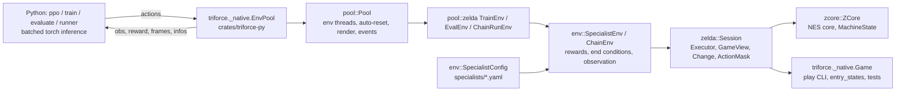

# Triforce v2 architecture and module contracts

Design: `triforce-v2-design.md` (kept outside the repo; decisions that change it go in `docs/decisions.md`).
This file lists the module boundaries and the interfaces between them.

## Crates and Python modules

| Crate / module | Owns |
|---|---|
| `crates/zcore` | Zelda-only NES core (MMC1), cut down from TetaNES (`UPSTREAM.md`), hardware timing. `machine.rs`: `Rom::from_ines`, `ZCore` (`power_on`, `run_frame(buttons, render)`, `pixels`/`rgb`, `ram`/`prg_ram`, `poke`, `snapshot`/`restore` of a `Copy` `MachineState`). `state_file.rs`: `TFZSTATE` `.state` files; gzip (legacy stable-retro) files raise `StateFormatError`. |
| `crates/zelda` | Game model and session, ported from the old Python stack: `vars`/`tables` (RAM variables, game data), `game.rs` (`GameView`: Link, enemies, items, projectiles), `room`/`room_state`/`tiles` (wavefront, doors, tile grid), `actions.rs` (`Action`, `ActionMask`, `compute_action_mask`), `executor.rs` (option executor: timed options, interrupts, uncontrollable skip), `blocks.rs` (shield collisions), `change.rs` + `ledger.rs` (`Change`, look-ahead `FutureCreditLedger`), `room_entry.rs`, `game_map.rs` (`game.yaml`/`routes.yaml`), `objectives.rs` (`GameCompletion`), `hearts.rs`, `linger.rs`, `session.rs` (`Session`). The `Nes` trait (`nes.rs`) abstracts the core so tests can run on zcore or a scripted double. |
| `crates/env` | `config.rs` (`SpecialistConfig`, `GameData`, cross-file validation), `rewards.rs` + `critic.rs`, `end_conditions.rs`, `observation.rs` (`ObservationBuilder`, schema v1), `objective.rs`, `start_states.rs`, `curriculum.rs`, `specialist_env.rs` (`SpecialistEnv`), `chain.rs` (`ChainEnv`, `Route`, `RoomRecord`, `RunResult`), `explore.rs` (`Explorer`, `AcceptSpec`). |
| `crates/pool` | Generic threaded `Pool<E: PoolEnv>` (`pool.rs`), buffer layout (`layout.rs`), frame pacing/render control (`control.rs`); `zelda/` holds the Train/Eval/ChainRun envs and pool events. |
| `crates/triforce-py` | `triforce._native` (PyO3): `Game`, `GameState`, `Change`, `Snapshot`, `Env`, `EnvPool` + `TrainTask`/`EvalTask`/`ChainTask`, `SpecialistConfig`, `Explorer`/`explore_states`, `route_steps`, `families`, `specialist_for`, `OBS_SPEC` and other constants, exception types. |
| `crates/movie` | `TFMOVIE` input movies and `TFGOLDEN` per-frame digests. |
| `crates/tools` | The `tf` CLI (below). |
| `triforce/` (Python) | `ppo.py`, `rollout_buffer.py`, `metrics.py`, `model.py`, `train.py`, `evaluate.py`, `runner.py`, `run.py`, `cli.py`, `play.py`, `play_grid.py`, `explore.py`, `entry_states.py`, `chain_hp.py`, `events.py`, `registry.py`, `demo.py`; thin `observation.py` (gym space from `OBS_SPEC`), `actions.py` (`Action`, `ActionMask` flat-mask view), `zelda_enums.py` (`ActionKind`, `Direction`, `MapLocation`), `specialist.py`, `paths.py` (`STATES_DIR`, `TRAJECTORIES_DIR`). |

## Processes and threads

Everything runs in one process. Each env owns its own `ZCore`; `Pool` pins envs round-robin to persistent OS
threads and steps them without the GIL. Python sends a batch of actions, `recv(out, min_ready)` fills
Python-owned buffers (obs per key, `mask`, `reward`, `frames`, `interrupt`, `terminated`, `truncated`,
`bootstrap`, `final_obs`, `final_valid`), and one batched `network.evaluate` picks the next actions. Envs auto-reset
after a terminal step; terminal infos, eval records, chain results and room-change events come from
`poll_events()`. Env `i` seeds a `ChaCha8Rng` from `(seed, i)`. Rendering (full 256×240) is off by default and
toggled per env with `set_render`; `frame(env, since)` copies the latest frame. Tools and tests that need a single
game use `triforce._native.Game`.

## Core

| Item | Contract |
|---|---|
| `zcore::ZCore` | One NES. `run_frame(buttons, render)` runs one frame with the raw NES button byte; with `render=false` no pixels are written but timing is identical. `ram()` 2 KiB, `prg_ram()` 8 KiB; `poke` only `$0000-$07FF`/`$6000-$7FFF`. |
| `zelda::actions` | `ACTION_SCHEMA_VERSION`; `ActionKind` = MOVE, WAIT, SWORD, BEAMS, BOMB, BOOMERANG, ARROW; `DIRECTIONS` (N,S,W,E,NW,NE,SW,SE); `DURATIONS` (4,8,16,32). `Action` with index conversion and text parsing (`MOVE N 16`). `ActionMask` with `kind[K]`, `direction[K,8]`, `duration[K,4]`; flat form bool[`MASK_SIZE`=91] = K + K·8 + K·4. A kind whose direction (or duration) row is all False doesn't use that head. Python `triforce.actions` keeps `Action`/`parse`/index helpers and a read-only `ActionMask.from_flat`. |
| `zelda::executor` | `Executor::execute(action, state) -> OptionResult(frames, interrupt, control_frames, projectile_blocks)`; blocks count confirmed shield collisions in executed frames, including attack/settling/uncontrollable frames. |
| `zelda::Session` | `load(state, LoadOptions { randomize_rng, fresh_room, controllable, overrides }, rng)`; controllable curriculum frames are not advanced before the first action; normal entries gain control through their transition. `act(action) -> Change`; `state()`, `mask()`, `snapshot()`/`restore()` (restore keeps `steps`/`total_frames`), `set_render`, `set_frame_sink`, `capture_pre_entry`/`last_pre_entry`. Python: `triforce._native.Game`. |
| `zelda::Change` | previous/current `GameView`, action, frames, interrupt, health lost/gained, enemies hit/stunned, items gained, changed location, gained triforce, action mask, executed projectile blocks. Look-ahead credit via `FutureCreditLedger` does not add simulated blocks. |
| `triforce-py/describe.rs`, `play.py` | Text dumps (`Game.describe_state/describe_change`) and the interactive `python -m triforce.play` tool. |

## Observation (`crates/env/src/observation.rs`)

`ObservationBuilder::new(objective)`, `reset(state, mask)`, `build(change, mask)`. Python sees the layout as
`triforce._native.OBS_SPEC` (`key → {shape, vocab, dtype}`) plus `OBS_SCHEMA_VERSION`, `ROOM_VOCAB`,
`ENTITY_VOCAB`, `NUM_TILE_CLASSES`, `NUM_ENTITY_SLOTS = 12` and the feature-name tuples;
`triforce/observation.py` builds the `gymnasium.spaces.Dict` the policy uses.

| Key | dtype / shape | Notes |
|---|---|---|
| `room_id` | int64 [1] | index < `ROOM_VOCAB` |
| `room_state` | float32 [84] | per-room flags from `docs/ram-catalog.md` |
| `link` | float32 [81] | |
| `entity_types` | int64 [12] | 0 = empty slot |
| `entity_features` | float32 [12, 33] | feature 0 = presence |
| `grid` | int64 [22, 32] | tile class per 8px tile, row-major |
| `history` | float32 [34] | last action kind/dir/duration, frames since |
| `objective` | float32 [10] | all zeros when `objective` is off |
| `action_mask` | bool [91] | flat `ActionMask` |

When the objective block is on, the env attaches the objective (`crates/env/src/objective.rs`) before calling
the builder.

Dungeon objectives fight for pending treasure or when every routed exit is closed by a living-monster shutter
trigger (all-dead, ringleader, last-boss or clear-to-drop). An unrelated shutter or an open route exit does not
force combat. The shutter rule excludes block/money triggers and non-foe-only rooms. Live barred-door
classification covers vertical tiles 0xa8–0xab and horizontal tiles 0xac–0xaf. Routing resumes after clearing.

## Specialist task and environment (`crates/env/src/specialist_env.rs`)

`specialists/<name>.yaml` follows design §3.3; it is parsed and validated by `env::SpecialistConfig`
(`crates/env/src/config.rs`, unknown keys rejected); Python loads it as `triforce._native.SpecialistConfig.load(name_or_path)`
(`replace(**fields)` re-validates). Training/evaluation CLIs pass that loaded config to the pool tasks.
`config.name` labels checkpoints and logs; it must not be used to reload the default YAML and discard overrides.

`SpecialistEnv` runs one specialist on one `Session`: `reset`, `step(action)`, `restore(snapshot)`. Pools wrap it
(`TrainTask`, `EvalTask`); `triforce._native.Env` exposes a single env with gym-like `reset`/`step` for
`demo.py`, `scripts/behavior_clone.py` and tests. Action space: `MultiDiscrete([NUM_KINDS, NUM_DIRECTIONS,
NUM_DURATIONS])`.

`info` keys every step: `frames` (int, frames this step: used for frame-aware discounting), `interrupt`,
`action` (str), `rewards` (dict name → value), `room` ((level, room, in_cave)), `health`, `max_health`,
`steps`, `total_frames`, `specialist`, `route`. On the last step: `ending` (end-condition name) and `outcome`
(the episode's entry room), plus `blocks`, `start_state`, `start_health`, `hearts`, `linger`,
`linger_room`, `bootstrap_truncation`, `curriculum`, `episode_steps`, `episode_frames`, `reward_total` and
`episode_rewards` (per-term episode totals; omitted `bootstrap_truncation`/`curriculum` mean false/none). `blocks` counts confirmed shield collisions over the
episode. An end condition that is
not classified raises. Evaluation reports mean `blocks` overall/per room/per state; training separates `blocks`
and `curriculum/blocks`; runner room records retain the visit's count. Historical absence is not a measured zero.

### Heart drops (`crates/zelda/src/hearts.rs`)

`HeartTracker` follows the hearts enemies drop (item 0x22 in monster slots 1–$B; fairies, triforce pieces and heart
containers don't count) through one room visit: `reset(state)`, `update(change)` every step, `finish(state)`,
`summary()` → `dropped`, `taken`, `healed` (real hearts gained), `wasted` (`taken − healed`), `left` (on the floor
when Link left the room, died or the visit ended) and `expired` (timed out). A heart that vanishes while its
lifetime timer (`Item.timer`, counts down once per 2 frames) is above what the step's frames could count down was
taken (by Link, his sword, arrow or boomerang); one near the end of its lifetime counts as taken only if Link's
health rose. A heart heals `min(1, max_health − health)`, so one picked up at full health wastes a whole heart.
"Total" heart change = real change (`health − start_health`) + `wasted`. `SpecialistEnv` puts the summary in the
terminal `info['hearts']`; metrics log `health_change_total` and `hearts/{dropped,taken,left,wasted}` per
episode; `evaluate` keeps it per episode and reports `mean_health_change_total` and `hearts_dropped/taken/left`
overall, per room and per start state; runner `RoomRecord`s carry `hearts_dropped/taken/healed/wasted/left/expired`.

### Lingering (`crates/zelda/src/linger.rs`)

`LingerTracker.reset(state)` / `update(change, hearts_taken=0)` measures progress without changing gameplay.
Progress is a hit/kill, pickup, healing (including pond refills), a new best walking distance to the objective,
or leaving a room. Damage alone is not progress. A frozen wavefront prevents enemy movement and Link's round
trips from manufacturing new best approaches; hits/kills/pickups and objective phase changes rebaseline it.
Phase changes alone do not reset the quiet clock. A progress action's frames do not count toward the quiet
interval it closes. `summary()` returns `max_steps/max_frames`, `tail_steps/tail_frames`, elapsed `steps/frames`,
and nullable boss-kill / heart-container-pickup action/frame timestamps.

Terminal env `info['linger']` and `RoomRecord.linger` carry the summary. Training `linger/{max,tail}_{steps,frames}`
are means over completed room-entry episodes; `linger/worst_{steps,frames}` are maxima across the iteration's
envs. `curriculum/linger/*` is separate; `linger/room/<room>/*` groups by episode entry room. These metrics reach
progress events and the GUI. Eval records retain raw summaries and report `linger_{max,tail}_{steps,frames}` means
and `linger_worst_{steps,frames}` maxima overall, per room and per start state. Older absent measurements remain
absent, not zero. Multi-room env episodes reset their tail on each exit and retain the episode's worst gap;
runner records always describe one visit.

### Experimental reward and cutoff controls

`reward.block_reward` (nonnegative, default 1) multiplies `REWARD_MEDIUM` for each confirmed shield collision,
advancing combat decay separately at the collision's room. The detector (`crates/zelda/src/blocks.rs`) checks consecutive executed RAM frames:
projectile transition signature, shield eligibility/facing/proximity and this frame's `$604` parry request.
Delayed `$605` audio, Darknut/immunity clinks, natural boomerang returns and unrelated disappearance are not enough.
The executor does not replace the user's frame callback, change inputs/timing, or collect speculative look-ahead.

`reward.quiet_enemy_penalty` (nonnegative, default 0) adds that cost per action after the shared quiet tail exceeds
the existing room-stall grace, only while living targetable enemies remain. `critique_gameplay` requires the
caller's measured `quiet_steps`; the env passes its already-updated tracker, without a second progress counter.
Hits/pickups/real approach reset the shared tail; damage and round trips do not. No cost for post-fight pickup time
or inactive/burrowed/dying enemies. This is separate from the existing room-stall ramp and remains default off.

`reward.nearby_items` (default false) adds heart/clock overlap tiles to the objective's PBRS targets alongside
exits. Multi-source walking distance picks the nearer target; the task, accepted exits and observation schema do
not change. This is not the old heart-only objective.

`no_progress_steps` (positive or null, default null) replaces legacy positional/room timeout with the shared
lingering tail. Training ends `no-room-progress` as a soft-failure **truncation** with no terminal penalty;
success/death keep precedence and the absolute episode cap remains enforced. Its terminal info marks
`bootstrap_truncation=True`: the PPO collector (`ppo.Collector`) adds `gamma**(frames/8) * V(final_observation)` to the
learning reward before reset, while done flags still stop the GAE trace. Logged episode rewards stay unchanged.
Legacy max-step truncations retain their existing nonbootstrapping behavior. Runner uses the per-visit tail for
`stuck` instead of the flat room budget, retaining the global run cap; it resets on every room exit.
Nearby-item shaping and the measured cutoff remain disabled in promoted configs until their experiments.

## Learning (`model.py`, `ppo.py`, `train.py`, `registry.py`)

- Action heads: kind (K), direction (8), duration (4). Direction/duration log-probs and entropies count only
  when the sampled kind uses that head (mask row non-empty).
- GAE discount per step: `gamma ** (frames / 8)`, `gamma = 0.99`; `frames` stored in the rollout buffer.
- Checkpoint (`models/<specialist>/<run-id>/ckpt.pt`): `obs_schema_version`, `action_schema_version`,
  `specialist`, `model_config`, `state_dict`, `optimizer`, `iterations`, `steps`, `metrics`.
  Loading with a mismatched schema version raises.
- `models/<specialist>/promoted` holds the promoted run id; `triforce promote <specialist> <run-id>` sets it.
- Metrics (design §12) go to TensorBoard and `metrics.jsonl` in the run directory; `train_summary.json`
  records iterations, steps, `stopped_early`, wall time and steps/sec.
- Training collects asynchronously from one `EnvPool(TrainTask(...), num_envs=--parallel, threads=--threads)`
  (`ppo.Collector`): `recv(min_ready=1)` → store each ready env's row in its own rows of the env-major
  `RolloutBuffer` → one `RolloutPolicy` forward over a fixed batch of one row per env (CUDA: a replayed CUDA
  graph of a private copy of the network) → `send` actions to the ready envs only. A rollout ends when every env
  has `T = steps_per_update / parallel` steps; finished envs wait for the rest. Bootstrap values
  (`V(final_obs)`) are computed in one batch at the end of the rollout. See `docs/performance.md`.
- `train --seed S` seeds model initialization and PPO RNGs, and the pool: env `i` draws from a `ChaCha8Rng`
  seeded with `(S, i)`. Without `--seed` the pool seed is random. Actions are sampled with Gumbel noise drawn per
  rollout as an `[n, T, NOISE_SIZE]` block from the collector's own generator (seeded from the torch RNG), indexed
  by (env, step), and the policy forward always has the same shape, so a row's action depends only on that env's
  observation and noise: rollouts don't depend on `--threads` or scheduling (CPU and CUDA, tested). On CPU
  training is reproducible end to end. On CUDA the PPO update is not bit-reproducible (atomic-add backward
  kernels), so long CUDA runs drift apart after some iterations even with the same seed (ow-moblin, 12 envs:
  identical for 9 iterations, different in the 10th). Shared curriculum progress depends on env completion
  order; this is not a promise of bitwise-identical curriculum training, nor exact RNG continuation when resuming
  a checkpoint. (Python's `random` streams of the old stack are not reproduced.)
- Live event logs (`events.py`, watched by `training-gui.py`): each training invocation gets
  `logs/<yymmdd>_<NNN>_<what>/` (gitignored; `--logs-dir` / `$TRIFORCE_LOGS_DIR`). `training.json` lists every
  specialist run in order with its status and is rewritten atomically. `<specialist>.jsonl` is an append-only
  stream (`start`, one `progress` per PPO iteration with steps/target/fraction/sps/eta and headline metrics,
  `checkpoint`, `early_stop`, `error`, `train_end`; the round driver adds `eval_start`, `eval_progress` (≤1/s:
  done/episodes/running success_rate), `eval`) whose last line
  is `end`. `<specialist>.log` is its console output. `round.jsonl` / `round.log` cover the round (chain,
  errors, `end`). SIGTERM is turned into an interrupt, so a killed run still saves and writes `end`.
- `train --stop-success R [--stop-patience 5]` (`EarlyStop`) ends training once the start-state-balanced
  success rate (mean over start states of each state's last 20 room-entry episodes; logged as
  `balanced_success_rate`) is ≥ R for that many consecutive iterations. The raw `success_rate` is biased toward
  the states the start-state pool oversamples (failures), so it is not used for stopping.
- `python -m triforce.explore --specialist NAME` (Go-Explore phase A; `crates/env/src/explore.rs`, CLI `explore.py`): per seed start state, an
  archive of cells (room, tile // 2, hearts, living enemies, keys, boomerang) with exact `Session`
  snapshots; random legal actions from cells chosen by progress/closeness/novelty; the best success is replayed
  and written as `trajectories/<specialist>/<state>/NNNN.state` + `trajectory.json`. `SpecialistEnv::restore(snapshot)`
  starts an episode from an exact snapshot.
- Backward curriculum (`crates/env/src/curriculum.rs`): on when the specialist's config has `curriculum: {enabled: on}`
  (trajectories default to `trajectories/<specialist>`; `train --curriculum DIR` overrides, `--no-curriculum`
  disables). Half of the resets start
  on a trajectory near its end; each trajectory's start point moves `ceil(len/10)` steps earlier once 6 of the
  last 10 episodes from the current stage succeed, until it reaches the room entry. Progress is kept in memory, shared by all
  envs of the pool, and rewritten atomically to `<run dir>/curriculum.json` on every change. Curriculum episodes are reported as `curriculum/*` and excluded
  from the room-entry metrics.
  Saved curriculum frames are already controllable: resets use `Session::load` with `controllable: true`
  without idle input or a second cave-entry cooldown. RNG/HP randomization still applies. Ordinary entry-state
  resets keep transition/fresh-room handling unchanged.
- Chain-matched health (`chain_hp.py`): `python -m triforce.chain_hp <chain jsonl ...>` writes
  `triforce/chain_hp.json`, the hearts Link entered each room with in chain runs. A specialist with
  `ram_randomization: {chain_hp: p}` draws its reset hp from its start room's list in a share `p` of room-entry
  resets (not curriculum starts); the rest keep the `hp` / `full_hp` draw.
- `evaluate.evaluate_specialist(specialist, checkpoint, episodes_per_state=20, parallel=1, seed=0,
  deterministic=False, *, threads=None, device='cpu')` plays every seed start state N times in one `EnvPool(EvalTask(...))` (episode i seeded `seed + i`; records sorted by seed) and
  returns success rate, outcomes/endings and per-room/per-state breakdowns; `python -m triforce.evaluate
  --specialist NAME` (or `triforce evaluate`) writes `eval.json` next to the checkpoint.
- `scripts/train_round.py --round ID` trains every trainable specialist (route order), promotes and
  evaluates each, then runs `eval-chain`; summaries go to `models/<round>-summary.json` and
  `models/<round>-chain-summary.json`.

## Runner and CLI (`crates/env/src/chain.rs`, `runner.py`, `run.py`, `cli.py`)

- Routes (`triforce/routes.yaml`, `zelda::game_map`; Python `triforce._native.route_steps(route)`): `milestone1` and `milestone1-fairy` (milestone1 with
  the post-D1 overworld replaced by the south road and the fairy pond; a spliced route is
  `{base, replace: {from, to}, steps}`). `GameCompletion(route, step)` routes on one of them: only the route's
  exits are correct on its rooms, and `waypoint:` steps are targets while they apply. Training episodes take the
  route from the start state's name (`zelda::objectives::start_route`, `env::start_states::state_entry`); see
  `docs/decisions.md` (second route) for the rule.
- `Route.load(name, stop_at=None)` reads `triforce/routes.yaml`. A route starts at the `start` savestate and
  ends on entering its `terminal` room (both routes: level 2 room 0x0e); `stop_at` ends it earlier.
- `env::ChainEnv` plays one route run; `runner.Runner(models_dir=None, checkpoints=None, deterministic=False,
  max_steps=50000, device='cpu', specialist_configs=None, networks=None, parallel=1, threads=None)` drives a
  `ChainTask` pool with per-specialist batched inference: `run(route, seed) -> RunResult`, `run_many(route,
  seeds)`. On each room entry: `game.yaml` tag → specialist → promoted checkpoint (cached). Untagged room or
  missing model → `result='error'` with the reason. Per-room outcomes:
  `exit-correct`, `exit-wrong`, `death`, `stuck` (specialist `max_steps` in one room), `milestone`.
  Finalizing a room captures live ending health together with dropped-heart counts, including room/run budgets
  and measured cutoffs; death remains zero. `health_out` is never left at entry health on a timed-out visit.
- `python -m triforce.run --route milestone1 [--seed N] [--render [--fps F] | --video PATH] [--from STATE]
  [--stop-at L:0xRR] [--checkpoint S=PATH] [--deterministic] [--device D]` prints one line per room and appends a JSON line to
  `runs/runner.jsonl`. `--render` shows one chain env with rendering on; `--video` records the run's inputs, then
  renders them through `ffmpeg` (`-r 60.0988`, H.264) and fails with `ffmpeg not found on PATH` without it.
- `triforce eval-chain --route milestone1 --runs 20 [--parallel N] [--threads T] [--device D] [--from STATE] [--stop-at L:0xRR]` → success
  rate and per-room failure counts (`chain_summary`); `--from` starts mid-route at a route entry state (e.g.
  `0_37c_2`, after Dungeon 1). `triforce promote <specialist> <run-id>`; `triforce list`;
  `triforce train|run|play|evaluate ...` forward to the module CLIs.
- Chain config overrides: repeat `eval-chain --specialist-config /path/to/arm.yaml`. Each YAML's `name` selects
  its family. `Runner` / `eval_chain(..., specialist_configs={name: loaded_config})` accept the same loaded
  objects; the chain pool uses them instead of reloading canonical YAML. Runtime item masks, observations
  and room/cutoff budgets use these configs. Route selection and carried inventory/health remain chain-owned.
  Other families retain canonical configs; checkpoint overrides and promoted pointers are independent.

## Entry states (`entry_states.py`)

Start states are `TFZSTATE` files in `triforce/states/` (`paths.STATES_DIR`, `$TRIFORCE_STATES_DIR`), listed in
`triforce/states/entry_states.json`. `python -m triforce.entry_states start` writes `start.state` from the base
movie `corpus/movies/power_on_to_start.tfmovie` at its first controllable frame; `build [--chains 0,1,2]
[--start-step N --source STATE]` follows the route; `path --source STATE --rooms 1:0x33,... [--chain C]
[--route R]` enters off-route rooms in order; `audit [--specialist S] [--states GLOB]` checks them. All use
`Game`, `Explorer` and `AcceptSpec` from `triforce._native`.

`build` follows route steps; `path` accepts explicit off-route destinations. `build` and `path` use `cross_room`: arriving
in the target is insufficient when the source room declares a key. The source room's persistent item-taken
flag must be set in the same level. Carried keys must retain the source inventory plus its newly required key,
minus the cost of the direct target door if initially locked; opening an unrelated side door is not an allowed
cost. Discovery and exact replay both enforce these requirements before returning captured pre-entry bytes.
This preserves intended off-route traversal without accepting premature key-room exits or depleted inventory.
`step_config` masks bombs for milestone-1 state generation. Route changes still require rebuilding and auditing
downstream inventories and refreshing affected curriculum snapshots; old filenames alone do not prove progress.

## Emulator verification (`tf`, `corpus/`)

`cargo run --release -p triforce-tools --bin tf -- <command>` (`--rom` defaults to `$TRIFORCE_ROM`, else
`roms/zelda.nes`); every command runs zcore. `movie {script,random,info,rebase}` records/inspects `TFMOVIE` files
(scripts in `corpus/scripts/`, movies in `corpus/movies/`, `corpus/manifest.toml`); `ladder-golden [--short] -o DIR`
writes `TFGOLDEN` digests of all 11 domains per frame and `ladder-diff [DIR]` replays each golden's movie and reports
the first diverging frame and domains (no DIR: the committed `corpus/golden/` of the seven `short` movies); this
self-diff is zcore's regression suite (README, "Emulator regression suite"). `trace MOVIE --frame K [--count N]`
prints every instruction of records K..K+N-1 for diffing two builds; `corpus {sync,check}` rebuilds the manifest
and checks its frame counts, the 1M-frame total and the presence of a `power-on-to-d2` movie; `bench` reports
frames/s with render on and off.
