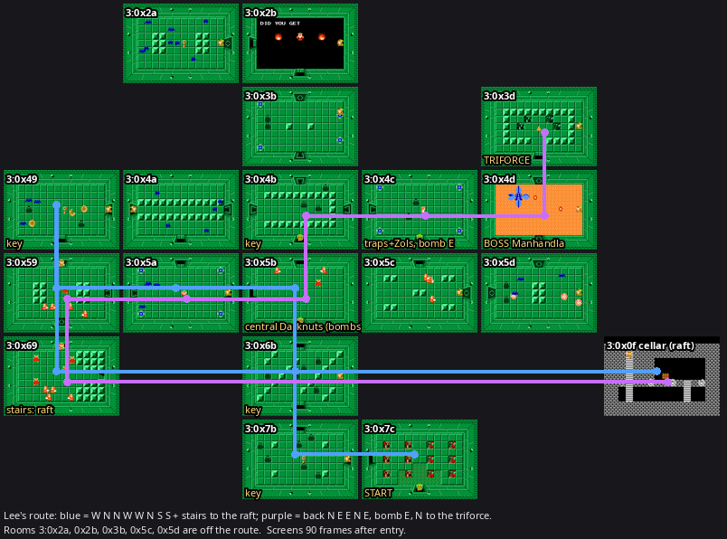

# Dungeon 3 (level 3) map

Mapping pass of Nov 9 (Lee): every Dungeon 3 room in `triforce/game.yaml` (level 3, 18 rooms plus the raft cellar),
ahead of turning Lee's directions into a route. Quest 1. The route followed the same day: d2first goes on from the
D1 triforce to Dungeon 3 and ends on its triforce (["The route"](#the-route-nov-9) below, `docs/routes/d2first.md`).



[`d3-map.png`](d3-map.png): each room 90 frames after entry (monsters out), half size; blue = Lee's way to the raft,
purple = back to the triforce.

## Getting in (probe states)

- Entrance: overworld 0x74's open cave mouth (cave index 3) → start room 3:0x7c (`Level_InfoUW3` `StartRoomId`).
- Probe: load `0_59w_0`, retarget the room id to 0x75 and hold Left (the overworld trick, `overworld.md`), empty the
  monster slots, put Link at (128, 141) under 0x74's mouth and walk N: the game loads level 3 and Link stands in 0x7c.
  Keys ($66E) and bombs ($658) were poked in (9 and 8).
- Any other room: from 0x7c, set `RoomId` to target + 1 and walk out of 0x7c's open W door; the transition reads the
  *current* room id's W door type (`asm:Room_CalcNext_JumpTable`), so that door is opened in the SRAM attr copy
  first (`$68FE + id`, B bits 7–5 = 0). The game then loads the target itself, entering it from its E side. Rooms
  whose own E door is a key door or a bomb wall (drawn opened when entered that way) and 0x69 (its stairs sit on the
  E entry path) were entered through an open door from a neighbour for the screenshots. Scripts:
  `/tmp/zmapwork/d3*.py` (throwaway).

## Data sources

Rooms: `SubmenuMapMask` of `Level_InfoUW3` (file 0x19604; rotation $0C) over `Level_BlockUW1to6Q1` (0x18710; levels 1–6
share it). Doors from attr A/B (N = A >> 5, S = (A >> 2) & 7, W = B >> 5, E = (B >> 2) & 7: 0 open, 1 wall,
4 bomb, 5/6 key, 7 shutter), monsters from C/D + `FoeCounts` (3, 5, 6, 8), item from E & $1F, `trigger` from F & 7
(`asm:Secret_RunTrigger`). The emulator confirmed every room's doors (tiles: locked/shutter/wall), monsters and the
visible items; blade traps ($49, four per trap room) and Bubbles are hazards, not monsters, so `enemies` leaves them out.
Names follow the repo enum, which follows the disassembly (`RedDarknut` = $0B, the red, slow Darknut).

## Rooms

Grid (row = id >> 4, column = id & $F; doors: `=`/`|` open both sides, `K` key, `B` bomb wall, `S` a shutter on at
least one side):

```
        col 9     col A     col B     col C     col D
row 2             2a ---S-- 2b
                            S
row 3                       3b                  3d
                            K                   S
row 4   49 ====== 4a ---K-- 4b ---K-- 4c ---B-- 4d
        |         |         |         |         S
row 5   59 ---K-- 5a ====== 5b ---B-- 5c ---S-- 5d
        S                   |
row 6   69                  6b
  (stairs to cellar 0f)     |
row 7                       7b ====== 7c  start (S: overworld 0x74)
```

| Room | Exits (game.yaml) | Enemies | Treasure | Notes |
|---|---|---|---|---|
| 0x7c | W 0x7b | — | — | start; S leaves to the overworld (omitted, as in D2) |
| 0x7b | N 0x6b, E 0x7c | Zol 6 | key | key visible on entry |
| 0x6b | N 0x5b, S 0x7b | Zol 5 | key | key appears when all are dead (trigger 7) |
| 0x5b | N 0x4b, E 0x5c (bomb wall), S 0x6b, W 0x5a | RedDarknut 3 | bombs | the central Darknut room; bombs appear when the Darknuts are dead |
| 0x5a | N 0x4a, E 0x5b, W 0x59 (locked) | BlueKeese 4 + 4 blade traps | compass | |
| 0x59 | N 0x49, E 0x5a (locked), S 0x69 (shutter) | RedDarknut 5 | — | the S shutter opens when all are dead (trigger 1); W is a wall |
| 0x49 | E 0x4a, S 0x59 | Bubble 3, Zol 2, BlueKeese 3 | key | key visible |
| 0x69 | N 0x59, `cave` → 3:0x0f | RedDarknut 8 | bombs | stairs at tiles (26–27, 10–11); bombs appear when all are dead |
| 0x0f (cellar) | N 0x69 (ladder) | BlueKeese 4 | raft | item cellar (layout $3F, side view), the raft at (128, 144) |
| 0x4a | E 0x4b (locked), S 0x5a, W 0x49 | BlueKeese 5 | bombs | trigger 7 |
| 0x4b | N 0x3b (locked), E 0x4c (locked), S 0x5b, W 0x4a (locked) | Zol 3 | key | key appears when all are dead |
| 0x4c | E 0x4d (bomb wall), S 0x5c, W 0x4b (locked) | Zol 2 + 4 blade traps | map | Lee's "trap/gel room"; `requires_bombs` |
| 0x4d | N 0x3d (shutter), S 0x5d (shutter), W 0x4c (bomb wall) | Manhandla 1 | heart-container | boss; shutters open and the heart appears when he dies; `requires_bombs` |
| 0x3d | S 0x4d | — | triforce | |
| 0x5c | N 0x4c, E 0x5d (shutter), W 0x5b (bomb wall) | RedDarknut 3 | — | trigger 1 |
| 0x5d | N 0x4d (shutter), W 0x5c (shutter) | Bubble 3, Zol 2, BlueKeese 3 | 5-rupees | trigger 7 |
| 0x3b | N 0x2b (shutter), S 0x4b (locked) | Zol 2 + 4 blade traps | — | pushing its block opens the N shutter (trigger 4) |
| 0x2b | S 0x3b, W 0x2a | old man (`Unknown_75`, UW person $4B) | — | hint ("DID YOU GET …") |
| 0x2a | E 0x2b (shutter) | BlueKeese 8 | key | key visible; shutter opens when all are dead |

No dark rooms (attr E bit 7 clear everywhere). Manhandla is one $3C object occupying five slots (body and four heads)
in the emulator. Keys: 0x7b, 0x6b, 0x49, 0x4b, 0x2a. Locked doors: 0x59|0x5a, 0x4a|0x4b, 0x4b|0x4c, 0x4b|0x3b.
Bomb walls (both sides listed in `bomb_walls`): 0x4c|0x4d, 0x5b|0x5c.

game.yaml conventions as everywhere (one convention, the comment block at the top of game.yaml: `locked: true`,
`# shutter` comments, `bomb_walls`, bomb walls also listed as exits with the comment `# bomb wall`): the boss room's
way in on Lee's route is 0x4c's E wall. New keys, read by nothing yet: `trigger` (attr F & 7: `kill-all`, `kill-all-item`,
`push-block`), `stairs`, `push_block_opens` (0x3b; deliberately not `push_block`, which marks a block that gates
stairs).

## The raft cellar

0x69's stairs lead to cellar room $0F (layout $3F: one ladder, attr A = attr B = $69, the raft as its attr-E item).
`Level_InfoUW3`'s `CellarRoomIdArray` is all $FF, so the stairs find it only because `asm:Warp_CheckUnderLink`
scans the array without a bound: it runs on past the 10 entries into `BossRoomId`, the map mask and the palette
bytes until a "cellar" whose A or B is the current room turns up — the 72nd byte, `$6BB2 + 72` = $0F (checked in RAM
in the emulator). game.yaml: `3:0x0f in_cave: true` with N back to 0x69, and 0x69's `cave` exit to it, as D1's bow
cellar 1:0x7f. Its four Blue Keese fly in the emulator; they don't come from the cellar's attr C/D.

## Lee's route on the real layout

Lee's directions: `W N N W W N S S (enter stairs to raft) N E E N E E (bomb wall for east in this last room)`, then
N of the boss to the triforce. **They match the layout exactly**, room by room:

| Move | Room | What happens |
|---|---|---|
| start | 0x7c | entrance |
| W | 0x7b | 6 Zols, key |
| N | 0x6b | 5 Zols, key (after the kills) |
| N | 0x5b | the central Darknut room (3 Darknuts; bombs) |
| W | 0x5a | traps + 4 Keese (compass) |
| W | 0x59 | through the locked door (key 1); 5 Darknuts; W is a wall ("W until you can't") |
| N | 0x49 | the key ("N for a key") |
| S | 0x59 | |
| S | 0x69 | through 0x59's S shutter (kill the 5 Darknuts first); 8 Darknuts, bombs not taken |
| stairs | 3:0x0f | the raft |
| ladder | 0x69 | |
| N | 0x59 | |
| E | 0x5a | the door opened on the way in |
| E | 0x5b | back in the central Darknut room |
| N | 0x4b | 3 Zols; the key appears when they die ("N for a key") |
| E | 0x4c | through the locked door (key 2): the trap/gel room (4 blade traps, 2 Zols, the map) |
| E (bomb) | 0x4d | bomb the E wall: Manhandla |
| N | 0x3d | through the shutter once he is dead: the triforce |

Walked end to end in the emulator (monster slots emptied before each move so kill-all shutters open; keys 9 → 7,
bombs 8 → 7): `7c W 7b N 6b N 5b W 5a W 59 N 49 S 59 S 69, stairs 0f (raft taken), ladder 69, N 59 E 5a E 5b N 4b E
4c, E (bomb) 4d, N 3d`. Test: `game_map::tests::d3_boss_room_and_lees_route`.

Where Lee's words differ: none in the directions. "The Darknut room above the raft room has a treasure we won't take"
is 0x69 itself (8 Darknuts, bombs), the room the cellar hangs under; 0x59 above it has no treasure. The S into 0x69
needs 0x59's Darknuts dead (shutter), the W into 0x59 and the E into 0x4c each take a key (Link collects 0x7b's,
0x6b's, 0x49's and 0x4b's on the way, plus whatever he carries from D1/D2).

## Bombs (Lee, Nov 9)

- The central Darknut room's (0x5b) treasure is bombs; the plan takes it on the last pass only, if Link has fewer
  than 4 bombs.
- Dungeon 3 needs 1 bomb for 0x4c's E wall; Dungeon 4 later needs 2.
- Manhandla is to be killed with bombs dropped into his path, so both 0x4c and 0x4d are `requires_bombs: true`
  (Lee): a specialist acting there is never left without a bomb (a cheated one: `zelda::cheats`, architecture.md
  "Cheated items").

## The route (Nov 9)

d2first steps 80–97 (`triforce/routes.yaml`; the walk from 0x37 to 0x74 is in `docs/routes/d2first.md`). Lee's
directions as route steps, one per room visit; the objective follows them by entry side and progress (the raft, as
the bow in D1: `StepProgress::raft`), so the three visits to 0x59 (from E, N, S), the two to 0x5b, 0x5a and 0x69 each
have their own step, start states and exit.

| Step | Room | Entry → exit | Family | What the objective asks |
|---|---|---|---|---|
| 80 | 0x7c | S → W | zol | the empty entrance hall |
| 81 | 0x7b | E → N | zol | the visible key, then N |
| 82 | 0x6b | S → N | zol | kill the 5 Zols for the key, then N |
| 83 | 0x5b | S → W | darknut | `treasure: skip`: straight W past the 3 Darknuts |
| 84 | 0x5a | E → W | trap-room | through the locked W door (the compass is ignored, as maps and compasses always are) |
| 85 | 0x59 | E → N | darknut | N (the room has no treasure; the N door is open) |
| 86 | 0x49 | S → S | zol | the visible key, then back S |
| 87 | 0x59 | N → S | darknut | kill the 5 Darknuts (the S shutter, kill-all), then S |
| 88 | 0x69 | N → stairs | darknut | `treasure: skip`: past the 8 Darknuts to the stairs (tiles 26–27, 10–11) |
| 89 | 0x0f (cellar) | S → N | equipment-room | `waypoint: raft`: take the raft, back up the left ladder |
| 90 | 0x69 | stairs → N | darknut | `treasure: skip`: N |
| 91 | 0x59 | S → E | darknut | E through the door opened on the way in |
| 92 | 0x5a | W → E | trap-room | E |
| 93 | 0x5b | W → N | darknut | `treasure: {if_bombs_below: 4}`: below 4 bombs kill the Darknuts and take the bombs, else N |
| 94 | 0x4b | S → E | zol | kill the 3 Zols for the key, then E through the locked door |
| 95 | 0x4c | W → E | trap-room | bomb the E wall (the target is the spot to bomb it from), then through it |
| 96 | 0x4d | W → N | boss-manhandla | kill Manhandla (bombs), take the heart container, N through the shutter |
| 97 | 0x3d | S → triforce | zol | take the triforce: **the route ends** (chain success, `RunResult` "took the level 3 triforce") |

**Treasure rules (Lee).** A routes.yaml step's `treasure:` says whether that visit takes its room's treasure: absent
(the default) the objective fights for a treasure the kills make appear and walks to a visible one, as before;
`skip` leaves it; `{if_bombs_below: N}` takes it only while Link holds fewer than N bombs (read live, so a dropped
bomb that brings him to 4 ends the fight). 0x69 is skipped on both visits (Lee's "the Darknut room above the raft
room", above the cellar), 0x5b on its first visit; its last visit takes the bombs only below 4 (Dungeon 4 needs 2).
With route-true inventories Link reaches step 93 with 5 or 8 bombs (the states), so the route-true case leaves N;
the `darknut` family draws bombs 0–8 at reset so both sides of the rule train.

**Keys.** Link enters with 3 keys (every chain's `3_7cs_N`, what Dungeon 1 leaves him). Locked doors on the route:
two (0x5a W | 0x59 E, used W on step 84; 0x4b E | 0x4c W, step 94). Keys picked up: four (0x7b, 0x6b, 0x49, 0x4b).

| After step | Keys | |
|---|---|---|
| entering (80) | 3 | |
| 81 0x7b | 4 | +1 |
| 82 0x6b | 5 | +1 |
| 84 0x5a W door | 4 | −1 |
| 86 0x49 | 5 | +1 |
| 91 0x59 E | 5 | the door stays open (room flags) |
| 94 0x4b key, E door | 5 | +1 −1 |
| end | 5 | |

The dungeon pays for itself: at the first locked door Link already holds 0x7b's and 0x6b's keys. The cheated-key
rule (`zelda::cheats`) only covers a key spent on a wrong door (0x4b's W and N doors are locked too).

**Bombs and the bomb wall.** 0x4c (trap-room) and 0x4d (boss-manhandla) are `requires_bombs`, so both families have
bombs on (`trap-room` for D1's 0x22 and D3's 0x5a too). A route step leaving through an intact game.yaml bomb wall
(`GameView::bomb_walls`) targets its bomb spot (`objectives::bomb_spot`): facing the wall 16 px short of its hotspot
(`asm:Bomb_WallHotspotsX`, `asm:Bomb_WallHotspotsY`), so the bomb Link places 16 px ahead
(`asm:Link_PlaceWeaponAhead`) lands on the hotspot (the game opens the wall for a bomb within $18 px). In 0x4c that
is (0xC0, 0x8D), tile (24, 10), 16 px outside the
column the right-hand blade traps slide along when Link lines up with them (|dx| < 14 from x 0xD0, the hotspot
itself; standing there in the emulator Link was knocked off the doorway row while the bomb ticked). Once the wall
opens the doorway is the target, and walking through is the correct exit.

**Families.** `zol` (new: 0x7c, 0x7b, 0x6b, 0x49, 0x4b, 0x3d), `darknut` (new: 0x5b, 0x59, 0x69), `trap-room`
(+0x5a, 0x4c), `equipment-room` (+the raft cellar 0x0f), `boss-manhandla` (new: 0x4d). See `docs/specialists.md`.

## Open questions

- The old man's full text in 0x2b (only "DID YOU GET …" captured).
- Whether the route should collect 0x2a's key or the compass/map (off Lee's path except the map in 0x4c).
