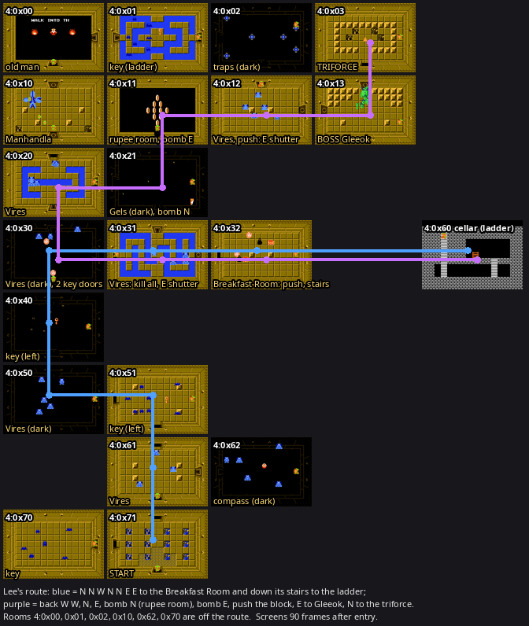

# Dungeon 4 (level 4) map

Scouting pass of Nov 11 (Lee): every Dungeon 4 room in `triforce/game.yaml` (level 4, 20 rooms plus the ladder
cellar), the way there from the Dungeon 3 triforce, Lee's directions as route steps, and start states for them. Nov
12 (Lee): the steps are part of `d2first` (steps 98–122, 98–120 since round 21's shortcut, 105–133 since round
22's; the route now ends on the Dungeon 4 triforce), the states live in `triforce/states/` with the rest, and the
new families train. Quest 1.



[`d4-map.png`](d4-map.png): each room 90 frames after entry (monsters out), half size; blue = Lee's way to the
ladder, purple = back to the triforce.

## Getting in (probe states)

- Entrance: overworld 0x45's open cave mouth (cave index 4) → start room 4:0x71 (`Level_InfoUW4` `StartRoomId`).
  0x45 is an island: its only way in is the raft from the dock of 0x55 (below).
- Probe (as Dungeon 3, `d3.md`): load `0_59w_0`, retarget the room id to 0x46 and hold Left, empty the monster
  slots, put Link at (128, 141) under the mouth and walk N: the game loads level 4 and Link stands in 0x71. Any
  other room: from 0x71, set `RoomId` to target + 1 and walk out of the open W door (the door of the retargeted
  room opened in the SRAM attr copy first), so Link enters the target from its E side; rooms whose own E door is a
  key door, a bomb wall or a shutter were entered through another door for the screenshots. Scripts:
  `/tmp/d4work/d4*.py` (throwaway).

## Data sources

As Dungeon 3: `Level_BlockUW1to6Q1` (0x18710; levels 1–6 share it), doors from attr A/B, monsters from C/D + `FoeCounts`
(3, 5, 6, 8), item from E & $1F, `trigger` from F & 7. `Level_InfoUW4` (file 0x19700): start 0x71, triforce 0x03,
boss 0x13, `CellarRoomIdArray[0]` = $60, map mask rotation $06. The rooms are the ones reachable from the start
room through any door that isn't a wall, the same set as the map mask. The emulator confirmed every room's monsters
and locked doors. Blade traps ($49), Bubbles and the rupee stash ($35) are not monsters.

New in this dungeon:

- **Dark rooms** (attr E bit 7; game.yaml `dark: true`, read by nothing): 0x01, 0x02, 0x21, 0x30, 0x40, 0x50, 0x62.
  The picture is black without a candle; the tiles, and so everything the models see, are the same.
- **Water** in 0x01, 0x20, 0x21, 0x30, 0x31 and 0x40 (`asm:RoomLayout_LayOutUWFloor` tile `$F4`; zelda-asm
  `levels/level-4.md` "What it changes"). Row 2 of 0x30 is water from wall to wall: its N door (round 20's step 116,
  E → N; off the route since round 21) **needs the ladder**. 0x31's four single squares on the door line (Y = $8D)
  are a ladder shortcut (its land path winds from the W door to the E door); 0x20's and 0x40's rings are open at the
  top and bottom; 0x21's island is ringed by water two or more squares wide, which the plain ladder can't cross (the
  ladder clip does, round 21); 0x01's key (on the route since round 22) needs it.
  The env models the ladder (`zelda::room`, `Room::ladder_axes`): with the ladder in a dungeon, a water strip
  exactly one square (2 tiles) wide between two walkable tiles is passable along its axis; the wavefronts (PBRS,
  the target, linger, the explorer) and the move mask follow it. Since round 21 the MOVE mask also models a laid
  ladder, and with a family's `clips: true` the wavefronts treat the ladder clip as a jump (`docs/architecture.md`
  "Grid-point skip").
- **Push blocks** (attr D bit $40) that do two different things. Both move only once the room's monsters are dead
  (`IsRoomAllDead` $34D; Bubbles don't count), pushed from any side:
  - 0x32 (trigger 5): the stairs to the cellar appear at tiles (26–27, 4–5). game.yaml `push_block: [N, S, E, W]`.
  - 0x12 (trigger 4): the E shutter into the boss room opens. game.yaml `push_block_opens: E`.

## Rooms

Grid (row = id >> 4, column = id & $F; doors: `=`/`|` open both sides, `K` key, `B` bomb wall, `S` a shutter on at
least one side):

```
        col 0     col 1     col 2     col 3
row 0   00 ---K-- 01 ====== 02        03
        S         B         |         S
row 1   10 ---B-- 11 ---B-- 12 ---S-- 13
        S         B
row 2   20 ====== 21
        K         K
row 3   30 ---K-- 31 ---S-- 32  (stairs to cellar 60)
        |
row 4   40
        |
row 5   50 ====== 51
                  |
row 6             61 ---K-- 62
                  |
row 7   70 ====== 71  start (S: overworld 0x45)
```

| Room | Exits (game.yaml) | Enemies | Treasure | Notes |
|---|---|---|---|---|
| 0x71 | N 0x61, W 0x70 | — | — | start; S leaves to the overworld (omitted, as in D2) |
| 0x70 | E 0x71 | BlueKeese 8 | key | key appears when all are dead (trigger 7); off the route |
| 0x61 | N 0x51, S 0x71, E 0x62 (locked) | Vire 3 | — | |
| 0x62 | W 0x61 (locked) | Vire 5 | compass | dark; off the route |
| 0x51 | S 0x61, W 0x50 | BlueKeese 8 | key | key visible; the route leaves it |
| 0x50 | N 0x40, E 0x51 | Vire 5 | — | dark |
| 0x40 | N 0x30, S 0x50 | Zol 5 | key | dark; key visible; the route leaves it |
| 0x30 | N 0x20 (locked), E 0x31 (locked), S 0x40 | Vire 3, Bubble 2 | — | dark; Lee's "vire room we already pathed through" |
| 0x31 | N 0x21 (locked), E 0x32 (shutter), W 0x30 (locked) | Vire 5 | — | water maze; the E shutter opens when all are dead (trigger 1) |
| 0x32 | W 0x31, `cave` → 4:0x60 | LikeLike 2, Zol 2, Bubble 2 | — | **the Breakfast Room** (Lee); the pushed block reveals the stairs |
| 0x60 (cellar) | N 0x32 (ladder) | BlueKeese 4 | ladder | item cellar (layout $3F, side view), the ladder at (128, 144) |
| 0x20 | N 0x10, E 0x21, S 0x30 (locked) | Vire 5 | — | water ring; 0x10's S door is a shutter |
| 0x21 | N 0x11 (bomb wall), S 0x31 (locked), W 0x20 | BlueGel 5 | map | dark; `requires_bombs` |
| 0x11 | N 0x01, E 0x12, S 0x21, W 0x10 (all bomb walls) | — | — | the rupee room: ten rupees; `requires_bombs` |
| 0x12 | N 0x02, E 0x13 (shutter), W 0x11 (bomb wall) | Vire 5 | — | the pushed block opens the E shutter |
| 0x13 | N 0x03 (shutter), W 0x12 (shutter) | Gleeok2 1 | heart-container | boss: Gleeok with two heads; the heart appears and the shutters open when he dies |
| 0x03 | S 0x13 | — | triforce | |
| 0x10 | N 0x00 (shutter), E 0x11 (bomb wall), S 0x20 (shutter) | Manhandla 1 | — | a second Manhandla; trigger 1; off the route |
| 0x00 | E 0x01 (locked), S 0x10 | old man (`Unknown_78`, UW person $4E) | — | hint ("WALK INTO THE WATERFALL"); off the route |
| 0x01 | E 0x02, S 0x11 (bomb wall), W 0x00 (locked) | BlueKeese 8 | key | dark, water; the key lies at (`$80`, `$80`) beyond one water square: the ladder; on the route since round 22 |
| 0x02 | S 0x12, W 0x01 | six blade traps | — | dark; on the route since round 22 |

Keys: 0x70, 0x51, 0x40, 0x01. Locked doors: 0x61|0x62, 0x30|0x31, 0x30|0x20, 0x31|0x21, 0x00|0x01. Bomb walls
(both sides listed in `bomb_walls`): 0x21|0x11, 0x11|0x12, 0x11|0x10, 0x11|0x01.

**Room names.** game.yaml rooms take an optional `name:` now (`GameRoom::name`, `_native.game_rooms()[...]['name']`):
what people call the room, for display only. 4:0x32 is `name: Breakfast Room` (Lee); the viewer's strip shows it
(`L4 0x32 Breakfast Room`). No other room has one yet.

## The ladder cellar

0x32's stairs lead to cellar room $60 (layout $3F, attr A = attr B = $32, the ladder as its attr-E item), the first
entry of `Level_InfoUW4`'s `CellarRoomIdArray`. Same shape as Dungeon 3's raft cellar: Link arrives at the top of the
left ladder (48, 93), the item lies on the walkway at (128, 144), and the way out is back up the left ladder. Four
Blue Keese fly in it (in the emulator; they don't come from the cellar's attr C/D), as in the raft cellar.
game.yaml: `4:0x60 in_cave: true` with N back to 0x32, and 0x32's `cave` exit to it.

## The way there: the raft

After the Dungeon 3 triforce Link stands on the overworld at 0x74. The route walks back the way it came (0x74 W,
0x73 N, 0x63 E, 0x64 E) to 0x65 and N into 0x55, whose dock sails to the island:

- `asm:Dock_Update`: with the raft, Link standing at X = $80, Y = $7D in 0x55 (tile (16, 8), the dock) is carried N
  off the top of the screen and lands on 0x45's pier at (128, 221), about 160 frames later. In 0x3f the dock is at
  X = $60 and leads to 0x2f.
- game.yaml `raft_exits` are graph exits now (`RoomExit::raft`; the dock side has `dock: [col, row]`). A route step
  may leave through one: the objective's target is the dock tile. Path searches pass a raft crossing only while
  Link holds the raft (`GameCompletion::open_raft_crossings` puts them into its opened doors).
- 0x55 is two parts: its W third can't reach the dock. 0x65's N exit has `span: [14, 27]` so the objective only
  offers the lanes that lead into 0x55's E part.
- 0x45: one Peahat; Link walks N from the pier into the mouth at tile (16, 8).

## Lee's route on the real layout

Lee's directions (Nov 11): *a direct path to the ladder; the room with the stairs to the ladder is the "Breakfast
Room"; from the Breakfast Room go all the way west back to the vire room we already pathed through; north 1, east
1, bomb N into the rupee room, bomb E into the vire room, then E to boss.* **They match the layout**, room by room:

| Move | Room | What happens |
|---|---|---|
| start | 0x71 | entrance |
| N | 0x61 | 3 Vires |
| N | 0x51 | 8 Keese; the key is taken (in the open) |
| W | 0x50 | 5 Vires (dark) |
| N | 0x40 | 5 Zols (dark); the key is taken (inside the water ring, open at the top) |
| N | 0x30 | 3 Vires, 2 Bubbles (dark) |
| E | 0x31 | through the locked door (key 1); 5 Vires in the water maze |
| E | 0x32 | through the shutter once the Vires are dead: the Breakfast Room |
| stairs | 4:0x60 | kill the Like Likes and Zols, push the block, down the stairs: the ladder |
| ladder | 0x32 | back up |
| W | 0x31 | |
| W | 0x30 | "all the way west": the Vire room already crossed |
| N | 0x20 | across the water row on the ladder, through the locked door (key 2): 5 Vires around the water ring |
| E | 0x21 | 5 Gels (dark) |
| N (bomb) | 0x11 | bomb the N wall: the rupee room |
| E (bomb) | 0x12 | bomb the E wall: 5 Vires |
| E | 0x13 | kill the Vires, push the block, through the shutter: Gleeok |
| N | 0x03 | through the shutter once he is dead: the triforce |

Walked end to end in the emulator (monster slots emptied before each move so kill-all shutters and blocks work;
keys 9 → 7, bombs 8 → 6): `71 N 61 N 51 W 50 N 40 N 30 E 31 E 32, push, stairs 60 (ladder taken), ladder 32, W 31
W 30 N 20 E 21, N (bomb) 11, E (bomb) 12, push, E 13, N 03`. Test: `game_map::tests::d4_lees_route_and_room_keys`
(since round 21 it walks the route's shortcut, `... W 31 N 21 N 11 ...`, and checks it against `d2first`).

Where the layout says more than the words: "the direct path" is the only one (N N W N N E E); the way from the
Breakfast Room to the rupee room could also go 0x31 N through its locked door straight into 0x21, one room
shorter and the same one key; Lee's words (W to 0x30, N, E) were the route until round 21.

**Round 21 (Lee, Nov 12): the shortcut.** From the Breakfast Room W into 0x31 and N through its locked door (key
2) onto 0x21's island, which no walk leaves: the ladder clip N over its two squares of water (`CLIP N`,
`zelda::clips`, `zelda-asm/mechanics.md` "Ladder clip"), a step down off the top wall, bomb the N wall. It replaces
0x31 W → 0x30 N → 0x20 E → 0x21; 0x20 and 0x30's N door are off the route (0x20 stays tagged `vire` so a chain that
wanders in has a model).

## The route: `d2first` steps 105–133

`triforce/routes.yaml`: the Dungeon 4 steps follow the Dungeon 3 triforce in `d2first` (Nov 12; Nov 11 they were
a separate route `d2first-d4: {extends: d2first, ...}`, a feature routes.yaml keeps). Chains, the golden path and
the viewer end on the Dungeon 4 triforce. Round 21 took 0x31 N onto 0x21's island (before it, 0x31 E → W, 0x30
E → N, 0x20 S → E and 0x21 W → N); since round 22 (the run-time clips switch) both are the stretch `d4-island`.

**Round 22 (Lee, Nov 13): "From 0x11 go north ... That grabs a key we'll need later in the run."** Read as 0x11 N
(bomb its N wall) into the dark Keese room 0x01, the key there on the water (the ladder), E into the dark trap room
0x02, S into the Vire room 0x12, entered from N instead of W (the lead's reading; 0x10 and 0x20 aren't on a way to
0x12 and hold no key, `zelda-asm/levels/level-4.md`'s "Without bombs" way runs 0x20 → 0x10 → 0x00 → 0x01 → 0x02 →
0x12). The block and the shutter work the same from N; the Vires must still die first.

| Step | Room | Entry → exit | Family | What the objective asks |
|---|---|---|---|---|
| 105 | 0:0x74 | cave → W | ow-tektite | from Dungeon 3's mouth W |
| 106 | 0:0x73 | E → N | ow-moblin | |
| 107 | 0:0x63 | S → E | ow-moblin | |
| 108 | 0:0x64 | W → E | ow-octorok | past the potion shop's open mouth |
| 109 | 0:0x65 | W → N | ow-zora | N through the right-hand lanes (`span`) |
| 110 | 0:0x55 | S → N | ow-zora | onto the dock (tile 16, 8): the raft sails |
| 111 | 0:0x45 | S → cave | ow-peahat | from the pier into Dungeon 4 |
| 112 | 0x71 | S → N | vire | the empty entrance hall; `bomb_reserve: 2` from here |
| 113 | 0x61 | S → N | vire | |
| 114 | 0x51 | S → W | stalfos-keese-gel | take the key (in the open from the start) |
| 115 | 0x50 | E → N | vire | |
| 116 | 0x40 | S → N | zol | take the key (in the open from the start) |
| 117 | 0x30 | S → E | vire | E through the locked door |
| 118 | 0x31 | W → E | vire | kill the 5 Vires (the E shutter, kill-all), then E |
| 119 | 0x32 | W → stairs | like-like | kill the Like Likes and Zols, push the block, down the stairs |
| 120 | 0x60 (cellar) | S → N | equipment-room | `waypoint: ladder`: take the ladder, back up the left ladder |
| 121 | 0x32 | stairs → W | like-like | W |
| 122 | 0x31 | E → N | vire | clip way: N through its locked door (key 2) onto 0x21's island |
| 123 | 0x21 | S → N | stalfos-keese-gel | clip way: `CLIP N` off the island (the ladder clip), bomb the N wall from (`$78`, `$5D`), through it |
| 124 | 0x31 | E → W | vire | plain way: W through its locked door |
| 125 | 0x30 | E → N | vire | plain way: N over the water row on the ladder, through the locked door |
| 126 | 0x20 | S → E | vire | plain way: E |
| 127 | 0x21 | W → N | stalfos-keese-gel | plain way: bomb the N wall, through it |
| 128 | 0x11 | S → N | trap-room | bomb the N wall (round 22; was E), then through it |
| 129 | 0x01 | S → E | stalfos-keese-gel | over the water square N of the door, take the key at (`$80`, `$80`), E over the second square through the open door |
| 130 | 0x02 | W → S | trap-room | past the six blade traps, S through the open door |
| 131 | 0x12 | N → E | vire | kill the 5 Vires, push the block (the E shutter), then E |
| 132 | 0x13 | W → N | boss-gleeok | kill Gleeok, take the heart container, N through the shutter |
| 133 | 0x03 | S → triforce | vire | take the triforce: the route ends |

**What the objective learned for this** (`crates/zelda/src/objectives.rs`):

- `StepProgress::ladder` and `waypoint: ladder`: as the bow and the raft, the cellar's item is taken before the way
  out, and the steps after it only match a Link who holds it.
- A step leaving through a raft exit targets its dock.
- A pending push block the objective needs moved (`push_wanted`): the targets are the tiles to push it from, for
  stairs it gates or reveals (`push_block`) and for a shutter it opens on the step's exit side
  (`push_block_opens`); while monsters live the objective is to fight them first (the block doesn't move).

**Keys** (Lee, Nov 12). Link leaves Dungeon 3 with 5 keys and takes 0x51's and 0x40's on the way: both lie on the
floor from the start (0x40's inside its water ring, which is open at the top), so 7 go into 0x30. The clip way uses 2
(0x30's E door on step 117 and 0x31's N door on step 122, whose other side is 0x21's S door), the plain way 2 as
well (0x30's E door, then 0x31's W door on step 124: the other side of the same door; 0x30's N door on step 125).
Since round 22 0x01's key (step 129) makes it 6 out of Dungeon 4, a spare for later dungeons. The cheated-key rule
covers a run that arrives without one.

**Bombs.** Two: 0x21's N wall and, since round 22, 0x11's N wall (was its E wall), both rooms `requires_bombs` (a
cheated bomb if Link has none). `bomb_reserve: 2` from the entrance 0x71 keeps them (Nov 12): outside those rooms
BOMB is masked at 2 bombs or fewer. In those rooms a `required` family (stalfos-keese-gel in 0x21, trap-room in
0x11) is offered BOMB only where the bomb opens the wall the objective leaves through (round 22: round 21's
stalfos-keese-gel spent its bombs in 0x21 anywhere). Vires may be bombed above the reserve (`vire` is `items:
{bombs: free}`, Lee, Nov 12: in 0x31 and 0x12, where a Vire killed outright can drop bombs; in 0x61 the hope is
that the model walks past). Dungeon 3's bombs go to its two walls and Manhandla, so Link reaches Dungeon 4 with few
or none, and the walls take cheated bombs (`zelda::cheats`). Fishing for a forced bomb drop in 0x12 is in the
backlog (a proposal: `bomb_reserve: 3` from the entrance).

**Hearts.** 7 on the way in (Manhandla's container), 8 after Gleeok's.

**Families** (by enemy; `docs/specialists.md`). New: `vire` (0x71, 0x61, 0x50, 0x30, 0x31, 0x12, 0x03, and 0x20 on
the plain way of `d4-island`: the dungeon's hall and triforce room with its main family, as `zol` holds Dungeon
3's), `like-like` (0x32), `boss-gleeok` (0x13), `ow-peahat` (0:0x45). Existing families got the rooms
whose enemies they already fight, with their start states: `zol` (0x40), `stalfos-keese-gel` (0x51, 0x21, round 22's
dark Keese room 0x01; `items: {bombs: required}` for 0x21's wall; round 21: `clips: true`, the only way off 0x21's
island), `equipment-room` (the cellar 0x60), `trap-room` (the rupee room 0x11: no monsters and no traps, a room
crossed through a bomb wall; Lee, Nov 12: it stays there; round 22's dark trap room 0x02).

**Gleeok** (`zelda::game::gleeok_heads`, zelda-asm `enemies.md` `# Gleeok`). His body (slot 1) hurts and can't be
killed: the env lists it as a hazard. The attached heads live in per-neck position arrays (`asm:Gleeok_NeckXAddrsLo`)
with slots 2–6 of type 0, so the env synthesizes one enemy per living neck (id $42, the ROM's unused one-necked
Gleeok type, in slot 2 + n) at its head; all heads share slot 5's HP byte, so one sword hit pays one boss hit. A
cut-off head flies ($46) and can't die: a hazard too. `boss-gleeok` is `items: {bombs: never}` (invincibility mask
$FE: only the sword hurts him).

## Start states

`triforce/states/`: chains 0–2 for every step 98–120 (69 states, in `entry_states.json` under the route `d2first`;
the audit: 0 with problems), built on Nov 11 with

```
python -m triforce.entry_states build --route d2first-d4 --chains N --start-step 97 \
    --source triforce/states/3_3ds_N.state --iterations 30000 --patience 400 --out target/entry-states/d4-cN
```

(then the route `d2first-d4`, the same steps 98–122; today `--route d2first`, the default). A chain takes 55–67
minutes on one core, every state on its first attempt. Most rooms take 20–60 s; the slow ones are the rooms that
must be cleared: 0x31 W→E (kill five Vires and their Keese for the shutter: 389–738 s, 108–209 thousand env steps),
0x12 (kill them, then push the block: 780–1010 s, 192–244 thousand) and Gleeok (724–1099 s, 189–314 thousand). The
default `--iterations 8000` is too few for 0x12 and Gleeok. The states were built without the ladder model and with
the keys skipped by the objective (the explorer took them anyway: 5 keys into 0x51, 7 into 0x30).

**Round 21** (`scripts/experiments/r21_states_curricula.sh`): `4_30e_*`, `4_20s_*` and `4_21w_*` were deleted (and
their manifest entries); from `4_31e_N` (unchanged) the steps 115–120 were built again, one chain per process:

```
python -m triforce.entry_states build --chains N --start-step 115 --source 4_31e_N \
    --iterations 30000 --patience 400 --out target/entry-states/r21-ladder-cN
```

The explorer plays each step with its family's `clips:` switch (`entry_states.step_config`), so stalfos-keese-gel's
`CLIP N` leaves 0x21's island. Every state on the first attempt: 0x31 E→N 63–119 steps, 10–13 thousand env steps
(47–65 s); 0x21 S→N 62–120 steps, 15–19 thousand (79–97 s); 0x11 25–41 steps, 10–31 thousand; 0x12 135–227 steps,
115–517 thousand (623–2329 s); Gleeok 136–260 steps, 52–80 thousand. What the states carry: 7 keys into 0x30, 6
into 0x31 from E, 5 into 0x21 and on (two keys used: 0x30 E and 0x31 N); bombs into 0x21 0, 3 and 2 (chains 0–2),
into 0x11 and on 0 in every chain (the explorer spends 0x21's in 0x21; the walls take cheated bombs); 7 hearts,
8 from 0x03.

## Open questions

- The rupee room: whether the route should collect its rupees (it walks straight through).
- Whether Dungeon 5 and later want 0x70's key (the route takes 0x51's and 0x40's).
- The old man's text in 0x00 ("WALK INTO THE WATERFALL") is the hint for the overworld waterfall cave.
