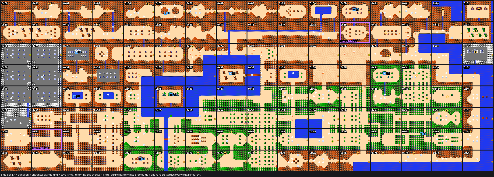

# The overworld map (game.yaml level 0)

Mapping pass of Nov 9 (Lee): every overworld room 0x00–0x7f is in `triforce/game.yaml` with its exits, enemies,
caves and secrets; the two maze rooms are modelled in code (`crates/zelda/src/game_map.rs` `MAZES`). Data only: no
route, family or tag changed (`specialist:` stays on the route rooms that had it). Map image:
[`overworld-map.png`](overworld-map.png) (half-size renders, room ids; blue box `Ln` = dungeon n entrance, orange
ring = other cave, purple frame = maze).

## How it was built

Quest 1 throughout. The ROM is `roms/zelda.nes`; disassembly tables are at file offset = `bins.xml` offset + 16
(`Level_BlockOW` 0x18410: six 128-byte tables A–F; `Level_InfoOW` 0x19310).

- **Loading a room:** the room-id retarget of `target/overworld/render.py`: load `0_59w_0`, set `RoomId` ($EB) to
  target + 1 and hold Left, so the game scrolls into the target from its E edge and loads it itself (0x60, left of
  the forest maze, is entered N from 0x70 instead). Every room reached mode 5 at level 0.
- **Exits** (walked): in each room Link was teleported, for every 8 px lane of every edge, to the first spot inside
  the edge where he fits (feet tiles walkable) and walked straight out; a lane counts when the game scrolls (mode 7)
  into another room. Monster slots were emptied first. A tile-grid pass agreed except where the game does what the
  tiles don't say (0x1f's wall gap, below). The run was repeated with the ladder: no edge needs it. Exits are
  symmetric except the mazes and the raft piers.
- **Enemies:** the ROM room list: monster id `C & $3F | (D & $80 ? $40 : 0)`, count `LevelInfo FoeCounts[C >> 6]`
  (1 for ids $32–$61), ids ≥ $62 index `Spawn_ObjLists` (the first `count` bytes) (`asm:Room_EnterCommon`), plus
  `Zora: 1` when attr A bit 3 is set (`asm:Zora_TrySpawn`). It matches the emulator's fresh load (the monster slots
  at load or the most seen at once over 600 frames) in 125 of 128 rooms (0x38/0x49's list of 6 runs one byte past
  its 5-byte `Spawn_ObjLists` entry, as the game copies `count` bytes); 0x58, 0x67 and 0x68 were on the start
  state's way, so the game's kill
  history lowered their counts (the ROM count is the fresh one). Names are the repo's (`describe::enemy_name`), unnamed ids as
  `Unknown_<decimal>` like the existing entries: `Unknown_31` = $1F the boulder generator, `Unknown_32` = $20 its
  boulders (counted as the most seen at once, as the existing boulder rooms do), `Unknown_47` = $2F a pond fairy.
  `edge_spawn: true` (attr F bit 3, 20 rooms): the monsters walk in from the screen edges (`asm:EdgeSpawn_FindNextCell`)
  instead of appearing in place; Leevers and Zoras surface by their own rules.
- **Caves:** attr B >> 2 is the cave index: < $10 a dungeon level, $10–$23 a cave (dweller `$6A + index − $10`).
  What a cave holds comes from OW block E (wares at `E[3i..]`, prices at `E[60 + 3i..]`,
  `asm:Cave_Init_SetUpTextAndWares`). How it opens comes from the room: a visible mouth, or the tile object in slot
  11 ($62 rock, $63 rock wall, $64 tree, $65 gravestone, `asm:RoomLayout_TileObjTypes`, `asm:RoomLayout_CheckTileObj`),
  the hard-coded armos rooms (`asm:Armos_SecretRoomIds`), or the recorder (Q1: 0x42 only). Tile
  object secrets carry a quest gate (attr F >> 6: 0 both, 1 Q1, 2 Q2); Q2-only ones are left out (a comment says so).
  **Every entrance was walked into in the emulator** (room flag $80 set first so bombed walls and burned trees show
  their opening; rocks pushed with the bracelet; armos touched; the recorder blown at 0x42) and the game went where the
  index says: the dungeon's start room, or cave mode $B with the right dweller. Not walked: the 0x21 gravestone
  (magic sword; Ghinis kept knocking Link off it) and 0x4e's armos stairs (they appear, the stand didn't enter) — both
  from the ROM only.

## game.yaml keys (level 0)

Existing entries are kept verbatim (data, comments, tags); new keys are appended. The Rust loader reads `exits`,
`enemies`, `treasure`, `maze` (and the keys it read before); the rest is data for the next route steps.

- `exits:` N/E/S/W walkable edges (and `cave:` for a dungeon entrance → the level's `StartRoomId`; the existing
  sword/heart caves keep their `in_cave` sub-rooms). Ordinary caves are not graph exits (no `in_cave` entries were
  added); `entrance:` describes them.
- `entrance:` `cave` (index, hex), `contents` (`level-N`, `wood-sword`, `white-sword`, `magic-sword`, `take-any`,
  `letter`, `shop`, `potion-shop`, `hint`, `pay-hint`, `money-game`, `door-repair`, `secret-rupees`, `any-road`),
  `how` (`open`, `bomb`, `burn`, `push`, `armos`, `recorder`), `tile` (top-left tile of the mouth square or stairs, as
  found after opening), and per kind `wares` (`[item, rupees]` in shops), `needs_hearts`, `rupees`, `prices`,
  `costs`, `stakes`. The existing `bomb_secret`/`requires_bombs` keys were not added to new rooms.
- `edge_spawn: true` (above). `raft_exits:` raft-only crossings, with the `dock:` tile the raft leaves from (in the
  graph since Nov 11 as `RoomExit::raft`: a route step can leave through one, and path searches use it only while
  Link holds the raft). `maze:` (below).

## Special edges

- **0x1f N → 0x0f:** the rock wall at the top of 0x1f is walkable at x = $80 only
  (`asm:Tile_GetAtObjOffset@SetTile`, a false-wall exception for room $1F); 0x0f's stairs lead back down. game.yaml
  has the exit with a comment.
- **Raft:** docks in 0x3f (x = $60) and 0x55 (x = $80) sail N to 0x2f and 0x45 with the raft (`asm:Dock_Update`;
  emulator: from the dock with the raft, 0x55 → 0x45 and 0x3f → 0x2f). Walking S off the piers of 0x2f/0x45 lands Link
  in the water at the top of 0x3f/0x55 without the raft, so those are `raft_exits` only. 0x2f has no walkable exit.
  The route (`d2first`, after the D3 triforce) sails 0x55 → 0x45 (`docs/routes/d4.md`).
- **Wrap-around:** the game doesn't stop E/W at the map edge (E from column 15 is the next row's column 0), but no
  column-0/15 room has an open outer edge.

## The mazes

`asm:Maze_CheckStep`, called on every overworld edge exit (`asm:Room_CalcNextRoomForDoor`). Direction bits E=1 W=2 S=4
N=8; `MazeStep` = $52F.

| Room | Sequence | Leads to | Leaves normally | Any other direction |
|---|---|---|---|---|
| 0x1b (mountain) | N, N, N, N (`Maze_LostHillsDirs` 08 08 08 08) | 0x0b on the 4th N | W → 0x1a (step kept) | E, S: back into 0x1b, step reset |
| 0x61 (Lost Woods) | N, W, S, W (`Maze_LostWoodsDirs` 08 02 04 02) | 0x60 on the last W | E → 0x62 (step kept) | back into 0x61, step reset |

- A matching direction that isn't the last one brings Link back into the maze room with `MazeStep + 1`. A mismatch
  resets the step to 0 **and doesn't count as a first step**: in the woods N, N leaves the step at 0 (the second N
  must be followed by a fresh N). `Maze_CheckStep` resets the step when Link leaves any other overworld room, so he always
  enters a maze at step 0.
- **4 vs 5 Ns:** four. From inside 0x1b the 4th N enters 0x0b, in the disassembly (`CPX #$03` on the 4th match) and
  in the emulator ($52F 0 → 1 → 2 → 3, then 0x0b). `d2first.md` and the existing game.yaml comment ("fourth N") are
  right; "5 times in a row" counts one move too many (perhaps the move that entered 0x1b, but 0x1b can only be
  entered from 0x1a, 0x1c and 0x0b — 0x2b's N edge is closed — and each of those resets the step).
- Emulator runs (`MazeStep` after each move): 0x1b N N N N → 0x1b 0x1b 0x1b 0x0b; N N N E/S → back, step 0; N N W →
  0x1a (step 2 kept); N N S N N N N → 0x0b. 0x61 N W S W → 0x60; W, N, S, E alone → 0x61 (0), 0x61 (1), 0x61 (0),
  0x62; N W S E → 0x62; N N W S W → 0x61 five times; N W S S N W S W → 0x60 on the 8th.
- **game.yaml:** the loops are ordinary exits back into the room (0x1b N/E/S, 0x61 N/S/W), the real way out is the
  normal exit (0x1b W, 0x61 E), and `maze:` holds `sequence`, `destination`, `free`. The loader checks the block
  against `MAZES` (a mismatch, a missing block, or a block on another room is an error) and that every non-free
  edge exit loops back.
- **Code:** `MAZES`/`Maze` (`next_direction(step)`, `leave(direction, step)`), a synthetic exit `maze` →
  destination costing the sequence's length in the Dijkstra, and `GameMap::exit_direction(from, to, maze_step)`: the
  objective's exit targets and the observation's objective direction ask for the sequence's next direction from
  $52F when the next room is the maze's destination (the objective doesn't cache its route in a maze room).
  A routes.yaml step that leaves through a maze's sequence (`exit: maze` or a looping edge) is a load error: chain
  runs and one-room episodes don't model a room visit that loops back into itself (unsupported until a route needs it).

## Dungeon entrances

| Level | Room | Opens by | Start room |
|---|---|---|---|
| 1 | 0x37 | open mouth | 1:0x73 |
| 2 | 0x3c | open mouth | 2:0x7d |
| 3 | 0x74 | open mouth | 3:0x7c |
| 4 | 0x45 | open mouth (the island N of the 0x55 dock: raft) | 4:0x71 |
| 5 | 0x0b | open mouth (an armos at x=$B0 also uncovers stairs to it) | 5:0x76 |
| 6 | 0x22 | open mouth (an armos at x=$30 also uncovers stairs to it) | 6:0x79 |
| 7 | 0x42 | the recorder drains the pond: stairs at (12, 10) | 7:0x79 |
| 8 | 0x6d | burn the tree at x=160 y=96 | 8:0x7e |
| 9 | 0x05 | bomb the rock wall at x=80 y=160 | 9:0x76 |

Q2-only secrets seen in the data and left out: 0x00 (bomb → level 9), 0x6c (burn → level 8), 0x02, 0x15, 0x18,
0x19, 0x53 (and the rocks/gravestones of 0x09, 0x11, 0x1b, 0x20).

## Caves (quest 1)

| Room | Index | Contents | Opens by | Tile | Wares / notes |
|---|---|---|---|---|---|
| 0x01 | `0x17` | door-repair | bomb | [18, 2] | costs 20 |
| 0x03 | `0x17` | door-repair | bomb | [14, 8] | costs 20 |
| 0x04 | `0x1a` | potion-shop | open | [24, 2] | blue-potion 40, red-potion 68 (needs the letter) |
| 0x07 | `0x17` | door-repair | bomb | [20, 8] | costs 20 |
| 0x0a | `0x12` | white-sword | open | [4, 2] | white-sword, needs 5 hearts |
| 0x0c | `0x1e` | shop | open | [16, 2] | magic-shield 160, key 100, blue-candle 60 |
| 0x0d | `0x1a` | potion-shop | bomb | [18, 2] | blue-potion 40, red-potion 68 |
| 0x0e | `0x18` | letter | open | [10, 8] | letter |
| 0x0f | `0x22` | secret-rupees | open | [16, 8] | 100 rupees |
| 0x10 | `0x16` | money-game | bomb | [18, 2] | |
| 0x12 | `0x1f` | shop | bomb | [16, 2] | magic-shield 90, food 100, heart 10 |
| 0x13 | `0x21` | secret-rupees | bomb | [4, 2] | 30 rupees |
| 0x14 | `0x17` | door-repair | bomb | [24, 2] | costs 20 |
| 0x16 | `0x16` | money-game | bomb | [12, 2] | |
| 0x1c | `0x15` | hint | armos (x=$B0) | | |
| 0x1d | `0x14` | any-road | push rock (bracelet) | [10, 6] | |
| 0x1e | `0x17` | door-repair | bomb | [24, 2] | costs 20 |
| 0x1f | `0x16` | money-game | open | [12, 8] | |
| 0x21 | `0x13` | magic-sword | push gravestone | | needs 12 hearts (ROM only) |
| 0x23 | `0x14` | any-road | push rock (bracelet) | [8, 10] | |
| 0x25 | `0x1d` | shop | open | [20, 2] | magic-shield 130, bombs 20, wood-arrow 80 |
| 0x26 | `0x1f` | shop | bomb | [6, 2] | magic-shield 90, food 100, heart 10 |
| 0x27 | `0x1a` | potion-shop | bomb | [28, 2] | blue-potion 40, red-potion 68 |
| 0x28 | `0x21` | secret-rupees | burn | [26, 12] | 30 rupees |
| 0x2c | `0x11` | take-any | bomb | [18, 12] | red-potion, heart-container (d2first's heart) |
| 0x2d | `0x21` | secret-rupees | bomb | [10, 2] | 30 rupees |
| 0x2f | `0x11` | take-any | open | [12, 8] | red-potion, heart-container (raft island) |
| 0x33 | `0x1a` | potion-shop | bomb | [20, 2] | blue-potion 40, red-potion 68 |
| 0x34 | `0x20` | shop | armos (x=$40) | | key 80, blue-ring 250, food 60 |
| 0x3d | `0x21` | secret-rupees | armos (x=$90) | | 30 rupees |
| 0x44 | `0x1d` | shop | open | [8, 2] | magic-shield 130, bombs 20, wood-arrow 80 |
| 0x46 | `0x1f` | shop | burn | [18, 14] | magic-shield 90, food 100, heart 10 |
| 0x47 | `0x11` | take-any | burn | [22, 14] | red-potion, heart-container |
| 0x48 | `0x21` | secret-rupees | burn | [26, 4] | 30 rupees |
| 0x49 | `0x14` | any-road | push rock (bracelet) | [10, 6] | |
| 0x4a | `0x1d` | shop | open | [22, 2] | magic-shield 130, bombs 20, wood-arrow 80 |
| 0x4b | `0x1a` | potion-shop | burn | [22, 4] | blue-potion 40, red-potion 68 |
| 0x4d | `0x1f` | shop | burn | [26, 12] | magic-shield 90, food 100, heart 10 |
| 0x4e | `0x23` | secret-rupees | armos (x=$A0) | | 10 rupees (stairs not entered in the emulator) |
| 0x51 | `0x23` | secret-rupees | burn | [18, 12] | 10 rupees |
| 0x56 | `0x23` | secret-rupees | burn | [20, 12] | 10 rupees |
| 0x5b | `0x23` | secret-rupees | burn | [4, 12] | 10 rupees |
| 0x5e | `0x1e` | shop | open | [14, 2] | magic-shield 160, key 100, blue-candle 60 |
| 0x62 | `0x22` | secret-rupees | burn | [16, 4] | 100 rupees |
| 0x63 | `0x17` | door-repair | burn | [12, 12] | costs 20 |
| 0x64 | `0x1a` | potion-shop | open | [14, 2] | blue-potion 40, red-potion 68 |
| 0x66 | `0x1e` | shop | open | [14, 2] | magic-shield 160, key 100, blue-candle 60 |
| 0x67 | `0x21` | secret-rupees | bomb | [14, 2] | 30 rupees |
| 0x68 | `0x17` | door-repair | burn | [4, 12] | costs 20 |
| 0x6a | `0x17` | door-repair | burn | [24, 12] | costs 20 |
| 0x6b | `0x22` | secret-rupees | burn | [16, 12] | 100 rupees |
| 0x6f | `0x1d` | shop | open | [6, 2] | magic-shield 130, bombs 20, wood-arrow 80 |
| 0x70 | `0x1c` | pay-hint | open | [22, 2] | 10 / 30 / 50 rupees |
| 0x71 | `0x21` | secret-rupees | bomb | [10, 2] | 30 rupees |
| 0x75 | `0x19` | hint | open | [4, 2] | |
| 0x76 | `0x16` | money-game | bomb | [12, 2] | |
| 0x77 | `0x10` | wood-sword | open | [8, 2] | wood-sword (the start) |
| 0x78 | `0x1a` | potion-shop | burn | [8, 12] | blue-potion 40, red-potion 68 |
| 0x7b | `0x11` | take-any | bomb | [18, 2] | red-potion, heart-container |
| 0x7c | `0x16` | money-game | bomb | [12, 2] | |
| 0x7d | `0x17` | door-repair | bomb | [12, 2] | costs 20 |

The any-road caves (0x1d, 0x23, 0x49, 0x79) warp between each other (OW `CellarRoomIdArray` = $1D $23 $49 $79).
Other treasure: 0x24's armos at x=$E0 hides the power bracelet (`treasure: power-bracelet`); 0x5f's coast heart
container (existing `treasure`; needs the ladder); fairy ponds at 0x39 and 0x43 (`Unknown_47`).

## Kept as they were

The boulder rooms list the boulders (`Unknown_32`) the ROM list doesn't hold (the generator spawns them). Three
existing rooms got exits they lacked: 0x1b's maze loops, 0x1f N (the wall gap) and 0x6d E plus its level-8 `cave`.

## Open questions

- Ladder crossings inside rooms (water one tile wide) and the coast heart's reach weren't mapped; no edge needs the
  ladder.
- 0x4e's armos stairs and 0x21's gravestone cave are ROM-only (see above).
- Hint texts (0x1c, 0x75, 0x70) aren't decoded.
